# UI 명세서(화면설계서) v0.25 — Qurious

| 문서 정보 | |
|---|---|
| **판 · 상태** | v0.25 · 초안(검토 전) — 2절 공통 영역 <표 2>(위 탭 여섯 · 왼쪽 「전체 메뉴」 트리 · ☰ 같은 트리 · 더보기 없앰 · 2026-10-18 D129) · 들어가는 길 다섯 · 3절 데이터 관제 「복원 리허설」 줄(요소 12) · 5.4절 적재 · 백업 복원 리허설 줄 글(주 1회 예약 · 마지막 성공 n일 전) · 금융 필수 지식 강의 주제 셋의 이름 · 13절 미국주식 › 주문/매매(시세 카드 · 확인 상자 · 장 닫힌 날 예약 주문 — 설계 C) · 4.1절 AI 투자 상담의 답 위 앱 판단 카드 · 답 끝 용어 칩 · 12절 투자 정보 리서치(첫 목록 「투자 관련만」 · 스위치 · 같은 제목 묶기 · 사이트 이름 제목 끝 묶음 · 종목 칸은 찾기 줄)(2026-10-17) |
| **구분** | 4. 화면·서비스 설계 — UI 명세서(화면설계서) |
| **작성** | 초안 이동원(팀장 · 공통 영역과 이동원 몫 화면) · 자기 화면의 상세 채우기와 판 올리기는 각 주담당 · 검수 이동원 |
| **검토** | 검토 전 |
| **최종 수정** | 2026-10-18 (KST) |
| **기준** | 2절 · 들어가는 길은 코드 작업 트리(S124 메뉴 개편 · `main` `0184834` 위) + Figma [「Qurious · 메뉴 개편」](https://www.figma.com/design/XdXzrxxuF4AcQXTo47wfiI) 05 · 06 · 08 · 그 밖은 코드 `main` `ed3221f`(#262 를 받은 뒤) + 주 1회 복원 리허설 · 팀원 화면 잠정 반영 셋 · 직접매매 최근 주문 내역 안내 한 줄(이 판과 같은 PR · 개발 앱 실측 2026-10-18) · 앞 판: 코드 `main` `12fd9fd`(#252 를 받은 뒤) + 종목 허브 서버 · 리서치 첫 목록 · 상담 앱 판단 카드 · 용어 칩(이 판과 같은 PR · 개발 앱 실측 2026-10-17 15시 · 1280 · 390 · Figma 「AI 투자 상담」 · 「투자 정보 리서치」 03-2 결정) |
| **관련 문서** | [IA v1.8](IA.md) · [와이어프레임 v0.5](와이어프레임.md) · [유스케이스 명세서 v0.3](../요구사항/유스케이스명세서.md) · [API 명세서 v0.32](../인터페이스/API명세서.md) · [목표 기능 ① 설계서 v1.6](../설계/목표기능1-데이터지식-설계.md) · [근거 답 출처 표시 조사서 v0.1](../조사/근거답-출처표시-화면-조사.md) · [이동원 파트 할 일 v0.3](../계획서/이동원파트-할일.md) 5절 · [코딩 표준 v0.1](../개발/코딩표준.md) 4절 · Figma [「데이터 수집 화면 — 수집 일정 · 직접 받기 · 적재 백업」](https://www.figma.com/design/AfiCh50uOwrSq5F2Tk2JLZ) |
| **최근 개정** | v0.24 → v0.25: <표 2> 2 · 5 · 6 · 7 · 8 · 9 · 12(메뉴 개편 D129) · 들어가는 길 다섯 · <그림 1> 은 옛 모습(다시 찍기는 10-19 영상 묶음) · (앞 개정) v0.23 → v0.24: <표 4> 요소 12 복원 리허설 · 5.4절 요소 4 리허설 줄 글 · <표 2-4> · 6절 금융 필수 지식 강의 주제 셋 이름(산업 분석과 공시 · 기술적 분석 · 재무제표 · 퀀트 사례 · 배당 · ETF) · 팀원 화면 잠정 반영 셋은 6절 목록 그대로(상세는 각 주담당 판). (이전) v0.22 → v0.23: 13절 미국주식 주문(<그림 26> · <그림 27> 번호 상자 12 · <표 34> 화면 정보 · <표 35> 요소 1 ~ 12 · <표 36> 경우 일곱) · 옛 13절 「앞으로」 → 14절. (이전) v0.21 → v0.22: 4.1절(<그림 21> · <그림 22> 번호 상자 9 · <표 29> 요소 15 ~ 23 · <표 30> 경우 일곱) · 12절 투자 정보 리서치(<표 31> · <그림 23> ~ <그림 25> · <표 32> 요소 9 · <표 33> 경우 여덟) · 「앞으로」 를 13절로 · <표 16> 1 · 9번 줄(부르는 API · 상세 자리) |

> **이 문서로 알 수 있는 것**
> 1. 모든 화면에 공통으로 있는 영역은 무엇이고, 무엇을 부르며 어떻게 동작하나?
> 2. 화면 하나는 어떤 칸으로 명세하나(데이터 관제를 본보기로)?
> 3. 화면 70개는 각각 어떤 API 를 부르고, 어느 요구 · 누구의 몫인가?
> 4. AI 투자 상담의 근거 답은 어떻게 보이고, 근거가 없거나 답할 수 없을 때 무엇을 보이나?
> 5. 크롤링 세 화면을 바꾼 데이터 수집 화면 셋(수집 일정 · 단계 · 자료 직접 받기 · 적재 · 백업)은 무엇을 보이고 어떻게 동작하나?
> 6. 자료 안내는 무엇을 누구에게 보이고, 개발 정보는 어떻게 관리자에게만 가나?
> 7. 관리자는 화면에서 한 단계 · 전체 수집을 어떻게 요청하고, 막는 때 · 작업자가 꺼졌을 때 무엇을 보나?
> 8. 자료 안내는 자료마다 칸(쉬운 이름 · 단위 · 뜻)을 어떻게 보이고, 줄 수는 언제 누가 세나?
> 9. AI 투자 상담의 답 위 카드와 답 끝 용어 칩은 무엇을 보이고, 투자 정보 리서치의 첫 목록은 왜 「투자 관련만」 인가?

## 요약

화면설계서의 실무 관행대로 **화면 그림에 번호를 찍고, 번호마다 요소 · 데이터(API) · 동작 · 빈 데이터 · 오류를 표로** 적는다. 모든 화면이 공유하는 공통 영역 11개와 데이터 관제 화면을 본보기로 자세히 썼고, v0.2 에서 AI 투자 상담(근거 답 · 요소 14 · 상태 표)을, v0.3 에서 데이터 수집 화면 셋(Figma 에서 정한 설계 · 요소 33 · 경우 표)을 더했고, v0.6 에서 그 셋을 만들어 그림을 구현 화면으로 바꿨고, v0.7 에서 자료 안내(새 화면)를, v0.8 에서 화면에서 수집을 요청하는 단추(요소 여덟 · 정한 것 넷 · 경우 표)를, v0.10 에서 자료 안내의 칸 정의와 숫자 파일(요소 둘 · 정한 것 다섯 · 경우 다섯)을, v0.11 에서 투자 성향별 상품 안내(7절)를, v0.12 에서 그 상품 상세 창(가운데 모달 · 요소 13 · 경우 아홉 · 7.1)을 더했다. 화면 70개의 목록(부르는 API · 관련 요구 · 주담당)은 IA 전수표와 API 명세서에서 만들었다. 화면 69개 중 51개가 API 를 불렀고(v0.1) 자료 안내가 하나를 더한다, 상세를 채울 사람은 목록의 「명세」 칸에 적었다.

---

## 1. 읽는 법

**<표 1> 화면 한 장의 칸** · 문서 작성 기준 5.4절

| 칸 | 적는 것 |
|---|---|
| 화면 정보 | 화면 ID(화면 키) · 화면명 · 들어가는 길(메뉴) · 설명 · 관련 요구 · 주담당 |
| 화면 그림 | 1280 × 800 캡처에 빨간 번호 |
| 요소 표 | 번호 · 요소 · 데이터(API ID) · 동작 · 빈 데이터 · 오류 · 비고 |

---

## 2. 공통 영역

모든 화면에 공통으로 있는 영역은 <그림 1> 과 같다(투자 대시보드에서 캡처).

**<그림 1> 공통 영역** · 범례: 빨간 상자와 번호 = <표 2> 의 요소 · 이 그림은 2026-10-18 메뉴 개편 전 모습이다(지금 모양은 <표 2> 와 IA 그림 2 · 다시 찍기는 10-19 영상 묶음)

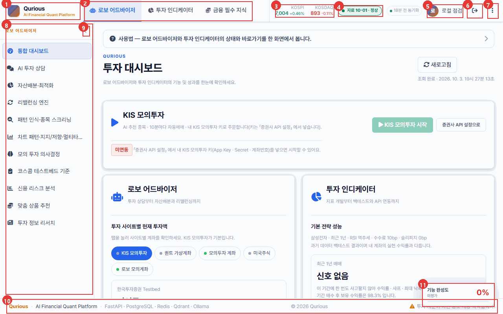

**<표 2> 공통 영역 요소**

| 번호 | 요소 | 데이터(API) | 동작 | 빈 데이터 · 오류 | 비고 |
|:-:|---|---|---|---|---|
| 1 | 로고 · 서비스 이름 | — | 누르면 첫 화면(투자 대시보드 `#dashboard`) | — | 부제 「AI Financial Quant Platform」 |
| 2 | 위 메뉴(고정 탭 여섯) | — | 로보 어드바이저 · 투자 인디케이터 · 모의투자 · 퀀트자동매매 · 학습 · 데이터 — 누르면 그 묶음의 첫 화면 · 왼쪽 트리에서 그 묶음이 펼쳐진다(「학습」 = 금융 필수 지식) | — | 숨는 탭 없음 · 다 안 들어가면 부제 → 아이콘 → 탭 줄 통째로 접힘(940 아래) · 2026-10-18 D129 |
| 3 | 지수 띠(KOSPI · KOSDAQ) | `API-STK-01` | 값과 등락률 | 못 받으면 칸을 비운다 | 1440 아래에서는 환율을 숨긴다 |
| 4 | 자료 상태 배지 | `API-DATA-01` | 수집 자료 기준일과 판정(정상 · 확인 필요 · 멈춤)을 보이고, 누르면 요약 서랍이 열린다 | 상태를 못 받으면 「자료 상태 …」 | 1분마다 다시 묻는다 |
| 5 | 사용자(아바타 ▾) | — | 누르면 이름 · 내 정보 · 로그아웃 메뉴(Esc · 바깥 누름이면 닫힘) | — | 이름 글자는 머리에서 숨김(DF-109) |
| 6 | 로그아웃 | `API-AUTH-03` | 아바타 메뉴(5) 안 — 로그아웃 뒤 로그인 화면 | — | 머리의 단추는 숨김(같은 처리를 부름) |
| 7 | (없앰) 더보기 · 오른쪽 서랍 | — | 2026-10-18 D129 로 없앴다 — 모든 묶음은 8 의 트리에 있다 | — | 시험 TC-NV-08 |
| 8 | 왼쪽 「전체 메뉴」 트리 | — | 13묶음 · 74항목(화면 70 · 새 화면 링크 4) · 지금 묶음만 펼침(다른 묶음은 눌러 펼침 · 다른 묶음 화면으로 옮기면 그 묶음만) · 지금 화면 강조(aria-current) · 바깥 주소는 「새 화면」 | — | 너비 clamp(240px, 15vw, 288px) · 긴 이름은 두 줄(자르지 않음) · 2026-10-18 D129 |
| 9 | 사이드바 접기 · 펼치기 | — | 트리를 54px 띠로 접고 편다(묶음 아이콘 · 펼친 묶음의 항목 아이콘만) | — | 이름은 마우스를 올리면(title) |
| 10 | 바닥글 | — | 서비스 이름 · 쓴 기술 · 저작권 · 투자 유의 문구 | — | — |
| 11 | 기능 완성도 배지 | 화면 쪽 고정 표 | 화면마다 완성도 점수 | 점수가 없는 화면은 「미평가 0%」 | 점검 기준은 별도 세션에서 정한다 |
| 12 | ☰ 전체 메뉴 열기(좁은 화면) | — | 폭 768 아래에서만 보인다 · 누르면 같은 트리(8)를 왼쪽에서 300px 로 펼치고 뒤는 어두운 막 — 막 누름 · Esc · 메뉴 고름 · 화면 바뀜이면 닫히고 초점은 ☰ 로 | — | aria-expanded · aria-controls="lnb" · 2026-10-18 D129 · IA I12 해소 |
| 13 | 화면 사용법 윗줄 · 창 | 사용법 글(`core.js`) | 화면 맨 위 왼쪽에 지금 위치(묶음 › 화면) · 오른쪽 「사용법」 — 누르면 가운데 창 | 사용법 글이 없는 화면은 윗줄도 없다 | 2.1절 · 2026-10-16 |

**좁은 화면의 머리글(폭 390 · IA I12 · 2026-10-10)** — 머리글이 약 800px 로 넘쳐 「더보기」(7)와 로그아웃(6)이 화면 밖에 있었고 ☰ 은 코드에만 있고 늘 숨어 있었다. 폭 768 아래에서는 지수 띠(3) · 사용자 이름(5 의 글자) · 동기화 글자를 빼고(점 · 아바타는 남김) ☰(12)을 보이며, 480 아래에서는 자료 상태 배지(4)가 글자 없이 색 점만 남는다(누르면 서랍 · 요약은 마우스를 올리면). 위 메뉴(2)의 묶음은 들어가는 만큼만 보이고 나머지는 더보기에 있다 — 390 에서는 묶음이 하나도 들어가지 않아 더보기가 「여기 안에 있음」 으로 칠해진다. 강사님 `app.html` · `app.css` 는 고치지 않고 우리 덧씌우기 파일(`qurious.css` · `datahub.css`)에서만 바꿨다. 하단 탭(IA 3.5 · Q7)은 그대로 다음 설계 차례다.

**메뉴 개편(2026-10-18 · D129)** — 「더보기」(7)는 없어지고 ☰(12)가 왼쪽 「전체 메뉴」 트리(8)를 300px 로 연다. 위 탭(2)은 폭 940 아래에서 줄째 접히고(메뉴는 트리), 768 아래에서는 ☰ 만 남는다. 아래 <그림 1-2> 는 그 앞 모습이다.

**<그림 1-2> 폭 390 — 머리글과 까닭 카드** · 범례: 빨간 상자와 번호 = <표 2>(4 · 7 · 12) · <표 10>(21)의 요소

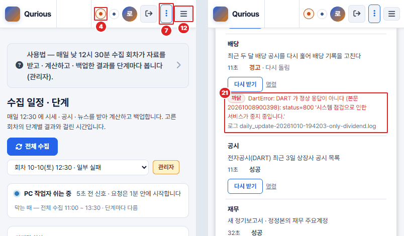

로컬 개발 앱 · 폭 390 · 2026-10-10 20:00 · 기준 `5d470c3` + 이 판의 구현 · 문서 폭은 자료 상태 배지가 늦게 채워진 뒤에도 390(가로 넘침 없음) · 까닭은 19:42 에 실제로 요청한 배당 다시 받기의 러너 기록

### 2.1 화면 사용법 창 (모든 화면 · 2026-10-16)

모든 화면 맨 위에 **윗줄**(왼쪽 지금 위치 · 오른쪽 「사용법」)이 있고, 「사용법」 을 누르면 **가운데 창**에 그 화면을 쓰는 법이 뜬다. 옛 접이식(화면 맨 위에서 펼치던 줄 · 펼침을 브라우저에 기억)을 바꿨다. 설계와 결정: [설계안](설계안/2026-10-16-사용법모달/설계안.md) · Figma 「투자 대시보드 · 메뉴 정리」 [03-2 지금 · 안 A · B · C 나란히](https://www.figma.com/design/lfYo3gVAxj1Raekzq9xFzZ?node-id=15-3) · [05 결정 기록 ④ ~ ⑧](https://www.figma.com/design/lfYo3gVAxj1Raekzq9xFzZ?node-id=7-180)(틀 = 가운데 창 · 단추 = 윗줄 · 영상이 없으면 칸을 숨김 · 크기는 화면마다 · 끝줄 = 그 화면의 개념 학습 장 + 용어사전 + 목차).

**<그림 1-3> 사용법 창** · 왼쪽부터 1280 투자 성향별 상품 안내(크게) · 390(화면 전체) · 1280 창 안 용어 카드(패턴 인식 · 종목 스크리닝 · 보통)

| 1280 · 크게 | 390 · 화면 전체 | 1280 · 창 안 용어 카드 |
|---|---|---|
| 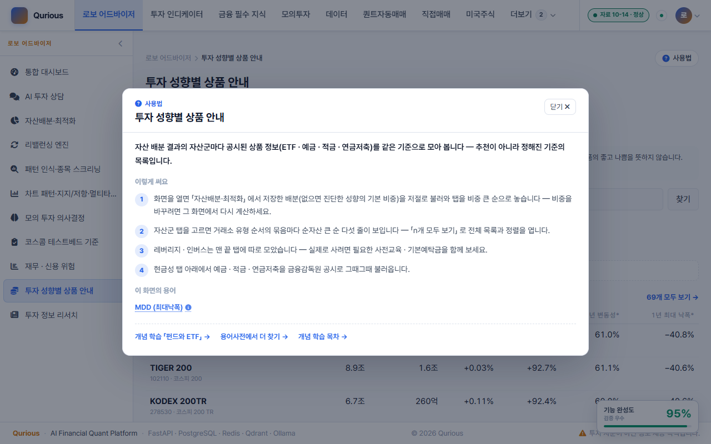 | 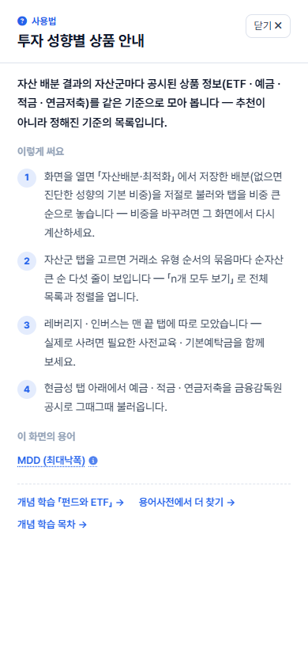 | 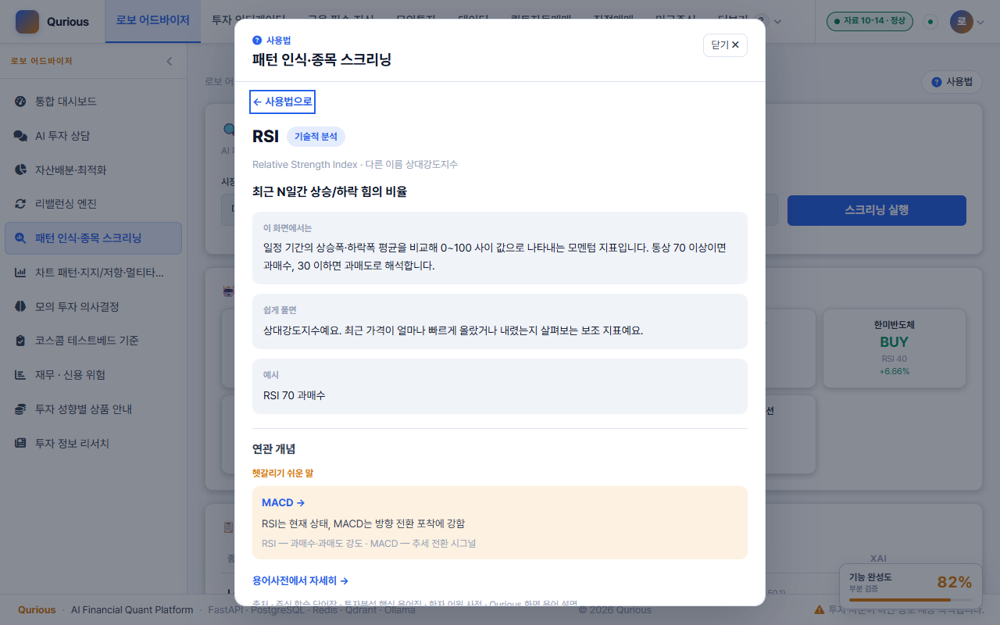 |

로컬 개발 앱 · 점검 계정 · 2026-10-16 12:07 · 기준 `1980058` + 이 판의 구현

**<표 2-1> 사용법 윗줄 · 창 요소**

| 번호 | 요소 | 데이터 | 동작 | 빈 데이터 · 오류 | 비고 |
|:-:|---|---|---|---|---|
| 1 | 지금 위치 | 메뉴 이름(`core.js` 메뉴 표) | 묶음 › 화면 이름 | — | 480 아래는 화면 이름만 |
| 2 | 「▶ 영상 길이」 | 영상 목록(`howtoview.js` `VIDEOS` — 시연 녹화 묶음에서 채움) | 누르면 창을 열고 영상을 바로 튼다 | 영상이 없으면 단추가 없다(지금 70곳 모두 없음) | 결정 ⑥ |
| 3 | 「사용법」 | — | 가운데 창을 연다 | — | 화면 뿌리 밖 — 화면이 머리를 다시 그려도(상품 안내 탭 · 데이터 관제 30초) 남는다 |
| 4 | 창 머리 | — | 「사용법」 · 화면 이름 · 닫기 | — | 창 제목은 메뉴의 화면 이름(화면 안 카드 제목을 잡지 않음) · 창을 굴려도 위에 붙어 있다 |
| 5 | 요약 | 사용법 글(`core.js` `VIEW_GUIDES`) | 한 문장 | — | — |
| 6 | 영상 칸 | 영상 목록 | 「영상으로 보기 · 길이 · 한국어 자막」 → 그 자리에서 재생 | 영상이 없으면 칸을 숨긴다 | 결정 ⑥ |
| 7 | 이렇게 써요 | 사용법 글 | 번호 단계 1 ~ 4 | — | 글은 글자로 그린다(꺾쇠가 태그가 되지 않음) |
| 8 | 이 화면의 용어 | 용어(`TERMS`) · 용어사전(`API-GLOS-04`) | 칩을 누르면 창 안에서 용어 카드 · 「← 사용법으로」 · 연관 개념도 창 안에서 | 용어사전에 없으면 화면의 짧은 설명 · 못 받으면 「다시 시도」 · 용어가 없으면 소제목도 없다 | 용어 서랍과 같은 받기 함수(`termcard.js` `fillTermCard`) |
| 9 | 끝줄 | 이어 준 장(`howtoview.js` `LEARN_OF`) | 「개념 학습 「장」 →」(새 탭) · 「용어사전에서 더 찾기 →」(창을 닫고 이동) · 「개념 학습 목차 →」(새 탭) | 맞는 장이 없으면 목차만 · 용어사전 화면에서는 용어사전 줄을 뺀다 | 결정 ⑧ |

**<표 2-2> 동작 · 경우**

| 경우 | 보이는 것 · 하는 일 |
|---|---|
| 연다 | 「사용법」 · 「▶ 영상」 — 맨 위 층 창(뒤 화면은 어두워지고 눌리지 않으며 굴러가지 않는다) · 첫 초점은 창 제목 |
| 닫는다 | 닫기 · Esc · 창 바깥(덮개) 누르기 · 다른 화면으로 가기 — 닫으면 초점이 「사용법」 단추로 돌아온다 |
| Esc 차례 | 창 안 용어 카드가 떠 있으면 먼저 사용법으로 돌아가고, 다음 Esc 에 창이 닫힌다 |
| Tab | 초점이 뒤 화면으로 나가지 않는다 — 마지막 칸 다음은 브라우저 쪽을 거쳐 창 첫 칸으로 돈다 |
| 좁은 화면(760 아래) | 화면 전체로 연다(상품 상세 창과 같은 경계) |
| 두 단 화면(거시경제 지표) | 윗줄은 두 단 위에 그대로 있다 |
| 기억 | 열림 · 닫힘을 브라우저에 남기지 않는다 · 화면을 바꾸면 닫힌다 |

**<표 2-3> 창 크기 규칙** (결정 ⑦ — 화면마다 · 판단은 `public/js/howtoview.js` 한 곳 · 폭은 `howto.css` 와 시험이 맞댄다)

| 크기 | 폭 | 언제 |
|---|:-:|---|
| 크게 | 840 | 차트 · 분석 화면 17곳(앞으로 사용법에 차트 · 시각 자료가 들어갈 자리) · 영상이 있는 화면 · 글 양 260 이상 |
| 보통 | 680 | 글 양 120 ~ 259 |
| 작게 | 560 | 글 양 120 미만 |

글 양 = 요약 + 단계 글 자수 + 용어 하나당 10. 높이는 내용만큼(최대 화면 − 48)이고 넘치면 창 안에서 굴린다. 폭은 화면 − 32 를 넘지 않는다.

**<표 2-4> 화면 70곳 — 창 크기 · 끝줄의 개념 학습 장** (판단 모듈을 그대로 돌려 만든 표 · 작게 22 · 보통 27 · 크게 21 · 장을 이어 준 화면 38)

| 묶음 | 화면 | 화면 키 | 창 크기 | 까닭 | 끝줄의 개념 학습 장 |
|---|---|---|---|---|---|
| 로보 어드바이저 | 통합 대시보드 | `dashboard` | 보통 680 | 글 255 | 목차만 |
| 로보 어드바이저 | AI 투자 상담 | `agent-chat` | 보통 680 | 글 198 | 「RAG」(`rag-basics`) |
| 로보 어드바이저 | 자산배분·최적화 | `robo-portfolio` | 크게 840 | 차트 · 분석 | 「투자 성향과 적합성」(`investor-profile-suitability`) |
| 로보 어드바이저 | 리밸런싱 엔진 | `robo-rebalance` | 크게 840 | 차트 · 분석 | 「자산배분과 퀀트」(`asset-allocation-quant`) |
| 로보 어드바이저 | 패턴 인식·종목 스크리닝 | `robo-screening` | 보통 680 | 글 191 | 목차만 |
| 로보 어드바이저 | 차트 패턴·지지/저항·멀티타임프레임 | `robo-patterns` | 크게 840 | 차트 · 분석 | 「봉과 OHLCV」(`ohlcv-bars`) |
| 로보 어드바이저 | 모의 투자 의사결정 | `robo-decision` | 보통 680 | 글 171 | 목차만 |
| 로보 어드바이저 | 코스콤 테스트베드 기준 | `robo-testbed` | 보통 680 | 글 193 | 「로보어드바이저와 법」(`robo-advisor-rules`) |
| 로보 어드바이저 | 재무 · 신용 위험 | `agent-cb` | 크게 840 | 글 264 | 목차만 |
| 로보 어드바이저 | 투자 성향별 상품 안내 | `agent-products` | 크게 840 | 글 385 | 「펀드와 ETF」(`funds-etf`) |
| 로보 어드바이저 | 투자 정보 리서치 | `agent-news` | 보통 680 | 글 251 | 「프롬프트와 출처 표기」(`prompt-citation`) |
| 데이터 | 데이터 관제 | `data-status` | 크게 840 | 차트 · 분석 | 「데이터 품질 검사」(`data-quality-check`) |
| 데이터 | 자료 안내 | `data-guide` | 크게 840 | 차트 · 분석 | 「원문 · 정제 · 파생」(`data-layers`) |
| 데이터 | 수집 일정 · 단계 | `crawl-auto` | 보통 680 | 글 258 | 「정기 배치」(`batch-scheduling`) |
| 데이터 | 자료 직접 받기 | `crawl-manual` | 보통 680 | 글 224 | 「공식 API 다루기」(`public-api-basics`) |
| 데이터 | 적재 · 백업 | `crawl-ingest` | 보통 680 | 글 162 | 「데이터셋 판과 공유」(`dataset-versioning-hf`) |
| 직접매매 | 주가 차트 | `trading-chart` | 크게 840 | 차트 · 분석 | 「봉과 OHLCV」(`ohlcv-bars`) |
| 직접매매 | 포트폴리오 | `trading-portfolio` | 작게 560 | 글 88 | 목차만 |
| 직접매매 | 주문/매매 | `trading-order` | 작게 560 | 글 115 | 「주식 · 시장 · 주문의 기본」(`stock-basics`) |
| 모의투자 | 모의계좌 현황 | `paper-dashboard` | 보통 680 | 글 129 | 목차만 |
| 모의투자 | 국내주식 모의주문 | `paper-stock` | 보통 680 | 글 160 | 「주식 · 시장 · 주문의 기본」(`stock-basics`) |
| 모의투자 | 코인 모의매매 | `paper-crypto` | 보통 680 | 글 144 | 「채권과 코인」(`bonds-crypto`) |
| 모의투자 | 대체자산 (선물·옵션·금·부동산) | `paper-alternative` | 보통 680 | 글 120 | 「선물과 옵션」(`derivatives-futures-options`) |
| 모의투자 | Open API · 외부 연동 | `paper-openapi` | 보통 680 | 글 233 | 「공식 API 다루기」(`public-api-basics`) |
| 퀀트자동매매 | 퀀트 대시보드 | `quant-dashboard` | 보통 680 | 글 123 | 목차만 |
| 퀀트자동매매 | 자동매매 현황 | `quant-auto` | 보통 680 | 글 176 | 목차만 |
| 퀀트자동매매 | 전략 분석 | `quant-backtest` | 크게 840 | 차트 · 분석 | 목차만 |
| 퀀트자동매매 | LEAN 백테스트 (QuantConnect) | `quant-lean` | 크게 840 | 차트 · 분석 | 목차만 |
| 퀀트자동매매 | 증권사 API 설정 | `settings` | 보통 680 | 글 178 | 「공식 API 다루기」(`public-api-basics`) |
| 퀀트자동매매 | 알림 설정 | `notification-settings` | 작게 560 | 글 113 | 목차만 |
| 미국주식 | 대시보드 | `us-dashboard` | 작게 560 | 글 84 | 목차만 |
| 미국주식 | 주가 차트 | `us-chart` | 크게 840 | 차트 · 분석 | 「분봉과 시간대」(`intraday-timezone`) |
| 미국주식 | 주문/매매 | `us-order` | 작게 560 | 글 119 | 「주식 · 시장 · 주문의 기본」(`stock-basics`) |
| 미국주식 | 포트폴리오 | `us-portfolio` | 작게 560 | 글 65 | 목차만 |
| 투자 인디케이터 | 기본 인디케이터 전략 | `indicator-strategy` | 보통 680 | 글 167 | 「Pine Script 기초」(`pine-script-basics`) |
| 투자 인디케이터 | 커스텀 인디케이터 개발 | `indicator-custom` | 보통 680 | 글 256 | 「Pine Script 기초」(`pine-script-basics`) |
| 투자 인디케이터 | 자유 산식 지표 (DSL·버전) | `indicator-formula` | 크게 840 | 글 319 | 「Pine Script 기초」(`pine-script-basics`) |
| 투자 인디케이터 | 성과 검증 (Python) | `indicator-backtest` | 크게 840 | 차트 · 분석 | 목차만 |
| 투자 인디케이터 | 증권사 API 자동화 | `indicator-api` | 보통 680 | 글 131 | 「공식 API 다루기」(`public-api-basics`) |
| 투자 인디케이터 | TradingView 연동 (Webhook·교차검증) | `indicator-tradingview` | 크게 840 | 차트 · 분석 | 「TradingView 경보를 서버로 받기」(`tradingview-webhook`) |
| 투자 인디케이터 | 지표 대시보드 | `company-dashboard` | 작게 560 | 글 105 | 목차만 |
| 투자 인디케이터 | 지표 비교 분석 | `company-compare` | 크게 840 | 차트 · 분석 | 목차만 |
| 투자 인디케이터 | 섹터 인디케이터 | `company-sector` | 작게 560 | 글 67 | 목차만 |
| ML·딥러닝 | 모델 비교 | `ml-compare` | 크게 840 | 차트 · 분석 | 목차만 |
| ML·딥러닝 | 회귀 분석 | `ml-regression` | 보통 680 | 글 139 | 목차만 |
| ML·딥러닝 | 종목 군집화 | `ml-cluster` | 크게 840 | 차트 · 분석 | 목차만 |
| ML·딥러닝 | 하이퍼파라미터 튜닝 | `ml-tune` | 작게 560 | 글 117 | 목차만 |
| ML·딥러닝 | 딥러닝 (LSTM·Transformer) | `ml-deeplearning` | 보통 680 | 글 128 | 목차만 |
| 투자분석 기초 | 거시경제 지표 | `macro-dashboard` | 크게 840 | 차트 · 분석 | 목차만 |
| 투자분석 기초 | 산업 분석 | `macro-industry` | 작게 560 | 글 79 | 목차만 |
| 투자분석 기초 | 재무제표 분석 | `invest-fundamental` | 보통 680 | 글 130 | 목차만 |
| 투자분석 기초 | 기술적 분석 | `invest-technical` | 크게 840 | 차트 · 분석 | 「봉과 OHLCV」(`ohlcv-bars`) |
| 투자분석 기초 | 일정 | `market-calendar` | 크게 840 | 글 284 | 「거래일 달력과 금융 일정」(`trading-calendar`) |
| 금융 필수 지식 | 강의실 (전체 과정) | `fin-lectures` | 보통 680 | 글 161 | 목차만 |
| 금융 필수 지식 | 선물과 옵션 | `fin-topic-futures` | 작게 560 | 글 96 | 「선물과 옵션」(`derivatives-futures-options`) |
| 금융 필수 지식 | 펀드와 ETF | `fin-topic-funds` | 작게 560 | 글 87 | 「펀드와 ETF」(`funds-etf`) |
| 금융 필수 지식 | 채권 · 금리 · 코인 | `fin-topic-bonds` | 작게 560 | 글 65 | 「채권과 코인」(`bonds-crypto`) |
| 금융 필수 지식 | 자산배분과 퀀트 | `fin-topic-allocation` | 작게 560 | 글 72 | 「자산배분과 퀀트」(`asset-allocation-quant`) |
| 금융 필수 지식 | 회사 구조 · 세무회계 | `fin-topic-company` | 작게 560 | 글 60 | 목차만 |
| 금융 필수 지식 | 산업 분석과 공시 | `fin-topic-stocks` | 작게 560 | 글 62 | 「주식 · 시장 · 주문의 기본」(`stock-basics`) |
| 금융 필수 지식 | 기술적 분석 · 재무제표 | `fin-topic-technical` | 작게 560 | 글 95 | 「봉과 OHLCV」(`ohlcv-bars`) |
| 금융 필수 지식 | 퀀트 사례 · 배당 · ETF | `fin-topic-industry` | 작게 560 | 글 51 | 목차만 |
| 금융 필수 지식 | 거시경제와 시장 | `fin-topic-macro` | 작게 560 | 글 93 | 목차만 |
| 금융 필수 지식 | 금융상품 이해 | `fin-products` | 작게 560 | 글 68 | 「펀드와 ETF」(`funds-etf`) |
| 금융 필수 지식 | 자산배분 모델 | `fin-allocation` | 작게 560 | 글 118 | 「자산배분과 퀀트」(`asset-allocation-quant`) |
| 금융 필수 지식 | 계절성 분석 | `quant-seasonal` | 크게 840 | 차트 · 분석 | 목차만 |
| 금융 필수 지식 | 용어사전 | `fin-glossary` | 보통 680 | 글 185 | 「용어 사전과 시소러스」(`thesaurus-skos`) |
| 시스템관리 | 서버 대시보드 | `sysadmin-dashboard` | 보통 680 | 글 136 | 「Docker Compose 와 개발 모드」(`docker-compose-dev`) |
| 시스템관리 | 감사 로그 | `sysadmin-logs` | 작게 560 | 글 98 | 목차만 |
| 내 계정 | 내 정보 (마이페이지) | `mypage` | 보통 680 | 글 152 | 목차만 |

**지키는 것**

- 기초 코드의 갈림은 몇 줄만 — `core.js` 는 넘기기만(7줄) · `app.html` 두 줄 · `calendar.js` 한 줄. 기초 코드 반영 때 강사님 판(머리 줄 끝 단추 + 가운데 창)이 소리 없이 들어오면 TC-HT-01 이 깨진다(설계안 2.2절 · 그대로 받으면 자산배분 창 제목이 카드 제목이 되고 상품 안내 · 데이터 관제에서 단추가 사라진다).
- 한 곳 — 크기 · 장 · HTML 은 `howtoview.js`, 용어 받기는 `termcard.js` 의 `fillTermCard` 하나(용어 서랍과 같이 쓴다).
- 사용법 글은 각 주담당이 고친다 — 예: 자산배분 2단계 「'배분 계산' 버튼」 ↔ 지금 단추 「포트폴리오 최적화 실행」(대화방 안내 2026-10-16).
- 시험: TC-HT 10(정적 + node) · 손 시험 `tests/e2e/howto_dialog.py`(폭 390 · 768 · 1280 · 1920 · 창 · Esc 차례 · 초점 · 덮개 · 다시 그리는 화면) · 깨 보기 26 / 26(테스트 계획서 4.15절).

---

## 3. 화면 상세 — 데이터 관제 (본보기)

**<표 3> 화면 정보**

| 칸 | 내용 |
|---|---|
| 화면 ID · 화면명 | `data-status` · 데이터 관제 |
| 들어가는 길 | 위 탭 「데이터」(첫 화면) 또는 왼쪽 전체 메뉴 › 데이터 › 「데이터 관제」 · 머리글의 자료 상태 배지 서랍에서 |
| 설명 | 모은 자료가 며칠 것까지 있는지, 매일 낮 12시 30분 갱신이 돌았는지, 팀 공유 저장소에 올라갔는지를 한 화면에서 본다 |
| 관련 요구 | `P01-①-2`(수집) · `P01-①-4`(갱신일 · 정기 배치) · 유스케이스 UC-04 |
| 주담당 | 이동원 |

화면은 <그림 2> 와 같다.

**<그림 2> 데이터 관제** · 범례: 빨간 상자와 번호 = <표 4> 의 요소

로컬 개발 앱 · 1280 폭 · 2026-10-10 16:29(관리자 화면 · 그날 12:30 회차는 경고 둘 · 건너뜀 셋이라 「확인 필요」 · 「일부 실패」) · 그림 판 v0.8 — v0.6(2026-10-08 14:08)에 관리자 한 줄(11)을 더한 판 · 수집 요청 목록 응답은 정책뉴스를 요청한 직후 것으로 고정해 찍었다 · 구현 대조: [Figma 03-2 · `52:2`](https://www.figma.com/design/AfiCh50uOwrSq5F2Tk2JLZ?node-id=52-2)

**<표 4> 데이터 관제 요소**

| 번호 | 요소 | 데이터(API) | 동작 | 빈 데이터 · 오류 |
|:-:|---|---|---|---|
| 1 | 사용법 안내 | — | 누르면 펼쳐 이 화면에서 무엇을 보는지 설명 | — |
| 2 | 화면 제목 | — | — | — |
| 3 | 새로 고침 | `API-DATA-01` | 상태를 다시 받는다 | (v0.2 에서 화면으로 확인) |
| 4 | 판정 카드 | `API-DATA-01` | 정상 · 확인 필요 · 멈춤 중 하나(모든 자료가 최신이거나, 하루 밀렸어도 출처 공개 마감 전이면 정상 — 2026-10-15) | (v0.2 에서 화면으로 확인) |
| 5 | 주식 시세 기준일 | `API-DATA-01` | 수집 DB 의 시세 기준일 · 공식 자료는 다음 날 낮에 들어온다는 안내 | — |
| 6 | 낮 갱신 | `API-DATA-01` | 오늘 회차의 시작 · 끝 · 걸린 시간 · 다음 회차(러너가 단계 목록에 쓴 회차 시각에서 — 앱에 시각 사본 없음 · D104 · 2026-10-15) | 도는 동안 「도는 중 — 시작 시각」 · 기록이 없으면 「갱신 기록이 없습니다」 · 회차 시각을 모르면(단계 목록 없음 · 옛 목록) 「회차 시각 모름」 · 다음 회차 「—」 · 「오늘 회차 없음」 을 판정하지 않는다 |
| 7 | 팀 공유 저장소 | `API-DATA-01` | 비공개 데이터셋에 올린 날과 올린 자료 | 「올린 기록 없음」 |
| 8 | 마지막 수집 한 줄 | `API-DATA-01` `runner.last` | 마지막 회차의 시작 · 성공 n / 전체 · 확인할 단계 · 관리자에게만 「단계별로 자세히 →」(수집 일정 · 단계로 — 결정 ④ · 2026-10-08) | 기록이 없으면 그 까닭 한 줄 · 도는 중이면 「수집 중 — 시작 시각」 |
| 9 | 자료별 기준일 표 | `API-DATA-01` | 자료마다 출처 · 기준일 · 판정 · 줄 수 · 설명 · 아래에 「판정 읽는 법」 — 판정 글은 서버가 출처마다 공개 마감으로 정한다(시세 · ETF · 지수의 하루 밀림은 다음 거래일 14:00 까지 「정상 · 공개 전」 · 그 뒤 「늦음 · 다시 받기」 · 공시 목록은 전 거래일 · 언론사 기사는 36시간 · 정책뉴스는 거래일 2일 · 재무 · 배당 · 일정 · 시장금리는 마지막 회차가 그 단계를 확인했나 · 화면은 받은 글을 그대로 · DF-91 · 2026-10-15) · 줄 수는 러너가 회차 끝에 쓴 숫자 파일에서(자료 안내와 같은 파일 · 앱이 세지 않는다 · 2026-10-15) | 날짜로 판정하지 않는 자료(공시 · 일정)는 따로 묶는다 · 줄 수 안내 줄(표 위 한 줄 · 서버 글 그대로) — 도는 중 「행 수는 지난 수집(MM-DD HH:MM) 기준이다」 · 수집 뒤 못 씀 「행 수는 MM-DD HH:MM 수집 기준이다 — …」 · 숫자 파일 없음 · 옛 판 · 깨짐이면 줄 수 「—」 와 까닭(기준일 · 판정은 그대로) |
| 10 | 지난 회차 | `API-DATA-01` `runner.history` | 회차마다 성공 · 실패 · 걸린 분 · 시세 기준일 · 한 단계만 다시 돌린 줄은 「다시 돌림 · 단계 · 걸린 초」 로 따로(DF-82 · 2026-10-08) · 아래 「판정 읽는 법」 | 「기록이 없습니다」 |
| 11 | 수집 요청 한 줄(관리자) | `API-DATA-13` | PC 작업자 상태(서버 글) · 대기 n · 도는 중 n · 최근 요청 하나(무엇 · 상태 · 시각) · 「수집 요청 →」(수집 일정 · 단계로 — 2026-10-10 결정 ①: 안 B 의 작업자 상태 · 최근 요청을 여기 한 줄로) | 일반 사용자에게는 칸이 없고 요청 API 도 부르지 않는다(TC-CL-14 · TC-DH-01) · 읽지 못하면 「수집 요청을 읽지 못했습니다 — 까닭」 · 요청이 없으면 「요청 없음」 |
| 12 | 복원 리허설 한 줄 · 카드 | `API-DATA-01` `rehearsal` | 마지막 성공 리허설이 며칠 전인지(「마지막 성공 n일 전(MM-DD)」 · 오늘이면 「오늘」) · 예약 글(「매주 일요일 15:00 자동」 또는 「주간 예약 없음(손으로 돌림)」) · 상태 다섯(최근 · 오래됨 · 실패 · 없음 · 모름)마다 색 — 글과 날 수는 서버가 정하고 화면은 그대로 싣는다(2026-10-18 · 2차-3 · <그림 2> 에는 아직 없음 — 다음 판에 다시 찍음) | 판정 기록에 리허설 칸이 아직 없으면 「모름」(다음 회차가 판정 기록을 쓰면 생김) · 한 번도 없으면 「없음」 + 돌릴 명령 · 8일보다 오래되면 「오래됨」 · 마지막 리허설이 실패면 「실패」 + 마지막 성공 날 |

---

## 4. 화면 상세 — AI 투자 상담 · 근거 답

**<표 5> 화면 정보**

| 칸 | 내용 |
|---|---|
| 화면 ID · 화면명 | `agent-chat` · AI 투자 상담(화면 머리 「로보 어드바이저 AI 상담」) |
| 들어가는 길 | 위 탭 「로보 어드바이저」 → 왼쪽 전체 메뉴 › 로보 어드바이저 › 「AI 투자 상담」 · 주소 `#agent-chat` |
| 설명 | 법 · 규정 질문은 근거 조문과 함께 답하고(근거 답), 그 밖의 질문은 일반 AI(Local Ollama)가 답한다. 처음 엔진은 「자동 — 근거 먼저」 다 |
| 관련 요구 | `P01-①-3`(근거 문서와 출처를 포함한 RAG 질의응답) · 유스케이스 UC-03 |
| 주담당 | 이동원 |
| 결정 기록 | [Figma 「Qurious · AI 투자 상담 — 근거 답과 출처」](https://www.figma.com/design/4hQ9nkdEaeOb5jSlpNELaQ) 05 결정 기록(2026-10-04) — 자리(이 화면) · 출처 모양(답 아래 카드) · 부르는 길(답변 엔진 칸) · 처음 엔진(자동 — 근거 먼저) |

근거 답을 받은 화면은 <그림 3> 과 같다(질문 「2026년 코스피 주식을 팔 때 증권거래세율은 얼마인가요?」 · 처음 엔진 「자동」).

**<그림 3> AI 투자 상담 — 근거 답을 받은 때** · 범례: 빨간 상자와 번호 = <표 6> 의 요소

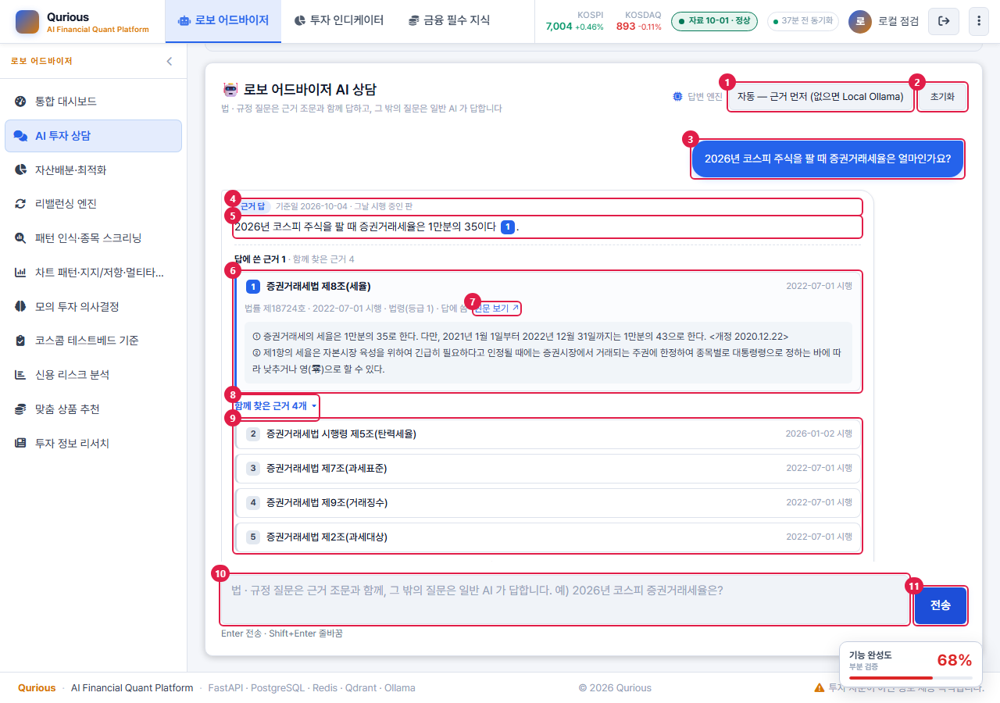

**<표 6> 근거 답 요소**

| 번호 | 요소 | 데이터(API) | 동작 | 빈 데이터 · 오류 |
|:-:|---|---|---|---|
| 1 | 답변 엔진 | — | 다섯 칸: 「자동 — 근거 먼저 (없으면 Local Ollama)」(처음 값) · 「근거 답 — 법령 · 규정 출처」 · Local Ollama · OpenAI · 「검색 결과 요약 (출처 확인 없음)」(옛 「순수 RAG 청크 사용 (LLM 미사용)」 — 2026-10-08 강사님 판부터 서버 LLM 이 검색 조각을 짧게 요약하고, 답 꼬리표에 실제 모델 · 요약하지 못했으면 「LLM 미사용 — 검색 조각」). 고른 칸은 이 브라우저에 기억한다(`qurious.chat.llmMode`) · 칸마다 입력칸 안내가 바뀐다 | OpenAI 는 키를 넣어야 보낸다(강사님 동작) |
| 2 | 초기화 | — | 대화를 지우고, 다음 채팅 전에 새 대화를 연다(모델이 화면에 없는 지난 대화를 보지 않게) | — |
| 3 | 질문 말풍선 | — | 보낸 질문 | — |
| 4 | 꼬리표 · 기준일 | `API-KB-03` | 「근거 답」(또는 「근거 발췌」) · 기준일 · 그날 시행 중인 판 | — |
| 5 | 답 글 · 출처 번호 | `API-KB-03` | 서버가 검사한 출처 번호만 남는다. 번호를 누르면 그 카드가 펼쳐지며 밝아진다 | 맞는 번호가 없거나 답 모델이 꺼지면 답 글 대신 근거 발췌(<표 8>) |
| 6 | 답에 쓴 근거 카드 | `API-KB-03` `citations[]` | 번호 · 문서 조(제목) · 시행일 · 판 · 법령/감독규정(등급) · 조문 글(`excerpt` · 900자에서 자름). 머리를 누르면 접히고 펼쳐진다 | 조문 글이 없으면 「원문 보기로 확인하세요」 |
| 7 | 원문 보기 | `citations[].url` | 국가법령정보센터의 그 판(시행일) 본문을 새 창으로 | 주소가 없으면 숨긴다 |
| 8 | 함께 찾은 근거 접기 | — | 함께 찾은 근거 목록을 접고 편다 | 함께 찾은 근거가 없으면 숨긴다 |
| 9 | 함께 찾은 근거 | `API-KB-03` `citations[]`(`used` 거짓) | 한 줄씩(번호 · 문서 조(제목) · 시행일) · 누르면 조문 글이 펼쳐진다 | — |
| 10 | 입력칸 | — | Enter 보내기 · Shift+Enter 줄바꿈 · 근거 답 칸에서는 300자까지(넘으면 알림 · 보내지 않고 글은 그대로) | — |
| 11 | 전송 | `API-KB-03` · 일반 AI 로 넘어가면 `API-CONV-01` → `API-CHAT-01` | 근거 답 칸이면 근거 답, 아니면 강사님 채팅 | 로그인이 풀리면 로그인 화면 · 그 밖의 오류는 위쪽 알림 |

말풍선 맨 아래에는 답 모델 · 걸린 시간 · 「답이 근거와 맞는지 조문을 열어 확인하세요」 · 투자 권유가 아니라는 안내가 붙는다(근거 목록 밖의 번호를 지웠으면 그 수도).

「근거 답」 칸에서 근거를 찾지 못한 때는 <그림 4> 와 같다.

**<그림 4> 근거 답만 — 근거를 찾지 못한 때** · 범례: 빨간 상자와 번호 = <표 7> 의 요소

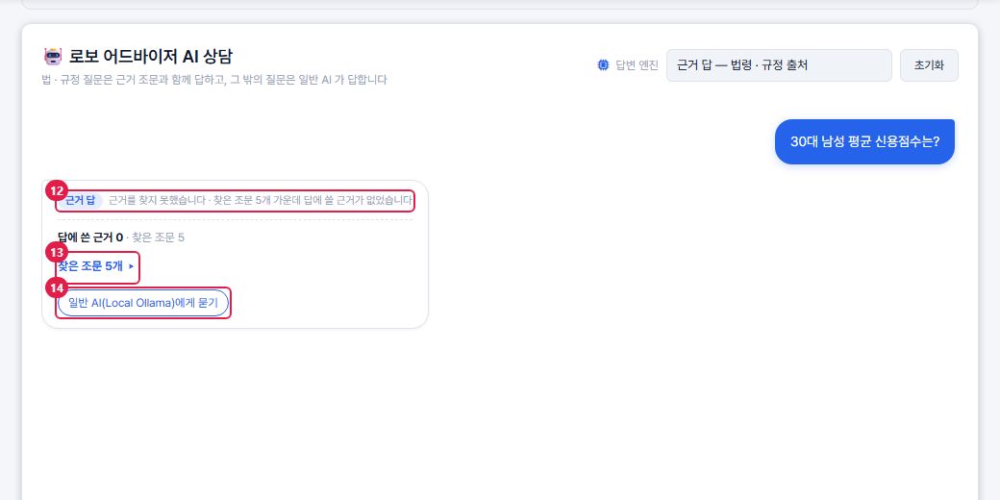

**<표 7> 근거 없음 요소**

| 번호 | 요소 | 데이터(API) | 동작 | 빈 데이터 · 오류 |
|:-:|---|---|---|---|
| 12 | 근거 없음 알림 | `API-KB-03`(`no_evidence`) | 「근거를 찾지 못했습니다 · 찾은 조문 n개 가운데 답에 쓸 근거가 없었습니다」 | 찾은 조문이 0 이면 「근거 문서에서 관련 조문을 찾지 못했습니다」 |
| 13 | 찾은 조문 | `citations[]` | 접힌 목록 · 펼치면 한 줄씩 · 누르면 조문 글 | 0 이면 숨긴다 |
| 14 | 일반 AI 에게 묻기 | `API-CONV-01` → `API-CHAT-01` | 같은 질문을 Local Ollama 에게 묻는다(「자동」 칸은 이것을 누르지 않아도 한다) | 오류는 위쪽 알림 |

상태마다 화면이 보이는 것은 <표 8> 과 같다.

**<표 8> 상태별 화면** · `status` = `API-KB-03` 응답

| 경우 | 화면 |
|---|---|
| 불러오는 중 | 「법령 · 감독규정에서 근거를 찾고 답을 쓰는 중 · n초」(1초마다) · 일반 AI 로 넘어가면 「근거 문서에 없는 질문이라 Local Ollama 가 답하는 중 · n초」 |
| `answered` | <그림 3> |
| `excerpt` | 꼬리표 「근거 발췌」 · 왜 답 글 대신 조문을 보이는지 한 줄(답 모델이 응답하지 않음 · 근거로 확인할 수 없음) · 「보여 드린 근거」 카드 · 바닥글에 까닭 |
| `no_evidence` · 「자동」 칸 | 근거 없음 한 줄 → 이어서 Local Ollama 답 말풍선(노란 테두리 · 꼬리표 「일반 AI 답 · 출처 없음」 · 「근거 문서(법령 · 감독규정)에 없는 질문이라 Local Ollama 가 답했습니다. 사실 여부를 따로 확인하세요.」) |
| `no_evidence` · 「근거 답」 칸 | <그림 4> |
| `declined` | 「투자 권유나 가격 · 수익률 예측은 하지 않습니다 …」 · 물을 수 있는 예시 셋(누르면 입력칸에) · 「자동」 칸이어도 일반 AI 로 넘기지 않는다 |
| 다른 엔진(Local Ollama · OpenAI · 검색 결과 요약)의 답 | 강사님 말풍선 아래 「근거 답으로 다시 묻기」 단추와 「이 답에는 출처가 없습니다 …」 · 누르면 같은 질문을 근거 답으로(입력칸 글은 그대로) |
| 좁은 화면(768 아래) | 화면 머리(제목 · 답변 엔진)를 위아래로 쌓는다 · 640 아래에서는 말풍선이 폭을 다 쓰고 카드의 시행일을 숨긴다(펼친 칸의 판 줄에 있다) |

강사님 화면에서 바뀐 것은 다섯이다. ① 답변 엔진에 두 칸을 더하고 처음 값을 「자동」 으로 ② 고른 엔진을 기억하는 이름을 `qurious.chat.llmMode` 로(옛 저장값을 한 번 비워 처음 값이 보이게) ③ 화면 부제를 「법 · 규정 질문은 근거 조문과 함께 답하고, 그 밖의 질문은 일반 AI 가 답합니다」 로(「투자 자문을 제공」 문구 삭제) ④ 화면을 새로 열거나 초기화하면 새 대화(DF-60) ⑤ 다른 엔진 답 아래 「다시 묻기」. 화면 코드는 `public/js/kbchat.js` · 모양은 `public/css/qurious.css` 이고, 강사님 `agent.js` 에는 넘기는 갈림만 두었다.

알려진 문제 — 근거 답이 출처 번호는 맞지만 조문을 잘못 읽을 수 있다(DF-59 · 예: 증권거래세율을 법 제8조의 기본 세율로 답함). 그래서 함께 찾은 근거까지 카드로 보인다. 일반 AI 이어 받기는 이 PC 에서 1 ~ 2분 걸린다(채팅 에이전트가 자료가 없는 신용 조회 도구를 되풀이해 부름). 채팅 모델(llama3.1)의 답에는 되풀이와 「目的」 같은 한자가 섞인다.

### 4.1 답 위 앱 판단 카드 · 답 끝 용어 칩 (2026-10-17)

질문에 종목 이름이 그대로 있으면 AI 답보다 먼저, 앱이 그 종목에 대해 이미 아는 것을 카드 한 장으로 보인다(<그림 21>). 카드 값은 종목 허브 묶음(`API-HUB-01`)을 그대로 옮긴 것이라 AI 가 숫자를 바꿀 수 없고, 칸을 합친 한 줄 결론은 만들지 않는다. 답 끝에는 서버가 글에서 찾은 용어를 칩으로 붙인다(<그림 22>). 결정 기록은 [Figma 「Qurious · AI 투자 상담 — 근거 답과 출처」](https://www.figma.com/design/4hQ9nkdEaeOb5jSlpNELaQ) 03-2 쪽이다 — 카드는 설계 A(답 위), 용어는 (가) 글 끝 칩 줄을 골랐다.

**<그림 21> 답 위 앱 판단 카드 — 질문 「신한지주 지금 사도 될까요? 우리 앱의 신호와 근거를 같이」** · 범례: 빨간 상자와 번호 = <표 29> 의 요소

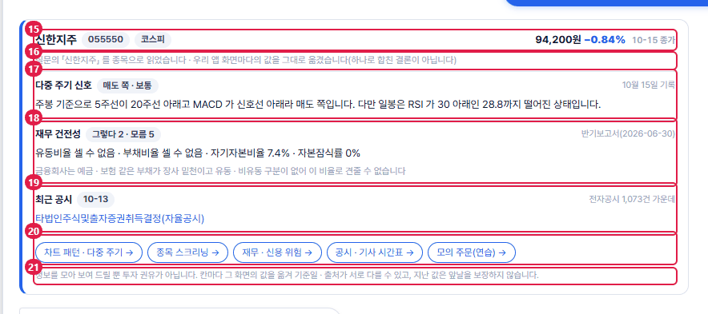

**<그림 22> 답 끝 용어 칩 — 일반 AI 답의 끝** · 범례: 빨간 상자와 번호 = <표 29> 의 요소

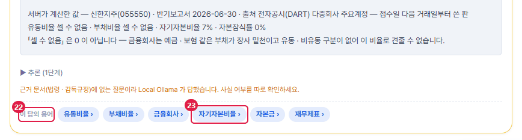

**<표 29> 앱 판단 카드 · 용어 칩 요소**

| 번호 | 요소 | 데이터(API) | 동작 | 빈 데이터 · 오류 |
|:-:|---|---|---|---|
| 15 | 카드 머리 | `API-HUB-01` `name` · `market` · `sections.price` | 이름 · 코드 · 시장 · 마지막 종가 · 등락(오름 빨강 · 내림 파랑 · 빼기는 「−」) · 「MM-DD 종가」 | 종가가 없으면 가격을 쓰지 않고 「마지막 종가 — (서버 까닭)」 한 줄 |
| 16 | 읽은 이름 | `API-HUB-02` `items[].matched` | 「질문의 「○○」 을(를) 종목으로 읽었습니다 · 우리 앱 화면마다의 값을 그대로 옮겼습니다(하나로 합친 결론이 아닙니다)」 — 질문에서 읽은 글자 그대로(회사 이름으로 바꾸지 않는다) | 흔한 낱말과 같은 이름(「신세계 같은 세상」)도 이름이 그대로면 읽는다 — 그래서 무엇을 읽었는지 밝힌다 |
| 17 | 다중 주기 신호 | `sections.signal` | 「매도 쪽 · 보통」(관망은 「쪽」 없이) · 「10월 15일 기록」 · 서버 요약 한 줄 | 신호를 기록하지 않는 종목이면 서버 까닭(「… 401종목에 들지 않습니다」) |
| 18 | 재무 건전성 | `sections.financials` | 「그렇다 n · 아니다 n · 모름 n」(0 인 아니다 · 모름은 빼고) · 보고서(기간 끝) · 지표마다 값 또는 「셀 수 없음」 · 금융회사 까닭(서버 글) | 재무를 못 읽으면 서버 까닭 |
| 19 | 최근 공시 | `sections.disclosures` | 날짜 · 「전자공시 n건 가운데」 · 가장 최근 공시 제목(원문 링크 — http(s) 주소만) | 공시가 없으면 「최근 공시가 없습니다.」 |
| 20 | 다른 화면으로 | `links`(이름은 서버 글) | 다섯 — 차트 패턴 · 다중 주기(종목 칸에 코드 → 분석 실행) · 종목 스크리닝(옮기기만) · 재무 · 신용 위험(코드로 그 회사) · 공시 · 기사 시간표(그 종목 시간표) · 모의 주문(연습)(코드 → 시세 조회 · 주문은 사용자가) | 서버 `links` 에 없는 화면은 단추를 그리지 않는다 |
| 21 | 고지 | `notice` | 서버 고지 그대로(투자 권유가 아님 · 칸마다 기준일 · 출처가 다름 · 지난 값은 앞날을 보장하지 않음) | — |
| 22 | 칩 줄 이름 | — | 「이 답의 용어」 | 찾은 용어가 없거나 찾기가 실패하면 줄을 그리지 않는다(답은 그대로 · 실패는 콘솔에 남긴다) |
| 23 | 용어 칩 | `API-GLOS-06` `items[]` | 글에 나온 차례로 최대 여섯 · 누르면 용어 풀이(화면 설정에서 고른 모양 — 기본 오른쪽 서랍) | — |

**<표 30> 카드 · 칩의 경우**

| 경우 | 화면이 보이는 것 |
|---|---|
| 질문에 종목 이름이 없다 | 카드 자리를 잡았다가 지운다(빈 칸이 남지 않는다) |
| 종목이 둘(서버 최대 둘) | 첫째는 펼치고, 둘째는 「질문의 「○○」 도 종목으로 읽었습니다 — 카드 펼치기」 로 접는다 |
| 종목은 읽었는데 허브를 못 읽음 | 「질문의 「○○」 을(를) 종목으로 읽었지만 앱 자료를 지금 읽지 못했습니다 — 잠시 뒤 다시 물어 주세요.」 한 줄 |
| 「자동」 · 「근거 답」 칸 | 질문 말풍선 바로 뒤에 카드 자리를 먼저 잡고 근거 답과 함께 불러온다(약 1초 · 답을 기다리게 하지 않는다) |
| 다른 엔진(Local Ollama · OpenAI · 검색 결과 요약) | 답이 온 뒤 그 답 줄 위로 카드를 끼운다 · 칩은 「근거 답으로 다시 묻기」 단추 위 |
| 근거 발췌 · 답하지 않는 질문 | 칩을 붙이지 않는다(발췌는 조문 글이고, 거절은 답이 없다) |
| 좁은 화면(640 아래) | 카드가 폭을 다 쓰고, 지금가를 이름 아래 줄로 내린다 |

카드는 종목 허브 화면과 같은 칸 묶음을 쓴다 — 칸 이름 · 값 · 까닭 글은 서버 한 곳에서 만들고 화면은 옮기기만 한다(그리는 판단은 `public/js/stockcard.js` 한 곳이고 DOM 없이 시험한다). 용어 칩 부품(`public/js/termchips.js`)은 다른 화면(차트 패턴 · 스크리닝 등)도 같은 이름으로 부를 수 있다. 용어사전의 「자기자본비율」 에는 은행 BIS 비율 뜻만 있어, 칩이 회사 재무의 7% 를 「최소 8% 미달」 로 읽히게 할 수 있었다 — 칩을 붙이기 전에 풀이를 회사 재무의 뜻(자본총계 ÷ 자산총계)으로 고치고 BIS 비율과 「헷갈리기 쉬운 말」 로 이었다.

---

## 5. 화면 상세 — 데이터 수집 화면 셋 · 자료 안내

데이터 묶음의 크롤링 세 화면(`crawl-auto` · `crawl-manual` · `crawl-ingest`)을 바꾼 화면이다. 옛 셋은 강사님 예제(외부 강의 문서 긁기 · 네이버 종목 긁기 · 신용평가 CSV 넣기 · DB 초기화)를 돌았고, 우리 수집은 화면 밖 러너가 매일 12:30 에 한다. Figma 에서 지금 화면 셋과 바꿀 화면 셋을 나란히 두고 경우 표와 정할 것 넷을 거쳐 2026-10-06 에 설계를 정했고, 2026-10-08 에 만들었다. 만들며 실제 코드와 맞대 보니 설계와 다르게 해야 할 곳이 셋 나와 그날 다시 정했다(<표 9> 결정 기록). 이 절의 그림은 2026-10-08 의 구현 화면이고, 숫자는 그날 낮(12:30 회차 전)의 실제 값이다.

### 5.1 세 화면에 공통

**<표 9> 세 화면 공통**

| 칸 | 내용 |
|---|---|
| 화면 ID · 화면명 | `crawl-auto` · 수집 일정 · 단계 / `crawl-manual` · 자료 직접 받기 / `crawl-ingest` · 적재 · 백업 — 화면 키는 옛 크롤링 그대로 두고 이름만 바꿨다(옛 주소가 열리고, 강사님 기초 코드를 받을 때 부딪히는 곳이 적다) |
| 들어가는 길 | 위 탭 「데이터」 또는 왼쪽 전체 메뉴 › 데이터의 넷(데이터 관제 · 수집 일정 · 단계 · 자료 직접 받기 · 적재 · 백업) · 데이터 관제의 한 줄 「단계별로 자세히 →」 |
| 누가 쓰나 | 관리자. 일반 사용자에게는 왼쪽 메뉴 · 전체 메뉴의 셋과 데이터 관제의 「자세히 →」 가 보이지 않는다 — 로그인 정보의 역할로 몸통에 `q-admin` 을 붙이고 CSS 가 숨긴다(역할을 확인하기 전에도 숨긴 채로 시작한다). 서버도 셋의 API 를 관리자만 받는다(일반 사용자 403 — 주소로 들어오면 「관리자만 볼 수 있는 화면입니다」) |
| 설명 | 우리 수집이 무엇을 언제 했는지 보고(수집 일정 · 단계), 빠진 날을 메울 범위와 명령을 보고(자료 직접 받기), 백업이 믿을 만한지 확인한다(적재 · 백업) |
| 관련 요구 | `P01-①-2`(수집) · `P01-①-4`(정기 배치) · 유스케이스 UC-04 |
| 주담당 | 이동원 |
| 결정 기록 | [Figma 05 정할 것](https://www.figma.com/design/AfiCh50uOwrSq5F2Tk2JLZ?node-id=10-2)(2026-10-06) — ① 네이버 종목 긁기는 화면에서 빼고 「막음」 예시로만 · ③ 외부 강의 문서 긁기는 수집 화면에서 빼고 개념 학습 자료로 · ④ 데이터 관제와 따로 두고 한 줄로 잇기 + 단계가 늘면 화면이 따라오게 · ② 신용평가 CSV 는 CSV 수동 적재 · 개인 CB · 「DB 초기화」 를 빼고 그 자료를 읽던 로보 어드바이저 화면 둘은 우리 자료로 고쳐 씀(2026-10-07) · 한 단계 다시 돌리기는 화면이 명령과 막히는 때만 보여 줌 · 「DB 초기화」 는 단추와 서버 길(`API-ADM-01`)을 함께 없앰(2026-10-07) · **구현 때 셋(2026-10-08)** — 가. PC 쪽 일(한 단계 다시 · 받기 · 원격 다시 확인 · 복원 리허설)은 모두 명령을 보여 주고 복사하게 한다 나. 자료 직접 받기는 실제 수집 단위로(종류가 출처를 정함 · 종목 칸 없음 · 날 · 해 단위 — 5.3절) 다. 백업 판정은 `scripts/hf_dataset.py` 가 쓰고 앱은 읽기만(5.4절) |
| 화면이 하지 않는 일 | 앱은 수집 폴더를 읽기만 하게 붙어 있다(`./data:/app/data/csv:ro`). 그래서 PC 쪽 일은 화면이 돌리지 않는다(결정 가) — 받기 · 원격 다시 확인 · 복원 리허설은 **이 PC 에서 돌릴 명령**을 상자에 보여 주고 복사하게 하고, 수집 일정의 「다시 받기」 · 「전체 수집」 은 앱 DB 의 요청 표에 줄만 남겨 이 PC 의 수집 작업자가 가져가 돌린다(2026-10-10). 화면이 보내는 쓰기는 주소 검사 · 주소로 받기(근거 문서 — 앱 DB · 검색 색인) · 수집 요청 만들기 · 취소 넷이고, 수집 요청 둘은 화면 머리글 `X-Qurious-Action: collect` 를 붙인다 |
| 화면 글 | 실제 서비스 말로 쓴다 — 저장소 · DB 이름이나 작업 말을 화면에 쓰지 않는다. 설계 주석은 Figma 화면 프레임 밖에 둔다 · 관리자가 PC 에서 돌릴 명령만 그대로 보인다 |
| 화면 파일 | 강사님 파일(`app.html` · `agent.js` · `main.js`)에는 뿌리 칸과 부르는 줄만 두고 그리기는 `public/js/collect.js` · `public/css/collect.css` 에 둔다(수집 요청 · 확인 창 · 대기 창 · 관제 한 줄은 `public/js/collect-requests.js` · 2026-10-10). 옛 단추를 뺀 자리의 리스너도 함께 뺐다 — 남기면 그 줄이 null 오류로 `agent.js` 전체(AI 투자 상담 화면 포함)를 멈춘다 |

### 5.2 수집 일정 · 단계 (`crawl-auto`)

매일 12:30 회차 하나를 단계별로 보인다 — 단계마다 하는 일 · 걸린 시간 · 결과를 보이고, 관리자는 한 단계 · 전체 수집을 요청하거나(2026-10-10) 이 PC 에서 돌릴 명령을 본다. 화면은 <그림 5> 와 같다.

**<그림 5> 수집 일정 · 단계 — 2026-10-10 회차 · 정책뉴스 다시 받기를 요청한 직후** · 범례: 빨간 상자와 번호 = <표 10> 의 요소

로컬 개발 앱 · 1280 폭 · 2026-10-10 16:29 · 기준 `83a0b12` + 이 판의 구현 · 정책뉴스 한 단계를 실제로 요청한 직후에 찍었다 — 요청 목록 응답만 그 순간 것으로 고정했고, 작업자는 1분 안에 실제로 가져가 3초 만에 끝냈다 · 그날 12:30 회차는 경고 둘(배당 · 기업 일정) · 건너뜀 셋 · 그림 판 v0.8(v0.6 은 2026-10-08 의 「이 단계만 다시」 판) · 구현 대조: [Figma 03-2 · `51:2`](https://www.figma.com/design/AfiCh50uOwrSq5F2Tk2JLZ?node-id=51-2) · 설계 원본: [03-2 [결정] 안 A](https://www.figma.com/design/AfiCh50uOwrSq5F2Tk2JLZ?node-id=40-2) · [03 설계 1](https://www.figma.com/design/AfiCh50uOwrSq5F2Tk2JLZ?node-id=7-2)

**<표 10> 수집 일정 · 단계 요소**

| 번호 | 요소 | 데이터(API) | 동작 | 빈 데이터 · 오류 |
|:-:|---|---|---|---|
| 1 | 왼쪽 메뉴 — 데이터 넷 | — | 관리자에게만 아래 셋이 보인다 · 지금 화면을 강조 | 일반 사용자는 데이터 관제 하나 |
| 2 | 회차 고르기 | `API-DATA-05` `last` · `history` | 마지막 회차 · 지난 회차를 고르면 그 회차의 타일 · 단계 표로 바뀐다 · 한 단계만 다시 돌린 줄은 「↳ 다시 돌림 · 단계」, 빠진 날을 채운 줄은 「↳ 빠진 날 채움 · 단계 날짜」 로 따로(DF-82 · 2026-10-10) · 화면에 들어올 때마다 마지막 회차부터 | 기록이 하나뿐이면 고르는 칸을 숨긴다 |
| 3 | 관리자 꼬리표 | — | 관리자 화면임을 보인다 | — |
| 4 | 안내 | — | 무엇을 언제 하는지 한 줄 | — |
| 5 | 요약 타일 넷 | `API-DATA-05` | 고른 회차(시작 → 끝 · 걸린 시간 — 다시 돌린 줄은 그 단계의 초) · 결과(성공 n / 전체 · 실패 · 경고 · 건너뜀) · 자료 기준일(그 회차의 시세 기준일 · 출처 공개는 다음 영업일 13시 뒤) · 다음 회차 | 도는 중이면 맨 위에 「수집 중 · 시작 시각」 한 줄(아래는 지난 회차) · 기록이 없으면 「아직 회차 기록이 없습니다 — 첫 수집은 12:30」 · 단계별 기록이 없는 옛 회차는 「이 회차는 단계별 기록이 없습니다」 |
| 6 | 단계 표 머리 | — | # · 단계 · 하는 일 · 걸린 시간 · 결과 · 다시 받기(2026-10-10 · 옛 「관리자」) | — |
| 7 | 묶음 줄 | `API-DATA-05` `groups` | 받기 · 계산 · 백업 · 근거 문서와 그 설명(러너 단계 목록에서) | — |
| 8 | 걸린 시간 막대 | `steps[].seconds` | 모든 막대가 같은 눈금(가장 긴 단계가 끝까지) · 옆에 걸린 시간 글자 | 단계별 기록이 없는 회차는 「—」 |
| 9 | 결과 | `steps[].status` · `followup` · `reason` · `date` | 성공 · 경고 · 실패 · 건너뜀(그 까닭) · 채울 날이 남은 건너뜀(`followup` — 신호 단계 앱 DB 꺼짐)은 노랑 「건너뜀」 과 빠진 거래일 · 빠진 날이 남은 단계는 성공 줄이어도 「채울 날 n」 꼬리표(23) · 그 회차 뒤에 다시 돌린 단계는 「성공 · 다시 돌림」 · 실패 · 경고 줄 아래에 까닭 줄(21) | 실패 줄은 빨강 · 기록 없는 회차는 「기록 없음」 |
| 10 | 다시 받기 | `API-DATA-12` `kind=step` · `API-DATA-13` `rules.blocked_now.steps` | 누르면 그 단계의 요청 줄을 남기고(새 줄이면 「요청했습니다 — … · PC 작업자가 1분 안에 가져갑니다」, 이미 대기 · 도는 중이면 「이미 기다리는 요청이 있습니다」) 대기 창(18)을 연다 — 작업자가 `run --only <단계>` 를 돈다(올리기 단계는 `--upload`). 옛 「이 단계만 다시」(명령 상자)는 14 「명령」 으로 남겼다(2026-10-10) · 빠진 날이 남은 단계는 이 단추가 「빠진 날 채우기(n일)」(19)로 바뀐다 | 막는 때 · 수집 중 · 이미 요청함 · 목록을 읽지 못함이면 꺼지고 마우스를 올리면 까닭 · 관리자가 아니면 「관리자만 요청할 수 있습니다」 |
| 11 | 아래 안내 | `rerun.blocked` | 「다시 받기」 · 「전체 수집」 은 요청만 남기고 이 PC 의 작업자가 1분 안에 가져가 돌린다는 것 · 화면이 수집을 직접 돌리지 않는다는 것 · 막는 때와 수집 중에는 단추가 꺼진다는 것 · 작업자가 꺼져 있으면 「명령」 으로 직접 · 명령이 막히는 때 | — |
| 12 | 전체 수집 | `API-DATA-12` `kind=all` · `API-DATA-13` `rules.blocked_now.full` | 누르면 확인 창(17)을 거쳐 요청 줄 하나를 남긴다 · 이미 요청했으면 「전체 수집 요청함」(꺼짐) | 막는 때(11:00 ~ 13:30) · 수집 중 · 이미 요청함 · 목록을 읽지 못함이면 꺼지고, 마우스를 올리면 까닭이 보인다 |
| 13 | PC 작업자 띠 | `API-DATA-13` `worker` · `rules` | 작업자 상태(서버 글 — 쉬는 중 · 기다리는 중 · 도는 중 · 꺼짐 · 없음) · 마지막 신호 · 오른쪽에 막는 때. 쉬는 중은 초록 점, 기다리는 중은 노랑 띠, 도는 중은 파랑 점(무엇 · 경과) | 꺼짐 · 없음이면 빨강 띠 「요청은 받지만 작업자가 켜질 때까지 기다립니다 — 마지막 신호 · 등록 안내」 · 목록을 못 읽으면 그 까닭 |
| 14 | 명령 | `API-DATA-05` `rerun` · `catalog.steps[].fill` | 옛 「이 단계만 다시」 의 동작 그대로 — 그 줄 아래 「이 PC 에서 돌릴 명령」 상자 · 신호 단계는 「빠진 날 채우기」 상자 · 복사 · 다시 누르면 닫힘. 작업자가 꺼져 있을 때 이 PC 에서 직접 돌리는 길이다(2026-10-10 결정 ④) | 복사를 못 하는 창이면 명령 글을 골라 두고 알린다 |
| 15 | 줄의 요청 상태 | `API-DATA-13` `requests[]` | 그 단계의 요청이 대기 · 도는 중이면 단추가 「요청함」(꺼짐)이 되고 아래에 상태와 기다리는 까닭의 앞마디(도는 중이면 경과 시간) | 막는 때면 「HH:MM 뒤에 누를 수 있음」 |
| 16 | 수집 요청 | `API-DATA-13` · `API-DATA-14` | 최근 10건 — 상태 칩 · 무엇 · 요청 시각과 요청한 사람 · 시작 → 끝 · 걸린 시간 · 결과 한 줄(대기면 기다리는 까닭) · 대기 줄에만 「취소」 · 실패 · 경고 줄은 결과 아래에 까닭 줄(22) · 대기 · 도는 중인 요청이 있으면 5초, 없으면 1분마다 새로 고침 | 「아직 요청이 없습니다 — …」 · 취소하는 사이 이미 돌기 시작했으면 서버 409 글 그대로 |
| 17 | 전체 수집 확인 창 | `API-DATA-05` 단계 수 · 지난 회차 길이 · `API-DATA-13` 작업자 · 막는 때 · 만료 | 단계 수 · 지난 회차가 걸린 시간 · HF 데이터셋 올리기까지 한다는 것 · 막는 때 · 3시간 안에 시작하지 못하면 만료 · 지금 작업자 상태 → 「전체 수집 요청」 · 「닫기」(Esc · 바깥 누름) | 작업자가 올리기를 끈 PC 면 「올리기를 하지 않습니다」 |
| 18 | 대기 창 | `API-DATA-13`(5초마다) | 요청 직후 열린다 — 모래시계 · 무엇 · 상태 칩과 기다리는 까닭(끝나면 결과 한 줄) · 경과 시간 · 「창 닫기」(요청은 계속) · 대기일 때만 「요청 취소」 · 움직임 줄이기 설정이면 모래시계가 돌지 않는다 | 끝나면 모래시계가 멈추고 걸린 시간을 보인다 · 실패면 결과 아래 까닭 줄(22) |
| 19 | 빠진 날 채우기(n일) | `API-DATA-05` `last.steps[]` 의 `followup` · `fill_from` · `fill_to` · `fill_days` · `API-DATA-13` `rules.blocked_now.fill` | 러너가 적은 빠진 날이 남은 단계(지금은 신호)만 「다시 받기」 자리에 노랑 단추로 · 날짜 · 날 수는 마지막 기록에서 그대로(화면이 셈하지 않는다 · 고른 지난 회차가 아니라) · 누르면 확인 창(20) | 막는 때(채우기 창 — 10:30 ~ 13:30) · 수집 중 · 같은 단계의 채우기가 대기 · 도는 중이면 꺼지고 마우스를 올리면 까닭 · 빠진 날이 없으면 단추가 「다시 받기」 로 돌아온다 |
| 20 | 채우기 확인 창 | 단추의 날짜 · `API-DATA-13` `rules.fill` · `fill_max_days` · `worker` | 첫날 ~ 마지막 날(하루면 날짜 하나) · 빠진 거래일 n일 · 같은 날을 다시 계산해도 값만 바뀐다 · 한 번에 31일까지(더 남은 날은 다음 묶음) · 막는 때 · 만료 · 지금 작업자 → 「빠진 날 채우기 요청」(`API-DATA-12` `kind=fill` · 날짜 두 칸) · 「닫기」(Esc · 바깥 누름) | 서버가 받지 않으면(상한 · 날짜 · 옛 단계 목록) 서버 글 그대로 알림 |
| 21 | 단계 표의 까닭 줄 | `API-DATA-05` `steps[].error` · `log_name`(관리자 답에만) | 실패 · 경고 줄 바로 아래 한 줄 — 빨간 「까닭」 꼬리표와 러너가 걸러 적은 글(마지막 예외 줄 · 경로는 파일 이름만 · 비밀값 지움 · 200자) · 그 아래 회색으로 로그 파일 이름 · 「명령」 상자는 까닭 줄 뒤에 열린다 | 성공 · 건너뜀 줄과 옛 기록(까닭 칸 없음)에는 없다 · 시간 한도를 넘기면 「시간 한도 n분을 넘겨 멈춤」 |
| 22 | 요청 결과의 까닭 줄 | `API-DATA-13` `requests[].result` 끝의 「 · 까닭: 」 | 작업자가 결과 한 줄 끝에 붙인 까닭을 떼어 결과 아래 한 줄로(요청 목록 · 대기 창 같은 도우미) · 전체 수집은 첫 실패 단계 이름과 함께 | 까닭이 없으면 결과 한 줄 그대로 |
| 23 | 채울 날 꼬리표 | `steps[].fill_days` · `fill_from` · `fill_to` · `fill_rest` | 결과 칸에 「채울 날 n」 · 하는 일 칸에 「채울 날 n (첫날 ~ 마지막 날)」(하루면 날짜 하나 · 다음 묶음이 있으면 「다음 묶음 m일」) | 건너뛴 줄은 러너 메모에 같은 글이 있어 하는 일 칸에 다시 붙이지 않는다 |

**채울 날이 남은 건너뜀 · 빠진 날 채우기(2026-10-08)** — 신호 단계(앱 DB 에 다중 주기 신호를 쓰는 단계)는 러너가 돌리기 전에 앱 DB 포트를 확인하고, 닫혀 있으면 돌리지 않고 「건너뜀」 으로 남긴다. 이 줄만 노랑 「건너뜀」 으로 칠하고 하는 일 칸에 까닭(러너가 적은 메모)과 빠진 거래일을 붙인다 — 할 일이 없어 건너뛴 줄(새 자료 없음 · 업로드 끔)은 회색 그대로다. 「이 단계만 다시」 를 열면 단계 목록에 빠진 날 채우기 명령이 있는 단계에만 둘째 상자 「빠진 날 채우기」 가 열린다(명령 글은 러너 단계 정의 한 곳에서 온다). 요약 타일의 결과에는 「건너뜀 n (채울 것 m)」.

**<그림 5-2> 신호 단계 — 앱 DB 꺼짐으로 건너뜀 · 빠진 날 채우기 상자**

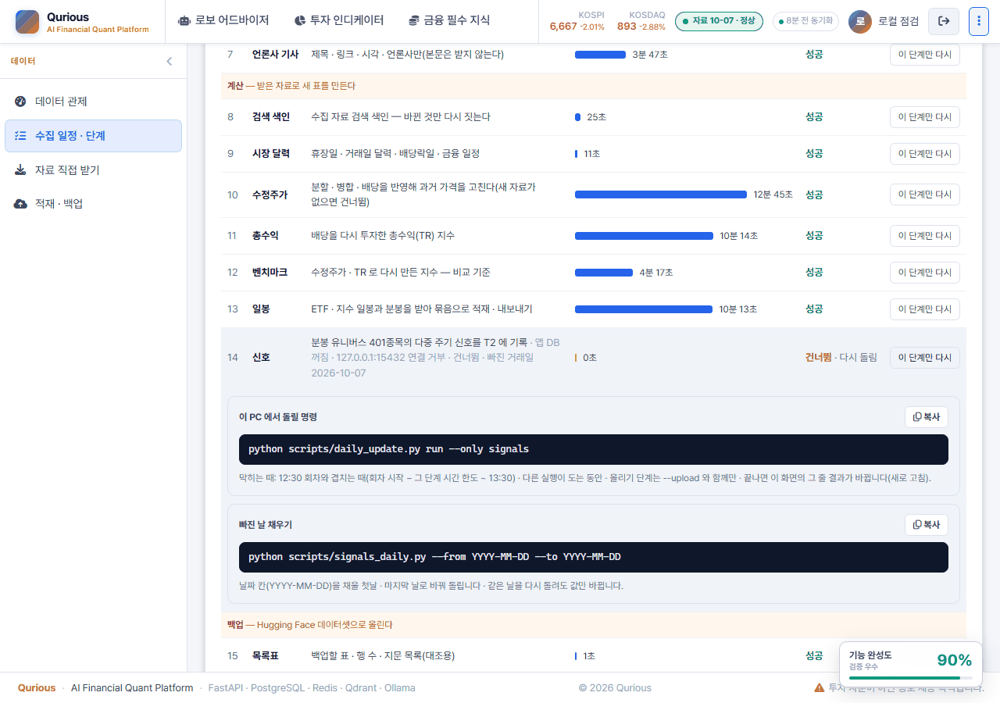

로컬 개발 앱 · 1280 폭 · 2026-10-08 · 기준 `5f3c325` + 이 판의 구현 · 앱 DB 는 켜져 있어 신호 줄의 응답만 브라우저에서 「앱 DB 꺼짐」 으로 바꿔 그렸다(회차 기록 파일은 건드리지 않음) · 「다시 돌림」 표시는 그날 실제로 다시 돌린 기록 때문이다

**실패한 단계의 까닭 · 빠진 날 채우기(2026-10-10)** — 10-10 12:30 회차의 배당 · 기업 일정이 DART 시스템 점검으로 실패했을 때 요청 결과가 「종료코드 1」 뿐이라 로그를 열어야 까닭을 알았다(DF-101). 이제 러너가 실패한 단계 로그 구간의 마지막 예외 줄을 걸러 단계 줄에 적고(`error` · `log_name`), 작업자가 요청 결과 끝에 붙인다. 빠진 날은 앱 DB 가 꺼진 회차마다 러너가 상태 파일에 모아 「채울 날 n · 첫날 · 마지막 날」 로 적고 — 이틀 넘게 꺼졌던 때도 센다 — 화면은 그 날짜로 채우기를 요청한다. 작업자는 `run --fill <단계> --from --to` 를 돌리고 러너는 채운 범위의 날만 지운다. 화면 꼴은 Figma 「데이터 수집 화면」 03-3 에서 세 안을 견줘 정했다(<표 10-3>).

**<표 10-3> 수집 단추 남은 것 — 정한 것 넷(2026-10-10)** · 원본: [Figma 03-3 · [결정] 안 A](https://www.figma.com/design/AfiCh50uOwrSq5F2Tk2JLZ?node-id=59-2)

| 정할 것 | 고른 것 | 까닭 |
|---|---|---|
| ① 까닭을 어디에 | 안 A — 실패 · 경고 줄 바로 아래 한 줄(+ 로그 파일 이름) · 요청 결과 아래 한 줄 | 열지 않아도 바로 읽힌다 · 안 B(접어 둠)는 한 번 더 눌러야 하고 안 C(결과 칸 안)는 표가 넓어진다 |
| ② 채우기 단추 | 빠진 날이 있을 때만 그 단계의 「다시 받기」 가 「빠진 날 채우기(n일)」 로 바뀐다 · 누르면 확인 창 | 할 일이 있을 때만 보이고, 날짜는 러너가 적은 그대로라 사람이 날짜를 고르다 틀릴 일이 없다 |
| ③ 한 번의 상한 | 31일(양 끝 포함) | 한 달 남짓 꺼졌던 때까지 한 번에 · 시간 한도는 평일 수 × 단계 한도에서 120분에 멈춘다 · 넘는 날은 다음 묶음 |
| ④ 요청 길 | 요청 표에 새 종류 `fill` + 날짜 칸 둘(이전 `0019`) | 「다시 받기」 의 뜻을 신호 줄에서만 바꾸지 않고 기록 · 감사에 범위가 남는다 |

구현 때 정한 것 — 까닭 · 로그 파일 이름은 **관리자 답(`API-DATA-05`)에만** 싣는다(내부 말 · PC 의 파일 이름 · 모두가 보는 데이터 관제 응답은 30초 캐시를 같이 쓴다) · 다시 돌림 줄의 로그 경로 · 요청 번호도 같은 까닭으로 관리자 답에만 · 빠진 날이 31일을 넘게 쌓이면 첫날부터 31일 안을 한 묶음으로 적고 남은 날 수를 따로(단추가 서버 상한을 넘는 범위를 만들지 않게) · 상한 · 채우기 창은 러너가 단계 목록 파일에 쓴 값 그대로(앱 사본 없음 — 실제 확인에서 앱이 그 칸을 떨어뜨려 확인 창의 상한 줄이 빠진 것을 찾아 고쳤고 TC-CQ-23 이 지킨다).

**<그림 5-4> 실패한 단계의 까닭 — 단계 표(21) · 요청 목록(22)** · 범례: 빨간 상자와 번호 = <표 10> 의 요소

로컬 개발 앱 · 1280 폭 · 2026-10-10 19:58 · 기준 `5d470c3` + 이 판의 구현 · 19:41 에 배당 다시 받기를 화면에서 실제로 요청했고(DART 가 아직 점검 중) 작업자가 19:42 에 돌려 11초 만에 실패했다 · 두 장을 잘라 붙였다 · 설계 원본: [03-3 [결정] 안 A](https://www.figma.com/design/AfiCh50uOwrSq5F2Tk2JLZ?node-id=59-2)

**<그림 5-5> 빠진 날 채우기 — 단추(19) · 꼬리표(23) · 확인 창(20)** · 범례: 빨간 상자와 번호 = <표 10> 의 요소

로컬 개발 앱 · 1280 폭 · 2026-10-10 19:46 · 기준 `5d470c3` + 이 판의 구현 · 빠진 날 하나(10-06)만 러너 상태 파일에 넣어 「앱 DB 가 꺼졌던 날」 을 흉내 냈고, 그 뒤는 실제 길이다 — 신호 다시 받기(19:43 · 10-07 계산 · 10-06 이 남아 단추가 바뀜) → 이 확인 창 → 「빠진 날 채우기 요청」 → 작업자가 19:47 에 `run --fill signals --from 2026-10-06 --to 2026-10-06` 을 돌려 1분 18초 만에 끝 · 단추는 「다시 받기」 로 돌아왔다 · 번호 상자는 찍은 뒤 그렸다

**단계가 늘면 화면이 따라온다(결정 ④)** — 단계 줄 · 묶음 · 하는 일과 데이터 관제의 한 줄은 러너 단계 목록(`scripts/daily_update.py` 의 `STEPS`)과 마지막 회차 기록에서 만든다. 러너 `Step` 의 `label` · `group` · `desc` 가 정본이고, 러너가 회차마다 단계 목록 파일(`state/daily_update_steps.json`)과 회차 기록의 단계 줄에 함께 쓴다(2026-10-07). 앱에는 이름표 사본이 없고, 사본이 다시 생기면 TC-DST-08 이 실패한다. 단계를 더해도 이 화면 · 관제 한 줄은 손대지 않아도 따라온다.

데이터 관제(3절)의 「오늘 갱신 — 단계」 칸은 이 화면으로 옮겼고(2026-10-08), 관제에는 마지막 수집 한 줄과 관리자에게만 보이는 「단계별로 자세히 →」 를 두었다(3절 <표 4> 8번).

**도는 중의 「n번째 단계」** — 설계 경우 표는 「수집 중 — 10번째 수정주가」 를 그렸다. 화면은 상태 응답에 지금 단계(`running_step`)가 오면 그 줄을 그리게 만들어 두었고, 지금 단계를 기록에 쓰는 일은 러너 쪽이다(5.6절 <표 15>).

**화면에서 수집 요청(2026-10-10)** — 「다시 받기」(10) · 「전체 수집」(12)은 요청 표에 줄 하나만 남긴다. 이 PC 의 수집 작업자(작업 스케줄러가 매 분 띄운다)가 그 줄을 가져가 러너를 돌리고 결과를 줄에 적는다 — 앱이 수집 폴더를 읽기만 하게 붙어 있다는 결정 가는 그대로다. 화면 꼴은 Figma 「데이터 수집 화면」 03-2 에서 세 안을 견줘 정했다. 정한 것은 <표 10-2> 와 같다.

**<표 10-2> 화면 수집 단추 — 정한 것 넷(2026-10-10)** · 원본: [Figma 03-2 · [결정] 경우 표 · 결정 넷](https://www.figma.com/design/AfiCh50uOwrSq5F2Tk2JLZ?node-id=47-2)

| 정할 것 | 고른 것 | 까닭 |
|---|---|---|
| ① 화면 꼴 | 안 A — 줄마다 「다시 받기」 · 위 작업자 띠 · 아래 요청 목록. 안 B 의 작업자 상태 · 최근 요청은 데이터 관제에 관리자 한 줄로(<표 4> 11) | 단계 표 옆에서 바로 누르고, 데이터 관제에서도 수집이 도는지 한눈에 본다 |
| ② 막는 때 | 단추를 끈다 — 마우스를 올리면 「막는 때입니다 — HH:MM 뒤에 누를 수 있습니다」 | 정기 회차(12:30)와 겹치지 않게. 판정은 서버가 서버 시각으로 셈한 값(`rules.blocked_now`) 그대로이고 화면이 시계로 다시 세지 않는다(TC-CL-10) |
| ③ 대기 창 | 강사님 기초 코드(lumina-invest 10-08 판)의 데이터 조회 대기 창 꼴(모래시계 · 경과 시간)을 가져와 고쳤다 | 창을 닫아도 요청은 계속 돈다 · 대기일 때만 「요청 취소」 · 창은 이 화면 파일이 만들고 강사님 `app.html` 은 고치지 않는다 |
| ④ 「명령」 | 남긴다 | 작업자가 꺼져 있을 때 이 PC 에서 직접 돌리는 길 |

글(요청 상태 · 작업자 상태 · 기다리는 까닭 · 결과 한 줄)은 서버가 준 글 그대로이고 화면은 색만 고른다(TC-CL-09). 같은 대상의 요청이 이미 대기 · 도는 중이면 서버가 새 줄을 만들지 않고 그 줄을 돌려준다(「이미 기다리는 요청이 있습니다」). 서버는 막는 때에도 요청을 받는다 — 단추를 끄는 것은 화면의 선택이다. 대기 · 도는 중인 요청이 있거나 대기 창이 열려 있으면 5초, 그 밖에는 1분마다 목록을 다시 묻는다 — 처음에는 요청이 없으면 멈추게 했는데, 화면을 열어 둔 채로 작업자 띠가 25분 넘게 「꺼짐」 으로 남는 것을 확인하고 고쳤다(2026-10-10 · TC-CL-12). 확인 창 · 대기 창은 <그림 5-3> 과 같다.

**<그림 5-3> 전체 수집 확인 창(17) · 대기 창(18)** · 범례: 빨간 상자와 번호 = <표 10> 의 요소

로컬 개발 앱 · 1280 폭 · 2026-10-10 16:29 · 대기 창은 정책뉴스 한 단계를 실제로 요청한 직후(작업자는 1분 안에 가져가 3초 만에 끝냈다) · 확인 창은 「닫기」 로 닫아 요청하지 않았다 · 설계 원본: [03-2 [결정] 확인 창](https://www.figma.com/design/AfiCh50uOwrSq5F2Tk2JLZ?node-id=43-2) · [대기 창](https://www.figma.com/design/AfiCh50uOwrSq5F2Tk2JLZ?node-id=44-2)

### 5.3 자료 직접 받기 (`crawl-manual`)

매일 수집이 빠뜨린 날이나 과거분을 메운다. 받을 범위를 수집기가 남긴 기록으로 먼저 세어 보이고, 받을 것이 있으면 이 PC 에서 돌릴 명령을 보인다. 주소로 받을 때는 허용 목록에 있는 곳만 받는다. 화면은 <그림 6> 과 같다.

**설계에서 바뀐 것(2026-10-08 결정 나)** — 설계는 시세 출처를 FinanceDataReader · yfinance · KRX 정보데이터시스템 중에 고르고 종목을 고르게 그렸지만, 우리 수집기는 시세를 공공데이터포털 주식시세정보로 **하루 한 번 부르면 그날 전 종목**을 받는다(`collector.backfill`). 그래서 출처는 고르지 않고 종류가 정한 출처를 보이고, 종목 칸은 뺐고, 받을 범위는 수집기가 실제로 받는 단위(시세 · 공시 · 정책뉴스는 날, 재무는 해)로 센다. 실시간으로 화면에 보이는 기능(차트 · 3차 TradingView 등)은 이와 상관없다 — 야후 지킴이(`tests/test_no_yahoo_regression.py`)는 야후를 가리키는 줄 수가 늘지 않게 막는 「봉인」 이고, 2026-09-30 결정은 「야후 · 네이버 시세는 적재하지 않되 화면 표시는 괜찮다」 이다.

**<그림 6> 자료 직접 받기 — 시세 · 최근 한 달** · 범례: 빨간 상자와 번호 = <표 11> 의 요소

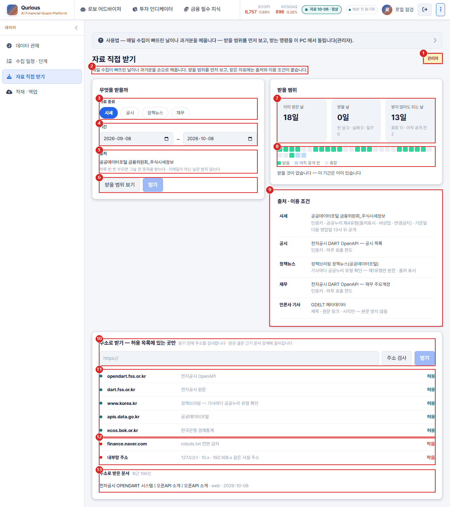

로컬 개발 앱 · 1280 폭 · 2026-10-08 12:2x · 「주소로 받은 문서」 한 건은 그날 실제로 받아 본 것 · 설계 원본: [Figma · 데이터 수집 화면 · 03 설계 2](https://www.figma.com/design/AfiCh50uOwrSq5F2Tk2JLZ?node-id=8-2)

**<표 11> 자료 직접 받기 요소**

| 번호 | 요소 | 데이터(API) | 동작 | 빈 데이터 · 오류 |
|:-:|---|---|---|---|
| 1 | 관리자 꼬리표 | — | 관리자 화면임을 보인다 | — |
| 2 | 안내 | — | 무엇을 하는 화면인지 한 줄 | — |
| 3 | 자료 종류 | `API-DATA-08` `kinds` | 시세 · 공시 · 정책뉴스 · 재무 — 서버 목록으로 그린다 · 바꾸면 받을 범위를 바로 다시 센다(기간은 그대로) | 목록을 못 받으면 「화면을 준비하지 못했습니다」 · 다시 시도 |
| 4 | 기간 | — | 시작 ~ 끝(처음은 최근 30일) · 오늘 뒤는 오늘까지로 줄인다 | 시작이 비면 알린다 · 끝 < 시작 · 400일 넘음은 서버 422 문구 그대로 |
| 5 | 출처 | `API-DATA-08` | 종류가 정한 출처와 받는 단위 한 줄(고르지 않는다 · 결정 나) | — |
| 6 | 받을 범위 보기 · 받기 | `API-DATA-09` | 받을 범위를 다시 센다 · 받기는 「이 PC 에서 돌릴 명령」 상자(받을 것의 처음 ~ 끝 · 복사 · 회차가 도는 동안엔 돌리지 말라는 말) | 받을 것이 없으면 받기 단추가 꺼진다 |
| 7 | 받을 범위 — 타일 셋 | `API-DATA-09` `counts` | 이미 받은 날 · 받을 날(빈 날 · 실패 · 일부) · 받지 않아도 되는 날(휴장 · 아직 공개 전) — 재무는 해 | 「받을 것이 없습니다 — 이 기간은 이미 있습니다」 |
| 8 | 날마다 칸 · 범례 · 받을 날 | `API-DATA-09` `days` · `years` | 날마다 한 칸(색 = 상태 · 마우스를 올리면 날짜 · 까닭) · 받을 날 목록(12개까지) · 재무는 해마다 표(묶음 끝남 / 전체 · 자료 없음) | — |
| 9 | 출처 · 이용 조건 | `API-DATA-08` | 종류 넷 + 받는 길이 화면에 없는 언론사 기사(본문 받지 않음) | — |
| 10 | 주소로 받기 | `API-DATA-07` 검사 · `API-ING-03` 받기 | 주소 검사(형식 → 내부망 → 허용 목록 → robots) 결과와 단계별 표시 · 지나면 받기 단추가 켜진다 · 받기는 리다이렉트로 옮겨 가는 주소도 보내기 전에 다시 검사한다 | 막히면 까닭 · 주소를 고치면 받기 단추가 다시 꺼진다 · 받은 글이 없으면 그 까닭 |
| 11 | 허용 목록 | `API-DATA-06` | 받아도 되는 출처 다섯과 그곳에서 받는 것 | — |
| 12 | 막음 | `API-DATA-06` | robots.txt 전면 금지(네이버 금융) · 내부망 주소 — 「막음」 예시(결정 ①) | — |
| 13 | 주소로 받은 문서 | `API-ING-12` | 최근 받은 문서 이름 · 날짜(받은 뒤 다시 읽는다) | 「아직 주소로 받은 문서가 없습니다」 |

받은 날을 세는 규칙은 <표 11-1> 과 같다. 수집기 상수(공시 유형 열 · 시장 셋 · 재무 묶음 수)를 앱에 베끼지 않고 수집기가 기록에 남긴 열쇠만 센다 — 앱 컨테이너에는 수집기 코드가 없고, 베끼면 수집기가 바뀔 때 화면이 틀린다. 처음 판은 끝난 창만 받은 날로 세어, 매일 잘 돌던 10월 공시가 모두 「일부 · 조합 0 / 30」 으로 보였다(만든 날 실제 값을 훑어 찾았다).

**<표 11-1> 받은 날을 세는 규칙**

| 종류 | 단위 · 기록 | 받은 날 | 받지 않아도 되는 날 |
|---|---|---|---|
| 시세 | 날 · 수집 기록(portal) | 그날 기록이 「받음」 — 13시 전이어도(출처가 약속보다 일찍 내주기도 한다 · 2026-10-08 12:30 회차가 10-07 을 받음) | 거래일이 아님(시장 달력) · 받지 않았고 다음 거래일 13시 전(출처 공개 전) |
| 공시 | 날 · 수집 기록(dart_list) — 창 × 조합(유형 × 시장) | 그날을 덮는 받은 창이 기록에 나온 모든 조합에 있다. 끝이 오늘인 매일 창은 그 창을 받은 날보다 앞선 날만 받은 날이고, 받은 그날은 「일부」 | 오늘 |
| 정책뉴스 | 날 · 원문 보관(과거분 `window/` · 매일 `daily/`) | 받은 창이 그날을 덮고, 그 창을 그날 뒤에 받았다 | 오늘(매일 수집은 어제까지) |
| 재무 | 해 · 수집 기록(dart_fin) — 연도 × 보고서 × 100개사 묶음 | 기록에 나온 묶음이 모두 끝났다 | 남은 묶음이 「자료 없음」 뿐(마감 전 보고서 · 매일 수집이 다시 본다) |

### 5.4 적재 · 백업 (`crawl-ingest`)

수집 자료를 Hugging Face 비공개 데이터셋으로 백업한 상태를 보이고, 로컬 원본을 지워도 되는지 판정한다. 판정 규칙(조건 여섯 — 표 빠짐 · 행 수 · 파일 · 깊은 대조 · 복원 리허설 · 원격)은 `scripts/hf_dataset.py` 한 곳에 있고, 그 도구가 판정 결과를 상태 폴더의 `hf_backup_status.json` 에 쓰면 화면은 읽어 점검 줄 넷으로 묶기만 한다(결정 다 · 단계 이름표 사본을 없앤 결정 ④ 와 같은 까닭). 확인하지 않은 조건은 통과가 아니다. 「자료 올리기(CSV)」 · 「위험 구역」 칸은 정할 것 ② 결정(2026-10-07)으로 뺐다. 화면은 <그림 7> 과 같다.

**<그림 7> 적재 · 백업 — 2026-10-08 판정 기록** · 범례: 빨간 상자와 번호 = <표 12> 의 요소

원본: 구현 화면(로컬 개발 앱 · 점검 계정 · 1280 · 2026-10-08 13:5x — 판정 기록 13:43 · 회차 13:25) · Figma 「데이터 수집 화면」 구현 대조 [`38:2`](https://www.figma.com/design/AfiCh50uOwrSq5F2Tk2JLZ?node-id=38-2) · 설계 판은 [03 설계 3](https://www.figma.com/design/AfiCh50uOwrSq5F2Tk2JLZ?node-id=9-2)(`_v0.4` 그림 · 지난판에 남음)

**<표 12> 적재 · 백업 요소**

| 번호 | 요소 | 데이터(API) | 동작 | 빈 데이터 · 오류 |
|:-:|---|---|---|---|
| 1 | 관리자 꼬리표 | — | 관리자 화면임을 보인다 | — |
| 2 | 데이터셋 머리 | `API-DATA-10` | 데이터셋 이름 · 판정 기록을 쓴 때(이 PC 기록) · 원격까지 확인했는지 | 기록이 없으면 「아직 백업 판정 기록이 없습니다」 + 기록을 만드는 명령(`status --write`) · 다른 데이터셋 · 이 PC 용량은 그대로 |
| 3 | 숫자 타일 | `API-DATA-10` `manifest` | 크기 · 파일 · 행 · 원본 대비 | — |
| 4 | 점검 줄 넷 | `API-DATA-10` `groups` · `rehearsal` | 마지막 올림(원격 조건 · 파일 n / n 일치) · 기본 대조(표 · 행 수 · 파일) · 깊은 대조(값까지) · 복원 리허설(줄 제목에 서버 `rehearsal` 글 — 「마지막 성공 n일 전(MM-DD) · 매주 일요일 15:00 자동」 · 2026-10-18) — 통과 · 아직 · 다시와 까닭 · 통과가 아닌 줄은 할 일을 먼저 적는다 | 확인하지 않은 조건은 「아직」 · 판정 기록의 판이 화면과 다르면 알린다 |
| 5 | 로컬 원본을 지워도 되나 | `API-DATA-10` `can_delete` · `remaining` | 남은 조건을 세어 판정한다 | 조건이 남으면 「아직 아닙니다 — 남은 조건 n」 · 도구가 「된다」 고 써도 남은 조건이 있으면 아니다 |
| 6 | 원격 다시 확인 · 복원 리허설 | `API-DATA-10` `commands` | 누르면 「이 PC 에서 돌릴 명령」 상자(`hf_dataset.py status --remote --write` — 원격을 읽기만 · `restore` — 임시 폴더에 되살렸다 지움) · 다시 누르면 닫힌다 | — |
| 7 | 다른 데이터셋 보기 | `API-DATA-10` `datasets` | 이 PC 기록이 있는 데이터셋(시세 · OHLCV)의 올린 날 | 「이 PC 기록 없음」 |
| 8 | 이 PC 용량 | `API-DATA-10` `disk` | C 드라이브 여유 · 수집 DB 크기 · 잰 시각(러너가 회차 끝에 잰다) | 「아직 잰 기록이 없습니다」 |
| ~~9~~ | ~~자료 올리기(CSV)~~ — **뺐다**(2026-10-07 · 결정 ② A) | — | CSV 수동 적재는 쓰지 않는다(자료 없음 · 개인 CB 는 개인신용정보) | — |
| ~~10~~ | ~~위험 구역 — 표 비우기~~ — **뺐다**(2026-10-07 · 결정 ② A) | — | 옛 「DB 초기화」(`API-ADM-01`)는 모든 사용자의 주문 · 포트폴리오 · 증권사 설정 · 채팅 · 크롤링 문서 · 감사 로그까지 지웠다 — 서버 길까지 없앴다(2026-10-08 · DF-78 닫힘) | — |

### 5.5 경우 표

세 화면이 상태마다 무엇을 보이는지는 <표 13> 과 같다. 모든 칸을 2026-10-08 브라우저로 눌러 보거나(정상 · 비어 있음 · 일반 사용자 · 폭) 시험으로 묶었다(오류 · 관리자 아님).

**<표 13> 경우 표 — 상태 × 권한 · 폭** · 원본: Figma 02 경우 표 · 구현과 맞춤(2026-10-08)

| 화면 | 정상 | 도는 중 · 불러오는 중 | 비어 있음 | 일부 실패 | 오류 | 일반 사용자 | 폭 390 |
|---|---|---|---|---|---|---|---|
| 수집 일정 · 단계 | 19 / 19 성공 · 단계 표 · 걸린 시간 막대 · 다음 회차 | 맨 위 「수집 중 · 시작 시각」 한 줄 · 아래는 지난 회차 · 다시 받기 · 전체 수집 꺼짐(요청 경우는 <표 13-2>) | 「아직 회차 기록이 없습니다 — 첫 수집은 12:30」 | 실패 단계 빨강 · 그 단계만 다시 돌릴 명령 | 「수집 기록을 읽지 못했습니다」 · 다시 시도 | 메뉴 안 보임 · 관제에 마지막 회차 한 줄(자세히 없음) · 주소로 오면 「관리자만 볼 수 있는 화면입니다」 | 표 → 단계 카드(걸린 시간 · 결과 한 줄 · 막대 대신 시간 글자) · 타일 한 줄씩 |
| 자료 직접 받기 | 범위 보기 → 받을 날 → 받기 명령 · 출처 · 이용 조건 | 「받을 범위를 세는 중…」 | 「받을 것이 없습니다 — 이 기간은 이미 있습니다」(받기 꺼짐) | 일부 · 실패한 날을 나눠 보이고 까닭(빈 응답 · 끝난 조합 수 · 그날 받은 창) | 서버 422 문구 그대로 · 수집 DB 없음 503 · 허용 목록 밖 · 내부망 주소는 받기 전에 막음 · robots 금지 | 메뉴 안 보임 | 칸을 한 줄씩 쌓고 타일 셋도 한 줄씩 |
| 적재 · 백업 | 데이터셋 · 마지막 올림 · 대조 · 복원 리허설 · 지워도 되나 | 「불러오는 중…」 | 「아직 백업 판정 기록이 없습니다」 + 기록을 만드는 명령 · 이 PC 용량 · 다른 데이터셋은 그대로 | 깊은 대조 · 복원 리허설이 아직이면 노랑 · 지우기 막음 | 「백업 상태를 읽지 못했습니다」 · 다시 시도 | 메뉴 안 보임 | 카드를 쌓고 숫자 타일은 두 줄 · 이 PC 용량은 아래로 |

**<표 13-2> 수집 요청 경우 표(2026-10-10)** · 원본: Figma 03-2 [결정] 경우 표 · 구현과 맞춤

| 경우 | 단추 · 단계 줄 | 작업자 띠 · 요청 목록 | 대기 창 · 알림 | 확인 |
|---|---|---|---|---|
| 작업자 쉬는 중(정상) | 다시 받기 · 전체 수집 켜짐 | 초록 점 「PC 작업자 쉬는 중 · n초 전 신호 · 요청은 1분 안에 시작합니다」 | — | 브라우저 |
| 요청 직후(대기) | 그 줄 「요청함」(꺼짐) · 「대기 · 곧 시작합니다(…)」 | 목록 맨 위에 대기 줄과 「취소」 | 대기 창이 열림 · 「요청했습니다 — … · PC 작업자가 1분 안에 가져갑니다」 | 브라우저 · 실제 요청(13초 · 3초에 끝) |
| 도는 중 | 「요청함」 · 「도는 중 · 경과 m:ss」 | 파랑 점 「PC 작업자 도는 중 · 무엇 · 경과」 · 취소 없음 | 경과 시간이 흐름 · 「요청 취소」 숨김 | 브라우저 |
| 끝(끝 · 경고 · 실패) | 단추가 다시 켜지고 단계 표(회차 기록)를 한 번 다시 읽는다 | 결과 한 줄(러너 기록에서) · 걸린 시간 | 모래시계가 멈추고 걸린 시간 | 브라우저 · TC-CW |
| 같은 대상을 두 번 | 새 줄 없음 | 그 줄 그대로 | 「이미 기다리는 요청이 있습니다 — … · 대기」 | 서버 200 `created:false` 실측 · TC-CQ |
| 대기 중 취소 | 단추가 다시 켜짐 | 「취소 · 관리자가 취소」 | 「요청을 취소했습니다」 | 브라우저 · TC-CQ |
| 돌기 시작한 뒤 취소 | — | 그대로 | 서버 글 「대기 중인 요청만 취소합니다 — 지금 「도는 중」」 | TC-CQ(409) |
| 막는 때 | 둘 다 꺼짐 · 「막는 때입니다 — HH:MM 뒤에 누를 수 있습니다」 · 줄 「HH:MM 뒤에 누를 수 있음」 | 띠 오른쪽에 막는 때 | — | 브라우저(응답을 바꿔) · TC-CQ-16 · 17 · TC-CL-10 |
| 정기 회차 수집 중 | 둘 다 꺼짐 · 「수집 중에는 요청할 수 없습니다」 | 맨 위 「수집 중 · 시작 시각」 | — | TC-CL |
| 작업자 꺼짐 · 없음 | 켜짐(서버는 요청을 받는다) | 빨강 띠 「PC 작업자 꺼짐 — 요청은 받지만 작업자가 켜질 때까지 기다립니다 — 마지막 신호 HH:MM … 등록 안내」 · 대기 줄 까닭 「PC 작업자 꺼짐 — …」 | 대기 창에 같은 까닭 | 작업자를 실제로 끄고 3분 뒤 |
| 3시간 안에 시작 못 함 | — | 「만료 · 3시간 안에 시작하지 못해 만료됐습니다 — …」 | — | TC-CQ |
| 목록을 읽지 못함 | 꺼짐 · 「수집 요청을 읽지 못했습니다」 | 띠에 까닭 · 단계 표는 그대로 | — | TC-CL |
| 일반 사용자 | 화면이 안 보임 · 서버 403 | 데이터 관제의 한 줄 칸이 없고 요청 API 도 부르지 않는다 | 「관리자만 요청할 수 있습니다」 | TC-CQ · TC-CL-14 · TC-DH-01 |
| 폭 390 | 머리에서 전체 수집이 맨 앞 · 단계 카드 안에 다시 받기 · 명령 · 줄 상태 · 까닭 줄은 그 카드의 끝(사이 구분선 없음) | 띠의 막는 때가 아래 줄로 · 요청 목록은 머리 줄 없이 줄마다 쌓임 | 창은 화면 폭에 맞춤(최대 460) | 브라우저(<그림 1-2>) |
| 단계 실패(까닭 있음 · 2026-10-10) | 그 줄 아래 까닭 줄(21) · 로그 파일 이름 | 결과 「… · 종료코드 n · 걸린 시간」 아래 까닭 줄(22) | 대기 창 결과 아래 같은 까닭 | 실제 배당 다시 받기(DART 점검 · <그림 5-4>) · TC-DU · TC-CW-14 · TC-CL-15 · 16 |
| 빠진 날이 남음 | 그 단계 단추 「빠진 날 채우기(n일)」 · 결과 칸 「채울 날 n」 · 하는 일 칸에 날짜 | — | — | 실제(상태 파일에 하루를 넣고 신호 다시 받기 · <그림 5-5>) · TC-DU · TC-CL-17 |
| 채우기 요청 → 끝 | 「요청함」 → 끝나면 빠진 날이 지워져 「다시 받기」 로 | 「신호 빠진 날 채우기 · 10-06」 대기 → 도는 중 → 끝 「… · 2026-10-06 · 1분 18초」 | 대기 창 · 「요청했습니다 — 신호 빠진 날 채우기 · 10-06 · …」 | 실제(19:46 ~ 19:48) · TC-CW-15 · TC-CQ-21 |
| 채우기 막는 때(10:30 ~ 13:30) | 채우기 단추 꺼짐 · 「막는 때입니다 — 13:30 뒤에 누를 수 있습니다」 | — | — | TC-CQ-19 · TC-CL-17 · TC-DU(러너도 같은 창 · 짧은 범위는 더 좁다) |
| 상한이 없는 옛 단계 목록 | 단추는 보이지만 요청하면 서버 글 「채우기 상한(fill_max_days)이 단계 목록에 없습니다 — …」 | — | 오류 알림(422) | TC-CQ-18 · 23 — 러너가 다음 회차 · `steps --write` 에 적는다 |

### 5.6 옛 화면에서 바뀐 것 · 서버

옛 화면 요소가 바뀐 곳은 <표 14> 와 같다.

**<표 14> 옛 화면에서 바뀐 것**

| 옛 요소 | 바뀐 뒤 | 까닭 |
|---|---|---|
| 자동 크롤링 「자동 크롤링 실행」(외부 강의 문서를 예제 검색 DB 에) | 없앴다 — 단계 하나씩 다시 돌릴 명령만 둔다(2026-10-08) → 2026-10-10 「다시 받기」 · 「전체 수집」 요청으로(요청 줄만 남기고 PC 작업자가 막는 때 밖에서 돌린다 · 명령은 「명령」 으로 남김) | 결정 ③ · 전체 다시 돌리기는 12:30 회차와 겹친다(99 버린 안) → 겹침은 막는 때(전체 11:00 ~ 13:30)로 풀었다(사용자 결정 2026-10-08 「사이트 단추로 언제든」 · 2026-10-10 안 A) |
| 수동 크롤링 URL 칸(아무 주소나 받음) | 주소 검사(허용 목록 · 내부망 · robots)를 지난 주소만 받고, 리다이렉트로 옮겨 가는 주소도 보내기 전에 다시 검사한다 | 옛 분석 A11(내부망 주소 요청 · robots) |
| 「네이버 주식 크롤링」 단추 | 없앴다 — 주소 검사의 「막음」 예시로만 | 결정 ① |
| 데이터 인제스트 「DB 초기화」(실행 단추 바로 옆) | 데이터 화면에서 빼고 서버 길(`API-ADM-01`)도 없앴다 — 모든 사용자 기록을 지웠다(결함 DF-78 닫힘) | IA I8 · 결정 ② A |
| 신용평가 CSV 인제스트 「데이터 인제스트 실행」 | 화면에서 뺐다 — 그 자료를 읽던 「맞춤 상품 추천」 · 「신용 리스크 분석」 은 우리 자료로 고쳐 쓴다(상품 안내 · 재무 · 신용 위험). 서버 길(`API-ING-01`)은 남아 있고 화면이 부르지 않는다 | 결정 ② A · [조사서](../조사/신용평가CSV-인제스트-조사.md) 6절 |
| 데이터 관제 「오늘 갱신 — 단계」 칸 | 한 줄 「마지막 수집 · 결과 · 단계별로 자세히 →」(자세히는 관리자) | 결정 ④ |

서버는 <표 15> 와 같다. 화면 결정을 기다리지 않고 먼저 만들었다.

**<표 15> 서버 — 화면이 쓰는 것**

| 무엇 | 쓰는 요소 | 만든 것 |
|---|---|---|
| 단계 목록 · 마지막 회차 · 회차 기록 | <표 10> 2 · 5 ~ 9 · 데이터 관제 한 줄 | `API-DATA-05` `GET /api/data/runner`(관리자 · 2026-10-07) · 단계 이름표는 러너 한 곳에서 |
| 한 단계 다시 돌리기 | <표 10> 10 · 14 | 러너 `python scripts/daily_update.py run --only <단계>`(회차와 겹치는 때 · 다른 실행이 돌 때 막음 · 마지막 회차의 그 줄만 바꿈 · 2026-10-07) — 「명령」 은 이 명령을 보인다(결정 가) |
| 화면 수집 요청 | <표 10> 10 · 12 · 13 · 15 ~ 18 · <표 4> 11 | `API-DATA-12 ~ 15`(요청 만들기 · 목록 · 취소 · 작업자 상태 · 관리자 · 2026-10-10 · 만들기 · 취소는 화면 머리글) + 요청 표(alembic 0018) + PC 작업자 `scripts/collect_worker.py`(작업 스케줄러 매 분 · 러너가 막힘 75 로 끝나면 다시 기다림) — 같은 대상 요청은 한 줄만(멱등) |
| 막는 때 | <표 10> 10 · 12 · 13 · 15 | 러너가 막는 데 쓰는 함수(`guard_window`)로 셈해 단계 목록 파일에 쓴 창(`guards`) + 앱이 그 창과 서버 시각으로 셈한 `rules.blocked_now`(양 끝 포함 · 러너 판정과 같은지 TC-CQ-17 · 2026-10-10) |
| 받을 범위 · 종류 · 출처 표 | <표 11> 3 ~ 9 | `API-DATA-08` `GET /api/data/fetch-sources` · `API-DATA-09` `GET /api/data/fetch-plan`(관리자 · 2026-10-08) — 수집 기록을 읽기만 · 받을 것이 있으면 수집기 명령(`collector.backfill` · `disclosure` · `policy_news` · `financials` 의 `backfill`) |
| 주소 검사 · 허용 목록 | <표 11> 10 ~ 12 | `API-DATA-06 · 07`(2026-10-07) · 받는 길 셋(`API-ING-03 · 04 · 10`)이 같은 검사를 지나야 받는다(막히면 400) · 리다이렉트 홉마다 보내기 전에 다시 검사(`url_guard.guard_request` · 막히면 400 · 2026-10-08) |
| 백업 판정 · 원격 확인 · 복원 리허설 | <표 12> 2 ~ 7 | `API-DATA-10` `GET /api/data/backup`(관리자 · 2026-10-08) — 판정은 `scripts/hf_dataset.py` 가 쓰고(결정 다) 앱은 읽기만 · 원격 확인 · 리허설은 명령 |
| 이 PC 용량 | <표 12> 8 | 러너가 회차 끝에 드라이브 여유 · 수집 DB 크기를 재서 `state/pc_disk.json` 에 쓴다(2026-10-07 · [로컬 용량 조사서](../조사/로컬용량-HF원격저장-조사.md) 권장 ①) |
| (표 비우기 — 두지 않음) | <표 12> 10 | `API-ADM-01` 을 없앴다(2026-10-08 · DF-78 닫힘 · 개발용 초기화는 일회용 시험 DB 로) |

---

### 5.7 자료 안내 (`data-guide`)

「우리가 무엇을 모으고 · 어떻게 모으고 · 무엇을 읽으면 되나」 를 한 화면에 보이는 새 화면이다(2026-10-08 사용자 요청 → Figma 세 안 → 결정: 안 B 「한 장 보고서」 + 안 A 의 「자료 한 장」 서랍). 데이터 묶음 왼쪽 메뉴의 둘째 줄(데이터 관제 바로 아래)에 있고 **모든 로그인 사용자**가 본다. 자료가 며칠 것까지 있는지(늦음 판정 색)는 데이터 관제가 맡고, 이 화면은 값 미리보기 · 내려받기를 두지 않는다(시세는 공공누리 제4유형 — 변경 · 재배포 금지).

설명(이름 · 한 줄 · 출처 · 이용 조건 · 공개 시각 · 길잡이 · 틀리기 쉬운 것 · 칸 정의)은 저장소의 대장(`docs/데이터/대장/자료안내-*.tsv` 다섯)에서 스캐너가 만든 생성물이다. 칸 정의는 칸 목록 · 차례 · 타입 · 열쇠를 코드(수집기의 표 만드는 문 · 앱 모델)에서, 쉬운 이름 · 단위 · 뜻을 칸 대장(`자료안내-칸.tsv` · 35표 · 376칸)에서 가져오고, 둘이 어긋나면 스캐너가 막는다(TC-DG-09 · 10).

숫자 중 **줄 수 · 마지막 날**은 러너가 매일 낮 수집이 끝날 때 쓰는 **숫자 파일**(`data/collector/state/data_guide_stats.json` — 데이터 관제와 같은 표 · 같은 셈법 · 15표)에서, 처음 · 연도별 · 시장별은 백업 목록 두 장에서 온다(`API-DATA-11`). 2단계부터 화면을 열 때 수집 DB 를 세지 않는다 — 1단계는 요청 때 세느라 최대 2.5초를 기다리고, 못 세면 4초마다 다시 물었다. 숫자 파일에 없는 다섯 자료(가격 조정 기록 · 주봉 · 분봉 대상 종목 · 받은 원문 · 받은 날 기록)는 백업 목록의 줄 수를 「백업 목록 기준」 으로 적고, 여덟 자료(일정 셋 · 근거 문서 둘 · 검색 색인 · 용어사전 · 회차 기록)는 이 화면에서 세지 않는다.

표 이름 · 칸 이름 · 타입 · 열쇠 · 읽는 길(API) · 백업 경로 · 받는 명령 같은 개발 정보는 **서버가 관리자 응답에만** 싣는다 — 화면이 숨기는 것으로는 응답(개발자 도구)에 남기 때문이다.

**<그림 8> 자료 안내 — 1280 폭(관리자)** · 빨간 번호 1 ~ 8 은 <표 15-1> · 위부터 머리 · 목차 · 숫자 띠 다섯 · 연도별 바둑판 · 자료 목록 · 흐름 · 길잡이 · 틀리기 쉬운 것

로컬 개발 앱 · 1280 폭(창을 세로로 늘려 안쪽 스크롤 없이) · 2026-10-11 17:36 · 기준 `9e580b6` + 이 판의 구현 · 숫자는 매일 낮 수집이 쓴 숫자 파일(10-11 17:27 — 따라잡기 회차 뒤 `steps --write`) · 위 메뉴의 「자료 10-07 · 멈춤」 은 그 회차가 올리기를 마친 뒤 러너 오류로 멈춘 기록 때문이다(DF-103 · 이 판과 같은 PR 에서 고침 — 머지 뒤 첫 회차에 풀린다) · 오른쪽 아래 「기능 완성도」 는 모든 화면에 뜨는 팀 배지 · 설계 원본: [Figma · 자료 안내 · 03 [결정] 안 B 1280](https://www.figma.com/design/VvA8jPPHsJ8bohge31hQ88?node-id=2-2) · 구현 대조 [`26:2`](https://www.figma.com/design/VvA8jPPHsJ8bohge31hQ88?node-id=26-2)

**<그림 9> 자료 안내 — 390 폭** · 숫자 띠가 두 칸씩 접히고, 바둑판은 자료마다 막대로 바뀐다

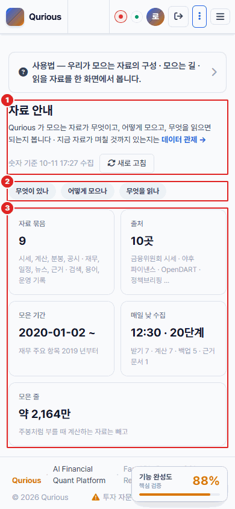

같은 앱 · 390 × 844 · 17:37 · 머리글은 v0.9 의 좁은 화면 머리글(넘침 없음) · 설계 원본: [Figma 390](https://www.figma.com/design/VvA8jPPHsJ8bohge31hQ88?node-id=7-2) · 구현 대조 [`27:2`](https://www.figma.com/design/VvA8jPPHsJ8bohge31hQ88?node-id=27-2)

**<그림 10> 자료 한 장 서랍 — 주식 일봉(관리자)** · 9 사양 칸 넷 · 11 칸 절(펼침) · 10 개발 정보(펼침)

같은 앱 · 1280 폭(서랍 안 스크롤 없이) · 17:37 · 서랍 뒤 화면은 어둡게 덮인다 · 설계 원본: [Figma 03-2 [결정] 안 B 관리자](https://www.figma.com/design/VvA8jPPHsJ8bohge31hQ88?node-id=17-2) · 1단계 [서랍 관리자](https://www.figma.com/design/VvA8jPPHsJ8bohge31hQ88?node-id=6-2) · 구현 대조 [`28:2`](https://www.figma.com/design/VvA8jPPHsJ8bohge31hQ88?node-id=28-2)

**<그림 10-2> 자료 한 장 서랍 — 일반 사용자 · 390 폭** · 9 사양 칸 · 11 칸 절(펼침) — 칸 이름 · 타입 · 열쇠 · 개발 정보가 없다

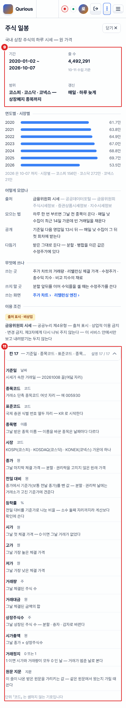

같은 앱 · 390 폭(서랍 안 스크롤 없이) · 17:38 · 서버가 만든 일반 사용자 답(`read(admin=False)`)을 브라우저 요청에 끼워 그렸다(이 PC 에 일반 사용자 계정이 없어서) — 답에 칸 이름 · 타입 · 열쇠가 글자로도 없는 것은 TC-DG-03 이 실제 라우트로 잰다 · 설계 원본: [Figma 03-2 [결정] 일반 사용자 390](https://www.figma.com/design/VvA8jPPHsJ8bohge31hQ88?node-id=20-2) · 1단계 [서랍 일반 사용자](https://www.figma.com/design/VvA8jPPHsJ8bohge31hQ88?node-id=10-2) · 구현 대조 [`29:2`](https://www.figma.com/design/VvA8jPPHsJ8bohge31hQ88?node-id=29-2)

**<표 15-1> 자료 안내 요소**

| 번호 | 요소 | 데이터(API) | 동작 | 빈 데이터 · 오류 |
|:-:|---|---|---|---|
| 1 | 화면 머리 — 제목 · 한 줄 · 숫자 기준 시각 · 새로 고침 · 「데이터 관제 →」 | `API-DATA-11` `stats.measured_at` | 「숫자 기준 MM-DD HH:MM 수집」 = 숫자 파일을 쓴 때 · 새로 고침은 다시 받기 · 자동으로 다시 묻지 않는다(숫자가 파일에서 오므로 기다릴 것이 없다) | 숫자 파일이 없거나 옛 판 · 깨짐이면 「숫자 기준 —」 · 설명 파일이 없으면 「자료 안내를 읽지 못했습니다」(503) |
| 2 | 목차 단추 셋 | — | 무엇이 있나 · 어떻게 모으나 · 무엇을 읽나 절로 내려간다 | — |
| 3 | 숫자 띠 다섯 | `guide.groups` · `sources` · `stats` | 자료 묶음 · 출처 · 모은 기간 · 매일 낮 수집(단계 수 · 묶음별) · 모은 줄(숫자 파일의 줄 수 합 · 주봉처럼 부를 때 계산하는 자료는 빼고) — 칸을 누르면 그 절로 | 숫자가 없으면 「—」 와 까닭(숫자 파일이 없으면 「매일 낮 수집이 끝날 때 셉니다」) · 단계 목록이 없으면 「이 PC 에서는 매일 수집을 돌리지 않습니다」 |
| 4 | 연도별 바둑판 | `stats.items[].years` | 칸을 누르면 그 자료 한 장 · 진하기는 그 자료 안의 비율 | 모은 자료가 없는 PC 는 감추고 한 줄 · 390 은 자료마다 막대 |
| 5 | 자료 목록 · 묶음 칩 | `guide.items` + `stats.items` | 칩으로 거른다 · 줄을 누르면 서랍 · 처음 다섯 줄 + 「모두 보기」(「전체」 일 때만) · 「쓰는 화면」 링크로 간다 | 화면이 없는 자료는 「화면 없음 · 백업 파일」 · 숫자 칸 「—」 와 까닭 |
| 6 | 흐름 한 장 | `stats.runner`(러너 단계 목록 · 마지막 회차) + 대장의 흐름 상자 | 상자를 누르면 그 묶음의 단계 이름이 펼쳐진다 · 확인할 단계가 있는 묶음에 표시 | 회차 기록이 없으면 단계 설명만 |
| 7 | 읽기 길잡이 | `guide.tasks` | 하려는 일 → 읽을 자료 → 어디서(화면 링크) · 관리자에게는 읽는 길(API) · 파일 | 일반 사용자에게는 관리자 화면 링크를 싣지 않는다 |
| 8 | 틀리기 쉬운 것 | `guide.pitfalls` | 펼침 | — |
| 9 | 자료 한 장 서랍 · 사양 칸 넷 | `guide.items[키]` + `stats.items[키]` | 기간 · 줄 수(「MM-DD 수집 기준」 또는 「백업 목록 기준」) · 범위 · 갱신 · 닫기 · Esc · 바깥 누르기 · 다른 화면으로 옮기면 닫힌다 · 닫으면 연 단추로 포커스 · 서랍 안 Tab 돌림 | 숫자 칸 「—」 와 까닭 |
| 10 | 개발 정보(서랍 안 · 관리자) | `guide.items[키].dev`(관리자 응답에만 있다) | 펼침 · 줄마다 복사 | 일반 사용자에게는 요소가 없다 |
| 11 | 칸 절(서랍 안 · 2단계) | `guide.items[키].columns` | 접힌 한 줄 「칸 n — 쉬운 이름 여섯 … · 설명 n / n」(표가 둘 이상이면 「칸 n표 · m」) · 누르면 칸마다 두 줄(쉬운 이름 · 단위 꼬리표 / 뜻) · 표가 둘 이상이면 표마다 작은 머리 · 다른 자료를 열면 다시 접힌다 · 관리자에게는 칸 이름 · 타입 칩 · 「열쇠」 표시 · 표 이름 칩 | 표가 없는 자료(주봉 · 회차 기록)는 절이 없다 · 일반 사용자 답에는 칸 이름 · 타입 · 열쇠가 글자로도 없다 · 쉬운 이름이 빈 칸은 「설명 n / 전체」 의 숫자로만 남는다 |
| 12 | 안내 줄(머리 아래) | `stats.note` · `stats.numbers` | 숫자 파일의 상태에 따라 한 줄 — <표 15-2> | 정상이면 없다 |

**<표 15-2> 자료 안내 경우 표** · 「일반 사용자」 는 서버가 만든 응답을 브라우저 요청에 끼워 넣어 그렸고(이 PC 에 일반 사용자 계정이 없어서), 「숫자 파일 없음」 · 「옛 판」 은 실제 숫자 파일을 잠시 치우거나 판을 바꿔 그린 뒤 되돌렸다(같은 해시) — 서버 쪽 분리 · 안내 줄의 차례는 시험이 실제 라우트로 잰다(TC-DG-03 · 05 · 06)

| 경우 | 무엇을 보이나 |
|---|---|
| 정상 | 숫자 띠 · 바둑판 · 목록 · 흐름 · 길잡이 · 틀리기 쉬운 것 모두 · 머리 「숫자 기준 MM-DD HH:MM 수집」 · 안내 줄 없음 |
| 매일 낮 수집이 도는 중 | 「매일 낮 수집이 도는 중입니다 — 숫자는 지난 수집(MM-DD HH:MM) 기준입니다」 · 숫자는 지난 파일 그대로 |
| 수집 뒤 숫자를 못 씀(파일이 마지막 수집 · 한 단계 다시보다 옛것) | 「숫자는 MM-DD HH:MM 수집 기준입니다 — 마지막 수집 뒤에 숫자를 새로 쓰지 못했습니다」 · 숫자는 그대로 보인다 · 관리자에게는 까닭 한 줄 |
| 숫자 파일 없음(받은 뒤 첫 수집 전) | 「숫자는 매일 낮 수집이 끝날 때 셉니다 — 다음 수집 뒤에 보입니다」 · 머리 「숫자 기준 —」 · 줄 수 칸 「—」(노랑 · 까닭 「줄 수는 매일 낮 수집이 끝날 때 셉니다」) · 처음 · 연도별은 백업 목록으로 그대로 |
| 숫자 파일이 옛 판 | 「숫자 파일이 이 화면보다 옛 판이라 숫자를 비워 둡니다 — 다음 수집 때 새로 씁니다」 · 숫자 칸은 「숫자 파일 없음」 과 같다 |
| 숫자 파일 깨짐 | 「숫자 파일을 읽지 못했습니다 — 숫자 칸은 비워 두고 설명은 그대로 보입니다」 와 오류 줄 · 숫자 칸 「—」(빨강) |
| 옛 러너가 쓴 숫자 파일(관제 밖 자료 여덟 칸이 없음 — 머지 뒤 첫 수집 전 · 2026-10-15) | 여덟 자료만 줄 수 「—」(노랑 · 「줄 수는 매일 낮 수집이 끝날 때 셉니다」) · 나머지 숫자는 그대로 · 관리자에게는 까닭 한 줄 |
| 오늘 낮 수집이 없음(회차 시각 + 1시간이 지나도 오늘 회차 기록이 없음 — 데이터 관제 「오늘 회차 없음」 · 2026-10-15) | 「오늘 낮 수집이 아직 없습니다 — 숫자는 MM-DD HH:MM 수집 기준입니다」 · 숫자는 그대로 |
| 회차 시각 모름(러너 단계 목록이 없거나 시각 칸이 없음 · 2026-10-15) | 흐름 머리 「매일 낮 회차 시각 모름 — 받고 · 계산하고 · 백업합니다」 · 숫자 띠 「매일 낮 수집」 칸도 같은 글 · 「오늘 낮 수집이 아직 없습니다」 를 띄우지 않는다(판정하지 않음) |
| 비어 있음(수집 자료가 없는 PC — 팀원 PC 대부분) | 「이 PC 에는 모은 자료가 없습니다 — 설명 · 흐름 · 길잡이는 그대로 봅니다」 · 바둑판을 감추고 숫자 칸은 「—」(0 을 넣지 않는다) |
| 일부(한 자료만 숫자가 없음) | 그 자료만 「—」 와 까닭(예: 「이 PC 에는 이 자료가 없습니다」) — 2026-10-15 부터 스물아홉 자료 모두 숫자를 잇는다(일정 셋 · 근거 문서 둘 · 검색 색인 · 용어사전 · 회차 기록도 숫자 파일에서 — 「이 화면에서는 세지 않는 자료입니다」 는 나오지 않는다) |
| 오류(설명 파일 없음 · 판 다름) | 「자료 안내를 읽지 못했습니다」 와 다시 시도 |
| 일반 사용자 | 개발 정보 · 뺀 표 · 관리자 화면 링크 · 표 이름 · 칸 이름 · 타입 · 열쇠가 응답에 없다 — 서랍의 개발 정보 요소 · 칸 이름 칩 · 「열쇠」 표시도 없다(<그림 10-2>) |
| 390 폭 | 숫자 띠 두 칸씩 · 바둑판 대신 자료마다 막대 · 서랍은 화면 전체 · 칸 절은 같은 두 줄(넘침 없음) |

차례는 깨짐 > 옛 판 > 자료 없음 > 파일 없음 > 수집 중 > 못 씀 > 오늘 낮 수집 없음(2026-10-15) — 위의 것이 있으면 아래 글은 보이지 않는다.

**3단계(2026-10-15 · 사용자 결정 「추천 표대로」)** — 숫자가 없던 여덟 자료(주총 · 배당 지급 일정 · 공휴일 · 금통위 · FOMC · 법령 · 규정 근거 · 섹터 법령 · 검색 색인 · 용어사전 · 매일 수집 회차 기록)도 러너 숫자 파일(`extras`)에서 줄 수 · 마지막 날 · 처음 날(공휴일 · 회의 · 검색 · 회차 기록만)을 받는다 — 화면 코드는 그대로이고, 개발 앱 실측(10-15 15:37 숫자 파일)은 공휴일 158 · 2020-01-01 ~ 2027-12-27 · 검색 색인 84만 · 용어사전 761 · 회차 기록 37 · 2026-09-28 ~ 10-15 였다. 「모은 줄」 합 · 모은 기간 머리에는 넣지 않는다(근거 조각 · 용어 · 회차 줄은 시세 줄과 뜻이 다르다 · 공휴일 처음 날이 시세 처음 날을 밀어내지 않게). ⚠️ 대장 「숫자주의」 글(줄의 뜻 — 근거 조각 · 조문 · 용어 수)은 서랍의 연도별 막대 아래에만 그려져, 연도 막대가 없는 이 여덟 자료에는 보이지 않는다 — 서랍 꼴을 바꾸는 일은 화면 몫(Figma 뒤 · 정할 것 D108).

**<표 15-3> 2단계에서 정한 것** · 2026-10-11 사용자 결정 · [Figma 03-2 결정 기록](https://www.figma.com/design/VvA8jPPHsJ8bohge31hQ88?node-id=23-22) · [논의 결정 대장](../계획서/논의결정대장.md) 부록 C

| 정할 것 | 정한 것 | 까닭 |
|---|---|---|
| ① 칸 정의를 어디까지 | 35표 · 376칸 모두(쉬운 이름 · 단위 · 뜻) | 「전부」 를 줄이지 않는다(추천은 사용자 자료 18표 먼저였다) — 칸 대장 한 장을 스캐너가 코드 칸과 하나씩 맞춘다 |
| ② 숫자 파일에 무엇을 | 데이터 관제 표 열쇠 15줄 — 표마다 줄 수 · 마지막 날 | 관제와 같은 표 정의 · 셈법을 그대로 부른다 — 따로 세면 두 화면 숫자가 갈린다 · 자료 28줄로 묶는 일은 앱이 |
| ③ 언제 쓰나 | 회차 끝 · 한 단계 다시 · 빠진 날 채우기 · `steps --write` 의 곁 파일(회차 시작에는 쓰지 않는다 · 단계 수 20 그대로) | 수집이 자료를 바꾼 뒤에 센다 · 읽기 전용 연결로 한 번에 1.4초 · 못 세면 🟡 한 줄을 남기고 옛 파일을 둔다 |
| ④ 칸 절 모양 | 안 B — 접힌 한 줄 + 칸마다 두 줄 · 관리자에게 칸 이름 · 타입 칩 | 390 에서도 넘치지 않는다(표 꼴 안 A 는 단위 「0 또는 1」 이 뜻 칸을 밀었다) |
| ⑤ 「열쇠」 와 안내 글 | 열쇠(한 줄을 가르는 칸)는 관리자에게만 · 안내 줄 글 여섯은 카드에 적은 그대로 | 추천은 「모두에게」 였다 — 서버가 관리자 답에만 싣는다 |

구현 때 정한 것 — ① ID 칸의 쉬운 이름에서 「열쇠」 말을 뺐다(일정 ID · 기사 ID · 문서 ID · 조각 ID · 정렬 값 · 용어 ID) — 일반 사용자 답에 「열쇠」 가 글자로도 남지 않게(⑤ · TC-DG-03). ② `measured_at` 은 숫자 파일이 정상 · 낡음일 때만 싣고 그 밖은 비운다 — 요청 시각으로 메우면 숫자가 언제 것인지 거짓이 된다. ③ 서랍의 칸 절은 다른 자료를 열면 접힌다(긴 절이 다음 자료에서 펼친 채 남지 않게).

- **화면 글** — 본문은 쉬운 이름만 쓴다(표 이름 · DB 이름 · 작업 말 금지). 스캐너가 대장의 쉬운 칸에 개발 말이 섞이면 막고(TC-DG-09 — 칸 대장은 그 표의 칸 이름을 쉬운 칸에 쓰면 · 정한 단위 스물넷 밖이면 · 코드에 없는 칸이면 막는다), 시험이 일반 사용자 응답의 글자를 본다(TC-DG-03 — 칸 이름 · 「열쇠」).
- **접근성** — 서랍은 `role=dialog` · `aria-modal` · 연 단추 `aria-expanded` · 열면 「닫기」 에 포커스 · 닫으면 연 단추로 · 흐름 상자 · 틀리기 쉬운 것 · 목록 접기 단추 · 칸 절 단추 `aria-expanded` · `aria-controls` · 바둑판 칸 `aria-label`(자료 · 해 · 줄 수).
- **2단계에서 한 것**(v0.10) — 칸 정의(서랍 안 펼침 · 요소 11) · 설명 채움 비율(「설명 n / n」) · 러너가 회차마다 쓰는 숫자 파일(요소 1 · 3 · 9 · 12) — 1단계 「미룬 것」 다섯 가운데 셋.
- **3단계로 미룬 것** — 근거 문서 · 용어 · 일정 · 회차 기록의 숫자(여덟 자료 — 앱 DB · 근거 문서 DB 에 있어 관제 표 열쇠 밖) · 주소로 서랍 열기(`#data-guide/<키>`) · 데이터 관제도 숫자 파일을 읽기(지금 관제는 요청 때 센다 — 8.6초 · 관제 기준 세션).

## 6. 화면 70개 목록

화면마다 부르는 API · 관련 요구 · 주담당은 <표 16> 과 같다. 「명세」 칸은 이 문서에서 상세를 누가 채우는지다.

**<표 16> 화면 목록** · 부르는 API = API 명세서 v0.3 「부르는 화면」 칸 · 관련 요구 = IA v1.0 전수표 · 주담당(추정) = 관련 요구의 첫 요구 ID 로 요구 대장에서 찾은 값(요구가 없으면 「—」)

| # | 화면 ID | 화면명 | 메뉴 묶음 | 부르는 API (`API-` 생략) | 관련 요구 | 주담당(추정) | 명세 |
|--:|---|---|---|---|---|---|---|
| 1 | `agent-chat` | AI 투자 상담 | 로보 어드바이저 | CHAT-01 · KB-03 · CONV-01 · HUB-01 · HUB-02 · GLOS-06 | `P01-①-3` | 이동원 | 상세(4절 · 4.1절) |
| 2 | `robo-portfolio` | 자산배분·최적화 | 로보 어드바이저 | ML-04 · ML-07 · ML-08 · ML-09 | `U1` · `U3` · `U4` · `RFP2-3.1.3-①` | 오준영 | 주담당이 채움 |
| 3 | `robo-rebalance` | 리밸런싱 엔진 | 로보 어드바이저 | RBAL-03 · RBAL-08 · RBAL-09 | `P01-③-1` ~ `③-3` · `U2` · `U5` | 오준영 | 주담당이 채움 |
| 4 | `robo-screening` | 패턴 인식·종목 스크리닝 | 로보 어드바이저 | STK-08 · ML-10 | `P01-②-1` · `RFP2-3.1.4-③` · `P01-①-5` | 신장환 | 주담당이 채움 |
| 5 | `robo-patterns` | 차트 패턴·지지/저항·멀티타임프레임 | 로보 어드바이저 | ING-12 · STK-02 · STK-03 · STK-08 · STK-09 · STK-10 외 22 | `P01-②-2` · `P01-②-3` | 신장환 | 주담당이 채움 |
| 6 | `robo-decision` | 모의 투자 의사결정 | 로보 어드바이저 | STK-27 · STK-28 · STK-29 · PAPR-33 · PAPR-35 | `P01-④-2` · `P01-④-3` · `U10` | 강민석 | 주담당이 채움 |
| 7 | `agent-cb` | 재무 · 신용 위험 | 로보 어드바이저 | RISK-01 · RISK-02 · STK-06(회사 찾기) | — | 이동원(2026-10-07 결정) | **8절**(2026-10-13) |
| 8 | `agent-products` | 투자 성향별 상품 안내 | 로보 어드바이저 | PROD-01 · PROD-02 · PROD-03 · PROD-04(상품 상세 창) · ML-12 · ML-11(비중 — 들어올 때 저절로 · #179) | — | 이동원(2026-10-07 결정) | **7절 · 7.1**(2026-10-12) |
| 9 | `agent-news` | 투자 정보 리서치 | 로보 어드바이저 | DATA-03 · STK-06 · CAL-02 | `P01-①-2` · `P01-①-3` | 이동원 | 상세(12절) |
| 10 | `crawl-auto` | 수집 일정 · 단계(옛 자동 크롤링) | 데이터 | DATA-05 · 12 · 13 · 14 | `P01-①-4` (가까움) | 이동원 | 상세(5.2) |
| 11 | `crawl-manual` | 자료 직접 받기(옛 수동 크롤링) | 데이터 | DATA-06 · DATA-07 · DATA-08 · DATA-09 · ING-03 · ING-12 | `P01-①-2` | 이동원 | 상세(5.3) |
| 12 | `crawl-ingest` | 적재 · 백업(옛 데이터 인제스트) | 데이터 | DATA-10 | `P01-①-2` | 이동원 | 상세(5.4) |
| 13 | `trading-chart` | 주가 차트 | 직접매매 | STK-02 · STK-03 · STK-06 | `U7` (가까움) | 신장환 | 주담당이 채움 |
| 14 | `trading-portfolio` | 포트폴리오 | 직접매매 | STK-09 · STK-10 · STK-11 | — | — | 주담당이 채움 |
| 15 | `trading-order` | 주문/매매 | 직접매매 | STK-12 · STK-13 · STK-15 · STK-16 | — | — | 주담당이 채움 |
| 16 | `paper-dashboard` | 모의계좌 현황 | 모의투자 | PAPR-01 · PAPR-33 | `P01-④-3` · `U2` | 강민석 | 주담당이 채움 |
| 17 | `paper-stock` | 국내주식 모의주문 | 모의투자 | PAPR-01 · PAPR-04 · PAPR-10 | `P01-④-3` | 강민석 | 주담당이 채움 |
| 18 | `paper-crypto` | 코인 모의매매 | 모의투자 | PAPR-11 · PAPR-12 · PAPR-13 · PAPR-14 · PAPR-15 · PAPR-16 외 2 | — | — | 주담당이 채움 |
| 19 | `paper-alternative` | 대체자산 | 모의투자 | PAPR-22 · PAPR-23 · PAPR-24 · PAPR-25 | — | — | 주담당이 채움 |
| 20 | `paper-openapi` | Open API · 외부 연동 | 모의투자 | PAPR-28 · PAPR-29 · PAPR-30 · O09 | `P02-③-3` | 이동원 | 주담당이 채움 |
| 21 | `quant-dashboard` | 퀀트 대시보드 | 퀀트자동매매 | STK-01 · STK-04 · STK-05 · STK-06 | `SCH-RT` (가까움) | 신장환 | 주담당이 채움 |
| 22 | `quant-auto` | 자동매매 현황 | 퀀트자동매매 | STK-24 · STK-25 · STK-26 · STK-36 · STK-37 | `P02-⑤-2` · `U10` | 오준영 | 주담당이 채움 |
| 23 | `quant-backtest` | 전략 분석 | 퀀트자동매매 | STK-04 · STK-30(#224 체결 시점 백테스트) · STK-06(종목 찾기) | — | 이동원(10-07 결정) | 종목 칸은 찾기 칸 하나(`js/stockpick.js` — 비었을 때 펼치면 「최근 본 종목」(이 브라우저) + 「대표 종목」 다섯 · 치면 국내 상장 종목 · 화살표 · Enter · Esc · 국내 기호 `000000.KS · .KQ` 만) · 제목 「퀀트 전략 분석」(「10년 · Mockup」 뺌 — 기간은 「자료」 줄) · 결과 제목 「이름(코드) 퀀트 분석」 · 「규칙 신호(RSI · 이동평균 · 볼린저 합산)」(「AI 시그널」 아님) · 카드 색은 화면 색 변수 · 지표 칸은 「마지막 종가」 · 「마지막 봉 RSI」 + 「자료: …」 한 줄(서버 `data_note` 그대로) · 체결 시점 백테스트 칸에도 같은 줄 · 전략 고르기는 3차(Figma 03-6 결정 · 2026-10-16) |
| 24 | `quant-lean` | LEAN 백테스트 | 퀀트자동매매 | LEAN-01 · LEAN-03 | `P02-④-1` · `P02-③-2` | 강민석 | 주담당이 채움 |
| 25 | `settings` | 증권사 API 설정 | 퀀트자동매매 | STK-38 · STK-39 · STK-17 · STK-18 · STK-19 · STK-26 | `P02-⑤-1` · `RFP2-4.2-①` | 오준영 | 주담당이 채움 |
| 26 | `notification-settings` | 알림 설정 | 퀀트자동매매 | NOTI-01 · NOTI-02 · NOTI-03 · NOTI-04 | `P02-③-3` · `P02-⑤-3` | 이동원 | 주담당이 채움 |
| 27 | `us-dashboard` | 대시보드 | 미국주식 | STK-02 · MACR-03 | — | 이동원(10-07 결정) | 머리 「지연 시세」 칩(「● LIVE」 아님) · 부제 「야후 파이낸스 지연 시세 · 주문 · 보유는 원화 모의 계좌」 · 칸 제목 「전일 대비 등락 · 미국 대형주 (응답 줄 수)」 + 규칙 줄(문턱은 `js/quoteview.js` `MOVE_LIMIT` 한 곳) · 카드는 평소 등락률만 · ±1.5% 를 넘은 종목에만 「▲ 크게 오름 · ▼ 크게 내림」(BUY · SELL 낱말 없음) · 카드 아래 서버 머리 글(`note` — 지연 시세 · 장이 닫힌 뒤 받은 값 · 마지막 체결 · 받은 시각 · 저장본 나이) · 지수 카드 등락률은 서버 값 · 모르면 「—」 · 시세를 못 받으면 「시세를 받지 못했습니다」(예시 가격 없음)(Figma 03-5 결정 · 2026-10-16) |
| 28 | `us-chart` | 주가 차트 | 미국주식 | STK-02 · STK-03 | — | 이동원(10-07 결정) | 머리 줄 「기호 · $가격 · 등락률(서버 값 · 모르면 「—」) · 지연 시세 · 마지막 체결 MM-DD HH:MM(KST)」(응답 `as_of` — 꼴이 다르면 시각을 붙이지 않음) · 분봉은 실시간 시세 조사서 결정 뒤(2026-10-16) |
| 29 | `us-order` | 주문/매매 | 미국주식 | PAPR-06 · PAPR-10 | — | 이동원(10-07 결정) | 원화 모의 장부 — 시장가 매수만(서버가 시세 · 환율을 정함 · 가격을 보내지 않음) · 지정가 · 해외 매도는 까닭 글(해외 비용 계산 전) · 체결 알림은 원화 환산 체결가 · 내역은 원화(옛 주문은 달러 + 「옛 주문」 표시) · 주문 칸 안내 글 · 지정가 칸 글도 그 길대로(「원화 모의 계좌 … 시장가 매수만」 · TC-USO-25)(2026-10-16) |
| 30 | `us-portfolio` | 포트폴리오 | 미국주식 | PAPR-04 · PAPR-03 | — | 이동원(10-07 결정) | 보유 · 평균단가 · 평가 · 손익은 장부 원화 · 현재가 아래 작은 글이 달러 시세 · 표 아래 환율 글(서버 `fx_note`) · 옛 달러 단가 보유가 있으면 바로잡는 법(모의계좌 초기화) 한 줄(2026-10-16) |
| 31 | `indicator-strategy` | 기본 인디케이터 전략 | 투자 인디케이터 | STK-04 | `P02-①-1` · `P02-①-2` · `U6` | 신장환 | 주담당이 채움 |
| 32 | `indicator-custom` | 커스텀 인디케이터 개발 | 투자 인디케이터 | STK-30 · STK-31 · STK-32 · STK-33 | `P02-②-1` · `P02-③-1` · `U6` | 신장환 | 주담당이 채움 |
| 33 | `indicator-formula` | 자유 산식 지표 | 투자 인디케이터 | FRML-01 · FRML-06 · FRML-07 · FRML-08 | `P02-②-1` · `P02-②-2` · `P02-②-3` · `P02-③-1` | 신장환 | 주담당이 채움 |
| 34 | `indicator-backtest` | 성과 검증 | 투자 인디케이터 | STK-30 | `P02-①-3` · `P02-④-2` · `P01-④-1` · `U8` | 신장환 | 주담당이 채움 |
| 35 | `indicator-api` | 증권사 API 자동화 | 투자 인디케이터 | STK-15 · STK-16 · STK-23 | `P02-⑤-1` | 오준영 | 주담당이 채움 |
| 36 | `indicator-tradingview` | TradingView 연동 | 투자 인디케이터 | TV-02 · TV-03 · TV-05 | `P02-③-2` · `P02-③-3` · `P02-④-3` | 이동원 | 주담당이 채움 |
| 37 | `company-dashboard` | 지표 대시보드 | 투자 인디케이터 | STK-06 · STK-07 | — | — | 주담당이 채움 |
| 38 | `company-compare` | 지표 비교 분석 | 투자 인디케이터 | — | — | — | 주담당이 채움 |
| 39 | `company-sector` | 섹터 인디케이터 | 투자 인디케이터 | — | — | — | 주담당이 채움 |
| 40 | `ml-compare` | 모델 비교 | ML·딥러닝 | MCMP-01 ~ 04(옛 ML-01 은 남김 · 부르는 메뉴 화면 없음) | — | 이동원(주인 없던 화면 · 10-07 결정) | 상세(11절) |
| 41 | `ml-regression` | 회귀 분석 | ML·딥러닝 | ML-06 | — | — | 주담당이 채움 |
| 42 | `ml-cluster` | 종목 군집화 | ML·딥러닝 | CLUS-01 | — | 이동원(주인 없던 화면 · 10-07 결정) | 상세(10절) |
| 43 | `ml-tune` | 하이퍼파라미터 튜닝 | ML·딥러닝 | ML-02 | — | — | 주담당이 채움 |
| 44 | `ml-deeplearning` | 딥러닝 (LSTM·Transformer) | ML·딥러닝 | — | — | — | 주담당이 채움 |
| 45 | `macro-dashboard` | 거시경제 지표 | 투자분석 기초 | MACR-01 | — | — | 주담당이 채움 |
| 46 | `macro-industry` | 산업 분석 | 투자분석 기초 | MACR-02 | — | — | 주담당이 채움 |
| 47 | `invest-fundamental` | 재무제표 분석 | 투자분석 기초 | MACR-04 | — | — | 주담당이 채움 |
| 48 | `invest-technical` | 기술적 분석 | 투자분석 기초 | — | — | — | 주담당이 채움 |
| 49 | `fin-lectures` | 강의실 (전체 과정) | 금융 필수 지식 › 강의 | — | `P01-①-1` | 이동원 | 상세 예정(v0.2) |
| 50 | `fin-topic-futures` | 선물과 옵션 · W19 틀 | 〃 (들여쓴 주제) | — | `P01-①-1` | 이동원 | 주담당이 채움 |
| 51 | `fin-topic-funds` | 펀드와 ETF · W19 틀 | 〃 | — | `P01-①-1` · `P01-①-2` | 이동원 | 주담당이 채움 |
| 52 | `fin-topic-bonds` | 채권 · 금리 · 코인 · W19 틀 | 〃 | — | `P01-①-1` · `P01-①-2` | 이동원 | 주담당이 채움 |
| 53 | `fin-topic-allocation` | 자산배분과 퀀트 · W19 틀 | 〃 | — | `P01-①-1` | 이동원 | 주담당이 채움 |
| 54 | `fin-topic-company` | 회사 구조 · 세무회계 · W19 틀 | 〃 | — | `P01-①-1` | 이동원 | 주담당이 채움 |
| 55 | `fin-topic-stocks` | 산업 분석과 공시 · W19 틀 | 〃 | — | `P01-①-1` | 이동원 | 주담당이 채움 |
| 56 | `fin-topic-technical` | 기술적 분석 · 재무제표 · W19 틀 | 〃 | — | `P01-①-1` | 이동원 | 주담당이 채움 |
| 57 | `fin-topic-industry` | 퀀트 사례 · 배당 · ETF · W19 틀 | 〃 | — | `P01-①-1` | 이동원 | 주담당이 채움 |
| 58 | `fin-topic-macro` | 거시경제와 시장 · W19 틀 | 〃 | — | `P01-①-1` | 이동원 | 주담당이 채움 |
| 59 | `fin-products` | 금융상품 이해 | 금융 필수 지식 › 요약 | — | — | — | 주담당이 채움 |
| 60 | `fin-allocation` | 자산배분 모델 | 금융 필수 지식 › 요약 | — | — | — | 주담당이 채움 |
| 61 | `quant-seasonal` | 계절성 분석 | 금융 필수 지식 › 요약 | SEAS-01 · STK-06 | — | 이동원(주인 없던 화면 · 10-07 결정) | 상세(9절) |
| 62 | `fin-glossary` | 용어사전 | 금융 필수 지식 › 연습 | — | `P01-①-1` | 이동원 | 상세 예정(v0.2) |
| 63 | `sysadmin-dashboard` | 서버 대시보드 | 시스템관리 | SYS-01 | — | — | 주담당이 채움 |
| 64 | `sysadmin-logs` | 감사 로그 | 시스템관리 | ADM-03 | — | — | 주담당이 채움 |
| 65 | `mypage` | 내 정보 (마이페이지) | 내 계정 | — | — (요구 밖 · TC-AC) | — | 주담당이 채움 |
| 66 | `data-status` | 데이터 관제 | 데이터 | DATA-01 · 13(관리자) | `P01-①-2` · `P01-①-4` | 이동원 | 상세(3절) |
| 67 | `market-calendar` | 일정 | 투자분석 기초 | CAL-01 · CAL-02 | `P01-①-4` | 이동원 | 상세 예정(v0.2) |
| 68 | `robo-testbed` | 코스콤 테스트베드 기준 | 로보 어드바이저 | PAPR-33 · PAPR-36 · PAPR-37 · PAPR-38 · PAPR-39 · PAPR-40 | `U9` (가까움) | 강민석 | 주담당이 채움 |
| 69 | `dashboard` | 투자 대시보드 | 로보 어드바이저 (첫 항목) | STK-40 · STK-41 · STK-29 · STK-30 · STK-31 · STK-32 외 2 | `U9` · `P02-⑤-1` (가까움) | 강민석 | 주담당이 채움 |
| 70 | `data-guide` | 자료 안내 | 데이터 | DATA-11 | `P01-①-2` · `P01-①-4` | 이동원 | 상세(5.7) |

---

## 7. 화면 상세 — 투자 성향별 상품 안내 (`agent-products`)

옛 「맞춤 상품 추천」 자리다(화면 키 그대로 · 메뉴 「로보 어드바이저」). 옛 화면은 상품 자료 없이 범용 대화 API 에 글로 묻는 검색이었다. 새 화면은 자산 배분과 같은 자산군 키로 **공시된 상품 정보를 정해진 기준으로** 늘어놓는다 — 「추천」 이 아니다. 주담당 이동원(주인 없던 화면 · 2026-10-07 결정) · 설계 Figma 「Qurious · 투자 성향별 상품 안내」 05 [결정] 안 A · 서버 `API-PROD-01 ~ 03` · 구현 `public/js/products.js` · `public/css/products.css`.

**<표 17> 화면 요소** — 번호는 위에서 아래 차례.

| 번호 | 요소 | 무엇을 보이나 | 자료 · API |
|---|---|---|---|
| 1 | 머리 | 제목 · 한 줄 설명 · 「처음이라면 — 개념 학습 「펀드와 ETF」 · 「투자 성향과 적합성」」(새 탭) · 투자 성향 칩 · 비중 줄 — 들어올 때 저절로: 저장한 배분(자산군 비중 · 저장 시각 KST · 투자 기간 · 「자산 배분 보기 →」) / 저장본이 없으면 진단 성향의 기본 비중(「자산 배분 계산하기 →」) / 둘 다 없으면 「투자 성향 진단하기 →」 / 못 읽으면 까닭 · 「다시 불러오기」 · 탭은 기본 차례 / 진단 성향과 저장본 성향이 다르면 다시 계산 안내 한 줄 | 비중 판단은 `js/productweights.js` 한 곳(#179 계약 — `API-ML-12` 저장본 먼저 · 404 일 때만 `API-ML-11` 기본 비중(진단 성향 · 3년) · 그 밖 오류는 메우지 않고 까닭) · 성향은 「자산배분·최적화」 화면이 이 브라우저에 남긴 진단 결과(읽기만) · 성향 이름표는 그 화면의 고르기 글 · 받은 비중은 브라우저에 남기지 않음 |
| 2 | 안내 상자 | 「공시된 상품 정보를 같은 기준으로 나열 · 추천이나 투자 권유가 아님 · 순서는 좋고 나쁨이 아님」 · 기준일 · 출처 링크 | `API-PROD-01` 의 기준일 · 출처 |
| 3 | 찾기 | 이름 · 기초지수 · 종목코드(40자) · 찾은 수 · 정렬 기준 · 지우기 | `API-PROD-02` `q` |
| 4 | 탭 | 자산군 여섯(비중을 불러오면 비중 큰 순 · 아니면 기본 차례) + 맨 끝 「레버리지 · 인버스」(노란 테두리) · 탭마다 상품 수 · 「모든 탭을 더하면 그날 상장 ETF 전부」 | `API-PROD-01` 의 자산군 칸 · 파생형 칸 |
| 5 | 파생형 안내 줄 | 그 자산군을 기초로 한 레버리지 · 인버스가 몇 개 빠져 끝 탭에 있는지 + 「그 탭 보기 →」 | 자산군 칸의 `derivatives_count` |
| 6 | 묶음 | 거래소 유형 순서(시장 대표 → 업종 · 테마 → 전략 · 스타일 …) · 묶음마다 순자산 큰 순 다섯 줄 · 「n개 모두 보기 →」 를 누르면 정렬(순자산 · 20일 거래대금 · 1년 수익률 · 1년 변동성 낮은 순 · 이름) · 더 보기(50줄씩) · 접기 | `API-PROD-01` · `API-PROD-02`(`asset_class` · `group` · `sort` · `order` · `offset`) |
| 7 | ETF 표 | 이름 · 종목코드 · 기초지수 · 배지(배수 · 단일종목 · 선물 · 합성 · 환헤지 · 액티브 · 옵션 전략 · 거래 정지 · 상장일) · 순자산 · 20일 거래대금 · 괴리율 · 1년 수익률* · 1년 변동성* · 1년 최대 낙폭* — 수익률에 오름 · 내림 색을 칠하지 않는다 | 줄마다의 지표 칸 · 배지 글은 서버의 이름표 · 설명 |
| 8 | 주의 상자 | 레버리지 · 인버스 탭 머리 · 닫을 수 없음 · 「하루 수익률을 배수로 따르는 단기 매매용 · 자산 배분 비중을 채우는 상품이 아님」 · 위험 구조 한 줄 · 요건 기준일 · 아래 한 줄 「오래 들고 있으면 왜 기초지수 수익률의 배수와 달라지나 — 개념 학습 「펀드와 ETF」」(새 탭) | 파생형 칸의 `notes`(요건 상수표에서 만든 문장) · 학습 장 `funds-etf` |
| 9 | 「실제로 사려면」 카드 셋 | 레버리지 · 인버스 2배 · 단일종목 · 인버스(−1배) — 사전교육 · 기본예탁금 · 시행일 · 그 밖 · 예정(시행 여부 미확인) · 출처 · 확실도(접힘) | 응답의 `requirements`(요건 상수표 한 곳) |
| 10 | 예금 · 적금 · 연금저축 | 현금성 탭 아래 · 종류 · 업권 · 기간 알약 · 표(예금 · 적금: 기본 금리 · 최고 우대 · 이자 방식 · 우대 조건 / 연금저축: 공시 이율 · 최저 보증 · 평균 수익률 · 지난 세 해) · 금융감독원 출처 문구 그대로 · 적금을 부를 때 기다림 안내 | `API-PROD-03`(부를 때마다 · 저장 안 함) |
| 11 | 각주 | 「우리가 모은 자료로 잰 숫자 · 과거 수익률은 미래 수익을 보장하지 않음」 · 재는 법과 한계(공식 투자위험등급 아님 · 총보수 · 추적오차는 이 자료에 없음) | 응답의 `notes` |

**<표 18> 경우** — 같은 자리에서 무엇이 보이나.

| 경우 | 보이는 것 |
|---|---|
| 모은 ETF 시세가 없음 · 읽기 실패 | 머리와 까닭 한 줄(「매일 낮 자료 갱신 뒤에 다시 열어 주세요」 · 「잠시 뒤 다시」) — 빈 표를 그리지 않는다 |
| 비중 줄 — 불러오는 중 · 저장본 · 저장본 없음(진단 뒤) · 둘 다 없음 · 못 읽음 · 성향 다름 | 「자산 배분 비중을 불러오는 중…」 / 비중 줄 + 「저장한 배분 · 10월 15일 14:32 · 투자 기간 3년」 + 탭 차례가 비중 큰 순(고른 탭이 없을 때만 첫 탭을 비중 큰 탭으로) / 「저장한 배분이 없어 진단 성향의 기본 비중 · 투자 기간 3년」 / 「투자 성향을 진단하면 …」 + 진단 링크 / 「자산 배분 비중을 읽지 못했습니다 — (까닭) · 탭은 기본 차례입니다」 + 「다시 불러오기」(기본 비중으로 메우지 않음) / 비중 줄 아래 「저장한 배분은 「(그 성향)」 성향으로 계산했고, 지금 진단한 성향은 「(진단 결과)」 입니다 — …」 + 「다시 계산하러 가기 →」 |
| 1년이 안 된 상품 · 「전일 대비」 가 빈 옛 자료 | 1년 칸은 빈칸(—) · 상장일 배지 / 수익률 · 낙폭 빈칸(가격으로 메우지 않음) · 빈칸은 정렬 방향과 상관없이 늘 뒤 |
| 금융감독원 키 없음 · 키 거절 · 하루 한도 · IP 막힘 · 연결 실패 | 일반 사용자 글 한 줄 · 관리자에게만 고칠 곳 한 줄 |
| 그 업권에 상품 없음 | 「이 업권에 공시된 … 상품이 없습니다 — 다른 업권을 골라 보세요」(연금저축으로 바꾸면 업권을 보험으로 맞춤) |
| 적금 | 금융감독원이 목록을 만드는 데 오래 걸린다(실측 은행 약 17초 · 저축은행 약 50초) — 기다림 안내 · 조건을 연달아 바꾸면 옛 응답은 버림 |
| 폭 390 | 탭은 줄을 바꿔 모두 보임(끝 탭이 화면 밖에 숨지 않음) · 표는 가로로 밀림 · 요건 카드는 한 줄에 하나 · 문서 가로 넘침 없음 |

**지키는 것** — ① 숨기지 않는다(탭 숫자 합 = 그날 전체 · 거래 정지 · 분류 못 함 · 파생형도 목록에) ② 순서 기준을 글로 보인다 · 「추천 · 최적 · 유망」 을 우리 글에 쓰지 않는다 ③ 위험은 숫자만 + 「공식 투자위험등급이 아님」 ④ 요건 숫자는 상수표 한 곳 — 화면에 따로 적지 않는다 ⑤ 비중표를 복제하지 않는다 ⑥ 금융감독원 응답을 저장하지 않는다 ⑦ 비중은 #179 계약 그대로 — 판단은 `js/productweights.js` 한 곳 · 404 일 때만 기본 비중 · 그 밖 오류는 메우지 않고 까닭 · 받은 비중은 브라우저에 남기지 않는다(같은 탭 다른 사용자). 시험 TC-EC(분류) · TC-PG(목록) · TC-FL(금융감독원) · TC-PD(화면 — 화면이 읽는 칸 = 서버 칸 · 요건 숫자 없음 · 연결 · 비중 읽기만 · 계약 그대로(서버가 낸 응답을 node 로) · 머리 상태 다섯 · 고른 탭 · 개념 학습 길 두 방향).

**실제 확인**(2026-10-12 로컬 개발 앱 · 점검 계정 · 헤드리스 1280 · 390) — 그날 1,172개 = 자산군 1,069 + 레버리지 · 인버스 103 · 탭 일곱 · 「모두 보기」 50 → 더 보기 69 · 정렬 · 찾기 「반도체」 63 · 비중 불러오기 17.5초 뒤 탭 재정렬 · 예금 은행 39(0.7초) · 적금 은행 59(16.5초) · 저축은행 276(48.5초) · 연금저축 보험 46 · 금융투자 297 · 폭 390 가로 넘침 없음 · 콘솔 오류 0. **2026-10-16**(로컬 개발 앱 · 점검 계정 · 1280 · 390 — 저장본 · 성향 다름 · 못 읽음 · 불러오는 중은 응답을 끼워, 기본 비중 · 다시 불러오기는 실제 서버의 404 길) — 상태 다섯 · 탭 차례(보수 저장본 → 국내채권 50% 먼저 · 공격 기본 비중 → 국내주식 45% 먼저) · 「다시 불러오기」 → 기본 비중 · 개념 학습 링크 둘(새 탭) · 레버리지 · 인버스 주의 상자의 링크 · 장에서 앱으로 돌아오는 링크 · 콘솔은 저장본이 없을 때(404)를 브라우저가 찍는 한 줄만(계약상 정상) · 설계 원본: [Figma 03-4 머리 비중 줄 자동 [결정]](https://www.figma.com/design/gJ4z5uAVXEgH9qCDwS2AlW?node-id=46-2)(사용자 결정 2026-10-16). 이 판의 그림은 7.1 상품 상세 창이다 — 목록 화면의 구현 캡처 · 번호 상자는 다음 판에 넣는다.

### 7.1 상품 상세 창 (가운데 모달 · `API-PROD-04`)

목록에서 ETF 이름을 누르면 화면 가운데에 크게 열리는 창이다. 한 종목의 기간 그림과 「이 숫자가 왜 이렇게 나왔나」 를 쉬운 말로 보인다 — 목록 숫자(1년 수익률 · 변동성 · 최대 낙폭)와 같은 값에서 시작한다. 설계 Figma 「투자 성향별 상품 안내」 03-2(내용 — 안 B 질문 칩 + 그림 한 칸) · 03-3(창 꼴 — 설계 F) · 05 결정 · 서버 `API-PROD-04`(`app/services/product_chart.py`) · 화면 `public/js/productchart.js` · `public/css/products.css` · 차트 TradingView Lightweight Charts 5.2.1(저장소 벤더 파일 · 창을 처음 열 때만 불러옴).

**<그림 11> 상품 상세 창 — KODEX 레버리지 · 왜 2배가 아닌가 · 1280** · 11 재는 법 · 12 표로 보기 펼침

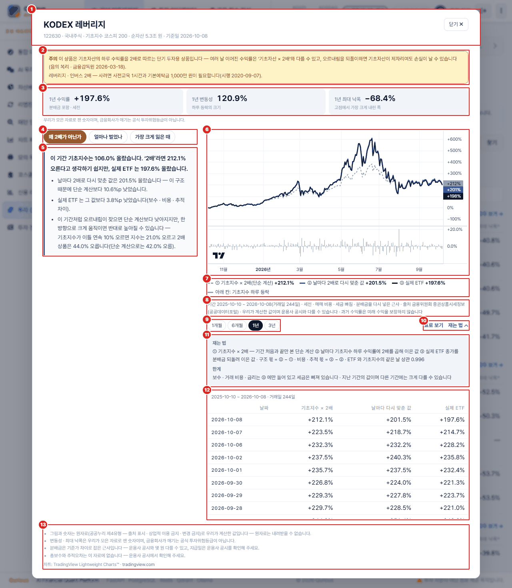

로컬 개발 앱 · 점검 계정 · 1280 폭 · 2026-10-12 · 기준 `d4a9d66` + 이 판의 구현 · 그림 전용으로 창 높이 제한을 풀어 안쪽 스크롤 없이 찍었다(실제 창은 높이 고정 — 화면 높이 − 48, 최대 880 · 넘치면 창 안에서 굴림) · 설계 원본: [Figma 03-3 설계 F · 1280 · 레버리지](https://www.figma.com/design/gJ4z5uAVXEgH9qCDwS2AlW?node-id=37-2) · [1배 상품](https://www.figma.com/design/gJ4z5uAVXEgH9qCDwS2AlW?node-id=37-5) · [1024](https://www.figma.com/design/gJ4z5uAVXEgH9qCDwS2AlW?node-id=37-8) · [390](https://www.figma.com/design/gJ4z5uAVXEgH9qCDwS2AlW?node-id=37-11) · [05 결정](https://www.figma.com/design/gJ4z5uAVXEgH9qCDwS2AlW?node-id=44-2)

**<표 19> 화면 요소** — 번호는 <그림 11>.

| 번호 | 요소 | 무엇을 보이나 | 자료 · API |
|---|---|---|---|
| 1 | 머리 | 상품 이름 · 종목코드 · 자산군 · 기초지수 · 순자산 · 기준일 · 닫기 | 응답 `item` · `as_of` |
| 2 | 주의 띠 | 레버리지 · 인버스만 · 닫을 수 없음 · 이 상품의 배수로 쓴 위험 구조 한 문장 + 사려면 필요한 것(사전교육 · 기본예탁금 · 시행일) | 응답 `band` · `requirement_note`(요건 상수표 한 곳) |
| 3 | 숫자 셋 | 1년 수익률(분배금 포함 · 세전) · 1년 변동성 · 1년 최대 낙폭 — 목록 줄과 같은 값 · 아래 한 줄 「공식 투자위험등급이 아님」 | 응답 `item`(목록 계산 결과의 그 줄) |
| 4 | 질문 칩 | 만든 것만 — 얼마나 벌었나 · 가장 크게 잃은 때 · (레버리지 · 인버스면) 왜 n배가 아닌가 · 레버리지 · 인버스는 「왜 n배가 아닌가」 가 기본 | 응답 `explain[].chip · title` · `default_chip` |
| 5 | 쉬운 말 | 굵은 한 줄 요약 + 근거 줄(왜 그런가 · 반대 예) — 화면이 문장을 다시 짓지 않는다 | 응답 `explain[].sentence · points` |
| 6 | 그림 | 얼마나 벌었나: 분배금을 다시 넣은 값 · 가격만 본 값(100만 원 시작) + 분배락 표시 / 가장 크게 잃은 때: 분배금 포함 값 · 그날까지의 최고점 + 아래 칸 물속 그림 · 고점 · 바닥 · 되찾음 표시 / 왜 n배가 아닌가: ① 기초지수 × n ② 날마다 n배로 다시 맞춘 값 ③ 실제 ETF + 아래 칸 기초지수 하루 등락 | 응답 `series`(칸마다 배열) · `events` · `stats` |
| 7 | 범례 | 선마다 이름과 마지막 값 | `stats` |
| 8 | 캡션 | 기간 · 거래일 · 세전 · 비용 · 분배금 근사 · 출처 · 과거 수익률 고지 | 응답 `caption` |
| 9 | 기간 칩 | 1개월 · 6개월 · 1년 · 3년 — 낼 수 없는 기간은 점선 · 누를 수 없음 · 마우스를 올리면 까닭 | 응답 `periods[]` |
| 10 | 표로 보기 · 재는 법 | 펼침 단추 둘 | — |
| 11 | 재는 법 | 칩마다 식과 한계 | 응답 `explain[].how · limits` |
| 12 | 표 | 그림과 같은 숫자를 날짜마다(새 날짜가 위) — 화면 읽기 프로그램용 · 옮겨 적기용 | 응답 `series` |
| 13 | 각주 · 크레딧 | 원자료 이용 조건 · 공식 등급 아님 · 분배금 근사 · 총보수 · 추적오차 없음 + 「차트: TradingView Lightweight Charts™ · tradingview.com」 | 응답 `notes` · 표시 의무(NOTICE) |
| 14 | 연습 상자 | 「이 ETF 로 사고팔기를 연습해 볼 수 있습니다」 · 「모의 계좌(가상 돈)에서만 · 이 상품을 사라는 뜻이 아닙니다 · 체결가는 그때 받은 시세(늦을 수 있음)」 · 「모의 주문에서 열기 →」 — 설명(5) 바로 아래 · 누르면 창을 닫고 국내주식 모의주문을 이 코드로 열어 「시세 조회」 까지만(주문은 사용자가 · 그 화면 코드는 바꾸지 않음) · <그림 11> 에는 아직 없다(다음 판에서 다시 찍음) | — (Figma 03-7 결정 · 2026-10-16) |

**<표 20> 경우**

| 경우 | 보이는 것 |
|---|---|
| 1배 상품 | 주의 띠 없음 · 칩 둘(얼마나 벌었나가 기본) · 1280 × 800 첫 화면에 그림 · 범례 · 캡션 · 기간까지 |
| 레버리지 · 인버스 · 기초지수와 견줄 수 있음 | 주의 띠 · 칩 셋(왜 n배가 아닌가가 기본) · 세 선 + 아래 칸 · 1280 × 800 첫 화면에 그림과 세 값 범례까지 |
| 레버리지 · 인버스 · 견줄 수 없음(해외 지수 · 지수 이름 바뀜 · 하루 늦음 · 지수 빈 날) | 기본 칩은 얼마나 벌었나 · 「왜 n배가 아닌가」 칩은 실제 ETF 선 하나와 서버가 낸 까닭 — 세 값을 만들어 내지 않는다 |
| 상장 1년 안 | 열 수 있는 가장 긴 기간으로 다시 열고 까닭 한 줄(「… 처음 거래돼(우리 자료 기준) 아직 1년이 지나지 않았습니다. 그래서 1개월 그림을 보입니다.」) · 낼 수 없는 기간 칩은 점선 |
| 그림 도구를 못 불러옴 | 그림 칸에 까닭 한 줄 — 글 · 표의 숫자는 그대로 |
| 목록에 없는 종목 · 자료 없음 · 읽기 실패 | 까닭 한 줄(「이 상품은 기준일 목록에 없습니다」 등) |
| 기간을 빨리 바꿈 | 앞 요청을 취소하고 늦게 온 옛 응답은 버린다 |
| 1024 이상(두 단) | 왼쪽 단(칩 · 쉬운 말 · 연습 상자)을 창 안에서 고정 — 그림 · 표를 아래로 내려도 연습 상자가 보인다(2026-10-16) |
| 1024 아래 · 760 아래 | 한 단(위 → 칩 · 쉬운 말 · 연습 상자 → 그림 차례 그대로 · 고정하지 않음) / 화면 전체(칩은 가로로 굴림 · 그림 높이 260) |
| 창 크기가 바뀜 | 그린 기간 전체가 그대로 보인다(기준일 쪽이 잘리지 않음) |

**정한 것** — ① 담는 틀은 가운데 모달(사용자 화면 피드백 2026-10-12 — 오른쪽 580 서랍보다 읽기 쉬움) · 꼴은 두 안의 융합 설계 F(위 전체 폭 + 가운데 두 단 · 사용자 결정 「둘을 잘 융합해서 단점 최소화」 — 한 단 안 D 는 첫 화면에서 그림이 아래로 밀렸고, 두 단 안 E 는 좁은 칸에 주의 띠가 여섯 줄로 늘어났다) ② 창 높이 고정(칩 · 기간을 바꿔도 창이 움직이지 않음) ③ 덮개 · 닫기 · Esc 로 닫고 초점은 목록의 이름 단추로 돌아간다 ④ 내용은 안 B 그대로(숫자 셋 · 질문 칩 · 그림 한 칸 · 만든 칩만 보임).

**지키는 것** — ① 머리 숫자 = 목록 줄(서버가 목록 계산 결과의 그 줄을 싣는다) ② 문장은 서버 한 곳(부호를 낱말로 · 요약 숫자 = 요약 칸) ③ 견줄 수 없으면 세 값을 그리지 않고 까닭을 보인다(말없는 대체 금지) ④ 좋고 나쁨 색을 쓰지 않는다 ⑤ 차트 위 로고 · 크레딧 줄을 끄지 않는다(표시 의무) ⑥ 차트 도구는 창을 열 때만 불러온다. 시험 TC-PCH(서버 32) · TC-PCS(화면 6).

**실제 확인**(2026-10-12 로컬 개발 앱 · 점검 계정 · 1280 · 1024 · 900 · 390) — 칩 셋 · 기간 넷 · 표로 보기(244줄) · 재는 법 · 닫기 셋(단추 · 덮개 · Esc)과 초점 돌아옴 · 칩을 바꿔도 칩 자리 그대로 · 창 크기를 1280 → 1024 · 390 → 1280 으로 바꿔도 그림이 기준일까지 · 견줄 수 없음(KODEX WTI원유선물인버스(H)) · 상장 1년 안(ACE K바이오코스닥액티브 → 1개월) · 창 위에서 휠을 굴려도 뒤 목록 그대로 · 콘솔 오류 0.

## 8. 화면 상세 — 재무 · 신용 위험 (`agent-cb`)

옛 「신용 리스크 분석」 자리다(화면 키 그대로 · 메뉴 「로보 어드바이저」). 옛 화면은 개인 · 기업 CB 조건을 글로 만들어 범용 대화 API 에 물었고, 대화 도구가 비어 있는 CB 표를 되풀이 읽어 답이 약 2분 걸렸다. 새 화면은 **상장사 한 곳의 재무 건전성**(우리 전자공시 재무 · 시점 고정)과 **시장 전체의 신용 스프레드**(한국은행 ECOS 시장금리)를 숫자 · 그림 · 쉬운 말로 보인다 — 투자 판단 · 등급이 아니다. 주담당 이동원(주인 없던 화면 · 2026-10-07 결정) · 설계 Figma 「Qurious · 재무 · 신용 위험」 [설계 D](https://www.figma.com/design/Q9y9udfl92n9O7IJhOTUlI?node-id=14-2) · [05 결정 기록](https://www.figma.com/design/Q9y9udfl92n9O7IJhOTUlI?node-id=1-4) · 서버 `API-RISK-01` · `02` · 구현 `public/js/riskcb.js` · `public/css/riskcb.css` · 차트 TradingView Lightweight Charts 5.2.1(저장소 벤더 파일 · 처음 그릴 때만 불러옴) · 조사 [재무 · 신용 위험 조사서](../조사/재무신용위험-지표출처-조사.md).

**<그림 12> 재무 · 신용 위험 — 회사 재무 건전성 탭 · 삼성전자 · 1280** · 1 ~ 12

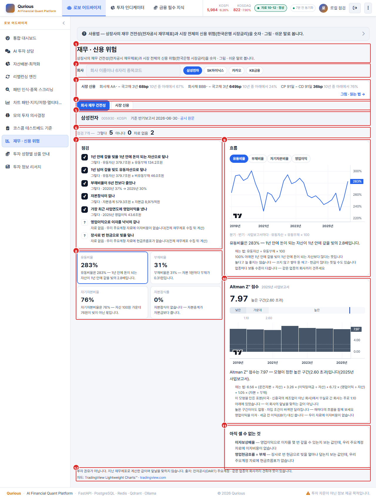

**<그림 13> 같은 화면 — 시장 신용 탭 · 1280** · 13 ~ 15(띠는 이 탭에서 숨는다 — 같은 숫자가 바로 아래 칸에 있다)

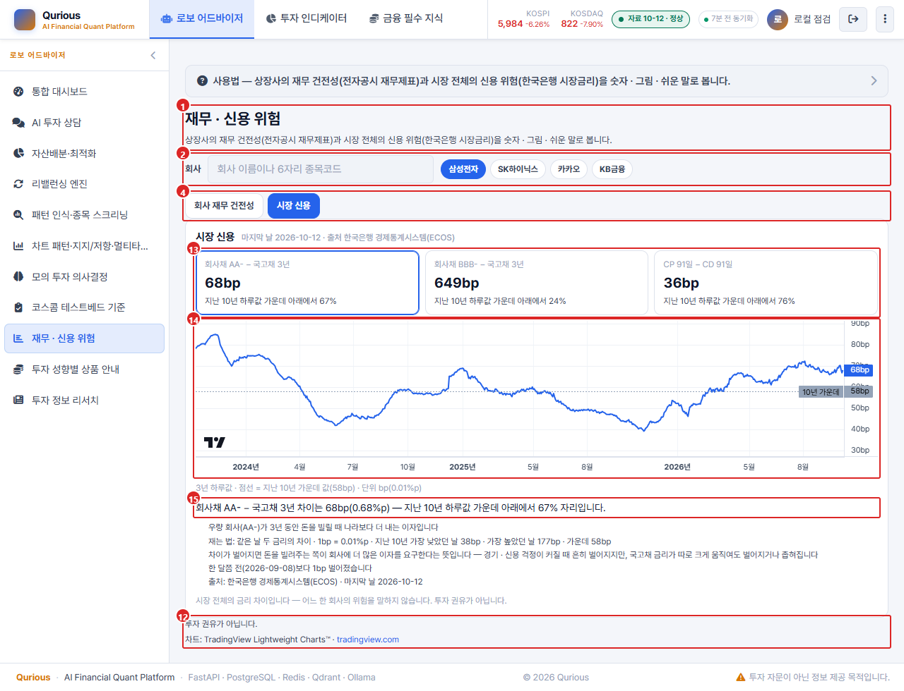

로컬 개발 앱 · 점검 계정 · 1280 폭 · 2026-10-13 · 기준 `8975696` + 이 판의 구현 · 창을 세로로 늘려 안쪽 스크롤 없이 찍고 번호 상자는 요소의 getBoundingClientRect 로 얹었다 · 설계 원본: [Figma 설계 D](https://www.figma.com/design/Q9y9udfl92n9O7IJhOTUlI?node-id=14-2) · [05 결정 기록](https://www.figma.com/design/Q9y9udfl92n9O7IJhOTUlI?node-id=1-4)

**<표 21> 화면 요소** — 번호는 <그림 12> · <그림 13>.

| 번호 | 요소 | 무엇을 보이나 | 자료 · API |
|---|---|---|---|
| 1 | 머리 | 제목 · 한 줄 설명(전자공시 재무제표 · 한국은행 시장금리를 숫자 · 그림 · 쉬운 말로) | — |
| 2 | 회사 고르기 | 입력 칸(회사 이름 → 찾기 목록 · 6자리 종목코드 + Enter) · 예시 회사 넷(삼성전자 · SK하이닉스 · 카카오 · KB금융 — 금융회사를 일부러 섞음) · 고른 회사는 그 탭에만 기억 | `API-STK-06`(이름 찾기 · 국내 6자리만) |
| 3 | 시장 신용 띠 | 늘 보이는 한 줄 — AA- · BBB- · CP − CD 의 bp 와 「n년 중 아래에서 m%」 · 「그림 · 읽는 법 →」 은 펼치지 않고 시장 신용 탭으로 옮긴다 | `API-RISK-02` `spreads[].latest · stats` |
| 4 | 탭 | 회사 재무 건전성 · 시장 신용 — 한 번에 한쪽만 | — |
| 5 | 회사 띠 | 이름 · 종목코드 · 시장 · 기준 보고서 · 기간 끝 · 「정정됨」(정정 공시로 값이 바뀐 기간) · 공시 원문 · 금융회사 · 별도 재무로 바꿈 안내 | `API-RISK-01` `latest` · `fs_note` · `kind_note` |
| 6 | 점검 요약 | 「점검 7개 — 그렇다 n · 아니다 n · 자료 없음 n」 | `summary` |
| 7 | 점검 일곱 | 질문 꼴 · ✔ ✕ ? 모양 + 「그렇다 · 아니다 · 자료 없음」 · 까닭(돈은 조원 · 억원) — 자료가 없는 둘(이자보상 · 영업현금흐름)도 빼지 않는다 | `checks[]` |
| 8 | 숫자 넷 | 유동비율 · 부채비율 · 자기자본비율 · 자본잠식률 — 값 · 한 줄 · 값이 없으면 까닭(누를 수 없음) · 누르면 9 의 그림이 그 숫자로 | `metrics[]` |
| 9 | 흐름 | 칩 넷(유동 · 부채 · 자기자본 · 영업이익) · 그림(분기 · 반기 · 사업보고서 차례 · 유동비율은 100% 점선 · 영업이익은 해마다 막대 — 손실은 회색) · 재는 법 · 한 줄 · 근거 줄 | `metrics[].history · formula · sentence · points` · `operating` |
| 10 | Altman Z'' | 점수 · 구간 이름(높은 · 가운데 · 낮은) · 띠 그림과 자리 표시 · 해마다 막대(경계 점선) · 한계 문장 · 근거 줄 — 값이 없으면 까닭 한 줄 | `zscore` |
| 11 | 아직 셀 수 없는 것 | 이자보상배율 · 영업현금흐름 ÷ 부채 — 까닭(주요계정에 이자비용 · 현금흐름이 없다) | `unavailable[]` |
| 12 | 각주 · 크레딧 | 보이는 탭에 맞춘 고지 — 회사 탭은 「투자 권유가 아닙니다 · 지난 재무제표로 계산 · 같은 업종끼리」, 시장 신용 탭은 「투자 권유가 아닙니다」 만(시장 고지는 15 안에) · 「차트: TradingView Lightweight Charts™ · tradingview.com」 | 회사 응답 `notice` · 표시 의무 |
| 13 | 스프레드 칸 셋 | AA- · BBB- · CP − CD — bp · 지난 n년 하루값 가운데 아래에서 몇 % · 누르면 그림이 그 스프레드로 | `API-RISK-02` `spreads[]` |
| 14 | 그림 | 3년 하루값 · 점선 = 지난 10년 가운데 값 · 단위 bp(0.01%p) | `spreads[].history · stats.median` |
| 15 | 쉬운 말 · 고지 | 한 줄 · 근거 줄(재는 법 · 가장 낮았던 날 · 높았던 날 · 출처) · 「시장 전체의 금리 차이 — 한 회사의 위험이 아님 · 투자 권유 아님」 · 마지막 날 · 출처(한국은행 ECOS) | `sentence · points` · `notice` · `source` |

**<표 22> 경우**

| 경우 | 보이는 것 |
|---|---|
| 처음 열 때 | 이 탭에서 마지막으로 본 회사 · 없으면 삼성전자 · 시장 신용은 따로 불러 띠를 채운다(둘 중 하나가 늦어도 다른 쪽은 먼저 보인다) |
| 금융회사(KB금융) | 회사 띠에 「금융회사는 예금 · 보험 같은 부채가 장사 밑천이고 유동 · 비유동 구분이 없어 이 비율로 견줄 수 없습니다」 · 유동비율 · 부채비율은 「—」 + 까닭(누를 수 없음) · 흐름은 자기자본비율로 · Z'' 는 까닭 한 줄 · 점검 셋은 자료 없음 |
| 연결 재무가 없는 회사 | 별도 재무로 바꾸고 회사 띠에 그 사실(말없이 바꾸지 않는다) |
| 정정된 기간 | 회사 띠에 「정정됨」 — 처음 보고된 값은 남아 있지 않다 |
| 재무가 없는 종목(ETF · 스팩 등) · 꼴이 틀린 코드 | 서버 글 한 줄(빈 표를 그리지 않는다) · 수집 · 설정 문제의 할 일(명령)은 관리자 응답에만 |
| 시장금리를 아직 받지 못함 | 띠 없음 · 시장 신용 탭에 「시장금리 자료를 아직 받지 못했습니다」 · 관리자에게만 할 일 한 줄 |
| 회사 찾기가 안 됨 | 「찾기가 지금 되지 않습니다 — 6자리 종목코드를 넣고 Enter」 · 국내 상장 종목이 아니면 「국내 상장 종목에서 찾지 못했습니다」 |
| 그림 도구를 못 불러옴 | 그림 칸에 까닭 한 줄 — 숫자 · 글은 그대로 |
| 다른 회사를 빨리 고름 | 늦게 온 옛 응답은 버린다 · 입력 칸 · 찾기 목록은 다시 그리지 않는다(재무를 부르는 사이 목록이 사라지지 않게) |
| 1024 아래 · 560 아래 | 한 단(점검 → 숫자 → 흐름 → Z'' 차례) / 숫자 · 스프레드 칸 한 줄에 하나 · 문서 가로 넘침 없음 |

**정한 것** — ① 꼴은 설계 D: 설계 B(탭 둘)와 C(점검 먼저 + 시장 신용 띠)의 융합(사용자 결정 2026-10-13 「B 와 C 잘 융합」 — A 한 장 두 단은 99 버린 안) ② 띠의 「그림 · 읽는 법 →」 은 펼치지 않고 시장 신용 탭으로 옮긴다(띠 숫자만 보고 뜻을 잘못 읽지 않게) ③ 점검 낱말은 「그렇다 · 아니다 · 자료 없음」(「통과 · 실패」 는 투자 판단 · 등급처럼 읽힌다) ④ Altman Z'' 는 보이되 한계 문장과 함께.

**지키는 것** — ① 문장 · 까닭은 서버 한 곳(화면이 다시 짓지 않는다) ② 경계(1.10 · 2.60) · 통계 햇수는 응답에서만 읽는다 ③ 신호등 색을 쓰지 않는다(빨강은 오류 글에만 · 점검은 모양과 글) ④ 숨기지 않는다(자료 없는 점검 둘 · 금융회사는 값 대신 까닭) ⑤ 차트 위 로고 · 크레딧 줄을 끄지 않는다 ⑥ 「투자 권유가 아닙니다」 · 「시장 전체의 금리 차이」 고지. 시험 TC-FH(서버 17) · TC-MC(서버 8) · TC-FRS(화면 5) · TC-AGR(대화 도구 7) · TC-ECS(수집기 10).

**실제 확인**(2026-10-13 로컬 개발 앱 · 점검 계정 · 1280 · 1024 · 900 · 390 · 시장금리는 같은 날 러너 `ecos` 단계로 받은 실제 값 — AA- 68bp · BBB- 649bp · CP − CD 36bp · 마지막 날 10-12) — 띠 「그림 · 읽는 법 →」 → 시장 신용 탭 · 스프레드 칸 셋 · 탭 둘 · 흐름 칩 넷 · 숫자 칸 · 예시 셋(SK하이닉스 · 카카오 · KB금융 — 금융회사는 흐름이 자기자본비율로 · Z'' 그림 없음) · 코드 입력 000660 + Enter · 이름 찾기 「삼성」(삼성물산 · 삼성생명 · 삼성카드 · 삼성증권 …) · 다른 화면에 갔다 와도 고른 회사 그대로 · 폭 넷 모두 가로 넘침 없음 · 콘솔 오류 0.

## 9. 화면 상세 — 계절성 분석 (`quant-seasonal`)

옛 강사님 칸 자리다(화면 키 그대로 · 메뉴 「금융 필수 지식 › 요약」). 옛 화면은 야후 시세로 **일간 수익률을 달별로 평균**(`API-ML-05`)만 보여 「1월 +0.08%」 가 하루 평균인지 한 달 수익률인지 헷갈렸고, 해마다 몇 번 그랬는지 · 우연과 구별되는지 · 「과거 패턴은 신호가 아님」 이 없었다. 새 화면은 **끝난 달의 달 수익률(달 끝 → 달 끝)을 해마다 표**로 두고, 달마다 평균 · 오른 해 · 판정(홀름 보정)을 서버가 숫자와 문장으로 함께 준다(`API-SEAS-01`). 코스피 · 코스닥은 한국은행 ECOS 가격 지수(1995 · 2003 ~ · 매일 수집), 종목은 수집 시세로 만든 총수익 · 가격 지수(2020 ~)다.

**<그림 14> 계절성 분석 — 코스피 · 해마다 표 탭 · 1280** · 1 ~ 15

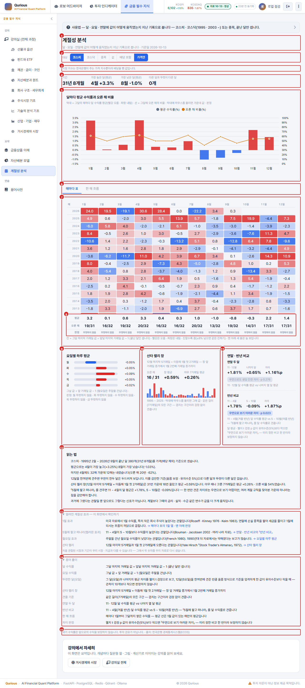

**<그림 15> 같은 화면 — 한 해 흐름 탭 · 종목 찾기 목록 · 1280** · 16 · 17

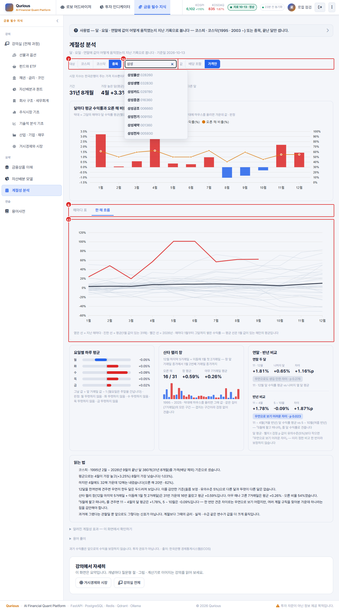

로컬 개발 앱 · 점검 계정 · 1280 폭 · 2026-10-14 · 기준 `1a59b6f` + 이 판의 구현 · 창을 세로로 늘려 안쪽 스크롤 없이 찍고 번호 상자는 요소의 getBoundingClientRect 로 얹었다 · 펼침 둘(알려진 효과 · 용어 풀이)은 펼친 채 · 설계 원본: [Figma 03-1 세 안](https://www.figma.com/design/kmhnl32nkmJaYilPQhN9TN?node-id=1-3) · [05 결정 기록](https://www.figma.com/design/kmhnl32nkmJaYilPQhN9TN?node-id=19-2)

**<표 23> 화면 요소** — 번호는 <그림 14> · <그림 15>.

| 번호 | 요소 | 무엇을 보이나 | 자료 · API |
|---|---|---|---|
| 1 | 머리 | 제목 · 한 줄 설명 · 기준일(마지막 값의 날) | `API-SEAS-01` `as_of` |
| 2 | 고르기 | 대상(코스피 · 코스닥 · 종목) · 값(배당 포함 · 가격만) — 단추 글 · 차례는 응답에서 · 눌린 값 단추는 실제로 센 값 | `choices` · `basis` |
| 3 | 값 안내 | 시장 지수에 「배당 포함」 을 고르면 「한국은행이 주는 가격 지수뿐이라 배당을 뺀 값」 — 말없이 바꾸지 않는다 | `basis_note` |
| 4 | 요약 숫자 넷 | 기간(끝난 달) · 가장 높은 달 · 가장 낮은 달(평균) · 다른 달과 뚜렷이 다른 달 수(관측이 모자라면 「판정 안 함」) | `span` · `by_month` |
| 5 | 달 막대 + 선 | 막대 = 달마다 해마다 달 수익률의 평균(빨강 오름 · 파랑 내림) · 선 = 오른 해 비율 · 막대에 마우스 → 해 수 · 평균 · 가운데 · 오른 해 · 가장 좋았던 · 나빴던 해 · 판정 | `by_month[]` |
| 6 | 탭 | 해마다 표 · 한 해 흐름 — 한 번에 하나 | — |
| 7 | 해마다 표 | 해(새것 위) × 12달 칸 · 오름 빨강 · 내림 파랑 · ±8% 에서 가장 진함 · 칸에 마우스 → 해 · 달 · 값 · 표 안에서 스크롤(머리 줄 고정) | `matrix[]` |
| 8 | 맨 아래 세 줄 | 평균 · 오른 해(n / 전체) · 판정(뚜렷 · 뚜렷하지 않음 · 판정 안 함) — 표를 내려도 늘 보인다 | `by_month[]` `mean · up · n · distinct_text` |
| 9 | 요일별 하루 평균 | 월 ~ 금 막대(0 을 가운데) · 마우스 → 관측 · 오른 날 비율 · 판정 · 아래에 다섯 요일 판정 글 | `weekday[]` |
| 10 | 산타 랠리 창 | 정의 · 오른 해 · 창 평균 · 아무 7거래일 평균 · 해마다 막대(마우스 → 그해 값) | `windows.santa` · `definitions.santa · baseline` |
| 11 | 연말 · 반년 비교 | 연말 두 달(11 · 12월 vs 나머지) · 반년(11 ~ 4월 vs 5 ~ 10월) — 평균 둘 · 차이(%p) · 판정 글 · p | `windows.year_end · halves` · `thresholds.alpha` |
| 12 | 읽는 법 | 서버가 지은 문장 — 범위 · 가장 높은 · 낮은 달 · 그달에도 내린 해 · 판정 · 산타 랠리 · 반년 · 표본 크기 · 「신호가 아님」 | `sentences[]` |
| 13 | 알려진 계절성 효과 | 1월 효과 · 5월에 팔고 떠나라 · 월요일 효과 · 산타 랠리 — 처음 관찰된 곳(연구 · 연도)과 이 화면에서 확인하는 칸 | 화면 글(값은 위 칸 · 응답) |
| 14 | 용어 풀이 | 달 수익률 · 요일 수익률 · 뚜렷한 달 · 산타 랠리 창 · 견줄 기준 · 연말 두 달 · 반년 비교 · 한 해 흐름 · 차이 판정 | `definitions` |
| 15 | 고지 · 출처 | 「과거 수익률은 앞으로의 수익을 보장하지 않습니다. 투자 권유가 아닙니다.」 · 출처(한국은행 ECOS · 또는 공공데이터포털 주식시세 + 우리 계산) | `notice` · `source` |
| 16 | 종목 찾기 | 「종목」 을 누르면 열린다 — 이름 · 코드 → 목록(국내 6자리만 · 여덟) · 6자리 + Enter · 고른 종목 이름 | `API-STK-06` |
| 17 | 한 해 흐름 | 해마다 1월부터 쌓은 수익률 선(옅은 회색) · 평균(진한 선 · 1월부터인 해만) · 올해(빨강) · 선에 마우스 → 해 · 그달까지 값 | `curves` |

**<표 24> 경우**

| 경우 | 보이는 것 |
|---|---|
| 처음 열 때 | 이 브라우저에서 마지막으로 본 대상 · 값 · 없으면 서버 기본(코스피 · 배당 포함 → 가격 지수로 셈 + 3 안내) |
| 종목(2020 ~) | 요약 넷째 칸 「판정 안 함」 · 표 판정 줄 모두 「판정 안 함」 · 문장에 「달마다 관측이 10해보다 적어 … 판정하지 않았습니다」 와 「표본이 작다」 |
| 지수를 아직 받지 않음 | 고르기는 그대로 · 서버 글 한 줄 · 관리자에게만 받기 명령 |
| 없는 종목 · 꼴이 틀린 코드 | 서버 글 한 줄(빈 표를 그리지 않는다) · 지난 결과는 그대로 둔다 |
| 지난번에 고른 종목을 지금 쓸 수 없음 | 기본 대상으로 다시 부르고 「지난번에 고른 대상을 지금은 쓸 수 없어 기본 대상으로 다시 불렀습니다」 |
| 종목 찾기가 안 됨 | 「찾기가 지금 되지 않습니다 — 6자리 종목코드를 넣고 Enter」 · 국내 상장 종목이 아니면 「국내 상장 종목에서 찾지 못했습니다」 |
| 그림 도구를 못 불러옴 | 막대 · 곡선 칸은 비고 표 · 숫자 · 문장은 그대로 |
| 창 크기를 바꿈 | 0.2초 뒤 그림만 다시 — 그림 도구 자체의 크기 맞춤은 끈다(바꾼 직후 탭을 누르면 지운 그림에 맞춤이 돌아 오류가 났다 · 2026-10-14 실측) |
| 1024 아래 · 900 아래 · 390 | 아래 카드 셋이 한 줄에 하나 · 표는 칸 안에서 가로 스크롤 · 문서 가로 넘침 없음 |

**정한 것** — ① 꼴은 안 A + B + C 탭(사용자 결정 2026-10-14) — 안 B 의 달 카드 12장은 뺐다(평균만 크게 보이면 「4월이 좋다」 로 잘못 읽힌다 — 코스피 실측: 다른 달과 뚜렷이 다른 달 0개) ② 끝난 달만 · 달 끝 → 달 끝(강사님 교재 「완료된 달만」 과 같은 규칙) ③ 12달 · 5요일은 홀름 보정 · 관측 10 미만은 판정하지 않는다 ④ 반년 비교는 옛 화면 카드의 「5월에 팔고 떠나라」 를 말로만 두지 않고 우리 자료로 견준다(미리 정한 한 번의 비교 · 문장이 「여러 규칙 가운데 하나」 라고 함께 말한다).

**지키는 것** — ① 계산 · 판정 · 문장은 서버 한 곳(화면이 다시 짓지 않는다 · TC-SE-15 · TC-SES-02) ② 고르기 값 · 판정 글 · 유의수준은 응답에서만 읽는다(TC-SES-02) ③ 서버 글은 이스케이프(TC-SES-03) ④ 오름 빨강 · 내림 파랑(국내 시세 표기) — 판정은 색이 아니라 글로 ⑤ 「과거 관찰 · 신호 아님」 문장과 고지를 빼지 않는다.

**실제 확인**(2026-10-14 로컬 개발 앱 · 점검 계정 · 1280 · 1024 · 900 · 390 · 코스피 · 코스닥은 같은 날 12:30 러너 `ecos` 단계로 처음 받은 실제 값 — 코스피 8,032줄 · 코스닥 5,867줄 · ECOS 견본 키로 2026년 달 끝 값 열을 따로 받아 표의 2026년 아홉 칸과 같음을 대조) — 대상 셋 · 값 둘 · 탭 둘 · 종목 찾기(이름 · 목록 · 6자리 Enter) · 다른 화면 갔다 오기(고른 값 기억) · 표 머리 · 맨 아래 줄 고정 · 창 크기 바꾼 직후 탭 — 콘솔 오류 0 · 문서 가로 넘침 0.

## 10. 화면 상세 — 종목 군집화 (`ml-cluster`)

옛 강사님 KMeans 칸 자리다(화면 키 그대로 · 메뉴 「ML·딥러닝」). 옛 화면은 `API-ML-03` 을 불렀는데 본문을 두 번 JSON 으로 바꿔 **늘 422** 였다(DF-108). 새 화면은 지난 기간에 **서로 비슷하게 움직인 종목끼리**(시장 몫을 뺀 일간 수익률 상관 · Ward) 또는 **위험 · 수익 특성이 닮은 종목끼리**(KMeans) 묶어 종목 지도 · 묶음 카드 · 쉬운 문장으로 보인다(`API-CLUS-01`). 대상은 자동매매 31종목(업종 표시) 또는 분봉 수집 종목(코스피 · 코스닥 지수 구성 · ETF 뺌)이다.

**<그림 16> 종목 군집화 — 31종목 · 3년 · 같이 움직임 · 묶음 탭 · 1280** · 1 ~ 9

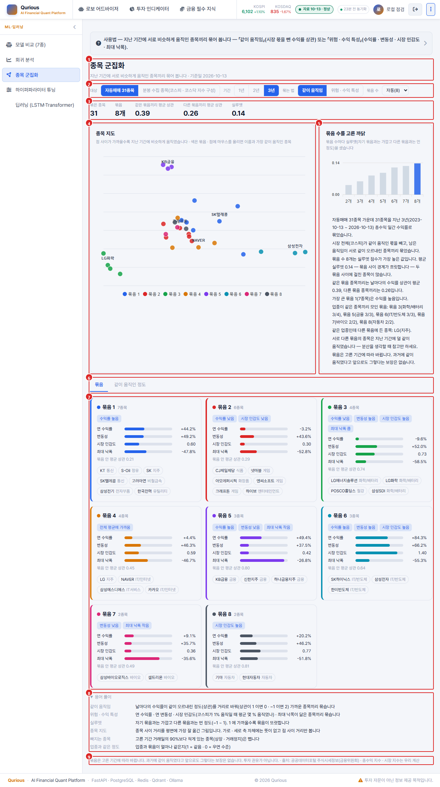

**<그림 17> 같은 화면 — 같이 움직인 정도(상관 표) 탭 · 1280** · 6 · 10

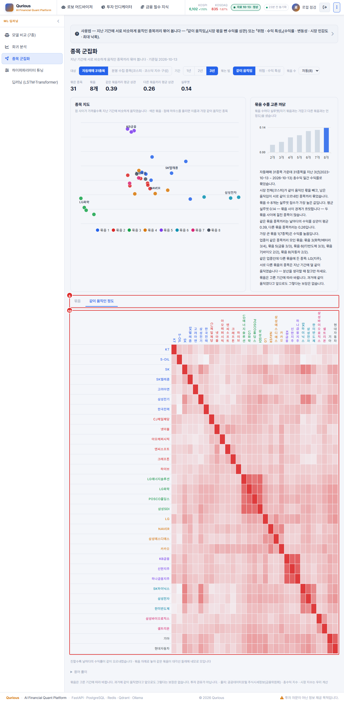

로컬 개발 앱 · 점검 계정 · 1280 폭 · 2026-10-14 · 기준 `1a59b6f` + 이 판의 구현 · 같은 방법(창을 세로로 늘림 · getBoundingClientRect 번호 상자) · 설계 원본: [Figma 03-2 세 안](https://www.figma.com/design/kmhnl32nkmJaYilPQhN9TN?node-id=1-4) · [05 결정 기록](https://www.figma.com/design/kmhnl32nkmJaYilPQhN9TN?node-id=19-9)

**<표 25> 화면 요소** — 번호는 <그림 16> · <그림 17>.

| 번호 | 요소 | 무엇을 보이나 | 자료 · API |
|---|---|---|---|
| 1 | 머리 | 제목 · 한 줄 설명 · 기준일 | `API-CLUS-01` `as_of` |
| 2 | 고르기 넷 | 대상(31종목 · 분봉 수집 종목) · 기간(1 · 2 · 3년) · 묶는 법(같이 움직임 · 위험 · 수익 특성) · 묶음 수(자동(n) · 2 ~ 8) — 단추 글 · 범위는 응답에서 | `choices` |
| 3 | 요약 숫자 | 묶은 종목 · 묶음 · 같은 묶음끼리 평균 상관 · 다른 묶음끼리 평균 상관 · 실루엣 | `points` · `k` · `separation` · `silhouette_mean` |
| 4 | 종목 지도 | 점 = 종목 · 색 = 묶음 · 가까울수록 비슷하게 움직임 · 이름은 묶음마다 가운데에 가까운 둘만(겹치면 건너뜀 · 60종목 넘으면 이름 없이) · 점에 마우스 → 이름 · 업종 · 묶음 · 연 수익률 · 변동성 · 가장 같이 움직인 종목 | `points[]` · `map` |
| 5 | 묶음 수를 고른 까닭 · 문장 | 묶음 수마다 실루엣 막대(고른 수 파랑) · 서버 문장(무엇을 · 어떻게 묶었나 · 경계가 흐릿한가 · 같은 · 다른 묶음 상관 · 업종과 맞는 묶음 · 다른 묶음에 든 같은 업종 · 「분산 참고만 · 보장 없음」) | `k_scores` · `sentences` |
| 6 | 탭 | 묶음 · 같이 움직인 정도(60종목 이하일 때만) | `matrix` |
| 7 | 묶음 카드 | 특징 낱말 · 연 수익률 · 변동성 · 시장 민감도 · 최대 낙폭 막대(대상 안의 자리) · 묶음 안 평균 상관 · 종목 칩(업종) · 24개 넘으면 「외 n종목 더 보기」 | `clusters[]` |
| 8 | 용어 풀이 | 같이 움직임 · 위험 · 수익 특성 · 실루엣 · 종목 지도 · 빠지는 종목 · 업종과 같은 정도 | `definitions` |
| 9 | 고지 · 출처 | 「묶음은 고른 기간에 따라 바뀝니다 … 보장은 없습니다 · 투자 권유가 아닙니다」 · 출처 | `notice` · `source` |
| 10 | 상관 표 | 묶음 차례로 놓은 종목 × 종목 · 진할수록 날마다 같이 오르내림 · 같은 묶음이 대각선 둘레에 네모로 · 칸에 마우스 → 값 | `matrix` |

**<표 26> 경우**

| 경우 | 보이는 것 |
|---|---|
| 처음 열 때 | 마지막으로 고른 대상 · 기간 · 방법 · 묶음 수 · 없으면 서버 기본(31종목 · 3년 · 같이 움직임 · 자동) |
| 분봉 수집 종목(약 350) | 지도에 이름 없이 점만(마우스로) · 상관 표 탭 없음 · 묶는 동안 「묶는 중입니다… 종목이 많으면 몇 초 걸립니다」 |
| 자료가 모자란 종목 | 「자료가 모자라 뺀 종목 n」 펼침에 이름과 까닭(빼고 묶었다는 사실을 숨기지 않는다) |
| 지난번에 고른 값을 지금 쓸 수 없음 | 기본으로 다시 부르고 그 사실 한 줄 |
| 대상 · 기간 · 방법을 바꿈 | 묶음 수는 다시 「자동」 |
| 그림 도구를 못 불러옴 | 지도 · 막대 칸은 비고 카드 · 숫자 · 문장은 그대로 |
| 창 크기를 바꿈 | 0.2초 뒤 그림만 다시 — 그림 도구 자체의 크기 맞춤은 끈다(계절성과 같은 까닭) |
| 900 아래 · 390 | 지도와 까닭 칸이 위아래로 · 카드 한 줄에 하나 · 상관 표는 칸 안에서 스크롤 · 문서 가로 넘침 없음 |

**정한 것** — ① 꼴은 안 A + B 융합(사용자 결정 2026-10-14) — 위 지도 · 아래 카드 · 상관 표(안 C)는 작은 대상에서만 탭 ② 대상은 31종목 기본 + 분봉 수집 종목 고르기 ③ 같이 움직임은 시장 몫(코스피 총수익 지수)을 빼고 묶는다 — 빼지 않으면 시장 전체 움직임이 커서 거의 한 묶음(31종목 29 + 2 · 401종목 347 + 1)이 됐다(구현 중 실측) ④ 거리는 상관 거리 √(2(1−ρ))(Mantegna 1999) · 연결은 Ward · 묶음 수는 실루엣이 가장 큰 수(같으면 작은 수).

**지키는 것** — ① 묶음 · 좌표 · 낱말 · 문장은 서버 한 곳 ② 고르기 값 · 기준값은 응답에서만(TC-CUS-02) ③ 서버 글은 이스케이프(TC-CUS-03) ④ 묶음 색은 구분용(좋음 · 나쁨 아님) — 범례는 묶음 번호 ⑤ 「분산 참고 · 보장 없음 · 권유 아님」 을 빼지 않는다 ⑥ 공통 `api()` 에 문자열 본문을 넘기지 않는다(DF-108 재발 막기 · TC-CUS-04 가 모든 화면 파일을 본다).

**실제 확인**(2026-10-14 로컬 개발 앱 · 점검 계정 · 1280 · 1024 · 900 · 390) — 고르기 넷의 모든 값 · 묶음 수 4 · 더 보기 · 탭 둘 · 분봉 수집 종목 · 다른 화면 갔다 오기 · 창 크기 바꾼 직후 탭 — 콘솔 오류 0 · 문서 가로 넘침 0. 31종목 · 3년 기본은 묶음 8개 · 실루엣 0.14(경계가 흐릿 — 문장이 그렇게 말한다) · 같은 묶음끼리 평균 상관 0.39 · 다른 묶음끼리 0.26.

## 11. 화면 상세 — 모델 비교 (`ml-compare`)

옛 강사님 「모델 비교 (7종)」 칸 자리다(화면 키 그대로 · 메뉴 「ML·딥러닝」). 옛 화면은 `API-ML-01` 을 불렀는데, 시험 구간보다 뒤(미래) 자료로 학습하는 교차검증 · 기준선 없는 정확도 순위 · 「7종」 인데 모델 8개였다([조사서](../조사/모델비교-시간순서평가-조사.md) 1절). 새 화면은 지난 시세로 학습한 모델 8개가 5거래일 뒤 오름 · 관망 · 내림을 얼마나 맞히는지를 **아무것도 배우지 않은 기준선 넷과 같은 날들로** 견주고, 기준선 셋 모두보다 뚜렷할 때만 「낫다」 고 말한다(`API-MCMP-01 ~ 04`). 처음 계산은 10 ~ 20초 걸려 앱 안 작업으로 돌리고 1초마다 진행을 묻는다 — 한 번 계산한 결과는 자료가 바뀌기 전까지 저장본으로 바로 보인다. 강사님 「📖 모델별 특성」 카드는 아래에 그대로 둔다.

**<그림 18> 모델 비교 — 삼성전자 · 2년 · 결과 · 그림 탭 · 1280** · 1 ~ 12

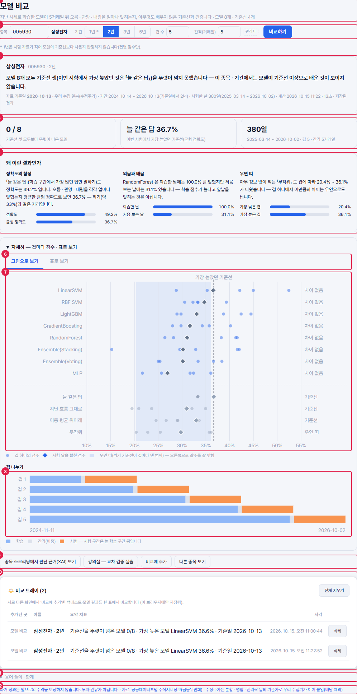

**<그림 19> 같은 화면 — 표로 보기 탭 · 1280** · 6 · 13

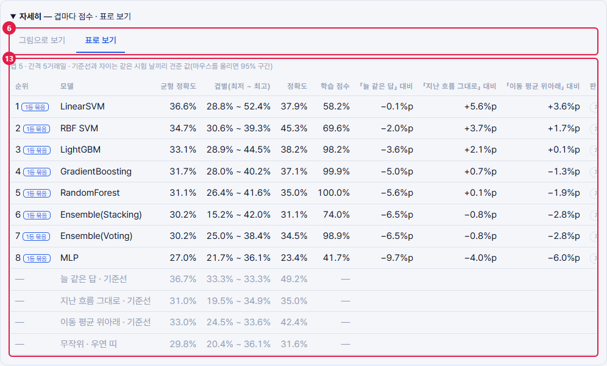

**<그림 20> 계산 중 — SK하이닉스 · 3년 · 1280** · 14

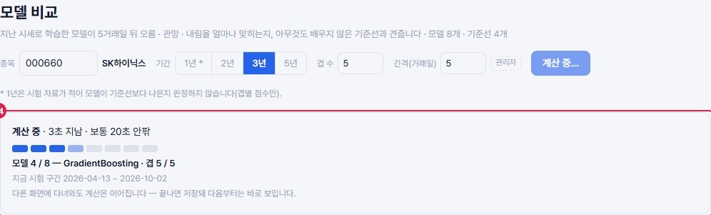

로컬 개발 앱 · 점검 계정(관리자 — 겹 수 · 간격 칸이 보인다) · 1280 폭 · 2026-10-15 · 기준 `8921f92` + 이 판의 구현 · 같은 방법(창을 세로로 늘림 · getBoundingClientRect 번호 상자) · 설계 원본: [Figma 03 [결정] 추천](https://www.figma.com/design/C82VemcAL7QC0tENjvdubm?node-id=8-15) · [04 구현 대조](https://www.figma.com/design/C82VemcAL7QC0tENjvdubm?node-id=14-3) · [05 결정 기록](https://www.figma.com/design/C82VemcAL7QC0tENjvdubm?node-id=13-2)

**<표 27> 화면 요소** — 번호는 <그림 18> ~ <그림 20>.

| 번호 | 요소 | 무엇을 보이나 | 자료 · API |
|---|---|---|---|
| 1 | 머리 | 제목 · 한 줄 설명 · 모델 수 · 기준선 수(응답 수 — 이름표에 숫자를 적지 않는다) | `API-MCMP-02` `model_count` |
| 2 | 고르기 줄 | 종목(6자리 · 자동매매 31종목 제안 · 이름 곁에) · 기간(1 · 2 · 3 · 5년 — 판정하지 않는 기간은 「*」 와 아래 한 줄) · 관리자만 겹 수 · 간격(범위는 응답에서) · 비교하기 | `choices` · `admin` |
| 3 | 머리 문장 · 기준 줄 | 서버가 지은 한 문장(판정 글을 끼움) · 자료 기준일 · 출처 · 기간 창(기준일에서 거꾸로) · 시험한 날 · 계산 시각 · 걸린 시간 · 저장된 결과 | `headline` · `data` · `samples` · `computed_at` · `cached` |
| 4 | 요약 카드 셋 | 기준선 셋 모두보다 뚜렷이 나은 모델 수 · 가장 높았던 기준선과 그 균형 정확도 · 시험한 날 수(겹 · 간격) | `models[].verdict` · `strongest_baseline` · `cv` |
| 5 | 왜 이런 결과인가 | 정확도의 함정(늘 같은 답의 정확도 vs 균형 정확도) · 외움과 배움(학습한 날 vs 처음 보는 날) · 우연 띠(찍기 기준선의 겹별 범위) — 문장 · 막대 값 모두 서버 | `insights[]` |
| 6 | 자세히 · 탭 | 그림으로 보기 · 표로 보기(처음엔 펼침) | — |
| 7 | 점 그림 | 모델 · 기준선마다 겹별 점 · 합친 값 마름모(판정 색 — 갈래 구분이지 좋음 · 나쁨이 아니다) · 우연 띠 · 가장 높았던 기준선 세로 점선 · 오른쪽 짧은 판정 이름표 · 점에 마우스 → 값 | `models[]` · `baselines[]` · `verdict_labels` |
| 8 | 겹 나누기 띠 | 겹마다 학습 · 간격(비움) · 시험 막대 — 시험 구간은 늘 학습 뒤 · 막대에 마우스 → 날짜 · 행 수 | `cv.folds[]` |
| 9 | 다음 행동 | 종목 스크리닝에서 판단 근거(XAI) 보기 · 강의실 — 교차 검증 실습 · 비교에 추가 · 다른 종목 보기 | 화면 이동 · 비교 트레이 |
| 10 | 비교 트레이 | 「비교에 추가」 로 담은 결과(다른 화면의 백테스트 결과와 한 표) · 지우기 | 브라우저 저장(공통 트레이) |
| 11 | 용어 풀이 · 한계 | 균형 정확도 · 정확도 · 방향 적중 · 신호 비율 · 학습 점수(Stacking 까닭) · 겹 · 간격 · 계층 균형 가중 · 판정 · 1등 묶음 / 한계 문장 | `definitions` · `limits` |
| 12 | 고지 · 출처 | 「과거 성과는 앞으로의 수익을 보장하지 않습니다 · 투자 권유가 아닙니다」 · 출처 표시 | `notice` · `data.attribution` |
| 13 | 표 | 순위(1등 묶음 표시) · 모델 · 균형 정확도 · 겹별 최저 ~ 최고 · 정확도 · 학습 점수 · 기준선별 차이(95% 구간 · 보정 p) · 판정 · 경고(반복 한도 · 가중 없음 · Stacking) · 아래에 기준선 넷 | `models[]` · `baselines[]` |
| 14 | 계산 중 | 지난 시간 · 보통 시간(그 기간의 지난 계산 · 없으면 기간별 기본) · 모델 칸 여덟(서버가 센 몇째 모델 · 몇째 겹 — 지어낸 백분율이 아니다) · 지금 시험 구간 · 30초 넘으면 「계속 기다리기 · 나중에 보기」 | `API-MCMP-03 · 04` `progress` · `expected_ms` |

**<표 28> 경우**

| 경우 | 보이는 것 |
|---|---|
| 처음 열 때 | 마지막으로 고른 종목 · 기간(이 브라우저) · 없으면 서버 기본(삼성전자 · 2년) · 「비교하기」 안내 카드(처음 계산은 보통 10 ~ 30초 · 저장본은 바로) |
| 저장본이 있음 | 곧바로 결과(기준 줄에 「저장된 결과」) — 자료 지문이 같을 때만 |
| 1년 | 계산은 하고 판정은 하지 않음 — 머리 문장 「시험 자료가 n행이라(최소 200행) … 판정하지 않습니다」 · 카드 「판정 안 함」 |
| 없는 종목 | 「수집 자료에 … 일봉이 없습니다 — 국내 상장 주식만 …」 + 제안 종목 칩(누르면 그 종목으로 계산) |
| ETF | 「… 는 ETF 입니다 — 아직 국내 상장 주식만 …」 + 칩 |
| 수집 DB 를 못 읽음 | 「시세 자료를 지금 읽을 수 없습니다. 잠시 뒤 다시 시도해 주세요.」 + 다시 시도(할 일은 관리자에게만) |
| 30초 넘게 걸림 | 「계속 기다리기 · 나중에 보기」 — 나중에 보기면 계산은 서버에서 이어지고 다시 누르면 저장본 |
| 다른 화면에 다녀옴 | 계산은 이어진다 · 돌아오면 지금 상태 · 끝났으면 결과 |
| 서버가 다시 켜짐 | 진행 묻기가 「계산 작업을 찾지 못했습니다 … 다시 계산해 주세요」 — 저장본이 있으면 다시 누를 때 바로 |
| 900 아래 · 390 | 카드 · 「왜」 가 한 줄에 하나 · 이름표와 칸이 한 묶음으로 줄바꿈 · 점 그림 · 겹 띠는 최소 폭 600 을 지키고 옆으로 밀어 봄(안내 한 줄) · 표는 칸 안에서 스크롤 · 문서 가로 넘침 없음 |

**정한 것** — ① 꼴은 추천 안(사용자 결정 2026-10-15) — 요약(C) 위 · 자세히 안에 그림(B) · 표(A) 탭 · 아래 다음 행동 ② 대표 지표 균형 정확도 · 판정은 기준선 셋 모두보다 뚜렷할 때만(블록 20거래일 · 홀름) ③ 1년은 계산하고 판정 안 함 · 겹 수 · 간격은 관리자만 ④ 일봉은 수집 DB 수정주가만 · 자료 지문 저장본 · 앱 안 작업 + 1초 진행 ⑤ 이름표는 숫자 빼고 「모델 비교」 — 수는 응답에서.

**지키는 것** — ① 판정 글 · 짧은 이름표 · 기준선 이름 · 기간 이름표 · 「왜」 문장 · 출처 글은 서버 한 곳(TC-MVS-02) ② 계산을 띄우는 POST 에만 화면 머리글(TC-MVS-03 · TC-MV-20) ③ 진행은 서버가 센 값 — 지어낸 백분율을 보이지 않는다(TC-MV-23) ④ 「비교에 추가」 로 담은 것을 이 화면에서 본다(TC-MVS-05) ⑤ 「과거 성과 · 권유 아님」 을 빼지 않는다.

**실제 확인**(2026-10-15 로컬 개발 앱 · 점검 계정 · 1280 · 1024 · 900 · 390) — 기간 넷 · 종목 바꾸기 · 칩 · 없는 종목(999999) · ETF(069500) · 진행 화면 · 저장본 · 탭 둘 · 다음 행동 넷 · 비교 트레이 · 다른 화면 갔다 오기 — 콘솔 오류 0 · 문서 가로 넘침 0. 확인에서 셋을 찾아 같은 PR 에서 고쳤다 — 옛 칸과 함께 비교 트레이 자리가 사라짐(TC-MVS-05) · 390 에서 「기간」 이름표만 윗줄에 남음 · 390 에서 그림이 줄어 글자가 8px 아래(최소 폭 + 옆으로 밀기). 아래 강사님 카드의 글자색도 고쳤다(어두운 테마용 연회색 · 대비 약 1.4:1 → 10:1). 삼성전자 2년은 모델 8개 모두 「차이 없음」 · 가장 높았던 기준선 「늘 같은 답」 36.7%(정확도 49.2%) · SK하이닉스 3년도 8개 모두 「차이 없음」(가장 높았던 기준선 「지난 흐름 그대로」).

## 12. 화면 상세 — 투자 정보 리서치 (`agent-news`) · 첫 목록 · 종목 칸

**<표 31> 화면 정보**

| 칸 | 내용 |
|---|---|
| 화면 ID · 화면명 | `agent-news` · 투자 정보 리서치 |
| 들어가는 길 | 위 탭 「로보 어드바이저」 → 왼쪽 전체 메뉴 › 로보 어드바이저 › 「투자 정보 리서치」 · 주소 `#agent-news` · AI 투자 상담 카드의 「공시 · 기사 시간표 →」(그 종목 시간표로) |
| 설명 | 전자공시 공시 · 정책브리핑 정책뉴스 · 언론사 기사 제목을 낱말 · 종목 · 주제 · 기간으로 찾는다. 종목을 고르면 같은 자리가 그 종목의 공시 · 기사 · 일정을 날짜 한 줄로 보인다(시간표). AI 가 답을 쓰는 화면이 아니다 |
| 관련 요구 | `P01-①-2`(수집 자료 검색) · `P01-①-3` |
| 주담당 | 이동원 |
| 결정 기록 | [Figma 「투자 정보 리서치 — 공시 · 뉴스 찾기」](https://www.figma.com/design/7fLcDQ0dQd50anuy3wgfu2) 05 결정 기록(2026-10-05 — 찾기 + 거름 칸 · 종목을 고르면 시간표 · 낱말이 있으면 관련도순) · 03-2 쪽(2026-10-17 — 설계 A 「투자 관련만」 기본 + 스위치 · 같은 제목 묶기 · 제목 없는 기사 뒤로 · 세 안 공통 — 종목 칸 Enter · 「검색」 고침 · 종목 칸은 찾기 줄로) |

처음 화면은 <그림 23> 과 같다. 첫 목록은 「투자 관련만」 — 공시와, 종목 · 주제 이름표가 붙은 뉴스만 보인다. 한 달 치 언론사 기사 약 4만 건 가운데 이름표가 붙은 것은 약 4천 건이라, 이 거름이 없으면 첫 화면이 정치 · 사회 기사와 제목이 사이트 이름뿐인 줄(「KBS 뉴스」)로 채워졌다. 숨긴 수는 스위치 옆에 밝힌다.

**<그림 23> 첫 목록 — 투자 관련만** · 범례: 빨간 상자와 번호 = <표 32> 의 요소

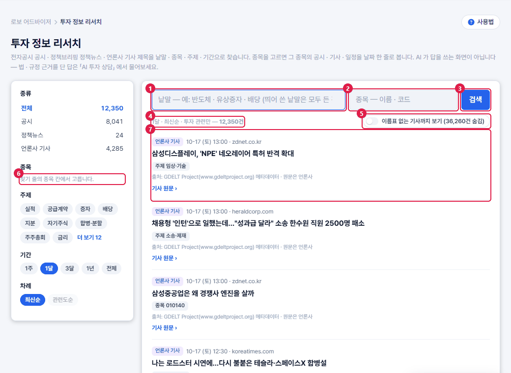

같은 제목의 기사는 한 줄로 묶는다(<그림 24>). 같은 기사가 주소 여럿으로 다시 나가는 일이 잦다(한 언론사가 같은 제목을 두 주소로 · 한 이야기를 여러 언론사가).

**<그림 24> 같은 제목 묶음** · 범례: 빨간 상자와 번호 = <표 32> 의 요소

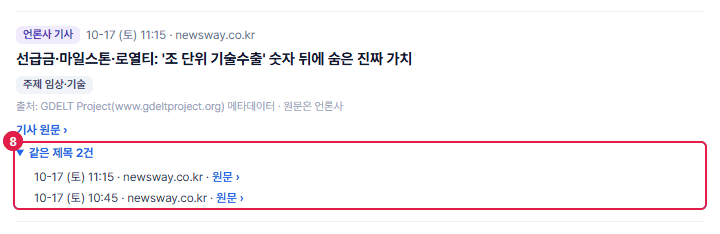

스위치를 켜면 이름표 없는 기사까지 보이고, 제목이 사이트 이름뿐인 기사는 받은 목록 끝에 게시처마다 한 줄로 모인다(<그림 25> — 낱말 「KBS 뉴스」 로 찾은 때).

**<그림 25> 제목에 사이트 이름만 있는 기사 묶음 — 스위치를 켜고 「KBS 뉴스」** · 범례: 빨간 상자와 번호 = <표 32> 의 요소

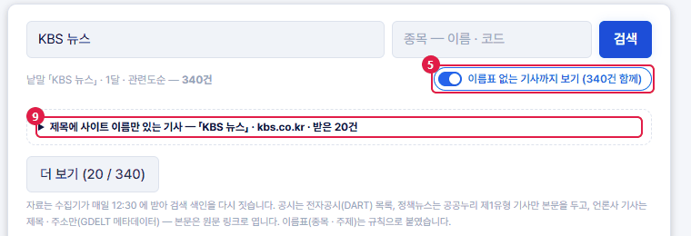

**<표 32> 투자 정보 리서치 요소**

| 번호 | 요소 | 데이터(API) | 동작 | 빈 데이터 · 오류 |
|:-:|---|---|---|---|
| 1 | 낱말 칸 | `API-DATA-03` `q` | 띄어 쓴 낱말은 모두 든 것만 · 낱말이 있으면 관련도순 · ✕ 를 누르거나 다 지우면 곧바로 최신 소식 | 낱말을 만들지 못하면 서버 글(422) |
| 2 | 종목 칸 | `API-STK-06` | 치면 0.25초 쉰 뒤 제안 목록(국내 6자리 종목만 · 여덟). Enter 와 「검색」 은 목록을 기다리지 않고 바로 찾는다 — 이름 · 코드가 정확히 같은 것 하나면 그 종목, 여럿이면 목록을 열고 첫 줄에 초점(↑ ↓ · Enter · Esc), 없으면 「국내 상장 종목에서 찾지 못했습니다」. 고른 종목은 이 칸에 이름으로 남고, 칸의 ✕ 로 거름을 푼다 · 칸 밖을 누르면 목록이 닫힌다 | 찾기가 실패하면 「종목 찾기가 잠시 안 됩니다 — 다시 눌러 보세요」(「없음」 으로 덮지 않는다) |
| 3 | 검색 | `API-DATA-03` | 낱말 · 종목을 함께 — 새로 친 종목은 먼저 찾고, 정확히 같은 것 하나면 낱말을 남긴 채 그 종목 시간표 · 종목 칸을 비우고 누르면 종목 거름을 푼다 | — |
| 4 | 조건 줄 | `total` · `facets.source` | 「1달 · 최신순 · 투자 관련만 — n건」(공시만 볼 때는 「투자 관련만」 을 쓰지 않는다) | — |
| 5 | 스위치 | `facets.untagged` | 「이름표 없는 기사까지 보기 (n건 숨김)」 — 켜면 「(n건 함께)」 · n 은 서버가 같은 조건에서 센 수 | 공시만 볼 때 · 숨길 것이 없을 때 · 시간표에서는 감춘다 |
| 6 | 거름 칸의 종목 | — | 고른 종목 칩(✕ 로 풀기) · 고르기 전에는 「찾기 줄의 종목 칸에서 고릅니다.」 | — |
| 7 | 목록 줄 | `items[]` | 출처 꼬리표 · 시각 · 게시처 · 제목(원문 링크) · 종목 · 주제 이름표(누르면 그 종목 시간표 · 그 주제) · 출처 표시 | — |
| 8 | 같은 제목 | `items[]`(뉴스) | 같은 제목은 처음 나온 줄 하나로 · 「같은 제목 n건」 을 펴면 묶인 기사마다 시각 · 게시처 · 원문 | 공시는 묶지 않는다(회사마다 같은 보고서 이름) |
| 9 | 제목에 사이트 이름만 있는 기사 | `items[].site_name_title` | 받은 목록 끝에 게시처마다 접힌 한 줄 — 「제목에 사이트 이름만 있는 기사 — 「○○」 · 게시처 · 받은 n건」 · 펴면 시각 · 원문 | — |

**<표 33> 투자 정보 리서치의 경우**

| 경우 | 화면이 보이는 것 |
|---|---|
| 처음(투자 관련만) | 공시 + 이름표가 붙은 뉴스 · 숨긴 수를 스위치에 |
| 스위치를 켬 | 이름표 없는 기사까지 · 사이트 이름 제목은 끝 묶음으로 |
| 「더 보기」 | 서버 쪽 넘기기 그대로 20건씩 받고, 받은 줄 전부를 다시 묶는다(묶음 · 끝 묶음의 수는 받은 줄 기준) |
| 종목 칸에 정확한 이름 + Enter | 곧바로 그 종목 시간표(공시 · 기사 · 일정) |
| 낱말 + 종목 + 「검색」 | 낱말을 남긴 채 그 종목 시간표 |
| 제안 목록에서 고름 | 낱말을 비우고 그 종목 전부의 시간표(찾던 낱말이 남아 비어 보이지 않게 — 2026-10-06 결정) |
| 없는 이름 | 「국내 상장 종목에서 찾지 못했습니다」 |
| 좁은 화면 | 720 아래 — 낱말 칸이 한 줄을 다 쓰고 종목 칸과 「검색」 은 다음 줄 · 900 아래 — 거름 칸은 접는다 |

제목이 사이트 이름뿐인지는 서버가 정한다 — 같은 제목이 주소 10개 · 3일 이상에 붙은 언론사 기사(가장 최근 기사로부터 30일). 2026-10-17 색인에서는 넷(「KBS 뉴스」 340 · 「허프포스트코리아」 280 · 「씨네21」 16 · 「Global Asset Management」 13)이었다. 「투자 관련만」 은 이름표 규칙에 기대므로, 규칙이 놓친 투자 기사는 스위치 뒤로 가고 규칙이 잘못 붙인 기사(「합병증」 → 합병·분할)는 앞에 남는다 — 이름표 정밀도 표본 점검에서 규칙을 고친다.

---

## 13. 화면 상세 — 미국주식 › 주문/매매 (`us-order`) · 시세 카드 · 확인 상자 · 예약 주문

**<표 34> 화면 정보**

| 칸 | 내용 |
|---|---|
| 화면 ID · 화면명 | `us-order` · 미국주식 주문 (모의투자) |
| 들어가는 길 | 왼쪽 전체 메뉴 › 미국주식 › 「주문/매매」(미국주식은 위 탭 여섯 밖) · 주소 `#us-order` |
| 설명 | 미국 종목을 원화 모의 계좌로 산다. 미국 정규장이 닫힌 때는 예약 주문으로 받아 다음 정규장 시작가로 체결한다. 실제 주문이 나가지 않는다(모의투자) |
| 관련 요구 | `P01-④-3`(모의 주문 · 운용) |
| 주담당 | 이동원(미국주식 화면 · 환율 모듈 · 예약 규칙) — 모의 장부 · 비용 모듈은 강민석 |
| 결정 기록 | [Figma 「Qurious · 미국주식 주문 화면」](https://www.figma.com/design/ZCsZfaB0nvUpHeUjh0hbr5) — 지금 화면 · 세 안(A 시세 한 줄 + 브라우저 확인창 · B 시세 카드 + 예상 금액 + 앱 안 확인 상자 · C B + 장 닫힌 날은 예약 주문) → **C 결정(2026-10-17)** · 구현 대조 쪽 |

종목을 넣으면 시세 카드가, 수량을 넣으면 예상 금액이 나온다(<그림 26>). 장 상태는 서버 한 곳(`app/services/us_reserve.py` — 뉴욕 09:30 ~ 16:00 · NYSE 휴장일 공지 2026 ~ 2028 · 서머타임은 시간대가 맞춤)이 정하고, 장이 닫혀 있으면 매수 단추가 「예약 매수 (다음 정규장)」 로 바뀐다. 2026-10-17 전에는 이 칸에 시세 · 장 상태 · 환율이 없고 단추를 누르면 확인 없이 바로 체결됐다 — 토요일에는 금요일 마감 값으로(모의투자 여정 점검 셋째 바퀴 · 이슈 #256).

**<그림 26> 주문 칸 — 장 닫힘 · 예약 대기 1건(2026-10-17 토 · PLUG 1주)** · 범례: 빨간 상자와 번호 = <표 35> 의 요소

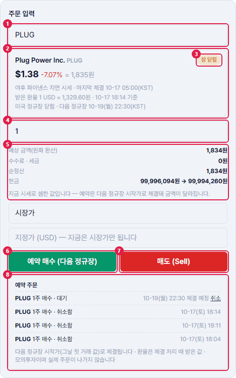

매수를 누르면 장 상태를 서버에 다시 묻고 앱 안 확인 상자를 연다(<그림 27>). 처음 초점은 「취소」 다 — Enter 를 잘못 눌러도 주문이 나가지 않는다. 원화 단가 · 순정산 · 현금 변화는 서버 미리 보기(`API-PAPR-05` — 체결과 같은 비용 셈 · 단가는 원 단위로 버림)를 그대로 쓴다. 시세 카드의 원화는 「≈」 반올림 표시라 1원 다를 수 있다.

**<그림 27> 확인 상자 — 장이 닫힌 때(예약)** · 범례: 빨간 상자와 번호 = <표 35> 의 요소

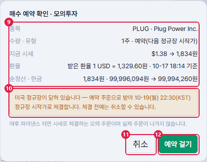

**<표 35> 미국주식 주문 요소**

| 번호 | 요소 | 데이터(API) | 동작 | 빈 데이터 · 오류 |
|:-:|---|---|---|---|
| 1 | 종목 칸 | — | 치면 0.45초 쉰 뒤 시세 카드를 다시 받는다(늦게 온 옛 응답은 버린다) | 비우면 카드 · 예상 금액을 지운다 |
| 2 | 시세 카드 | `API-STK-02` · `API-PAPR-03` | 이름 · 티커 · 달러가 · 전일 대비 · 원화 환산(≈) · 「야후 파이낸스 지연 시세 · 마지막 체결 MM-DD HH:MM(KST)」 · 환율 글 · 장 상태 글(둘 다 서버 글 그대로) | 모르는 값은 「—」 · 체결 시각을 모르면 「마지막 체결 시각 모름」 · 모의 시세를 못 받으면 서버 글 |
| 3 | 장 상태 배지 | `API-USRV-01` | 장 열림 · 장 닫힘 · 장 상태 모름 | 모름(휴장일 표 밖)은 닫힘으로 짐작하지 않는다 |
| 4 | 수량 칸 | — | 치면 0.3초 쉰 뒤 예상 금액을 다시 받는다 | — |
| 5 | 예상 금액 | `API-PAPR-05` | 예상 금액 · 수수료 · 세금 · 순정산 · 현금 변화(서버 값 그대로) · 장이 닫히면 「지금 시세로 셈한 값입니다 — 예약은 다음 정규장 시작가로 체결돼 금액이 달라집니다」 | 현금이 모자라면 서버 까닭 |
| 6 | 매수 단추 | `API-USRV-01` | 장 열림 → 「매수 (Buy)」 · 닫힘 → 「예약 매수 (다음 정규장)」 · 누르면 장 상태를 다시 묻고 확인 상자 | 시세를 못 받으면 「시세를 받지 못해 주문할 수 없습니다」 |
| 7 | 매도 단추 | — | 해외 매도는 아직 막는다(해외 매도 비용 계산이 준비되면 연다) | 까닭 글 |
| 8 | 예약 목록 | `API-USRV-02` · `API-USRV-04` | 대기 · 체결 · 건너뜀 · 취소함 · 대기 줄에만 「취소」 · 화면을 열 때 정규장이 이미 열린 예약은 그 시가로 먼저 체결하고 목록 위에 결과 한 줄 | 시가를 아직 못 받으면 「기다림 — 까닭」 · 현금이 모자라면 「건너뜀 — 까닭」 |
| 9 | 확인 상자 본문 | `API-PAPR-05` · `API-PAPR-03` | 종목 · 수량 · 유형(시장가 · 예약) · 지금 시세(원화는 미리 보기 단가) · 환율 · 순정산 · 현금 | — |
| 10 | 장 닫힘 안내 | `API-USRV-01` | 「미국 정규장이 닫혀 있습니다 — 예약 주문으로 받아 다음 정규장(KST) 정규장 시작가로 체결합니다. 체결 전에는 취소할 수 있습니다.」 | 장 상태를 모르면 「… — 지금 지연 시세로 바로 체결됩니다」 |
| 11 | 취소 | — | 상자를 닫는다(처음 초점) | — |
| 12 | 예약 걸기 · 매수 주문 내기 | `API-USRV-03` · `API-PAPR-06` | 장 닫힘 → 예약 · 열림 → 바로 체결 | 서버가 장이 열렸다고 하면 409 「바로 주문하세요」 · 국내 종목 · 잘못된 수량은 400 + 까닭 |

**<표 36> 미국주식 주문 — 경우**

| 경우 | 화면 |
|---|---|
| 장 열림 | 배지 「장 열림」 · 단추 「매수 (Buy)」 · 확인 상자 「매수 주문 내기」 · 지연 시세로 바로 체결 |
| 장 닫힘(주말 · 휴장일 · 정규장 밖) | 배지 「장 닫힘」 · 단추 「예약 매수 (다음 정규장)」 · 확인 상자에 장 닫힘 안내 · 예약 목록에 대기 줄 |
| 장 상태 모름(휴장일 표 밖의 해) | 배지 「장 상태 모름」 · 단추 「매수 (Buy)」 · 확인 상자에 「… — 지금 지연 시세로 바로 체결됩니다」 |
| 다음 정규장이 열린 뒤 화면을 엶 | 예약을 그 정규장 시가 × 그때 환율로 체결 · 체결 시각 = 정규장 시작 · 목록 위 「예약 체결: …」 한 줄 · 주문 내역 · 보유에 들어감 |
| 시가를 아직 못 받음 | 대기 그대로 · 「기다림 — … 시가를 아직 받지 못했습니다」(다른 날 값으로 메우지 않음) |
| 현금 부족 | 예약은 「건너뜀」 · 서버 까닭 한 줄 |
| 다른 화면 종목 찾기에 국내 목록에 없는 한글 이름 | 서버가 「찾지 못함」 + 「해외 종목은 영어 이름이나 티커(예: TSLA)로」 를 준다(DF-125 고침 · 502 아님) |

## 14. 앞으로 — 상세를 채울 차례

| 화면 | 누가 | 언제 |
|---|---|---|
| 용어사전 · 일정 · 강의실 | 이동원 | 다음 판 |
| 자기 목표 기능의 화면(목록의 「주담당이 채움」) | 각 주담당 | 각자 화면을 고칠 때 |
| 주담당이 「—」 인 화면(투자분석 기초 · 보관함 화면 등) | 팀이 정한다 | — |

---

## 부록 A. 만든 방법

- 화면 그림: 로컬 개발 앱에 점검 전용 계정으로 로그인해 1280 × 800 으로 캡처하고, 요소 위치를 브라우저에서 읽어 번호 상자를 그렸다(2026-10-03).
- 화면 목록: IA v1.0 2.1절 전수표(화면 ID · 이름 · 묶음 · 요구 ID)에 API 명세서 v0.3 의 「부르는 화면」 칸을 거꾸로 이어 붙였다. 주담당은 요구 대장의 주담당 칸이다.
- 동작은 `public/js/main.js` · `core.js` · `datahub.js` 와 화면에서 확인했다.
- 4절(v0.2): 같은 방법으로 2026-10-04 14:05 에 찍었다(근거 답은 처음 엔진 「자동」 · 근거 없음은 「근거 답」 칸). 동작은 `public/js/kbchat.js` · `agent.js` 와 화면을 눌러 확인했다(엔진 · 번호 누르기 · 함께 찾은 근거 펼치기 · 거절 예시 · 300자 막기 · 다시 묻기 · 자동 이어 받기 · 390 — 콘솔 오류 0). 연결과 규약은 시험 묶음 TC-KS 가 잰다. 목록 1번 줄의 부르는 API 는 그 판에서 손으로 고쳤다(API 명세서 v0.5 의 「부르는 화면」 칸과 같다).
- 5절(v0.3): 그림은 Figma 「데이터 수집 화면」 03 설계 프레임 셋을 1배 PNG 로 받아, 요소 위치를 Figma 에서 읽어(프레임 기준 좌표) 번호 상자를 그리고 128색으로 줄였다. 단계 표의 열아홉 줄 · 차례는 러너 단계 목록(`scripts/daily_update.py` 의 `STEPS`)과 같은 것을 확인했고, 숫자는 2026-10-06 회차의 기록이다. 경우 표는 Figma 02 경우 표를 옮겼다. 「지금 있는 것」 칸은 `app/services/data_status.py` · `scripts/daily_update.py`(인자) · API 명세서 v0.11 에서 확인했다.
- 5.7 그림 넷(v0.10): 로컬 개발 앱(점검 계정 · 관리자)에서 창을 세로로 늘려(1280 × 2944 · 서랍은 1280 × 2326 · 390 × 2191) 안쪽 스크롤 없이 찍고, 번호 상자는 요소의 getBoundingClientRect 로 화면 위에 얹어 함께 찍었다(그림을 손으로 그리지 않음). 같은 화면(상자 포함)을 `generate_figma_design` 으로 Figma 「자료 안내」 03 · 03-2 쪽의 구현 대조 프레임 넷으로 보냈다(Figma 글꼴 폭이 조금 넓어 몇 줄이 한 줄 더 접힌다 — 정본은 PNG). 일반 사용자 서랍은 서버 코드로 만든 일반 사용자 답을 `page.route` 로 끼워 그렸고, 숫자 파일 없음 · 옛 판은 실제 파일을 잠시 치우거나 판을 바꿔 확인한 뒤 되돌렸다(해시 같음). 동작은 칸 절 펼침 · 접힘 · 다른 자료로 옮기면 접힘 · 개발 정보 · 복사 · Esc · 다른 화면으로 옮기면 닫힘 · 돌아오기를 눌러 확인했고, 1280 · 390 에서 가로 넘침 0 · 콘솔 오류 0 이다.
- 5절 · 3절 그림 2(v0.6): 구현 화면을 로컬 개발 앱(점검 계정 · 관리자)에서 1280 폭으로, 창을 세로로 늘려 안쪽 스크롤 없이 찍고 요소 자리를 브라우저의 getBoundingClientRect 로 읽어 번호 상자를 그렸다(2026-10-08). 동작은 모든 단추(회차 고르기 · 이 단계만 다시 · 복사 · 자료 종류 넷 · 받을 범위 보기 · 받기 · 주소 검사 셋 · 주소로 받기 · 원격 다시 확인 · 복원 리허설)를 눌러 확인했고, 폭 1440 · 1024 · 768 · 390 에서 화면 안 가로 넘침 0 이다(768 · 390 의 머리글 넘침은 옛 문제 — IA I12). <그림 7> 은 백업 도구가 판정 기록을 처음 쓴 뒤(2026-10-08 13:43 · `hf_dataset.py status --write`) 같은 방법으로 찍었다.
- 9 · 10절 <그림 14> ~ <그림 17>(v0.14): 로컬 개발 앱(점검 계정)에서 1280 폭으로 창을 세로로 늘려 안쪽 스크롤 없이 찍고, 번호 상자는 요소의 getBoundingClientRect 로 화면 위에 얹어 함께 찍었다(펼침은 펼친 채 · 곡선 탭은 탭을 바꾸고 종목 찾기에 「삼성」 을 넣은 뒤 · 상관 표는 탭을 바꾼 뒤 · 2026-10-14). 동작은 모든 단추 · 탭 · 네 폭을 눌러 확인했다(`.playwright-mcp/s111/check_seasonal.js` · `check_cluster.js` — 저장소에 올리지 않는 점검 스크립트).
- 8절 <그림 12> · <그림 13>(v0.13): 로컬 개발 앱(점검 계정)에서 1280 폭으로 창을 세로로 늘려 안쪽 스크롤 없이 찍고, 번호 상자는 요소의 getBoundingClientRect 로 화면 위에 얹어 함께 찍었다(시장 신용 탭은 탭을 바꾼 뒤 같은 방법). 동작은 모든 단추 · 칩 · 탭 · 예시 · 찾기를 눌러 확인했다.
- 7.1 <그림 11>(v0.12): 로컬 개발 앱(점검 계정)에서 1280 폭으로 창을 열고 「재는 법」 · 「표로 보기」 를 펼친 뒤, 그림 전용으로 창 높이 제한을 풀어(실제 창은 높이 고정) 안쪽 스크롤 없이 찍었다. 번호 상자는 요소의 getBoundingClientRect 로 화면 위에 얹어 함께 찍고 128색으로 줄였다. 같은 창을 1280 · 1024 · 390 첫 화면 그대로 `generate_figma_design` 으로 Figma 03-3 쪽의 설계 F 틀 넷으로 보냈다(두 안 D · E 의 캡처는 99 쪽). 동작은 칩 셋 · 기간 넷 · 표로 보기 · 재는 법 · 닫기 셋 · 초점 돌아옴 · 창 크기 바꾸기 · 휠을 눌러 · 굴려 확인했다.

## 부록 B. 변경 노트 — 다음 판(v0.4)에 넣을 것

| 날짜 | 종류 | 무엇 | 옮길 곳 | 근거 |
|---|---|---|---|---|
| 2026-10-07 | 정정 | 목록 <표 16> 의 부르는 API 칸은 API 명세서 v0.3 기준이라 그 뒤 바뀐 화면이 옛 값이다 — 예: `agent-news` 는 이제 수집 자료 검색(`DATA-03`)을 부른다. API 명세서 최신 판의 「부르는 화면」 칸으로 다시 채운다 | 6절 <표 16> | `public/js/research.js` · `api_scan.py --doc` |

## 부록 C. 개정 이력

| 판 | 날짜 | 무엇이 바뀌었나 | 왜 | 근거 |
|---|---|---|---|---|
| v0.25 | 2026-10-18 | 변경 — 2절 <표 2> 2 · 5 · 6 · 7(없앰) · 8 · 9 · 12 · 좁은 화면 문단 · 들어가는 길 다섯(데이터 관제 · AI 투자 상담 · 데이터 관리자 넷 · 투자 정보 리서치 · 미국주식 주문) · <그림 1> 알림 · 기준 · 관련 문서 IA v1.8 | 메뉴 개편(D129 · S124 — 위 고정 탭 여섯 + 왼쪽 「전체 메뉴」 트리 · ☰ 같은 트리 · 대비 셋 · 글 안 자르기) | Figma 「Qurious · 메뉴 개편」 05 · 06 · 08 · `public/app.html` · `public/js/core.js` · TC-NV-01 ~ 15 |
| v0.24 | 2026-10-18 | 추가 — <표 4> 요소 12 복원 리허설(데이터 관제) / 변경 — 5.4절 요소 4(리허설 줄 글) · <표 2-4> · 6절 55 ~ 57 이름 셋 · 기준 · 관련 문서 판 | 주 1회 복원 리허설(2차-3) · 2026-10-17 교재 단원 정리(#262)의 메뉴 이름 · 팀원 화면 잠정 반영 셋(D124 — 상세는 주담당 판) | `public/js/datahub.js` · `public/js/collect.js` · `public/js/core.js` 121 ~ 123 · 개발 앱 2026-10-18 |
| v0.23 | 2026-10-17 | 추가 — 13절 미국주식 › 주문/매매(설계 C · <그림 26> 주문 칸 · <그림 27> 확인 상자 · 번호 상자 12 · <표 34> 화면 정보 · <표 35> 요소 · <표 36> 경우 일곱) · 옛 13절 「앞으로」 를 14절로 |
| v0.22 | 2026-10-17 | 추가 — 4.1절 답 위 앱 판단 카드 · 답 끝 용어 칩(<그림 21> · <그림 22> · <표 29> 요소 15 ~ 23 · <표 30> 경우 일곱) · 12절 투자 정보 리서치 첫 목록 · 종목 칸(<표 31> 화면 정보 · <그림 23> ~ <그림 25> · <표 32> 요소 9 · <표 33> 경우 여덟) / 변경 — <표 16> 1번(부르는 API HUB-01 · HUB-02 · GLOS-06) · 9번(DATA-03 · STK-06 · CAL-02 · 상세 12절) · 「앞으로」 13절 | 모의투자 여정 점검에서 찾은 끊긴 곳 — 상담 답에 앱 신호 · 근거가 없음 · 본문에서 용어 풀이로 가는 길 없음 · 리서치 첫 목록이 투자와 무관한 기사 · 치자마자 Enter · 「검색」 이 종목 칸 글을 버림 · 제목이 사이트 이름뿐인 줄(Figma 03-2 결정) | `public/js/stockcard.js` · `public/js/termchips.js` · `public/js/kbchat.js` · `public/js/research.js` · `public/js/researchrows.js` · TC-SCC · TC-TCH · TC-RS-07 ~ 10 |
| v0.21 | 2026-10-16 | 변경 — <표 16> 23 · 27 · 28번 줄(부르는 API · 주담당 · 명세) · 7.1절 <표 19> 14번 연습 상자 · <표 20> 두 단 고정 줄 · 한 단 줄 | 모의투자 여정의 이동원 몫 고치기 — 지연 시세를 「실시간 · LIVE」 로 부름 · 규칙을 「AI 시그널」 로 부름 · 고정 다섯 종목 · 상품 상세에서 모의 주문으로 가는 길이 없음(모의투자 점검 첫째 · 둘째 바퀴) · Figma 세 안 → 사용자 「잘 융합」 → 융합안 「이대로 진행」 | Figma [「모의투자 여정 고치기」](https://www.figma.com/design/8Vo3atQN38mMB7CgmmNZ1k) 03-5 · 03-6 · 03-7 · 05 [`19:2`](https://www.figma.com/design/8Vo3atQN38mMB7CgmmNZ1k?node-id=19-2) · TC-QVS · TC-SPK · TC-PCS-06 |
| v0.20 | 2026-10-16 | 변경 — <표 16> 세 줄(23 전략 분석 · 29 미국 주문 · 30 미국 포트폴리오): 부르는 API(PAPR-06 · PAPR-10 · PAPR-04 · PAPR-03 · STK-30) · 주담당 · 명세 | 응답이 숫자의 출처 · 기준일을 말하게(DF-15) · 미국 주문이 달러 값을 원화 장부에 넣던 것(모의투자 점검 둘째 바퀴 🔴)을 고침 | TC-DP · TC-USO · 개발 앱 확인 |
| v0.19 | 2026-10-16 | 추가 — 2.1절 화면 사용법 창(모든 화면 · 결정 안 A — 가운데 창 · 윗줄 단추 · 영상이 없으면 칸을 숨김 · 크기는 화면마다 · 끝줄 = 개념 학습 장 + 용어사전 + 목차) · <그림 1-3> · <표 2-1> ~ <표 2-4> · <표 2> 13번 | 화면 사용법 창(F07) | Figma 05 결정 기록 ④ ~ ⑧ · 설계안 v0.2 · 개발 앱 실측(폭 넷) |
| v0.18 | 2026-10-16 | 변경 — 7절 <표 17> 1번(머리 — 비중 줄 상태 다섯 · 「처음이라면 — 개념 학습」 링크 둘) · 8번(주의 상자에 개념 학습 링크) · <표 18> 비중 줄 경우 · 지키는 것 ⑦ · 실제 확인 · 5절 화면 목록 8번 API 칸(ML-04 단추 → ML-12 · ML-11 저절로) | 비중 불러오기가 단추로만 있었고 실패하면 말없이 단추로 돌아갔다 — #179 계약(오준영 님 답글 02)대로 저장본 먼저 · 404 일 때만 기본 비중 · 그 밖 오류는 까닭 · 2차 화면에서 개념 학습으로 가는 길(명확성 · 흐름 · CTA) | `public/js/productweights.js` · `public/js/products.js` · TC-PD-04 ~ 07 · 깨 보기 스물(시험 계획서 4.14절) |
| v0.17 | 2026-10-15 | 변경 — 3절 <표 4> 6번(다음 회차는 러너 단계 목록의 회차 시각 · 모르면 「회차 시각 모름」) · 9번(줄 수는 러너 숫자 파일 · 안내 줄) · 5.7절 <표 15-2> 경우 셋 더함 · 「일부」 줄 · 차례 줄 · 3단계 단락 · 제목 판 맞춤 | 관제 · 운영 마무리 PR — 회차 시각을 러너 한 곳에서(D104) · 관제 행 수를 러너 숫자 파일에서 · 관제 밖 자료 여덟에 숫자 · 「오늘 회차 없음」 안내 줄(화면 코드는 그대로) | `app/services/data_status.py` `load_catalog` · `counts_view` · `extra_counts` · `app/services/data_guide.py` · TC-DST-10 · 27 · 28 · TC-DG-12 · 13 |
| v0.16 | 2026-10-15 | 변경 — 3절 <표 4> 4번(판정 카드 — 하루 밀렸어도 공개 마감 전이면 정상) · 9번(자료별 기준일 표 — 판정 글은 서버가 출처마다 공개 마감으로 · 「정상 · 공개 전」 · 「늦음 · 다시 받기」 · DF-91) | 운영 묶음 PR — 관제가 시각을 아는 신선도(화면 코드는 그대로 · 받은 글을 그대로 그린다) | `app/services/data_status.py` `FRESHNESS` · TC-DST-19 ~ 26 |
| v0.15 | 2026-10-15 | 추가 — 11절 모델 비교(<그림 18> ~ <그림 20> 번호 상자 14 · <표 27> 요소 14 · <표 28> 경우 열 · 정한 것 다섯 · 지키는 것 다섯 · 실제 확인) / 변경 — <표 16> 40번 줄(`MCMP-01 ~ 04` · 상세 11절) · 「앞으로」 를 12절로(모델 비교 줄 뺌) | 주인 없던 화면 셋 가운데 마지막 「모델 비교」 를 시간 순서 평가로 다시 세움(사용자 결정 — 추천 안) | `public/js/mlcompare.js` · `API-MCMP-01 ~ 04` · TC-MV · TC-MVS · Figma 「Qurious · 모델 비교」 03 · 04 · 05 |
| v0.14 | 2026-10-14 | 추가 — 9절 계절성 분석(<그림 14> · <그림 15> 번호 상자 17 · <표 23> 요소 17 · <표 24> 경우 아홉 · 정한 것 넷 · 지키는 것 다섯 · 실제 확인) · 10절 종목 군집화(<그림 16> · <그림 17> 번호 상자 10 · <표 25> 요소 10 · <표 26> 경우 여덟 · 정한 것 넷 · 지키는 것 여섯 · 실제 확인) · 부록 A 그림 한 줄 · 「앞으로」 표에 모델 비교 / 변경 — <표 16> 42 · 61번 줄(부르는 API · 주담당 · 상세) · 「앞으로」 를 9절 → 11절 · 관련 문서의 API 명세서 판(v0.24) | 주인 없던 화면 둘을 수집 자료로 다시 만들었다 — Figma 세 안 → 사용자 결정(계절성 안 A + B + C 탭 · 군집화 안 A + B 융합) → 구현 · 실제 확인 | `public/js/seasonal.js` · `clusters.js` · `public/css/seasonal.css` · `clusters.css` · [Figma 05 결정](https://www.figma.com/design/kmhnl32nkmJaYilPQhN9TN?node-id=1-5) · TC-SES 3 · TC-CUS 4 |
| v0.13 | 2026-10-13 | 추가 — 8절 재무 · 신용 위험(<그림 12> · <그림 13> 번호 상자 15 · <표 21> 요소 15 · <표 22> 경우 열 · 정한 것 넷 · 지키는 것 여섯 · 실제 확인) · 부록 A 그림 한 줄 / 변경 — <표 16> 7번 줄(이름 · 부르는 API · 주담당 · 명세) · 「앞으로」 8절 → 9절 | 옛 「신용 리스크 분석」 은 빈 CB 표를 대화 API 로 되풀이 물어 약 2분 걸렸다 — 우리 재무 · ECOS 시장금리로 바꾼 화면(설계 D · 사용자 결정) | 로컬 개발 앱 · Figma 설계 D · 05 결정 기록 · API 명세서 v0.23 |
| v0.12 | 2026-10-12 | 추가 — 7.1 상품 상세 창(<그림 11> 번호 상자 13 · <표 19> 요소 13 · <표 20> 경우 아홉 · 정한 것 넷 · 지키는 것 여섯 · 실제 확인) · 부록 A 그림 한 줄 / 변경 — <표 16> 8번 줄(`PROD-04` · 7.1) · 7절 실제 확인의 「다음 판」 문장 · 요약 · 제목 줄의 판 번호(v0.10 → v0.12 — v0.11 때 고치지 못함) | 상품 상세 창 구현(④-1) — 내용은 안 B(사용자 결정 2026-10-12) · 담는 틀은 사용자 화면 피드백(오른쪽 서랍 → 가운데 모달) · 꼴은 사용자 결정 「둘을 잘 융합해서 단점 최소화」(설계 F) | 로컬 개발 앱 캡처 2026-10-12 · Figma 03-3 `37:2` · `37:5` · `37:8` · `37:11` · 05 `44:2` · API 명세서 v0.22 `API-PROD-04` · 시험 TC-PCH · TC-PCS |
| v0.11 | 2026-10-12 | 추가 — 7절 투자 성향별 상품 안내(<표 17> 화면 요소 11 · <표 18> 경우 일곱 · 지키는 것 여섯 · 실제 확인 숫자) / 변경 — <표 16> 8번 줄(이름 · 부르는 API · 주담당 · 명세) · 「앞으로」 7절 → 8절 | 옛 「맞춤 상품 추천」 을 상품 정보 안내로 고쳐 씀(사용자 결정 2026-10-12 — 안 A 묶음 탭 · 전략 묶음 · 요건 숫자 · 위험은 숫자만) | Figma 「투자 성향별 상품 안내」 05 · API 명세서 v0.21 `API-PROD-01 ~ 03` · 시험 TC-EC · TC-PG · TC-FL · TC-PD |
| v0.10 | 2026-10-11 | 추가 — 5.7 <표 15-1> 요소 11(칸 절) · 12(안내 줄) · <표 15-2> 숫자 파일 경우 다섯(수집 중 · 못 씀 · 없음 · 옛 판 · 깨짐)과 차례 · <표 15-3> 정한 것 다섯과 구현 때 정한 것 셋 · <그림 10-2> 일반 사용자 서랍 390 · 질문 8 · 부록 A 그림 넷 / 변경 — 5.7 둘째 문단(숫자는 러너가 쓰는 숫자 파일에서 · 요청 때 세지 않음 · 백업 목록 기준 다섯 · 세지 않는 여덟) · <표 15-1> 1 · 3 · 9 · <표 15-2> 일반 사용자 · 390 줄 · <그림 8> · <그림 9> · <그림 10> 새 캡처(번호 상자 · 구현 대조) · 화면 글 · 접근성 · 「2단계로 미룬 것」 → 「2단계에서 한 것」 · 「3단계로 미룬 것」 · 요약 / 없앰 — 경우 「불러오는 중(상태 계산이 2.5초를 넘음)」 | 자료 안내 2단계 — 사용자 결정 2026-10-11(칸 정의 35표 · 376칸 모두 · 숫자 파일은 관제 표 열쇠 15줄 · 회차 끝 곁 파일 · 칸 절 안 B · 열쇠는 관리자에게만 · 안내 글 여섯) | 로컬 개발 앱 캡처 2026-10-11 17:36 ~ 17:38(숫자 파일 10-11 17:27) · Figma 03-2 결정 `17:2` · `20:2` · 구현 대조 `26:2` ~ `29:2` · TC-DG-01 ~ 11 · TC-DU 「숫자 파일」 셋 |
| v0.9 | 2026-10-10 | 추가 — 5.2 <표 10> 요소 19 ~ 23(빠진 날 채우기 단추 · 채우기 확인 창 · 단계 표의 까닭 줄 · 요청 결과의 까닭 줄 · 채울 날 꼬리표) · <표 10-3> 정한 것 넷과 구현 때 정한 것 · <그림 5-4> · <그림 5-5> · 5.5 <표 13-2> 다섯 줄 · 2절 <표 2> 12 ☰ · 좁은 화면 머리글 설명 · <그림 1-2> / 변경 — <표 10> 2 · 9 · 10 · 16 · 18 · <표 13-2> 폭 390 줄 · 요약 | 수집 단추 남은 것(DF-101 · 빠진 날 세기 · 채우기 요청) — 사용자 결정 2026-10-10(새 요청 종류 fill · 까닭 안 A · 채우기 단추는 빠진 날이 있을 때만 · 상한 31일) · IA I12(390 머리글) | 로컬 개발 앱 캡처 2026-10-10 19:42 ~ 20:00(실제 요청 셋) · Figma 03-3 결정 `59:2` · TC-CL-15 ~ 18 · TC-CQ-18 ~ 23 · TC-DST-18 · TC-CW-13 ~ 15 |
| v0.8 | 2026-10-10 | 추가 — 5.2 <표 10> 요소 12 ~ 18(전체 수집 · PC 작업자 띠 · 명령 · 줄의 요청 상태 · 수집 요청 · 확인 창 · 대기 창) · <표 10-2> 정한 것 넷 · 화면에서 수집 요청 설명 · <그림 5-3> · 5.5 <표 13-2> 수집 요청 경우 표(14 경우) · <표 15> 두 줄(화면 수집 요청 · 막는 때) · 3절 <표 4> 11 수집 요청 한 줄(관리자) · 질문 7 / 변경 — <그림 2> · <그림 5> 새 캡처(v0.8) · <표 10> 6 · 10 · 11 · <표 9> 화면이 하지 않는 일 · 화면 파일 · <표 13> 수집 일정 줄 · <표 14> 첫 줄 · 목록 10 · 66 줄 · 요약 | 화면 수집 단추 구현 — 사용자 결정 2026-10-08(사이트 단추로 언제든 한 단계 · 전체) · 2026-10-10(안 A + 관제 한 줄 · 막는 때 단추 끔 · 강사님 대기 창 · 명령 남김) · 구현 중 실측(요청이 없을 때 다시 묻지 않으면 띠가 낡는다 → 1분) | 로컬 개발 앱 캡처 2026-10-10 16:29(실제 요청 하나) · Figma 03-2 결정 · 구현 대조 `51:2` · `52:2` · TC-CL-06 · 09 ~ 14 · TC-CQ-16 · 17 · TC-DH-01 |
| v0.7 | 2026-10-08 | 추가 — 5.7 자료 안내(<그림 8> 1280 · <그림 9> 390 · <그림 10> 서랍 · <표 15-1> 요소 10 · <표 15-2> 경우 표 · 화면 글 · 접근성 · 2단계로 미룬 것) · 5.2 채울 날이 남은 건너뜀 · 빠진 날 채우기(<그림 5-2> · <표 10> 9 · 10번 줄) · 6절 70번째 줄 · 화면 69 → 70 | 「자료 안내」 결정(2026-10-08 · 안 B + 서랍) · 러너 묶음(신호 단계 · 앱 DB 꺼짐은 돌리기 전에 확인 — 조사서 안 B · #142 답글 「노랑 · 채우기 명령」) | 구현 캡처 넷(로컬 개발 앱 · 같은 PR 의 코드) · TC-DG · TC-CL-08 · Figma 「자료 안내」 03 |
| v0.6 | 2026-10-08 | 변경 — 5절 데이터 수집 화면 셋을 구현 화면으로(<그림 5> · <그림 6> 구현 캡처 · <표 10> · <표 11>(13 요소) · <표 12> · <표 13> 경우 표 · <표 14> 바뀐 것 · <표 15> 서버) · 3절 <그림 2> · <표 4> 8번(마지막 수집 한 줄) · 10번(지난 회차 · DF-82) · 6절 목록 10 ~ 12 줄 / 추가 — <표 9> 「화면이 하지 않는 일」 · 구현 때 결정 셋 · <표 11-1> 받은 날을 세는 규칙 · 설계에서 바뀐 것(출처 · 종목 칸) · <그림 7> 구현 캡처(판정 기록이 처음 생긴 2026-10-08 13:43 — 기본 대조 통과 · 나머지 셋 아직) · 7절 그 할 일 끝 · <그림 2> 다시 찍음(자료별 기준일 표 뉴스 두 줄 — DF-87) | 크롤링 세 화면 구현 — 사용자 결정 셋(2026-10-08) | 구현 캡처 · TC-CL · TC-FP · TC-BK · TC-UG-07 · 08 · [API 명세서 v0.14](../인터페이스/API명세서.md) |
| v0.5 | 2026-10-08 | 변경 — AI 투자 상담 「답변 엔진」 다섯째 칸 이름 「순수 RAG 청크 사용 (LLM 미사용)」 → 「검색 결과 요약 (출처 확인 없음)」 · 답 꼬리표에 실제 모델과 「LLM 미사용 — 검색 조각」(요약 실패 때) · 입력 칸 안내 글(「LLM 없이 그대로」 → 「짧게 요약」) | 강사님 기초 코드 th06 10-07 판부터 rag 모드도 서버 LLM 이 요약한다(응답 `llm_used`) — 옛 이름이 틀린 말이 됨 · 강사님 이름 「Qwen · 검색 근거 기반 답변」 은 우리 모델 · 근거 답과 헷갈려 우리 말로(사용자 2026-10-08) | `public/app.html` 선택 칸 · `public/js/agent.js` 꼬리표 · TC-BM 「rag 이름」 |
| v0.4 | 2026-10-07 | 변경 — 5절 <표 15> 「지금 있는 것」 칸(단계 목록 · 회차 기록 · 이 PC 용량 · 주소 검사는 만듦 · 한 단계 다시는 러너 명령까지 · 받을 범위 · 백업 상태는 남음) · 단계 이름표 사본 설계 메모(사본을 없앴다) · 관련 문서 판 / Figma 손질 — 경우 표 낱말 단위 줄바꿈 · 설계 2 「예시 값」 꼬리표를 화면 밖 주석 `29:2` 로 · 「KRX 정보데이터시스템」 줄바꿈 · 설계 3 의 자료 올리기(CSV) · 위험 구역 칸 뺌(결정 ② A) · 표지 · 지금 화면 설명의 작업 말 · 그림 6 · 7 새 판(v0.2 · 번호 상자 12 · 8) · <표 12> 9 · 10 줄을 지운 줄로 · 부록 B 의 그림 7 할 일 끝 / 결정 기록(5절) — 한 단계 다시 돌리기는 화면이 명령과 막히는 때만 보여 줌 · 「DB 초기화」 단추와 서버 길(`API-ADM-01`) 모두 없앰 | 크롤링 세 화면 서버를 만들었다(화면 구현은 다음) | `scripts/daily_update.py` · `app/services/data_status.py` · `app/services/url_guard.py` · Figma 「데이터 수집 화면」 00 · 01 · 02 · 03 · 05 |
| v0.3 | 2026-10-07 | 추가 — 5절 데이터 수집 화면 셋 상세(공통 · 그림 셋 · 요소 33 · 경우 표 · 바뀌는 것 · 서버에 필요한 것 · 단계 이름표 사본을 없애는 설계 메모) · 요약 · 질문 5 · 부록 B 두 줄 / 변경 — 목록 10 ~ 12 줄(화면명 · 묶음 「데이터」 · `crawl-auto` 요구 · 명세 칸) · 채울 차례 · 절 번호(목록 6 · 채울 차례 7) · 표 번호(목록 <표 9> → <표 16>) · 관련 문서 판 | 크롤링 세 화면의 설계를 Figma 에서 정했다(2026-10-06) — 구현 전에 화면 요소와 서버에 필요한 것을 적어 둔다 | [Figma 03 · 05](https://www.figma.com/design/AfiCh50uOwrSq5F2Tk2JLZ) · `scripts/daily_update.py` `STEPS` · `app/services/data_status.py` |
| v0.2 | 2026-10-04 | 추가 — 4절 AI 투자 상담 · 근거 답 상세(화면 정보 · 그림 둘 · 요소 14 · 상태 8 · 강사님 화면에서 바뀐 것 · 알려진 문제) / 변경 — 목록 1번 줄(부르는 API · 명세 칸) · 채울 차례 · 절 번호(목록 5 · 채울 차례 6) | 근거 답 화면을 Figma 에서 정하고 만들었다 | Figma 결정 기록 · 화면 캡처 · TC-KS |
| v0.1 | 2026-10-03 | 추가 — 새 문서(읽는 법 · 공통 영역 11 · 데이터 관제 상세 · 화면 69 목록 · 채울 차례) | 강사님 산출물 표 4구분 「UI 명세서」 가 비어 있었다 | 화면 캡처 · IA · API 명세서 |
