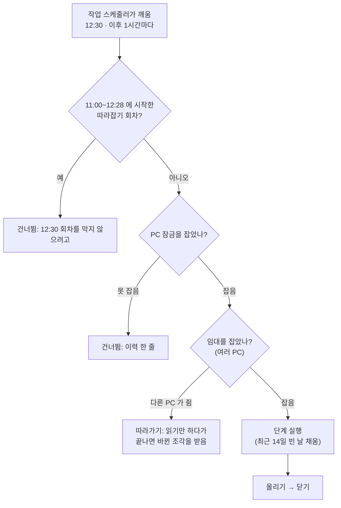

> [!GOAL]
>
> - 예약(언제)과 실행(무엇을)을 나눠 설명하고, 작업 스케줄러 설정 몇 가지가 하는 일을 말할 수 있습니다.
> - 잠금(겹침 막기)과 멱등성(다시 돌려도 같은 결과)이 **서로 다른 문제**를 푼다는 것을 예로 들 수 있습니다.
> - 놓친 날을 「빈 날 계산」으로 따라잡는 설계와, 실패했을 때 상태에 무엇을 남길지 설명할 수 있습니다.

이 장은 [2.1](#/p/data-layers)의 세 층, [2.2](#/p/public-api-basics)의 API 호출, [2.3](#/p/dataset-versioning-hf)의 판 올리기를 **매일 자동으로 돌리는** 뼈대를 다룹니다. 증권사 시세를 5분 · 10분 주기로 도는 자동매매의 예약은 이 장 범위 밖입니다.

> [!NOTE]
> 외부 사실은 2026-11-03 조사에서 열람한 Microsoft 문서와 오픈소스 문서를 기준으로 합니다. 대부분은 2026-11-04 에 원문 페이지를 직접 열어 문장을 대조했고, 대조하지 못한 것은 「더 읽을거리」 에 표시했습니다. 우리 코드는 2026-11-03 기준입니다.

## 아무도 기억하지 않아도 데이터가 매일 최신이 되려면?

2026-09-28 에 확인해 보니 원격 스냅샷은 09-21, 로컬 시세는 09-22, 수정주가 · 총수익 · 벤치마크는 09-17 에 멈춰 있었습니다. 단계마다 멈춘 날이 **서로 달랐다**는 것이 증거였습니다. 사람이 세션마다 기억해서 돌리는 방식은 결국 안 돕니다. 그래서 Claude 세션이나 터미널, 앱 컨테이너와 무관하게 Windows **작업 스케줄러**에 올렸습니다. 앱 스택에 들어 있는 주기 작업(Celery Beat)도 같은 일정을 갖지만, 스택이 떠 있을 때만 돕니다.

## 예약과 실행은 어떻게 나뉘나요?

작업 스케줄러는 **언제** 부를지만 알고, 러너(`scripts/daily_update.py`)가 **무엇을 어떤 순서로, 실패하면 어떻게** 할지를 가집니다. 단계 목록과 순서 · 실패 처리는 러너 안에 선언되어 있어서, 예약을 바꾸지 않고도 단계를 고칠 수 있습니다.

작업 정의에서 눈여겨볼 설정입니다. 「문서가 말하는 뜻」 은 Microsoft Learn 의 작업 스케줄러 스키마 문서(2026-11-03 열람)입니다.

| 설정 | 우리 값 | 문서가 말하는 뜻 |
|---|---|---|
| `MultipleInstancesPolicy` | `IgnoreNew` | 실행 중이면 새 인스턴스를 시작하지 않음 |
| `StartWhenAvailable` | `true` | 예약 시각이 지난 뒤 **언제든** 시작할 수 있게 함(시간 기준 작업에만 적용, 스키마상 기본 false) |
| `RunOnlyIfNetworkAvailable` | `true` | 네트워크가 있을 때만 실행 |
| `WakeToRun` | `false` | 예약 시각에 컴퓨터를 깨움 |
| `ExecutionTimeLimit` | `PT4H` | 허용 시간. 문서의 기본값은 시작 후 72시간에 중지 |
| `Repetition` | 1시간마다 10시간 | 반복 간격은 1분~31일 |
| `LogonType` | `InteractiveToken` | 사용자가 **이미 로그온해 있을 때만** 실행 |

예약 시각은 12:30 입니다. 시세는 다음 거래일 낮에 공개되므로 전 거래일 것을 12:30 에 받습니다.

> [!WARNING]
> `IgnoreNew` 가 있다고 러너의 잠금이 필요 없는 것이 아닙니다. 둘은 **보호 범위가 다릅니다.** 스케줄러 쪽은 같은 작업의 인스턴스만 봅니다. 화면의 「전체 수집」 이나 `--only` 같은 수동 실행은 같은 작업이 아니므로 러너의 잠금이 막습니다.

## 같은 배치가 두 번 동시에 돌면 무엇이 깨지나요?

같은 표에 두 회차가 동시에 쓰거나, 같은 파일을 서로 덮어쓰거나, 같은 호출 한도를 두 번 태웁니다. 이를 막는 가장 단순한 방법이 **잠금 파일**입니다. 운영체제의 「없을 때만 만든다」 연산(`O_CREAT` 와 `O_EXCL` 을 함께 주면 이미 있을 때 `EEXIST` 로 실패)을 쓰면 둘이 동시에 만들어도 한쪽만 성공합니다. 예제 ①입니다.

```output
① 첫 번째: True | 두 번째: False
```

잠금에는 함정이 둘 있습니다.

1. **죽은 프로세스가 남긴 잠금.** 파일은 그대로 남습니다. PID 가 살아 있는지 확인해야 하고, PID 는 재사용되므로 **너무 오래된 잠금은 쥔 것으로 보지 않습니다.** 우리는 4시간을 넘기면 치웁니다.
2. **Windows 에서 `os.kill(pid, 0)` 으로 생존을 묻지 않기.** 유닉스에서는 신호 0 이 「살아 있나」 를 묻는 관용이지만, Python 문서에 따르면 Windows 에서는 CTRL 이벤트가 아닌 sig 가 `TerminateProcess` 로 프로세스를 **무조건 종료**시킵니다. 우리는 `OpenProcess` 와 `GetExitCodeProcess` 로 묻고, 종료 코드 259(`STILL_ACTIVE`)와 비교합니다. 이 값을 응용이 종료 코드로 쓰면 아직 실행 중으로 오판할 수 있다고 문서가 경고합니다.

잠금에 걸린 회차는 어떻게 되나요? 정기 회차는 새 로그를 만들지 않고 이력에 「건너뜀」 한 줄만 남기고 끝납니다. 수동 회차는 종료 코드 75(`EX_TEMPFAIL`, 「나중에 다시」)를 돌려줍니다. 이 PC 의 이력에는 2026-10-28 13:30 에 「다른 실행이 돌고 있다」 로 건너뛴 기록이 있습니다. 12:36 에 시작한 회차가 아직 돌던 중에 1시간마다 다시 깨우는 반복이 걸린 것입니다.

## 다시 돌려도 같은 결과가 되려면?

잠금은 **동시에** 도는 것을 막고, **멱등성**은 **다시** 돌려도 같은 결과가 되게 합니다. 둘은 다른 문제입니다. 실패한 회차를 다시 돌려야 하는 정기 배치는 멱등이 아니면 한 번 실패할 때마다 데이터가 어긋납니다.

Apache Airflow 의 모범 사례 문서는 태스크를 DB 트랜잭션처럼 다루고, 재시도마다 같은 결과가 나오게 하라고 권합니다. 다시 돌릴 때 INSERT 대신 UPSERT 를 쓰고 특정 파티션만 읽고 쓰라는 것입니다(2026-11-04 원문 확인). 우리 시세 적재는 세 가지로 이를 따릅니다.

- **기본키 + upsert.** 표의 기본키가 (날짜, 종목)이고 `INSERT OR REPLACE` 로 넣어 같은 날을 두 번 받아도 행이 늘지 않습니다.
- **상태 표.** 날짜별 `done` · `empty` · `holiday` · `error` 를 적어 「이미 했으면 건너뛰기」 를 합니다.
- **한 트랜잭션.** 원문 · 정제 표 · 상태를 한 번에 커밋해 「상태는 done 인데 데이터는 없음」 이 생기지 않게 합니다. 「이미 했으면 건너뛰기」 는 무엇을 했다고 적었는지가 정확해야 믿을 수 있습니다.

```output
②  적재 2행 | 건너뜀(이미 done) | 행 수 2
```

파생 단계(수정주가 · 총수익 · 벤치마크)는 **새 자료가 없으면 건너뜁니다.** 같은 날 두 번 돌아도 계산을 되풀이하지 않기 위해서입니다. 올리기도 바뀐 파케이가 0개면 건너뛰어 내용 없는 커밋이 매일 쌓이지 않게 합니다([2.3](#/p/dataset-versioning-hf)).

> [!NOTE]
> 모든 단계가 멱등인 것은 아닙니다. 알림처럼 두 번 돌면 두 번 보낼 수 있는 단계는 「중복 방지 장치가 있는가」 를 따로 확인해야 합니다. 이 장을 쓰면서 수집 보고 알림의 중복 방지까지는 읽지 않았습니다.

## 놓친 날은 어떻게 따라잡나요?

컴퓨터가 꺼져 있거나 절전이면 12:30 에 못 돕니다. `StartWhenAvailable` 은 예약 시각이 지난 뒤 **한 번** 시작할 수 있게 할 뿐, 며칠 놓친 것을 날마다 채워 주지 않습니다. 이틀 놓쳤다면 오늘 한 번 돌고, 빠진 날을 메우는 일은 **배치 자신의 몫**입니다.

우리는 오늘을 찍는 대신 **최근 14일을 되돌아보며 빈 날만** 받습니다. 상태 표에서 `done` 과 `holiday` 는 건너뛰고 `error` 나 기록이 없는 날은 받습니다. 그래서 PC 가 사흘 꺼져 있어도 다음 회차가 알아서 메웁니다. 포털이 금요일 시세를 토요일 오전에도 주지 않았기 때문에(우리 실측), 「오늘 것을 오늘 받는」 일정은 성립하지 않는다는 이유도 있습니다. 예제 ③이 이 계산을 보입니다(합성 날짜).

```output
③ 빈 날(최근 7일 창): ['2026-10-28', '2026-10-29', '2026-10-30', '2026-11-03']
```

### 따라잡기 회차는 언제 시작하나요?

2026-10-26 에 PC 가 12:30 부터 18:48 까지 절전이었다가 복귀했고, 예약은 **18:54:23** 에 시작해 55분 30초 만에 끝났습니다(`StartWhenAvailable` 켬, `WakeToRun` 끔).

| 출처 | 복귀 뒤 시작까지 |
|---|---|
| Microsoft Learn(COM 속성 문서) | 늦게 시작되는 작업은 지연 후 시작, 기본 지연 10분 |
| 우리 실측(10-26) | 약 6분(18:48 → 18:54:23) |

문서값과 실측이 달라서 하나로 단정하지 않습니다. 이 한 번의 관찰이 일반 규칙인지는 확인하지 못했습니다. 또 「절전 중에는 예약 작업이 못 돈다」 는 직접 문장은 Microsoft 문서에서 찾지 못했습니다. 우리는 `WakeToRun` 을 일부러 끄고 **깨어난 뒤 따라잡기**에 맡겼습니다.

다른 도구들도 같은 문제를 다르게 풉니다. Airflow 의 `catchup` 은 켜면 안 돈 구간마다 실행 건을 만들고 끄면 최신 구간 하나만 만듭니다(기본은 꺼짐). systemd 의 `Persistent=` 는 마지막 실행 시각을 디스크에 저장했다가 놓친 실행이 있으면 활성화 즉시 **한 번** 따라잡습니다. cron 의 매뉴얼에는 놓친 실행을 따라잡는다는 서술이 없고, anacron 은 기계가 계속 켜져 있다고 가정하지 않는 도구로 소개됩니다. Airflow · systemd · cron · anacron 의 해당 문장은 2026-11-04 에 원문 페이지를 직접 열어 확인했습니다.



*그림 1. 한 회차의 갈림길(단순화). 어디서든 「건너뜀」 은 이력에 한 줄을 남깁니다.*

## 컴퓨터가 여러 대면 누가 도나요?

PC 잠금 파일은 **한 PC 안**에서만 막습니다. 같은 일을 하는 PC 가 둘이면 서로 모릅니다. Qurious 는 [2.3](#/p/dataset-versioning-hf)의 `parent_commit` 성질을 빌려, 백업 저장소의 전용 가지에 `lease.json` 하나를 두고 한 PC 만 잡게 합니다. 이것이 **임대(lease)** 입니다.

- 임대에는 **만료**가 있습니다(90분). 쥔 PC 는 단계 사이에 15분에 한 번까지 갱신하고, 소식이 90분 넘게 없으면 다른 PC 가 이어받습니다(예제 ⑤).
- 쥔 PC 가 도는 동안 못 잡은 PC 는 **읽기만** 합니다(5분마다, 최대 3시간). 끝나면 바뀐 조각만 받습니다.
- 임대 저장소에 닿지 못하면 회차를 **잡지 않습니다**(fail-closed). Google SRE 책의 분산 cron 장은 일반적으로 이중 실행보다 건너뜀을 택한다고 설명합니다(복구가 더 쉽기 때문이며 이것을 「fail closed」 라 부릅니다). 가비지 컬렉션 같은 멱등한 작업은 여러 번 돌려도 안전하지만, 뉴스레터처럼 두 번 돌면 안 되는 작업이 있고 월급 계산처럼 건너뛰면 안 되는 작업도 있어 상황마다 답이 다르다고 함께 말합니다.
- 만료된 뒤 깨어난 옛 쥔(좀비)이 쓰는 문제는 Martin Kleppmann 의 개인 글(2016)이 **펜싱 토큰**으로 설명합니다. 잠금 서비스가 단조 증가 토큰을 주고 저장소가 본 최댓값보다 낮은 토큰의 쓰기를 거부해야 한다는 것입니다. 우리는 갱신과 닫기의 「앞 커밋 비교」 로 비슷한 효과를 내는데, 이것은 **우리 해석**이며 펜싱 토큰 구현은 아닙니다.

```output
⑤ 60분 무소식: False | 91분 무소식: True
```

자리(slot) 날짜도 있습니다. 12:28 부터는 그날의 회차이고 그 앞은 전날 자리입니다. 이 12:28 은 12:30 회차가 시계 차이로 몇 초 일찍 깨어나도 건너뛰지 않게 둔 여유와 맞춰져 있습니다. 예제 ④입니다.

```output
④ 2026-11-03 09:00 -> 자리 2026-11-02 -> 건너뜀(끝남)
④ 2026-11-03 12:30 -> 자리 2026-11-03 -> 돈다
④ 2026-11-03 18:54 -> 자리 2026-11-03 -> 돈다
④ 2026-11-04 08:00 -> 자리 2026-11-03 -> 돈다
```

## 실패하면 상태에 무엇을 남기나요?

실패를 로그 한 줄로 끝내면 다음 회차가 무엇을 다시 해야 할지 모릅니다. 러너는 단계마다 이렇게 남깁니다.

- **단계 선언.** 실패하면 뒤 단계를 멈추는 단계(`fatal`), 허용된 실패 코드(`warn_codes`), 단계별 시간 한도(`timeout_min`)를 단계 목록에 적어 둡니다.
- **종료 코드 약속.** 「받은 날은 저장하고 일부는 못 받음」(69), 「나중에 다시」(75) 같은 값을 정해 러너가 경고와 실패를 가릅니다.
- **까닭 한 줄과 로그 파일 이름.** 실패한 단계의 까닭을 한 줄로 상태에 적습니다.
- **세 개의 파일.** 마지막 회차 상태(`daily_update_last.json`), 이력(`daily_update_history.jsonl`), 진행 중 상태가 있고 앱은 **읽기만** 합니다. 앱은 `GET /api/data/status` 로 이 파일을 읽을 뿐 수집 DB 를 열지 않습니다. 요청 때마다 수집 DB 를 세면 느리고 위험하기 때문입니다.


*그림 2. 2026-11-03 12:30 회차의 큰 단계(실제 기록). 한 PC 의 한 회차이므로 일반화하지 않습니다. 만든 스크립트는 `tools/learn_figs/batch-scheduling.py`.*

## 직접 해 보기

예제 [`batch_basics.py`](/learn/examples/batch_basics.py)는 표준 라이브러리만으로 위 ①~⑤를 합성 데이터에 돌립니다(임시 폴더만 씁니다). 다음은 2026-11-04 에 `python -X utf8 -I batch_basics.py` 로 돌린 전체 결과입니다(Python 3.13.14). 잠금과 멱등 적재의 핵심 줄은 이렇습니다.

```python
fd = os.open(lock, os.O_CREAT | os.O_EXCL | os.O_WRONLY)   # 이미 있으면 FileExistsError → 잡기 실패

with con:                                                   # 적재와 상태를 한 트랜잭션으로
    con.executemany("INSERT OR REPLACE INTO price VALUES (?,?,?)", rows)
    con.execute("INSERT OR REPLACE INTO ingest VALUES (?, 'done')", (day,))
```

```output
① 첫 번째: True | 두 번째: False
②  적재 2행 | 건너뜀(이미 done) | 행 수 2
③ 빈 날(최근 7일 창): ['2026-10-28', '2026-10-29', '2026-10-30', '2026-11-03']
④ 2026-11-03 09:00 -> 자리 2026-11-02 -> 건너뜀(끝남)
④ 2026-11-03 12:30 -> 자리 2026-11-03 -> 돈다
④ 2026-11-03 18:54 -> 자리 2026-11-03 -> 돈다
④ 2026-11-04 08:00 -> 자리 2026-11-03 -> 돈다
⑤ 60분 무소식: False | 91분 무소식: True
```

## Qurious 는 이렇게 돌립니다

**Qurious 는 이렇게 합니다.** 위 내용을 모으면 이렇습니다(2026-11-03 기준).

| 하는 일 | 방식 |
|---|---|
| 예약 | 작업 스케줄러가 12:30 에 `daily_update.py run --upload` 를 부름. 1시간마다 10시간 다시 깨워 절전 · 로그온 지연 · 일시 장애를 이어받음 |
| 겹침 막기 | PC 잠금 파일(`O_EXCL` · PID 생존 · 4시간), 여러 PC 는 임대(90분) |
| 멱등 | 상태 표 + upsert + 한 트랜잭션. 파생 · 올리기는 바뀐 것이 없으면 건너뜀 |
| 따라잡기 | 회차마다 최근 14일의 빈 날만 받음. 11:00~12:28 에 시작한 따라잡기 회차는 12:30 회차를 막지 않도록 돌지 않음 |
| 실패 기록 | 단계별 종료 코드 · 까닭 한 줄 · 이력 파일. 앱은 읽기만 |

### 교과서와 다른 점

| 교과서 | Qurious | 이유 |
|---|---|---|
| Airflow · EventBridge 같은 오케스트레이터 | 작업 스케줄러 + 자체 러너 | 사용자 PC 한 대 규모이고 서버가 없으며, 앱 스택과 무관하게 돌아야 함. **두 도구를 비교 검토한 기록은 찾지 못했습니다** |
| `catchup` 으로 구간별 재실행 | 회차마다 최근 14일의 빈 날만 | 「빈 날 계산」 이 멱등의 기준이라 구간이 틀어져도 다음 회차가 같은 규칙으로 메움 |
| 분산 잠금(Redis · etcd) | 저장소 가지 + 앞 커밋 비교 | 이미 쓰는 저장소를 재활용. 쓸 때마다 커밋이 쌓여 30일마다 그 가지만 이력을 정리 |
| `RestartOnFailure` 로 실패 시 재시작 | 쓰지 않음 | 실패는 단계별 상태에 남고 다음 회차가 메움. 쓰지 않는 이유가 코드에 적혀 있지는 않음 |

## 흔한 실수

1. **「`StartWhenAvailable` 이면 놓친 날이 전부 따라잡힌다」.** 시작할 수 있게 할 뿐입니다. 빈 날은 배치가 계산해 채웁니다.
2. **「따라잡기 회차는 즉시 돈다」.** 문서의 기본 지연은 10분이고 우리 한 번의 관찰은 6분이었습니다.
3. **「잠금 파일이 있으면 돌고 있는 것」.** 죽은 프로세스의 잠금도 남습니다. PID 생존과 나이를 함께 봅니다.
4. **「`os.kill(pid, 0)` 으로 생존 확인」.** Windows 에서는 프로세스를 죽입니다.
5. **「멱등이면 두 번 돌려도 된다」.** 같은 입력일 때만입니다. 「했다」 고 적는 상태가 정확해야 합니다.
6. **「스케줄러의 `IgnoreNew` 가 있으니 잠금은 필요 없다」.** 보호 범위가 다릅니다.
7. **「잠금은 한 PC 안만 막으면 된다」.** PC 가 여럿이면 임대 같은 공유 장치가 필요합니다.
8. **「`InteractiveToken` 은 비밀번호를 저장하지 않는 설정」.** 문서에는 그 말이 없습니다. 사용자가 로그온해 있을 때만 실행된다는 뜻입니다.

## 정리

1. 예약(언제)은 스케줄러가, 실행(무엇을 · 실패하면)은 러너가 가집니다.
2. 잠금은 **동시에** 도는 것을, 멱등성은 **다시** 돌리는 것을 다룹니다.
3. 놓친 날은 스케줄러가 아니라 배치가 「빈 날 계산」 으로 메웁니다.
4. 이중 실행보다 건너뜀을 택하면(fail-closed) 다음 회차가 이어받을 수 있습니다.
5. 실패는 까닭과 함께 상태에 남겨 다음 회차가 무엇을 다시 할지 알게 합니다.

<details>
<summary>확인 문제 1 — 12:30 에 꺼져 있던 PC 가 18:54 에 켜져 <code>StartWhenAvailable</code> 로 회차가 시작됐습니다. 이틀 전 빠진 날도 채워지나요?</summary>

스케줄러가 해 주는 일이 아닙니다. 배치가 「최근 14일의 빈 날」 을 스스로 계산해 채우므로 채워집니다(우리 설계). `StartWhenAvailable` 은 시작할 수 있게만 합니다.
</details>

<details>
<summary>확인 문제 2 — 잠금 파일에 PID 만 적고 나이는 안 보면 어떤 일이 생기나요?</summary>

죽은 프로세스의 PID 가 다른 프로세스에 재사용되면 영원히 「돌고 있다」 로 읽힙니다. 그래서 PID 생존과 4시간 나이를 함께 봅니다.
</details>

<details>
<summary>확인 문제 3 — Windows 에서 <code>os.kill(pid, 0)</code> 으로 프로세스가 살아 있는지 확인해도 되나요?</summary>

안 됩니다. Windows 에서는 임의의 sig 가 `TerminateProcess` 가 되어 그 프로세스를 종료시킵니다. `OpenProcess` 와 `GetExitCodeProcess` 로 종료 코드를 `STILL_ACTIVE`(259)와 비교합니다.
</details>

<details>
<summary>확인 문제 4 — 같은 날 시세 적재를 두 번 돌려도 행이 늘지 않게 하려면 무엇이 필요한가요?</summary>

기본키(날짜, 종목)와 `INSERT OR REPLACE`(upsert), 그리고 적재와 상태를 한 트랜잭션에 넣어 「상태는 done 인데 데이터가 없는」 경우를 막는 것입니다(예제 ②).
</details>

<details>
<summary>확인 문제 5 — 두 PC 가 같은 12:30 에 임대를 잡으려 합니다. 어떻게 하나만 이기나요?</summary>

「앞 커밋이 그대로일 때만 커밋」 이라는 저장소의 성질을 씁니다. 같은 머리를 읽고 함께 써도 먼저 쓴 쪽만 머리를 옮기고 나머지는 거절됩니다([2.3](#/p/dataset-versioning-hf)의 예제 ④).
</details>

## 더 읽을거리

아래 자료는 2026-11-03 조사에서 열람한 자료이며, 이 장을 쓰면서 다시 열지는 않았습니다. **대부분은 2026-11-04 에 원문 페이지를 직접 열어 대조했고, 항목마다 대조 범위를 적었습니다.**

- Microsoft Learn, 작업 스케줄러 스키마 — <https://learn.microsoft.com/en-us/windows/win32/taskschd/taskschedulerschema-startwhenavailable-settingstype-element> 외 `MultipleInstancesPolicy` · `ExecutionTimeLimit` · `LogonType` 항목.
- Microsoft Learn, `ITaskSettings::get_StartWhenAvailable` — <https://learn.microsoft.com/en-us/windows/win32/api/taskschd/nf-taskschd-itasksettings-get_startwhenavailable> · 늦게 시작할 때의 지연.
- Microsoft Learn, `GetExitCodeProcess` — <https://learn.microsoft.com/en-us/windows/win32/api/processthreadsapi/nf-processthreadsapi-getexitcodeprocess> · `STILL_ACTIVE`(259).
- Python 문서, `os.kill` — <https://docs.python.org/3/library/os.html#os.kill> · Windows 에서의 동작(2026-11-04 원문 확인).
- Linux man-pages, `open(2)` — <https://man7.org/linux/man-pages/man2/open.2.html> · `O_CREAT` 와 `O_EXCL`(2026-11-04 원문 확인).
- Apache Airflow, 「DAG Runs」 · 「Best Practices」 — <https://airflow.apache.org/docs/apache-airflow/stable/core-concepts/dag-run.html> · <https://airflow.apache.org/docs/apache-airflow/stable/best-practices.html>(2026-11-04 원문 확인 · `catchup_by_default=False` · UPSERT · 같은 결과 권고).
- freedesktop.org, `systemd.timer(5)` — <https://www.freedesktop.org/software/systemd/man/latest/systemd.timer.html> · `Persistent=`(2026-11-04 원문 확인 · 기본 false · `OnCalendar=` 에만 적용).
- Amazon Builders' Library, 「Making retries safe with idempotent APIs」 — <https://aws.amazon.com/builders-library/making-retries-safe-with-idempotent-APIs/>(2026-11-04 목차와 멱등 설명을 확인했고 세부 문장은 인용하지 않았습니다).
- Google SRE 책, 「Distributed Periodic Scheduling with Cron」 — <https://sre.google/sre-book/distributed-periodic-scheduling/>(2026-11-04 원문 확인 · 건너뜀 선호 · fail closed · 뉴스레터와 월급 예).
- Martin Kleppmann, 「How to do distributed locking」(2016) — <https://martin.kleppmann.com/2016/02/08/how-to-do-distributed-locking.html> · **개인 글**(분산 시스템 연구자의 글)이며 2026-11-04 원문에서 펜싱 토큰 설명을 확인했습니다.
- 이 장의 예제 [`batch_basics.py`](/learn/examples/batch_basics.py) · API 한도와 재시도는 [2.2](#/p/public-api-basics) · 판 올리기는 [2.3](#/p/dataset-versioning-hf).

> [!NOTE]
> 확인하지 못해 단정하지 않은 것: ① 「절전 중에는 예약 작업이 못 돈다」 는 직접 문장 ② `StartWhenAvailable` 이 유한한 반복과 함께 쓰일 때의 정확한 동작(우리 관찰 10-26 에 의존) ③ `OpenProcess` 가 이미 끝난 PID 에 어떻게 반응하는지 ④ 수집 보고 알림의 중복 방지 ⑤ 같은 회차에 두 PC 가 켜진 임대 경합의 실제 기록.

**용어**

| 말 | 뜻 |
|---|---|
| 배치 | 사람이 지켜보지 않아도 정해진 일을 한꺼번에 처리하는 작업 |
| 작업 스케줄러 | Windows 가 정해진 시각에 프로그램을 실행해 주는 기능 |
| 잠금(lock) | 같은 일이 동시에 두 번 돌지 않게 하는 표시 |
| 멱등성 | 같은 입력으로 몇 번을 돌려도 결과가 같은 성질 |
| upsert | 있으면 갱신, 없으면 추가(`INSERT OR REPLACE` 등) |
| 따라잡기(catch-up) | 놓친 회차 · 날을 나중에 메우는 일 |
| 임대(lease) | 만료 시각이 있는 잠금. 소식이 없으면 다른 쪽이 이어받음 |
| fail-closed | 확인하지 못하면 실행하지 않고 멈추는 방향의 설계 |
| 펜싱 토큰 | 단조 증가 번호로 낡은 쓰기를 거부하는 장치 |
