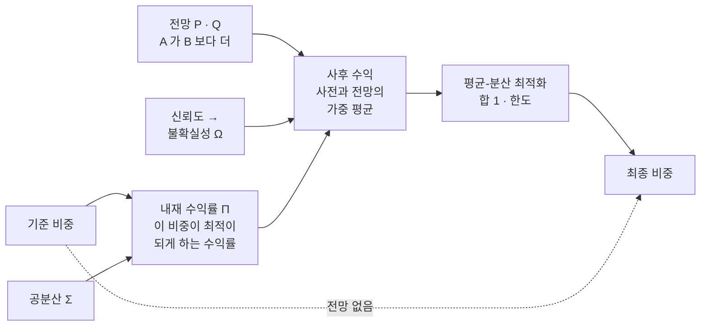

> [!GOAL]
>
> - 블랙–리터만이 무엇을 입력으로 받아 무엇을 내놓는지(기준 비중 → 내재 수익률 → 전망 · 신뢰도 → 사후 수익 → 비중)를 한 흐름으로 말하고, 평균-분산 최적화와 무엇이 다른지 설명할 수 있습니다.
> - 내재 수익률 Π · 전망 P · Q · 불확실성 Ω 가 각각 무엇인지 알고, 전망이 하나일 때 신뢰도 c 가 사후 수익을 사전에서 전망 쪽으로 c 만큼 옮긴다는 것을 계산으로 확인할 수 있습니다.
> - 교과서의 블랙–리터만(시가총액 시장 포트폴리오에서 출발)과 Qurious 의 블랙–리터만(사용자 기준 비중에서 출발)이 어디서 다른지, 한도와 입력이 결과를 어떻게 바꾸는지 구분할 수 있습니다.

이 장은 [11.5 평균-분산 최적화](#/p/mean-variance-optimization)에서 본 약점, 곧 기대수익 입력의 작은 오차가 비중을 크게 흔드는 문제에 대한 한 가지 대답을 다룹니다. 정해진 비중을 지키는 규칙은 [11.2 리밸런싱](#/p/rebalancing-methods)에 있고, 위험을 같게 나누는 리스크 패리티는 [11.6](#/p/risk-parity-min-variance)에서 다룹니다.

> [!NOTE]
> 모든 입력은 손으로 정한 합성 값이고 교육용입니다. 「국내주식이 해외주식보다 더 낫다」 는 전망도 계산을 보이려고 정한 가정이며 특정 투자를 권하는 글이 아닙니다. 출력은 2026-11-04 에 예제 [`black_litterman.py`](/learn/examples/black_litterman.py) 를 돌린 결과입니다.

## 평균-분산 최적화에는 무엇이 모자랐나요?

평균-분산 최적화는 모든 자산의 기대수익을 숫자로 넣어야 합니다. 그런데 투자자가 실제로 할 수 있는 말은 「국내주식이 해외주식보다 나아 보인다」 정도이고, 모든 자산의 연 수익률을 정확히 말하기는 어렵습니다. He · Litterman(1999)은 이 점과, 최적화기가 돌려주는 비중이 지나치게 제약하지 않으면 극단적이고 직관에 맞지 않는 경우가 많다는 점을 짚습니다. 입력을 정할 자연스러운 출발점이 없다는 것입니다. 같은 글은 이것이 Black 과 Litterman 이 이 방법을 만든 동기였다고 씁니다. 11.5 에서도 자산 B 의 기대수익을 1%p 바꾸자 세 비중의 변화 합계가 32.5%p 였습니다.

블랙–리터만은 입력을 받는 방식을 세 가지로 바꿉니다.

1. **출발점을 줍니다.** 기대수익을 빈 칸에서 시작하지 않고, 어떤 기준 포트폴리오가 이미 최적이라고 보았을 때 나오는 수익률(내재 수익률)에서 시작합니다.
2. **전망을 일부만 말하게 합니다.** 「A 가 B 보다 연 3%p 더」 처럼 일부 자산에 대한 문장만 넣고, 전망이 없는 부분은 출발점에 그대로 둡니다.
3. **얼마나 믿는지를 입력으로 받습니다.** 전망과 출발점을 섞는 정도를 신뢰도로 정합니다.

## 계산은 어떤 순서로 흘러가나요?



| 기호 | 이름 | 뜻 |
|---|---|---|
| Σ | 공분산 | 자산별 변동성과 자산 사이 상관을 묶은 표(11.5) |
| δ | 위험 회피 계수 | 클수록 위험을 싫어함. 원 모형에서는 시장 전체의 평균 위험 회피를 나타냄 |
| Π | 내재 수익률 | 기준 비중이 최적이 되게 하는 수익률 Π = δΣw |
| τ | 사전의 불확실성 | Π 가 얼마나 불확실한지를 나타내는 작은 양수 |
| P · Q | 전망 | K 개의 전망을 Pμ = Q + 오차 로 적은 것. P 는 어느 자산에 대한 문장인지, Q 는 그 값 |
| Ω | 전망의 불확실성 | 전망 오차의 분산. 작을수록 확신이 큼 |
| μ̄ | 사후 수익 | 사전과 전망을 섞어 고친 기대수익 |

기호는 He · Litterman(1999) 부록 B 를 따릅니다. 전망을 보기 전의 추정이 **사전**(prior), 반영한 뒤의 추정이 **사후**(posterior)입니다. 새 정보를 섞어 추정을 고치는 이 방식을 베이즈(Bayes) 접근이라 하고, PyPortfolioOpt 문서도 블랙–리터만을 이렇게 설명합니다.

## 내재 수익률은 무엇이고 어떻게 구하나요?

11.5 에서 합 제약이 없을 때 효용을 가장 크게 하는 비중은 (δΣ)⁻¹μ 였습니다. 이 식을 거꾸로 읽으면 μ = δΣw 입니다. 어떤 비중 w 가 지금 최적이려면 기대수익이 이 값이어야 한다는 뜻입니다. 비중에서 수익률을 거꾸로 구하는 일을 **역최적화**라 하고, 그 값 Π = δΣw 를 **내재 수익률**이라 합니다.

교과서의 블랙–리터만은 w 로 시가총액 비중의 시장 포트폴리오를 씁니다. 시장 전체가 이 비중으로 수요와 공급이 맞아 있다고 보는 것이고, 그 Π 를 균형 수익률이라 부릅니다. He · Litterman 은 자본자산가격결정모형(CAPM)의 균형에서 나온 이 수익률을 모델의 중립적인 기준점이라 설명합니다.

Qurious 는 시장 포트폴리오를 쓰지 않습니다. 성향별 기본 배분(현금 제외)이나 사용자가 입력한 기준 비중을 같은 식에 넣습니다. 그래서 이 장은 이 값을 「시장 균형 수익률」 이 아니라 **기준 비중의 내재 수익률**이라 부릅니다.

> [!IMPORTANT]
> 내재 수익률은 시장이나 누군가의 예측이 아닙니다. 「이 비중이 합리적이려면 필요했을 수익률」 입니다. 기준 비중이 시가총액 비중이 아니면 「균형」 이라는 말도 맞지 않습니다.

예제의 네 자산군은 합성 값입니다. 변동성은 국내주식 18% · 해외주식 16% · 국내채권 5% · 대체자산 14% 이고, 기준 비중은 30 · 25 · 30 · 10 에서 현금 5% 를 뺀 비중입니다. δ=3 일 때 Π 는 이렇습니다.

```output
① 기준 비중 w0 에서 거꾸로 푼 수익률 Π = 3·Σ·w0 (합성 · 연 초과수익 %)
  기준 비중 [ 31.6  26.3  31.6  10.5]%  →  Π [  4.91   4.07   0.34   1.52]%   (국내주식 − 해외주식 = 0.833%p)
  뷰 없음 → 최적 비중 [ 31.6  26.3  31.6  10.5]%  (= w0 로 돌아옴: True)
```

국내채권의 Π 가 0.34% 로 낮은 것은 변동성이 5% 로 가장 낮아 Σw 가 작기 때문입니다. 이 Π 를 효용 최대화에 그대로 넣으면(전망 없음) 기준 비중으로 돌아옵니다. 역최적화가 맞게 되돌려졌다는 확인이고, 전망이 없으면 결과가 출발점에 머문다는 블랙–리터만의 성질이기도 합니다. 출력의 「뷰」 는 이 장의 「전망」 입니다.

## 전망과 신뢰도는 어떻게 입력하나요?

**전망.** 블랙–리터만의 전망은 기대수익에 대한 일차식 문장 Pμ = Q + 오차 입니다. P 는 어느 자산들에 대한 문장인지, Q 는 그 문장이 말하는 값입니다.

- **절대 전망**: 「A 는 연 10% 오른다」. P 의 행에서 A 자리만 1.
- **상대 전망**: 「A 가 B 보다 연 3%p 더 오른다」. A 자리에 +1, B 자리에 −1. 행의 합이 0 입니다.

PyPortfolioOpt 문서도 상대 전망 행의 합이 0 이어야 한다고 적습니다. Qurious 는 상대 전망만 받습니다.

**불확실성 Ω.** 전망이 틀릴 수 있는 정도를 오차의 분산 Ω 로 적습니다. 작을수록 확신이 크고 Ω = 0 이면 100% 확신입니다(Idzorek). He · Litterman 은 전망 하나의 불확실성을 ω 라 하고 확신을 1/ω 로 표현합니다. 문제는 Ω 를 숫자로 정하기 어렵다는 것이고, 문헌에는 몇 가지 방법이 있습니다.

| 방법 | Ω 를 정하는 법 (출처) |
|---|---|
| He · Litterman 기본 보정 | Ω/τ 를 전망 포트폴리오의 분산 pΣpᵀ 와 같게 둠: Ω = τ·pΣpᵀ. τ 를 따로 정하지 않음 (He · Litterman 각주 6) |
| Idzorek 방법 | 전망마다 0~100% 신뢰도 C 를 받아, 전망이 만드는 비중 이동이 「확신 100% 일 때 이동 × C」 에 가깝도록 Ω 를 정함 (Idzorek 3.2절) |
| PyPortfolioOpt | 기본은 Ω = τ·pΣpᵀ. omega="idzorek" 를 고르면 신뢰도 c(0~1)로 Ω = τ·((1−c)/c)·pΣpᵀ. 소스 설명은 이를 Walters(2014)의 닫힌 해라고 적음 (문서 · 소스) |

Qurious 의 규칙은 마지막 식과 같은 꼴입니다. Ω = τ·pΣpᵀ·(1−c)/c 이고 c 는 입력한 신뢰도, τ 는 0.05 입니다. c = 50% 이면 (1−c)/c = 1 이어서 He · Litterman 기본 보정과 같아집니다. 다만 앱 코드는 이 규칙의 출처를 밝히지 않고, Walters(2014) 원문은 열람하지 못했습니다. 그래서 이 장은 이 식을 「Qurious 의 규칙」 이라 부르고, PyPortfolioOpt 가 Idzorek 방법의 닫힌 해로 구현한 식과 같은 꼴이라고만 말합니다. c = 0 이면 Qurious 는 그 전망을 건너뜁니다. PyPortfolioOpt 는 Ω 를 아주 큰 값(1,000,000)으로 두어 사실상 무시합니다.

> [!NOTE]
> 신뢰도는 전망이 맞을 확률이 아닙니다. 70% 신뢰도는 「맞을 확률 70%」 가 아니라, 전망과 출발점을 섞을 때 전망 쪽에 얼마나 무게를 두느냐를 정하는 입력입니다. 다음 절에서 계산으로 봅니다.

## 사후 수익은 어떻게 계산되나요?

전망을 반영한 사후 기대수익은 He · Litterman 부록 B 의 식입니다.

μ̄ = [(τΣ)⁻¹ + PᵀΩ⁻¹P]⁻¹ [(τΣ)⁻¹Π + PᵀΩ⁻¹Q]

복잡해 보이지만 사전 Π 와 전망 Q 를 각각 불확실성의 역수로 가중해 평균한 것입니다. PyPortfolioOpt 문서도 같은 설명을 합니다. Qurious 는 같은 값을 주는 다음 꼴로 계산합니다.

μ̄ = Π + τΣPᵀ (τPΣPᵀ + Ω)⁻¹ (Q − PΠ)

Q − PΠ 는 「전망이 사전과 얼마나 다른가」 이고, 앞의 곱이 그 차이의 얼마만큼을 사전에 더할지 정합니다. 두 꼴이 같은 값을 주는지는 아래 예제 ⑥ 에서 확인하고, Qurious 꼴을 옮긴 코드는 예제의 `posterior` 함수입니다.

**전망이 하나일 때** 결과가 단순해집니다. 전망의 사전 값을 π = pΠ, 전망 포트폴리오의 분산을 s = pΣpᵀ 라 하면 Ω = τ·s·(1−c)/c 에서 τs / (τs + Ω) = c 입니다. 따라서 사후 상대수익은 π + c·(Q − π) 입니다. 사전에서 전망 쪽으로 **c 만큼** 갑니다. 신뢰도 0 이면 사전 그대로, 1 에 가까우면 전망 값에 가까워집니다.

```output
② 뷰: 국내주식이 해외주식보다 연 3%p 더 — 신뢰도 c 에 따라 사후 상대수익은 사전에서 3%p 쪽으로 c 만큼 간다
  c=0.25 사후 상대수익 1.375%p   사전 + c·(3 − 사전) = 1.375%p
  c=0.5  사후 상대수익 1.917%p   사전 + c·(3 − 사전) = 1.917%p
  c=0.9  사후 상대수익 2.783%p   사전 + c·(3 − 사전) = 2.783%p
  c=0.5 에서 네 자산군의 기대수익 (연 초과수익 %) — 뷰에 나오지 않는 자산의 기대수익도 움직인다
  국내주식  사전  4.91 → 사후  5.66  (+0.75%p)
  해외주식  사전  4.07 → 사후  3.74  (-0.33%p)
  국내채권  사전  0.34 → 사후  0.40  (+0.06%p)
  대체자산  사전  1.52 → 사후  1.55  (+0.03%p)
```

사전 0.833%p 에서 전망 3%p 까지의 거리를 신뢰도 25 · 50 · 90% 만큼 간 값이 1.375 · 1.917 · 2.783%p 입니다. 그림 1 의 직선이 이 관계입니다. 한편 전망에 나오지 않은 국내채권과 대체자산의 기대수익도 오릅니다. 두 자산이 전망 포트폴리오(국내주식을 사고 해외주식을 판 포지션)와 양의 공분산이 있기 때문이고, He · Litterman 도 독일 대 유럽 나머지 전망에서 프랑스와 영국의 기대수익이 오르는 현상을 같은 이유로 설명합니다. 그러나 비중은 아래에서 보듯 움직이지 않습니다.


*그림 1. 신뢰도에 따른 사후 상대수익. 합성 데이터이며 전망 하나(국내주식이 해외주식보다 연 3%p 더)만 넣었습니다.*

```output
④ τ 를 바꿔도 사후 수익은 같다 (c=0.5 · Ω 가 τ 에 비례해 약분된다)
  τ=0.005 사후 수익 [  5.66   3.74   0.40   1.55]%
  τ=0.05  사후 수익 [  5.66   3.74   0.40   1.55]%
  τ=0.5   사후 수익 [  5.66   3.74   0.40   1.55]%
⑤ 신뢰도 99% 와 0%
  c=0.99 사후 상대수익 2.978%p (뷰 3%p 에 거의 닿음)
  c=0 이면 뷰를 쓰지 않는다 → 사후 수익 = Π, 비중 = 기준 비중
```

τ 는 이 규칙에서 결과에 영향이 없습니다. Ω 가 τ 에 비례해 약분되기 때문입니다. PyPortfolioOpt 문서도 기본 Ω 나 idzorek 옵션을 쓰면 τ 값이 중요하지 않다고 적지만, Ω 를 직접 숫자로 넣을 때는 τ 를 따로 정해야 합니다. 신뢰도 99% 에서는 2.978%p 로 전망에 거의 닿고, 0% 이면 전망을 쓰지 않아 사후 수익이 Π 그대로입니다. 앱은 신뢰도를 0~99% 까지만 받고 100% 는 받지 않습니다.

## 최적 비중은 어떻게 나오나요?

사후 수익이 나오면 비중을 구합니다. 제약이 없으면 He · Litterman 부록 B 의 결과처럼 w = (δΣ)⁻¹μ̄ 이고, 이는 **기준 비중에 전망 포트폴리오들의 가중합을 더한 것**입니다. 그래서 전망에 나오지 않은 자산은 기준 비중에서 벗어나지 않습니다. 제약(합 1 · 한도 등)이 붙으면 이렇게 간단히 쓸 수 없습니다. 이때 He · Litterman 은 블랙–리터만으로 사후 기대수익을 만든 뒤 그 수익을 평균-분산 최적화기에 넣어 푸는 것이 가장 쉬운 방법이라고 말하고, Qurious 도 그렇게 합니다. 예제의 `weights` 함수는 11.5 의 `best` 와 같은 방식(SciPy SLSQP)으로 풉니다.

같은 전망(국내주식이 해외주식보다 연 3%p 더)을 넣고 신뢰도를 바꿔 봅니다. 「한도 없음」 은 닫힌 식 (δΣ)⁻¹μ̄ 이고, 「앱 한도」 는 합 1 · 각 1~95% 로 푼 값입니다.

```output
③ 같은 뷰를 넣은 최적 비중 (국내주식 · 해외주식 · 국내채권 · 대체자산 %)
  뷰 없음(기준 비중)      [ 31.6  26.3  31.6  10.5]
  c=0.25 한도 없음 [ 41.8  16.1  31.6  10.5]   앱 한도 1~95% [ 41.8  16.1  31.6  10.5]
  c=0.5  한도 없음 [ 52.0   5.9  31.6  10.5]   앱 한도 1~95% [ 52.0   5.9  31.6  10.5]
  c=0.9  한도 없음 [ 68.3 -10.5  31.6  10.5]   앱 한도 1~95% [ 61.1   1.0  28.8   9.1]
  c=1.0 한도 없음         [ 72.4 -14.5  31.6  10.5]   ← 확신 100%(Ω=0) 일 때 한도 없는 비중
  c=0.25 (한도 없음 이동) / (확신 100% 이동) = [0.25 0.25]
  c=0.5  (한도 없음 이동) / (확신 100% 이동) = [0.5 0.5]
  c=0.9  (한도 없음 이동) / (확신 100% 이동) = [0.9 0.9]
```


*그림 2. 신뢰도에 따른 최적 비중. 합성 데이터이며 굵은 점선이 앱 한도(1~95%), 가는 실선이 한도 없음입니다.*

읽는 법은 세 가지입니다.

- **한도가 없으면 정확히 c 배입니다.** 전망이 하나이고 한도가 없을 때 비중 이동은 확신 100% 일 때 이동의 c 배입니다(마지막 세 줄). Idzorek 방법이 목표로 하는 「확신 100% 때 이동 × 신뢰도」 와 같은 모양입니다. 전망이 둘 이상인 경우는 이 장에서 확인하지 않았으므로 같은 비례를 가정하지 않습니다.
- **전망에 없는 자산은 안 움직입니다.** c=0.25 와 0.5 에서 국내채권 31.6 · 대체자산 10.5 가 그대로입니다. 반면 c=0.9 에서는 한도 없이 풀면 해외주식이 −10.5%(공매도)가 되고, 앱은 공매도를 허용하지 않아 해외주식을 1% 하한에 묶고, 합 1 을 맞추려고 국내주식(61.1)과 국내채권(28.8) · 대체자산(9.1)이 함께 줄어듭니다. 한도가 걸리면 비례도, 전망에 없는 자산이 안 움직인다는 성질도 깨집니다(그림 2 의 점선).
- **전망 하나의 영향이 큽니다.** 3%p 전망 하나가 c=0.5 에서 국내주식을 31.6% 에서 52.0% 로 20.4%p 움직였습니다. 전망 하나 · 한도 없음에서 이동은 c·(Q − pΠ)/(δ·pΣpᵀ) 에 전망 벡터 p 를 곱한 크기입니다(사후 수익 식과 w = (δΣ)⁻¹μ̄ 에서 정리한 식). 분모의 pΣpᵀ 가 작을수록, 곧 전망 포트폴리오의 변동성이 낮을수록 같은 전망 차이에도 비중이 크게 움직입니다.

아래 ⑥ 이 이 닫힌 식을 숫자로 확인하고, 앞에서 말한 두 꼴(부록 B 형태와 Qurious 형태)이 같은 값을 주는지도 확인합니다.

```output
⑥ 교과서 꼴과 같은 값인지, 뷰 하나 · 한도 없음일 때 비중 이동의 닫힌 식
  c=0.25 [(τΣ)⁻¹ + PᵀΩ⁻¹P]⁻¹[(τΣ)⁻¹Π + PᵀΩ⁻¹Q] 와 같은 값: True
  c=0.5  [(τΣ)⁻¹ + PᵀΩ⁻¹P]⁻¹[(τΣ)⁻¹Π + PᵀΩ⁻¹Q] 와 같은 값: True
  c=0.9  [(τΣ)⁻¹ + PᵀΩ⁻¹P]⁻¹[(τΣ)⁻¹Π + PᵀΩ⁻¹Q] 와 같은 값: True
  pΣpᵀ = 0.01768 (상대 포지션의 분산) · 100% 확신 때 국내주식 +40.9%p · 해외주식 −40.9%p
  c=0.25 닫힌 식 c·(Q − pΠ)/(δ·pΣpᵀ) = 10.21%p   푼 값 10.21%p
  c=0.5  닫힌 식 c·(Q − pΠ)/(δ·pΣpᵀ) = 20.43%p   푼 값 20.43%p
  c=0.9  닫힌 식 c·(Q − pΠ)/(δ·pΣpᵀ) = 36.77%p   푼 값 36.77%p
```

이 예에서 pΣpᵀ = 0.01768(변동성 약 13.3%)이고 사전과 전망의 차이는 3 − 0.833 = 2.17%p 입니다. 블랙–리터만은 비중이 움직이는 이유를 이해하기 쉽게 만들어 줄 뿐, 입력에 민감한 성질까지 없애 주지는 않습니다.

## 우리 서비스에서는 어떻게 쓰나요?

**Qurious 는 이렇게 합니다.**

- **어디에 쓰이나**: 자산군 배분 모델 네 가지(리스크 패리티 · 최소분산 · 블랙–리터만 · 시장 국면) 중 하나입니다. 네 자산군(국내주식 · 해외주식 · 국내채권 · 대체자산)의 공분산은 각각의 대용 ETF 일수익률로 추정합니다(11.5 참고).
- **기준 비중**: 성향별 기본 배분 또는 사용자가 입력한 기준 비중에서 현금을 뺀 네 자산군 비중입니다. 입력은 합 100% · 0.1% 단위이고, 현금을 뺀 뒤 각 자산군은 1~95% 안이어야 합니다. 화면 입력칸의 기본값은 국내주식 30 · 해외주식 25 · 국내채권 30 · 대체자산 10 · 현금 5 이고, 이 장의 예제 기준 비중이 여기서 현금을 뺀 값입니다.
- **내재 수익률**: Π = 3·Σ·기준 비중. δ 는 3 으로 고정이고 시장에서 추정한 값이 아닙니다. PyPortfolioOpt 문서는 시장의 초과수익을 분산으로 나눈 값을 시장 내재 위험 회피로 소개합니다.
- **전망**: 「A 자산군이 B 자산군보다 연 q%p 더」 형태의 상대 전망만 받습니다. 최대 6개, 같은 자산군 쌍은 한 번만, q 는 −50~+50%p, 신뢰도는 0~99% 입니다. 화면의 새 전망 기본값은 3%p · 신뢰도 50% 입니다.
- **불확실성**: Ω = τ·pΣpᵀ·(1−c)/c, τ = 0.05. 신뢰도 0 인 전망은 건너뛰고, 남는 전망이 없으면 최적화 없이 기준 비중을 그대로 돌려줍니다.
- **비중**: 사후 수익을 효용 최소화(δ=3)에 넣고 합 1 · 각 1~95% 로 SciPy SLSQP 가 풉니다. 수렴하지 않으면 임의의 비중을 내지 않고 오류를 내며 기존 저장 결과를 유지합니다. 사후 공분산은 계산하지 않고 표본 공분산 Σ 를 그대로 씁니다. He · Litterman 의 제약 없는 해도 Σ 를 쓰므로 틀린 것이 아니라 단순화한 선택입니다.
- **표시**: 결과 설명에 「사용자 기준 균형 비중입니다. 시가총액 가중 시장 비중은 아닙니다.」 가 함께 나옵니다. 결과에 담기는 기대수익은 사후 초과수익에 현금과 같은 연 2.5% 를 더해 만들며 비중 계산에는 쓰이지 않습니다.

**앱의 설명 문구와 다른 곳이 있습니다.** 용어사전과 도움말은 블랙–리터만을 「시장 균형 수익률에 투자자의 주관적 전망을 결합하는 모델」 이라고 설명합니다. 이는 교과서의 설명이고, 위 계산은 시장이 아니라 기준 비중에서 출발합니다. 배분 화면의 「기준 균형 비중」 도 시가총액 균형이 아니라 사용자 기준을 뜻합니다. 이 장은 계산을 기준으로 씁니다.

**이 장의 예제와 앱 계산의 관계.** 예제는 앱의 계산식을 옮긴 것입니다. 2026-11-04 에 앱의 계산 함수를 같은 입력(기준 비중 · 공분산 · 3%p 전망 · 신뢰도 25 · 50 · 90%)으로 실행해 비교했습니다. 사후 수익은 같았고 비중 차이는 0.001%p 이내였습니다(최적화 풀이의 허용 오차). 전망이 없는 경우와 신뢰도 0 인 경우에도 기준 비중이 그대로 나왔습니다. 다만 화면의 숫자는 실제 대용 ETF 로 추정한 공분산을 쓰므로 이 장의 숫자와 같지 않습니다.

## 흔한 실수

1. **내재 수익률을 시장의 예측으로 읽기.** 「이 비중이 최적이려면 필요했을 수익률」 일 뿐이고, 입력이 시장 비중이 아니면 「균형」 도 아닙니다.
2. **Qurious 의 기준 비중을 시가총액 비중으로 알기.** 성향 배분 또는 사용자 입력이고, 결과에도 그렇게 표시됩니다.
3. **신뢰도를 맞을 확률로 읽기.** 사전과 전망을 섞는 비율입니다. 전망 하나에서는 사후 상대수익이 사전에서 전망 쪽으로 c 만큼 갑니다.
4. **τ 를 키우면 전망이 더 반영된다고 믿기.** Qurious 의 Ω 규칙에서는 τ 가 약분되어 사후 수익이 같습니다.
5. **블랙–리터만이 입력 오차를 없애 준다고 믿기.** 기대수익을 정하는 부담을 덜어 줄 뿐입니다. 공분산은 여전히 과거 표본(앱은 최근 최대 756거래일)에서 추정하고, 전망과 신뢰도는 사용자의 가정이며 예측이 아닙니다.

## 정리

1. 블랙–리터만은 기준 비중에서 거꾸로 푼 내재 수익률 Π 를 사전으로 두고, 전망을 신뢰도(불확실성 Ω)만큼 섞어 사후 수익을 얻은 뒤 평균-분산 최적화로 비중을 구하는 방법입니다.
2. 교과서는 시가총액 시장 포트폴리오에서 출발하지만 Qurious 는 성향 배분 또는 사용자 입력 기준 비중에서 출발합니다. 「시장 균형」 이라 부르면 오해가 생깁니다.
3. 전망이 하나이고 한도가 없으면 사후 수익도 비중 이동도 신뢰도 c 에 비례합니다. 한도가 걸리면 그 비례가 깨집니다.
4. 비중이 움직이는 이유는 이해하기 쉬워지지만 입력에 민감한 성질은 남습니다. 전망 · 신뢰도 · 기준 비중이 결과를 정합니다.

<details>
<summary>확인 문제 1 — 전망을 하나도 넣지 않거나 신뢰도를 0% 로 두면 앱의 결과 비중은 무엇인가요?</summary>

기준 비중 그대로입니다. 전망이 없으면 사후 수익이 내재 수익률 Π 이고, Π 는 기준 비중이 최적이 되도록 거꾸로 구한 값이기 때문입니다(예제 ①).
</details>

<details>
<summary>확인 문제 2 — 신뢰도 50% 인 전망 하나의 사후 상대수익은 사전 0.833%p, 전망 3%p 일 때 얼마인가요?</summary>

사전과 전망의 한가운데인 1.917%p 입니다. 사전 + c × (전망 − 사전) = 0.833 + 0.5 × (3 − 0.833) 입니다.
</details>

<details>
<summary>확인 문제 3 — c=0.9 에서 한도 없이 풀면 해외주식이 −10.5% 인데 앱 결과는 1.0% 입니다. 왜 다른가요?</summary>

앱은 공매도를 허용하지 않고 각 자산군을 1~95% 로 제한합니다. 해외주식이 하한 1% 에 묶이고 합 1 을 맞추려고 국내채권과 대체자산이 줄었습니다. 그래서 이 구간에서는 전망에 없는 자산도 움직입니다.
</details>

<details>
<summary>확인 문제 4 — Qurious 의 기준 비중이 시가총액 시장 비중이 아니라는 사실은 사용자에게 어디서 알리나요?</summary>

블랙–리터만 결과 설명에 「사용자 기준 균형 비중입니다. 시가총액 가중 시장 비중은 아닙니다.」 라는 문구가 함께 나옵니다.
</details>

## 더 읽을거리

- He, Litterman (1999.12), 「The Intuition Behind Black-Litterman Model Portfolios」, Goldman Sachs Investment Management Research — <https://people.duke.edu/~charvey/Teaching/BA453_2006/GS_The_intuition_behind.pdf> · 부록 B(Π · 사전 · 전망 · 사후 수익 식) · 각주 6(Ω 기본 보정) · 제약이 있을 때의 풀이 · 극단 비중 예. 대학 강의 사이트에 올라 있는 사본을 열람했습니다. 2026-11-04 확인.
- Idzorek (2004.7.20 판), 「A Step-by-Step Guide to the Black-Litterman Model: Incorporating user-specified confidence levels」 — <https://people.duke.edu/~charvey/Teaching/BA453_2006/Idzorek_onBL.pdf> · 3.2절 신뢰도와 비중 이동. 저자 사본의 초안이며 학술서에 실린 판은 열람하지 못했습니다. 2026-11-04 확인.
- PyPortfolioOpt, 「Black-Litterman Allocation」 (1.5.4) — <https://pyportfolioopt.readthedocs.io/en/latest/BlackLitterman.html> · 소스 <https://pyportfolioopt.readthedocs.io/en/latest/_modules/pypfopt/black_litterman.html> · 전망 입력 · Ω 와 τ · idzorek 옵션의 식. Walters(2014) 원문은 열람하지 못했습니다. 2026-11-04 확인.
- Black, Litterman (1992), 「Global Portfolio Optimization」, *Financial Analysts Journal* 48(5), 28–43 — DOI <https://doi.org/10.2469/faj.v48.n5.28> · 서지만 확인했고 본문은 열람하지 못했습니다. He · Litterman 의 참고문헌에는 같은 저자의 1990년 골드만삭스 보고서도 실려 있습니다. 2026-11-04 확인.
- 이 장의 예제 [`black_litterman.py`](/learn/examples/black_litterman.py) · 입력 민감도와 최적화는 [11.5](#/p/mean-variance-optimization) · 정해진 비중을 지키는 규칙은 [11.2](#/p/rebalancing-methods).

**용어**

| 말 | 뜻 |
|---|---|
| 블랙–리터만 | 기준 포트폴리오의 내재 수익률에 투자자의 전망을 신뢰도만큼 섞어 기대수익과 비중을 정하는 모델 |
| 역최적화 | 비중이 최적이라고 보고 그 비중이 나오게 하는 수익률을 거꾸로 구하는 일 |
| 내재 수익률 Π | δΣw. 기준 비중이 최적이 되게 하는 수익률. 시장 비중에서 구하면 균형 수익률 |
| 전망(뷰) | 일부 자산의 기대수익에 대한 문장. 절대 전망과 상대 전망이 있음 |
| 불확실성 Ω | 전망 오차의 분산. 작을수록 확신이 큼 |
| 신뢰도 c | 전망 쪽에 두는 무게. 맞을 확률이 아님 |
| τ | 사전의 불확실성을 나타내는 스칼라. Qurious 의 Ω 규칙에서는 결과에 영향이 없음 |
