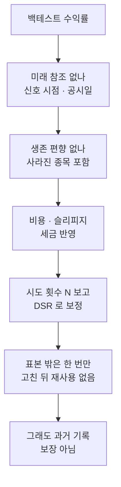

> [!GOAL]
>
> - 백테스트 성과가 실제보다 좋게 나오기 쉬운 이유를 미래 참조 · 생존 편향 · 과최적화 · 비용 누락 · 표본 밖 재사용 다섯 가지로 설명할 수 있습니다.
> - 난수 전략만으로도 높은 샤프가 나오는 것을 코드로 재현하고, 시도 횟수 N 이 왜 필요한지 말할 수 있습니다.
> - 어떤 백테스트 보고서를 받든 시도 횟수 · 표본 밖 · 비용 · 기간 · 편향을 점검표로 따져 물을 수 있습니다.

이 장은 백테스트를 믿는 법과 의심하는 법을 다룹니다. 체결 가정과 비용을 계산하는 방법은 [10.1 백테스트의 뼈대](#/p/backtest-basics), 시간 순서를 지킨 모델 평가 기법은 [12.2](#/p/time-ordered-model-evaluation)에 있습니다.

> [!NOTE]
> 그림과 출력은 난수로 만든 합성 데이터이고 교육용입니다. 과거의 성과는 앞날의 수익을 보장하지 않습니다.

## 아무 실력이 없는 전략에서도 높은 샤프가 나올 수 있을까요?

평균 수익률이 0 인 난수로 「전략」 을 만듭니다. 일 표준편차는 1%, 기간은 3년(756거래일)입니다. 이런 전략을 N개 만들어 그중 샤프가 가장 높은 것을 고르고, 같은 실험을 200번 되풀이해 평균을 냅니다. 이 실험을 하는 [`backtest_trust.py`](/learn/examples/backtest_trust.py) 의 첫 부분입니다.

```output
① 난수 전략 N개 중 최고 연환산 샤프 (합성 데이터 · 평균 0 · 일 표준편차 1% · 3년 756일 · 200번 평균 · 시드 42)
  N=1     시뮬레이션 -0.05   기대 최댓값 식 +0.00
  N=10    시뮬레이션 +0.89   기대 최댓값 식 +0.91
  N=100   시뮬레이션 +1.43   기대 최댓값 식 +1.46
  N=1000  시뮬레이션 +1.89   기대 최댓값 식 +1.88
```


*그림 1. 시도한 전략의 수와 그중 최고 샤프. 합성 데이터(시드 42)이며 모든 전략의 참 실력은 0 입니다.*

실력이 전혀 없어도 하나만 만들면 샤프는 0 근처인데, 1,000개를 시험해 가장 좋은 것을 고르면 평균 1.89 가 나옵니다. 오른쪽 열은 Bailey · López de Prado(2014)가 보인 기대 최댓값 식으로 계산한 값이고, 시뮬레이션과 거의 같습니다. 이 식은 시도들의 샤프가 정규분포일 때 N번 시도의 기대 최댓값을 줍니다.

이 사실이 백테스트 읽기를 바꿉니다. 샤프 1.4 짜리 전략이 있어도, 100개를 시험해 고른 것이라면 난수에서도 흔한 값입니다. 그래서 Bailey 등(2014)은 시도 횟수 N 을 밝히지 않은 백테스트는 과최적화(overfitting) 위험을 평가할 수 없다고 말합니다. 이 논문은 5년치 일간 자료로 서로 독립인 설정을 45개 넘게 시험하면 순수 난수에서도 기대 최대 표본 안 샤프가 1 을 넘는다고 계산합니다.

여기서 문제는 파라미터가 많으냐가 아니라 **몇 번 시험했느냐**입니다. 이동평균 기간 두 개만 바꿔도 조합은 수백 번이 됩니다.

디플레이티드 샤프(DSR, Deflated Sharpe Ratio)는 이 시도 횟수를 식에 넣습니다. 시도 횟수로 높인 기준 샤프와 표본 길이 · 수익률의 왜도 · 첨도를 써서 「참 샤프가 기준보다 클 확률」 을 0~1 로 냅니다([10.2](#/p/performance-metrics-calc)). 같은 문제를 다른 쪽에서 보는 지표로 PBO 도 있습니다. 표본 안에서 가장 좋았던 전략이 표본 밖에서 중앙값보다 못할 확률입니다. 여러 후보를 거친 끝에 고른 전략의 t 값도 같은 이유로 더 높아야 합니다. Harvey · Liu · Zhu 의 작업논문(NBER, 2014)은 이미 발표된 요인이 316개라는 점에서 새 요인에는 t 값 3.0 을 넘을 것을 요구합니다. 검정을 M번 했다면 p 값에 M 을 곱해 견주는 본페로니(Bonferroni) 보정도 있어서, 10번이면 기준 p 값이 0.005 가 됩니다.

## 표본 안에서 고른 1등은 표본 밖에서도 1등일까요?

전략을 고르는 데 쓴 구간이 표본 안(in-sample), 고른 뒤 처음 보는 구간이 표본 밖(out-of-sample)입니다. 앞 3년에서 샤프가 가장 높은 난수 전략을 100개 중에서 골라, 다음 3년에 그대로 써 봅니다.

```output
② 100개 중 앞 3년 1등을 다음 3년에 (합성 데이터 · 300번 평균 · 시드 42)
  앞 3년(표본 안) 평균 샤프 +1.44  →  다음 3년(표본 밖) 평균 샤프 -0.01  (표준오차 0.04)
  첫 반복 하나만 보면  표본 안 +1.77  →  표본 밖 -0.60
```


*그림 2. 표본 안 1등의 표본 밖 성과. 합성 데이터(시드 42). 왼쪽은 첫 반복을 고르지 않고 그린 한 번의 결과이고, 오른쪽은 300번 평균입니다.*

표본 안의 1등은 평균 1.44 였지만 표본 밖에서는 0 근처로 돌아갑니다. 실력이 없는 전략이었으니 당연한 결과입니다. 왼쪽 곡선은 한 번의 반복일 뿐이고, 그 한 번의 표본 밖 샤프(−0.60)는 이렇게 흔들립니다. 그래서 표본 밖 결과도 한 번이 아니라 분포로 읽어야 합니다.

표본 밖 검증에는 규칙이 하나 있습니다. **표본 밖은 한 번만 씁니다.** 표본 밖에서 실패해서 모델을 고치고 같은 표본 밖에 다시 돌렸다면 그것은 더 이상 표본 밖이 아닙니다. 고칠 때마다 시도 횟수가 늘기 때문입니다. Bailey · López de Prado(2014)는 한 번의 hold-out 이 시도가 한 번인 것처럼 보일 뿐이고, 20번 적용하면 95% 신뢰수준에서도 거짓 양성이 기대된다고 설명합니다.

## 미래 참조는 어디서 몰래 들어오나요?

미래 참조(look-ahead)는 그 시점에 알 수 없던 정보를 신호나 체결에 쓰는 일입니다. 극단적인 예로, 「그날 수익률이 양수였는가」 를 신호로 삼아 같은 날 수익률에 곱해 봅니다. 그날 종가를 본 뒤에야 아는 신호입니다.

```output
③ 그날 수익률 부호를 신호로 (합성 데이터 · 평균 0 · 일 표준편차 1% · 3년 756일 · 200번 평균 · 시드 7)
  같은 날에 씀  평균 연환산 샤프 10.9
  하루 미룸     평균 연환산 샤프 +0.02  (표준오차 0.05)
```

같은 날에 쓰면 오른 날만 골라 가므로 연환산 샤프가 10.9 인 「성배」 가 나옵니다. 신호를 하루 미루면 아무 힘이 없다는 것이 드러납니다. 실제 백테스트의 미래 참조는 이렇게 눈에 띄지 않고 조용히 들어옵니다.

- 종가로 계산한 신호를 같은 종가에 체결하기(미래 참조에 가까운 낙관적 체결 가정)
- 정정된 재무제표를 원래 공시일에 붙이기(나중에 고쳐진 숫자가 과거에 섞이는 「재작성 누수」)
- 지표를 전체 기간의 평균으로 정규화하기

**Qurious 는 이렇게 합니다.** 백테스트는 신호를 하루 미뤄(`shift(1)`) 씁니다. 그날 종가로 낸 신호는 다음 날 수익에만 쓰이므로 ③ 같은 직접적인 미래 참조는 막혀 있습니다. 사용자 수식의 `shift()` 도 1 이상만 받고, 재무 자료는 기준일 전날까지 접수된 판만 쓰는 방식(`pit=strict`)을 기본으로 합니다.

**남는 것은 미래 참조에 가까운 낙관적 체결 가정입니다.** 기본값(`entry_mode="close"`)은 신호를 낸 날의 종가에 사고판다고 봅니다. 그 종가가 끝나야 신호가 나오는데도 정확히 그 가격에 체결된다고 보는 것이므로 낙관적인 가정입니다. 다음 봉 시가에 체결하는 `"open"` 도 고를 수 있고, 앱 코드는 이쪽을 TradingView 의 기본 체결로 적어 둡니다(공식 문서 확인 필요). 손절 · 익절도 종가로만 판정하므로 장중에 손절가를 건드렸다가 회복한 날은 보이지 않습니다. 보고서에서 체결 시점이 어느 쪽인지 밝히지 않았다면 되물어야 합니다.

## 사라진 종목을 빼면 무슨 일이 생기나요?

가정 숫자로 계산해 봅시다. 종목 10개를 5년 보유했는데 8개가 평균 +10% 로 살아남았고 2개가 상장폐지로 −100% 가 되었다고 합니다. 전체 평균은 (8 × 10 + 2 × (−100)) ÷ 10 = −12% 지만, 지금 남은 8개만 보면 +10% 입니다. 지금 시장에 있는 종목만 모아 과거를 재면 이렇게 결과가 높아 보이는데, 이것이 생존 편향(survivorship bias)입니다. 펀드 성과 연구에서도 같은 문제를 다룹니다(Elton · Gruber · Blake, 1996, 「Survivor Bias and Mutual Fund Performance」 · 편향의 크기는 본문 확인 필요).

반대 함정도 있습니다. 폐지를 모두 −100% 로 치는 것도 맞지 않습니다. 합병이나 자진 상장폐지처럼 주주가 대가를 받는 경우가 있기 때문입니다. 사라진 이유(폐지 · 합병 · 이전상장)를 가르려면 별도 자료가 필요합니다.

**Qurious 는 이렇게 합니다.** 수집한 자료에서 사라진 종목의 과거 행을 지우지 않고, 폐지를 일괄 −100% 로 치지도 않습니다. 사유 구분은 앞으로 채울 과제입니다.

## 비용을 넣으면 순위가 바뀌나요?

연 80번 사고파는 전략 X 가 한 번에 평균 +0.5% 를 번다고 하고, 연 8번 사고파는 전략 Y 는 한 번에 +1.5% 를 번다고 합시다(가정 숫자). 비용 전 총수익은 X 가 40%, Y 가 12% 로 X 가 앞섭니다.

```output
④ 한 번 사고파는 비용 (코스피 · 2026-11-03 비용 모델 · 슬리피지는 가정)
  슬리피지 0bp  0.2354%    슬리피지 10bp(편도)  0.4354%
⑤ 비용을 빼면 순위가 바뀌나 (손으로 정한 가정 숫자 · 단순 합 · 슬리피지 10bp)
  잦은 거래  연 80회 × 회당 +0.5%  총수익 40.0%  비용 34.8%  비용 뒤 +5.2%
  드문 거래  연  8회 × 회당 +1.5%  총수익 12.0%  비용 3.5%  비용 뒤 +8.5%
```

한 번 사고파는 비용이 약 0.44% 라면 X 는 한 해에 비용으로 34.8% 를 쓰고, 비용 뒤 순위는 Y 가 앞섭니다. 비용은 거래가 잦은 전략일수록 크게 쌓입니다. 수수료만 넣고 슬리피지 · 세금 · 거래가 적은 날의 체결 문제를 빼면 「비용을 반영했다」 고 하기 어렵습니다.

> [!IMPORTANT]
> 위 비용은 Qurious 의 비용 모델 안의 값입니다(2026-11-03 기준, 코스피 · 온라인 계좌). 슬리피지 10bp(편도 0.10%)는 앱의 가정이고 세율과 수수료는 바뀔 수 있으니 공식 안내를 확인해야 합니다. 세목은 [F.3 매매 비용과 증권거래세](#/p/trading-costs-tax)에서 다룹니다.

비교 대상인 매수 후 보유에도 같은 비용을 떼어야 같은 잣대가 됩니다. Qurious 의 백테스트는 전략과 매수 후 보유 양쪽에서 비용을 뗍니다.

## 우리 앱은 어떻게 막고 있고, 어디가 가정인가요?

시도 횟수를 센 값으로 밝힌 예가 앱 안에 있습니다. 성과 검증 화면의 「기준 전략」 카드는 2026-10-30 시험에서 이동평균 교차 11가지 조합을 종목 10개에 모두 돌렸습니다(110번). 합격선(이익÷손실 1.5 초과 · 최대 낙폭 −15% 이내 · 샤프 1.0 초과)은 시험 전에 정했고, 2026-09-01 이후 구간은 검증용으로 남겨 두고 쓰지 않았습니다. 세 가지를 모두 넘은 조합은 없었고 샤프 1.0 을 넘은 것은 110번 중 0번이었습니다. N 을 밝히고, 기준을 미리 정하고, 표본 밖을 봉인한 절차입니다.

**표 1. 위험별로 앱이 하는 일과 남은 가정**

| 위험 | Qurious 가 하는 일 | 남은 가정 · 한계 |
|---|---|---|
| 미래 참조 | 신호를 하루 미룸 · 수식은 과거 봉만 · 재무는 접수일 이후 | 기본 체결이 신호 낸 날의 종가 |
| 손절 · 익절 | 종가로 판정 | 장중 터치는 못 봄 |
| 생존 편향 | 사라진 종목의 과거 행 유지 | 사유 구분은 과제 |
| 시도 횟수 | 기준 전략 시험은 센 값을 밝힘 | 사용자가 돌린 횟수는 앱이 모름 |
| DSR | 논문과 같은 꼴의 식 | 아래 설명 |

**DSR 은 이렇게 다릅니다.** 모의계좌 화면은 DSR 을 「시도 횟수 50회 기준」 으로 계산한다고 밝힙니다. 이 50 은 실제로 센 값이 아니라 정해 둔 가정입니다. 또 논문은 기준 샤프의 크기를 **시도들 사이의 샤프 분산**으로 정하는데, 앱은 그 자리에 선택된 전략 하나의 샤프 표준오차를 씁니다. 틀렸다기보다 대용치이고 값이 같지는 않으므로, 화면의 DSR 은 참고용으로 읽습니다. 식에 넣는 샤프는 연환산하지 않은 값이어야 한다는 점은 [10.2](#/p/performance-metrics-calc)에 있습니다.

## 백테스트를 받으면 무엇을 물을까요?



**표 2. 흔한 편향 다섯 가지**

| 편향 | 한 줄 설명 | 증상 | 막는 법 |
|---|---|---|---|
| 미래 참조 | 그때 모르던 정보를 씀 | 너무 매끈한 곡선 | 신호 미루기 · 공시일 기준 |
| 생존 편향 | 살아남은 종목만 봄 | 평균 수익이 높음 | 사라진 종목 포함 |
| 과최적화 | 많이 시험해 우연을 고름 | 표본 안만 좋음 | N 보고 · DSR |
| 비용 누락 | 사고팔 때 드는 돈을 뺌 | 잦은 거래일수록 차이 | 수수료 · 세금 · 슬리피지 |
| 표본 밖 재사용 | 보고 고치고 또 봄 | 표본 밖이 거짓 통과 | 한 번만 쓰기 · 봉인 |

## 흔한 실수

1. **표본 밖을 했으니 안전하다고 믿기.** 결과를 보고 모델을 고친 뒤 같은 구간에 다시 쓰면 시도가 늘어납니다.
2. **샤프 2 면 좋은 전략이라고 믿기.** 설정을 수백 번 바꾼 끝의 1등이라면 난수에서도 비슷한 값이 나옵니다.
3. **과최적화를 파라미터 수의 문제로만 보기.** 파라미터가 둘이어도 조합을 수백 번 훑으면 같은 일이 생깁니다.
4. **미래 참조를 눈에 띄는 버그로만 생각하기.** 대부분은 종가 체결 · 정정 재무 · 전체 기간 정규화처럼 조용히 들어옵니다.
5. **수수료만 넣고 비용을 반영했다고 하기.** 슬리피지 · 세금 · 거래가 적은 날의 체결을 따로 봅니다.
6. **통과를 증명으로 읽기.** 좋은 백테스트는 필요조건일 뿐이고 경제적 이유가 없는 패턴은 우연일 가능성이 큽니다.

## 정리

1. 난수 전략도 많이 시험하면 높은 샤프가 나옵니다. 시도 횟수 N 을 밝히지 않은 성과는 평가할 수 없습니다.
2. 표본 안의 1등은 표본 밖에서 평균으로 돌아갑니다. 표본 밖은 한 번만 쓰고, 고친 뒤에는 쓰지 않습니다.
3. 미래 참조 · 생존 편향 · 비용 누락은 조용히 성과를 부풀리므로 신호 시점 · 대상 종목 · 비용을 되묻습니다.
4. 앱의 DSR 은 시도 횟수 50 이라는 가정과 대용치로 계산한 참고값입니다. 통과해도 과거 기록일 뿐입니다.

<details>
<summary>확인 문제 1 — 설정을 1,000번 바꿔 시험해 가장 좋은 전략의 연환산 샤프가 1.9 입니다. 이것만으로 실력이라 할 수 있나요?</summary>

아닙니다. 실력이 0 인 난수 전략 1,000개 중 최고도 평균 1.89 가 나옵니다(합성 실험). 시도 횟수를 밝히고 DSR 처럼 보정한 뒤에 판단합니다.
</details>

<details>
<summary>확인 문제 2 — 표본 밖에서 실패해 모델을 고치고 같은 표본 밖에 다시 돌렸더니 통과했습니다. 이 결과의 뜻은?</summary>

더 이상 표본 밖이 아닙니다. 고친 것이 그 구간을 본 뒤의 선택이라 시도가 늘었고, 표본 밖을 반복해 쓰면 거짓 양성이 기대됩니다.
</details>

<details>
<summary>확인 문제 3 — 상장폐지된 종목을 데이터에서 빼면 평균 수익률은 어느 쪽으로 틀어지나요?</summary>

높은 쪽입니다(생존 편향). 사라진 종목에는 성과가 나빠서 사라진 경우가 많기 때문입니다. 다만 폐지를 모두 −100% 로 치는 것도 틀립니다.
</details>

<details>
<summary>확인 문제 4 — DSR 식에 연환산 샤프를 그대로 넣으면 무슨 일이 생기나요?</summary>

표본이 짧을수록 확률이 부풉니다. 실력 없는 무작위 수익률로 시험해도 DSR 이 높게 나오는 일이 잦아지고, 일 단위 샤프로 고치면 거의 사라집니다([10.2](#/p/performance-metrics-calc)의 합성 실험).
</details>

<details>
<summary>확인 문제 5 — 신호를 낸 날의 종가에 체결하는 백테스트를 다음 봉 시가 체결과 견주면 왜 차이가 날 수 있나요?</summary>

종가에 체결한다는 가정은 신호가 나온 바로 그 가격에 거래할 수 있다고 보는 낙관적 가정이기 때문입니다. 다음 봉 시가에는 갭이 반영되므로 성과가 달라집니다.
</details>

## 더 읽을거리

- Bailey, Borwein, López de Prado, Zhu (2014), 「Pseudo-Mathematics and Financial Charlatanism」, *Notices of the AMS* 61(5) — <https://www.ams.org/notices/201405/rnoti-p458.pdf> · 시도 횟수 · 최소 백테스트 길이. 2026-11-03 확인.
- Bailey, López de Prado (2014), 「The Deflated Sharpe Ratio」 — <https://davidhbailey.com/dhbpapers/deflated-sharpe.pdf> · 기대 최댓값 식 · DSR · hold-out. 2026-11-03 확인.
- Harvey, Liu, Zhu (2014), 「… and the Cross-Section of Expected Returns」, NBER Working Paper 20592 (작업논문판) — <https://www.nber.org/papers/w20592> · 다중 검정 · t 값 3.0. 2026-11-03 확인(게재판과 숫자가 같은지는 대조하지 않았습니다).
- Bailey, Borwein, López de Prado, Zhu (2017), 「The Probability of Backtest Overfitting」, *Journal of Computational Finance* 20(4) — <https://davidhbailey.com/dhbpapers/backtest-prob.pdf> · PBO 의 정의(개정 작업본을 열람). 2026-11-03 확인.
- 이 장의 예제 [`backtest_trust.py`](/learn/examples/backtest_trust.py) · 체결과 비용은 [10.1](#/p/backtest-basics), 지표 읽기는 [F.11](#/p/reading-performance-metrics).

**용어**

| 말 | 뜻 |
|---|---|
| 백테스트 | 신호를 과거 자료에 적용해 성과를 재어 보는 것 |
| 표본 안 · 표본 밖 | 전략을 고르는 데 쓴 구간 · 고른 뒤 처음 보는 구간 |
| 과최적화 | 우연한 패턴에 맞춰 표본 안에서만 좋아 보이는 상태 |
| 시도 횟수 N | 전략 설정을 바꿔 시험해 본 횟수 |
| 미래 참조 | 그 시점에 알 수 없던 정보를 쓰는 것 |
| 생존 편향 | 사라진 종목을 빼서 성과가 높게 보이는 것 |
| DSR | 시도 횟수를 반영해 샤프의 신뢰도를 0~1 로 내는 지표 |
| PBO | 표본 안에서 가장 좋았던 전략이 표본 밖에서 중앙값보다 못할 확률(Bailey 등, 2017) |
