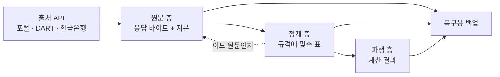
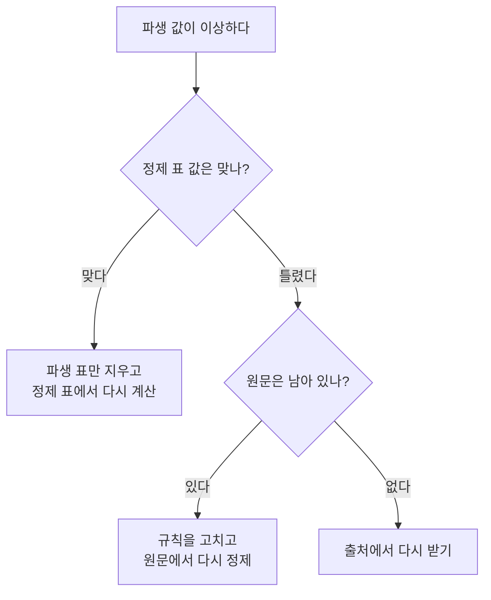

> [!GOAL]
>
> - 세 층(원문 · 정제 · 파생)이 각각 무엇을 지키는지 한 문장씩 말할 수 있습니다.
> - 원문을 sha256 지문과 함께 남기는 까닭을 「정규화 규칙이 틀렸을 때 원문에서 다시 만든다」 는 사례로 설명하고, 지문이 증명하는 것과 증명하지 못하는 것을 구분할 수 있습니다.
> - Qurious 수집 DB 의 표 이름을 보고 어느 층인지 짚고, 파생 값이 이상할 때 어느 층에서 다시 만드는지 알 수 있습니다.

이 장은 [전체 지도](#/p/map)에서 본 「모으고 → 쌓고」 단계를 더 가까이 봅니다. 수정주가를 계산하는 방법 자체는 [1.2 수정주가](#/p/adjusted-price)가, 판을 비교하고 공유하는 방법은 [2.3 데이터셋 판과 공유](#/p/dataset-versioning-hf)가, 매일 돌리는 일은 [2.4 정기 배치](#/p/batch-scheduling)가 다룹니다. 여기서는 「어느 층에서 다시 만드는가」 만 봅니다.

## 정제한 표가 있는데 원문은 왜 남기나요?

공공데이터포털 같은 출처에서 하루치 시세를 받으면, 보통은 그 응답을 읽어 표(예: 종목별 종가)로 바꿔 저장합니다. 이 바꾸는 일을 **정규화**라 합니다. 문제는 정규화 규칙도 사람이 짠 코드라 틀린다는 점입니다. 필드 이름을 잘못 짝짓거나, 어떤 값에서만 숫자 읽기가 깨질 수 있습니다.

예를 들어 종가가 `"70,000"` 처럼 천 단위 쉼표를 달고 온 날, 규칙이 쉼표 든 값을 0 으로 읽었다고 해 봅시다. 표에는 0 이 들어갔고, 그 0 으로 일수익률을 계산하면 값이 없거나 틀립니다. 이때 응답 원문을 버렸다면 고치는 길은 **출처에서 다시 받는 것**뿐입니다. 몇 해 치를 다시 받으면 하루 호출 한도를 크게 쓰고, 출처가 그사이 과거 값을 고쳤다면 같은 자료를 다시 받을 수도 없습니다.

원문을 남겨 두면 규칙만 고치고 **네트워크를 한 번도 타지 않고** 표를 다시 만듭니다. 이것이 세 층으로 나누는 가장 큰 이유입니다.

## 세 층은 각각 무엇을 지키나요?

데이터 플랫폼 업계에서는 이 구조를 흔히 **Bronze → Silver → Gold**(메달리온 구조)라 부릅니다. Databricks 문서의 정의는 이렇습니다.

| 층 | 문서의 설명 | 지키는 것 |
|---|---|---|
| Bronze | 원천에서 받은 그대로 쌓는 층 | 충실도와 이력. 나중에 다시 처리하고 감사할 수 있게 함 |
| Silver | 정제 · 검증 · 중복 제거를 거친 층 | 규격. 같은 이름이면 같은 뜻 · 같은 형 |
| Gold | 분석 · 보고에 맞게 모델링 · 집계한 층 | 계산 규칙. 쓰는 사람이 바로 읽을 수 있는 값 |

Databricks 문서는 Bronze 에 대부분의 필드를 문자열이나 바이너리로 두라고 권하고, 파일 이름 같은 **출처 메타데이터 열을 더하는 것**은 괜찮다고 합니다. 「그대로」 는 값을 바꾸지 않는다는 뜻이지 아무것도 덧붙이지 않는다는 뜻이 아닙니다. 또 같은 문서는 세 층을 「권장 모범사례이지 필수는 아니다」 라고 설명합니다. 층의 수나 이름은 정해진 규격이 아니라 **패턴**입니다. Microsoft 는 같은 구조를 bronze(raw) · silver(enriched) · gold(curated)로 소개하며 Bronze 를 도착한 그대로 두고 바꾸지 않는 층으로 설명합니다.

> [!NOTE]
> 두 문서 모두 「Bronze · Silver · Gold 는 어느 회사의 상표다」 또는 「업계 공통 용어다」 라고 말하지 않습니다. 이 장은 Databricks 가 널리 알린 이름 정도로만 씁니다.

Qurious 는 코드와 설계 문서에서 이 세 층을 **원문 층 · 정제 층 · 파생 층**이라 부릅니다. 이 장도 이제부터 우리 이름을 씁니다.



*그림 1. 세 층의 흐름. 점선은 정제 표의 한 행에서 그 행이 나온 원문을 거슬러 가는 길입니다.*

## 원문에는 무엇을 함께 남기나요?

원문만 덜렁 있으면 쓸모가 반쯤입니다. 다음 네 가지를 함께 남깁니다.

1. **받은 시각.** 「우리가 이 사실을 언제부터 알 수 있었나」 의 근거입니다. 정제 표에만 적어 두면 나중에 고쳐 적었는지 증명할 길이 없습니다. 과거의 어느 날에 알 수 없었던 값을 쓴 모형은 성적이 좋아 보이므로, 증명할 수 없는 시각은 없는 것과 같습니다.
2. **응답 상태.** HTTP 상태 코드와 짧은 메모(받은 행 수 등).
3. **크기.** 압축 전 바이트 수.
4. **지문(sha256).** 아래에서 설명합니다.

### 지문은 무엇을 증명하나요?

SHA-256 은 어떤 바이트열이든 256비트 요약값으로 바꾸는 방법입니다. 미국 NIST 의 표준 문서(FIPS 180-4)는 이 요약값으로 메시지가 만들어진 뒤 **바뀌었는지 탐지**할 수 있다고 설명합니다. 같은 바이트에서는 늘 같은 값이 나오고, 한 바이트만 달라져도 값이 달라집니다.

따라서 지문이 답하는 질문은 둘입니다. 「받은 뒤 변했나?」 「두 사람이 같은 것을 갖고 있나?」 반대로 **지문이 같다고 값이 옳은 것은 아닙니다.** 처음부터 틀린 응답을 받았다면 지문도 그 틀린 응답의 지문입니다. 아래 예제의 ⑤ 가 이 경우입니다.

> [!IMPORTANT]
> 지문은 **압축 전 원문**으로 만듭니다. 압축한 바이트는 압축 라이브러리의 판이나 설정에 따라 달라질 수 있어서, 그 값을 지문으로 삼으면 언젠가 「같은 자료인데 다르다」 가 나옵니다. Qurious 는 압축 전 원문의 지문을 쓰고, 압축 파일 머리에 들어가는 시각(`mtime`)도 0 으로 고정합니다.

## 직접 해 보기 — 틀린 규칙을 원문에서 고치기

예제 [`data_layers.py`](/learn/examples/data_layers.py)는 표준 라이브러리만으로 세 층을 메모리 안에 만듭니다. 종목 코드 `111111` · `222222` 와 가격은 모두 **합성**한 값입니다. 핵심 부분만 줄이면 이렇습니다.

```python
def save_raw(con, target, body):                     # 원문 층: 바이트 그대로 + 압축 전 지문
    digest = hashlib.sha256(body).hexdigest()
    con.execute("INSERT OR REPLACE INTO raw VALUES (?,?,?)",
                (target, gzip.compress(body, mtime=0), digest))
    return digest

def load_raw(con, target):                           # 꺼낼 때마다 지문을 다시 계산
    packed, digest = con.execute("SELECT body, sha256 FROM raw WHERE target=?", (target,)).fetchone()
    body = gzip.decompress(packed)
    if hashlib.sha256(body).hexdigest() != digest:
        raise ValueError("원문 손상")
    return body, digest

def normalize_v1(body):                              # 일부러 틀린 규칙: 쉼표 값은 0
    for it in json.loads(body)["items"]:
        c = it["clpr"]; yield it["basDt"], it["srtnCd"], int(c) if c.isdigit() else 0
```

`normalize_v2` 는 `replace(",", "")` 로 쉼표를 지우고 읽는 고친 규칙입니다. 전체 코드는 예제 파일에 있습니다. 다음은 2026-11-04 에 `python -X utf8 -I data_layers.py` 로 돌린 결과입니다(Python 3.13.14).

```output
① 같은 입력의 지문이 같다: True | 지문 길이 64
② 규칙 v1 (쉼표 값을 0 으로 읽음)
  정제 표 종가 [('111111', 0), ('222222', 180000)]
  파생 표 일수익률 [('111111', None), ('222222', -0.0167)]
  규칙 v2 로 원문에서 다시 정제한 뒤
  정제 표 종가 [('111111', 70000), ('222222', 180000)]
  파생 표 일수익률 [('111111', 0.02), ('222222', -0.0167)]
③ 파생 표를 지우고 다시 만들어도 같다: True
  정제 행에서 원문으로 거슬러 가기: True
④ 바뀐 원문을 꺼내면: 원문 손상
⑤ 지문 검사는 통과한다: True | 그래도 종가 -5 는 옳은 값이 아니다
```

**②** 틀린 규칙 v1 은 `111111` 의 종가를 0 으로 읽어, 파생 표의 일수익률이 `None`(앞 종가가 0 이라 계산하지 않음)이 되었습니다. 규칙을 v2 로 고치고 **원문에서** 정제 표를 다시 만들자 종가가 70000 이 되었고 일수익률이 0.02(+2%)로 바뀌었습니다. 이 사이에 출처를 다시 부르지 않았습니다. 정제 표에는 어느 원문에서 나온 행인지 알려 주는 `raw_sha256` 칸이 있어 **③** 처럼 정제 행에서 원문으로 거슬러 갈 수 있습니다.

**④** 압축 파일은 멀쩡하지만 내용이 다른 바이트로 몰래 바뀌었다고 가정했습니다. 꺼낼 때 지문을 다시 계산하니 기록된 지문과 달라 멈췄습니다. 조용히 틀린 값을 쓰는 것보다 멈추는 편이 낫습니다. **⑤** 는 반대로, 처음부터 종가 −5 가 담긴 응답을 받으면 지문 검사는 통과한다는 것을 보입니다. 값이 말이 되는지는 별도의 [데이터 품질 검사](#/p/data-quality-check)가 맡습니다.

## 파생 값이 틀리면 어디서 다시 만드나요?



*그림 2. 「어디서부터 다시 만드나」 판단. 아래 방향은 Qurious 의 설계입니다.*

| 층 | 지키는 것 | 바꾸나 | 틀렸을 때 |
|---|---|---|---|
| 원문 | 받은 그대로 · 받은 시각 · 지문 | 바꾸지 않음. 다시 받으면 받은 시각이 다른 새 줄 | 출처에서 다시 받기 |
| 정제 | 규격 · 기본키 · 형 | 규칙을 고치면 원문에서 통째로 다시 | 원문에서 다시 정제 |
| 파생 | 계산 규칙 | 규칙이나 입력이 바뀌면 통째로 다시 | 파생 표만 지우고 다시 |

> [!NOTE]
> 「파생이 틀리면 정제에서, 정제가 틀리면 원문에서 다시」 라는 방향은 Databricks 와 Microsoft 문서가 명시한 지침이 아닙니다. 문서는 Silver 가 Bronze 에서 만들어진다고만 말하고, 이 장은 거기서 이어서 Qurious 가 정한 운영 규칙을 적은 것입니다.

가장 중요한 규칙은 **파생이 정제를 덮어쓰지 않는다**는 점입니다. 수정주가는 규칙이 바뀌면 과거 전체를 다시 쓰는 일입니다. 정제 표에 덮어쓰면 「원래 값이 무엇이었나」 를 잃어 되돌릴 수 없습니다.

## 우리 서비스에서는 어떻게 쓰나요?

**Qurious 는 이렇게 합니다.** 수집 DB(SQLite 파일 하나)에 세 층이 표로 들어 있습니다.

| 층 | 표 | 하는 일 |
|---|---|---|
| 원문 | `raw_response` | 응답 바이트를 gzip 으로 압축해 두고, 압축 전 지문 · 받은 시각 · 상태 코드 · 크기를 함께 둡니다. 기본키는 (출처, 대상, 받은 시각) |
| 정제 | `price_daily` | 포털 응답의 값을 그대로 담은 일별 시세. `raw_sha256` 칸이 그 행이 나온 원문을 가리킵니다 |
| 정제 | `ingest_day` | 기준일별 수집 상태(받음 · 0건 · 휴장 확정 · 실패). 이어받기의 근거입니다 |
| 파생 | `price_adjusted` | 수정주가. 정제 표를 덮어쓰지 않고 따로 쌓고, 언제든 지우고 다시 만듭니다 |
| 파생 | `price_total_return` | 배당을 더한 총수익 지수. 수정주가와 다시 만드는 조건이 달라 표를 따로 둡니다 |

- **원문은 바이트 그대로.** 응답을 문자열로 바꿔 담으면 그 순간 인코딩 추측이 끼어듭니다(EUC-KR 로 오는 출처가 실제로 있습니다). 잘못 읽은 원문은 더 이상 원문이 아닙니다. 그래서 저장 함수는 문자열을 받으면 오류를 냅니다.
- **한 번에 커밋합니다.** 하루치를 받으면 원문 저장 · 정제 표 적재 · 수집 상태 기록을 **한 트랜잭션**으로 묶습니다. 원문만 남고 상태가 없으면 같은 날을 또 받아 한도를 두 배로 쓰고, 상태만 남고 원문이 없으면 다시 정제할 수 없기 때문입니다.
- **꺼낼 때마다 지문을 확인합니다.** 지문이 다르면 「보존된 원문이 손상됐다」 로 멈추고, 전체 점검 함수가 어긋난 대상 목록을 돌려줍니다.
- **크기.** 2026-09-19 에 코드 주석으로 남긴 측정에서 하루치 전종목 2,870행은 784,012바이트였고 gzip 으로 176,719바이트(22.5%)였습니다. 같은 주석은 이를 하루 약 172 KB, 1,648 거래일에 약 278 MB 로 어림합니다. 이 숫자는 그날의 측정이며 지금 DB 에서 다시 잰 값이 아닙니다.
- **무엇을 원문으로 두나.** 기관이 API 로 내려주는 공공 · 금융 데이터(포털 · 한국투자증권 · 한국은행 · DART · KRX · 정책뉴스)만입니다. 크롤링한 문서 본문은 저작권 문제라 원문으로 두지 않고, 허용 목록에 없는 출처는 조용히 넘어가지 않고 오류로 막습니다. 한국투자증권 원문은 약관 때문에 보존만 하고 밖으로 내보내지 않습니다.
- **파생을 다시 만드는 때.** 일일 갱신은 시세나 배당이 바뀌었거나, 파생 표가 시세보다 뒤처져 있을 때 파생 단계를 돌립니다. 새 자료가 없으면 건너뜁니다. 한 번 어긋난 파생 표가 새 거래일이 올 때까지 뒤처진 채 남지 않게 하는 장치입니다.
- **지문 목록(매니페스트).** 날짜별 (원문 지문 · 행 수 · 받은 시각)만 담아 전체 지문을 하나 더 만듭니다. 값은 담지 않아 저장소에 올려도 되는 목록이고, 두 PC 의 목록을 비교해 「나만 있는 날 · 상대만 있는 날 · 같은 날인데 지문이 다른 날」 을 가릅니다(자세한 것은 [2.3](#/p/dataset-versioning-hf)).
- **원문도 백업합니다.** 원문과 수집 상태는 분석용이 아니라 **복구용**으로 파케이에 내보냅니다. 이 둘을 빼고 SQLite 를 지우면 `raw_sha256` 이 가리키는 근거가 영영 사라지고 다시 정제할 재료도 없어집니다.
- **모든 출처가 세 층을 다 거치지는 않습니다.** 한국은행 · 연준의 일정은 원문 층을 거치지 않고 정제 층으로 곧장 갑니다.

### 교과서와 다른 점

| 데이터 플랫폼의 흔한 구성 | Qurious |
|---|---|
| 객체 저장소에 원천 파일, Silver 는 파케이, Gold 는 분석용 DB | SQLite 한 파일 안에 원문(BLOB) · 정제 · 파생 표를 두고, 백업은 파케이와 Hugging Face 로 함 |
| 층의 이름이 Bronze · Silver · Gold | 원문 층 · 정제 층 · 파생 층 (코드에 Bronze 같은 이름은 없음) |

수집기를 앱 스택에 묶지 않으려고 표준 라이브러리와 `requests` 만으로 만든 선택입니다. 층의 개념은 같고 저장소만 다릅니다.

> [!NOTE]
> 앱의 「자료 안내」 화면에는 원문 · 정제 · 파생을 가르는 표시가 따로 없습니다. 세 층은 수집 DB 의 구조이고, 화면이 보여 주는 것은 자료 목록과 수집 상태입니다.

## 흔한 실수

1. **「Bronze 는 그냥 복사본」.** 받은 시각 · 출처 같은 메타데이터를 덧붙이는 것은 허용됩니다. 바뀌지 않는 것은 응답의 값입니다.
2. **「정제했으면 원문은 버려도 된다」.** 정규화는 틀릴 수 있고, 안 담은 칸이 나중에 필요해집니다. 원문이 없으면 고치는 길이 「다시 받기」 뿐입니다.
3. **「파생이 틀리면 정제 표를 고친다」.** 방향이 반대입니다. 정제 표 값이 맞다면 파생 표를 지우고 다시 만듭니다.
4. **「세 층이 표준 규격이다」.** 문서가 말하는 것은 권장 패턴입니다. 층의 수나 저장소 종류는 필수가 아닙니다.
5. **「지문이 같으면 옳은 자료다」.** 지문은 받은 뒤 바뀌지 않았음만 보입니다.
6. **「압축한 결과로 지문을 만든다」.** 압축 바이트는 달라질 수 있습니다. 압축 전 원문으로 만듭니다.

## 정리

1. 원문 층은 받은 그대로(값은 바꾸지 않고 시각 · 상태 · 지문을 덧붙임), 정제 층은 규격, 파생 층은 계산 규칙을 지킵니다.
2. 원문을 남기면 정규화 규칙이 틀렸을 때 네트워크 없이 정제 층부터 다시 만들 수 있습니다.
3. 지문은 「변하지 않았다」 를 보일 뿐 「옳다」 를 보이지 않습니다. 값이 말이 되는지는 품질 검사의 몫입니다.
4. 파생은 정제를 덮어쓰지 않고 따로 쌓습니다. 이상하면 파생 표만 지우고 다시 만듭니다. 이 방향은 Qurious 의 운영 규칙입니다.

<details>
<summary>확인 문제 1 — 정규화 규칙에 버그가 있었습니다. 원문 층이 있으면 어떻게 고치나요?</summary>

규칙을 고친 뒤 원문에서 정제 표를 다시 만듭니다. 네트워크 호출이 필요 없고(예제 ②), 정제 표가 바뀌면 그 위의 파생 표도 다시 만듭니다.
</details>

<details>
<summary>확인 문제 2 — 압축한 바이트가 아니라 압축 전 원문의 sha256 을 지문으로 쓰는 까닭은?</summary>

압축 결과는 라이브러리 판이나 설정에 따라 달라질 수 있어, 같은 자료인데 지문이 다르다는 결과가 나올 수 있기 때문입니다.
</details>

<details>
<summary>확인 문제 3 — 수정주가 표가 이상합니다. 일별 시세 정제 표를 고치나요, 수정주가 파생 표를 다시 만드나요?</summary>

정제 표의 값이 맞다면 파생 표를 지우고 다시 만듭니다. 파생은 정제를 덮어쓰지 않습니다. 정제 표 값부터 틀렸다면 원문에서 다시 정제한 뒤 파생을 다시 만듭니다.
</details>

<details>
<summary>확인 문제 4 — 원문의 지문이 기록과 일치하면 그 자료가 옳다고 말할 수 있나요?</summary>

아닙니다. 받은 뒤 바뀌지 않았다는 것만 보입니다. 처음부터 틀린 응답을 받았다면 지문도 그 응답의 것입니다(예제 ⑤).
</details>

<details>
<summary>확인 문제 5 — 크롤링한 기사 본문을 원문 층에 넣지 않는 까닭은?</summary>

저작권 문제입니다. Qurious 는 기관이 API 로 내려주는 공공 · 금융 데이터만 원문으로 보존하고, 크롤링 본문은 정규화 결과만 저장합니다.
</details>

## 더 읽을거리

아래 자료는 2026-11-03 조사에서 열람한 1차 자료이며, 이 장을 쓰면서 다시 열지는 않았습니다.

- Databricks, 「What is the medallion lakehouse architecture?」 — <https://docs.databricks.com/aws/en/lakehouse/medallion> · 세 층의 정의 · Bronze 에 원본과 출처 메타데이터를 두는 까닭 · 권장 모범사례이지 필수는 아니라는 설명. 2026-11-03 조사에서 열람.
- Databricks, 「What is Medallion Architecture?」 — <https://www.databricks.com/blog/what-is-medallion-architecture> · Bronze 에 적재 시각 · 프로세스 ID 열을 덧붙이는 설명. 옛 용어집 주소에서 옮겨진 주소입니다. 2026-11-03 조사에서 열람.
- Microsoft Learn, 「Understand medallion architecture for Fabric with OneLake」 — <https://learn.microsoft.com/en-us/fabric/onelake/onelake-medallion-lakehouse-architecture> · bronze(raw) · silver(enriched) · gold(curated)의 정의. 2026-11-03 조사에서 열람.
- NIST, FIPS 180-4 「Secure Hash Standard」 — <https://csrc.nist.gov/pubs/fips/180-4/upd1/final> · SHA-256 이 256비트 요약값을 내며 메시지가 만들어진 뒤 바뀌었는지 탐지하는 데 쓰인다는 초록. 2026-11-03 조사에서 열람.
- 이 장의 예제 [`data_layers.py`](/learn/examples/data_layers.py) · 수정주가 계산은 [1.2](#/p/adjusted-price) · 값이 말이 되는지 보는 법은 [1.4](#/p/data-quality-check).

> [!NOTE]
> 재현 가능한 분석에서 원자료를 바꾸지 않고 가공물을 다시 만든다는 지침을 다룬 Wilson 외(2017, PLOS Computational Biology)는 검색 발췌만 보았고 전문은 **원문 직접 확인 전**이라 이 장에서 인용하지 않았습니다.

**용어**

| 말 | 뜻 |
|---|---|
| 정규화 | 받은 응답을 규칙에 따라 표의 칸과 형에 맞게 바꾸는 일 |
| 원문 층(Bronze) | 응답을 받은 그대로 바이트 단위로 남기는 층 |
| 정제 층(Silver) | 원문을 규격에 맞게 정리한 표를 두는 층 |
| 파생 층(Gold) | 정제 표에서 계산한 값(수정주가 · 총수익 등)을 따로 두는 층 |
| 지문(sha256) | 바이트열에서 계산한 256비트 요약값. 바뀌었는지 알아보는 데 씀 |
| 메달리온 구조 | 세 층으로 데이터를 단계별로 다듬는 설계 패턴의 이름 |
| 재처리 | 원문에서 정제 · 파생을 다시 만드는 일 |
