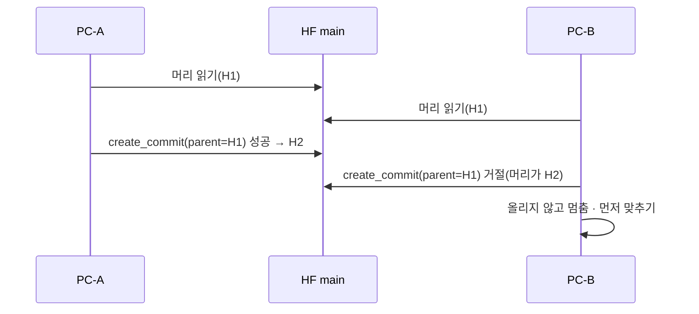
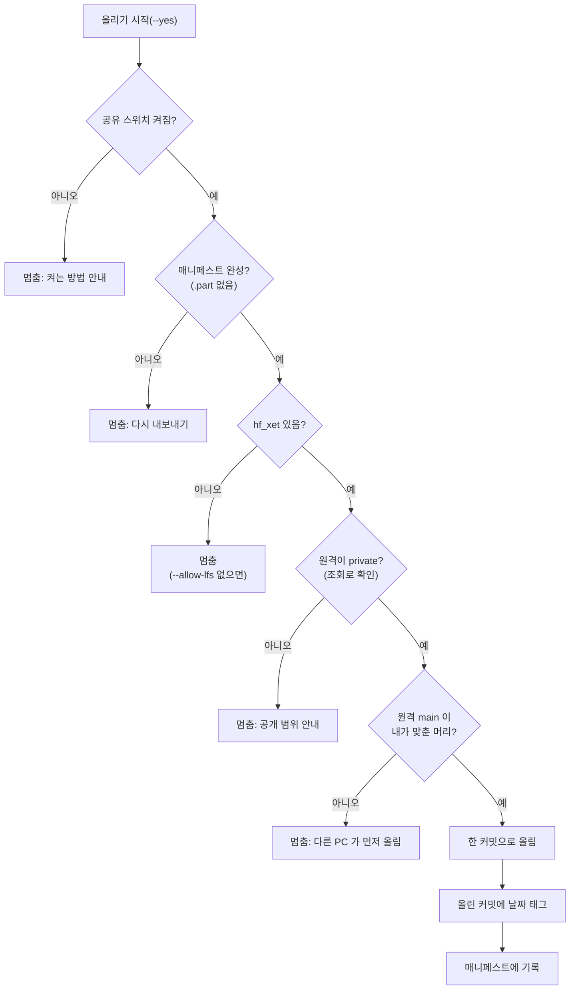

> [!GOAL]
>
> - 데이터셋 저장소가 git 처럼 커밋 · 브랜치 · 태그를 갖는다는 것과, **태그와 커밋 해시의 차이**를 설명할 수 있습니다.
> - 파일별 지문(매니페스트)과 커밋 머리로 「같은 판인가」를 두 층으로 확인할 수 있습니다.
> - 올리기 전에 공개 범위를 **조회로 확인**해야 하는 까닭을 말할 수 있습니다.

이 장은 [2.1 원문 · 정제 · 파생](#/p/data-layers)에서 만든 세 층의 자료를 **팀이 함께 쓰게 하는** 방법을 다룹니다. 매일 돌리는 일은 [2.4 정기 배치](#/p/batch-scheduling)가 맡습니다.

> [!NOTE]
> 외부 사실은 2026-11-03 조사에서 Hugging Face 공식 문서를 열람한 내용이고, 한도 · 요금 수치는 바뀔 수 있습니다. 이 장은 법률 자문이 아니며, 약관과 이용 조건은 각 출처의 안내를 확인하세요.

## 팀이 같은 데이터를 쓰려면 무엇이 필요한가요?

처음 Qurious 의 6년 넘는 시세는 한 대의 노트북 디스크에만 있었습니다. 그 한 곳을 잃으면 다시 받을 길이 호출 한도에 막힙니다([2.2](#/p/public-api-basics)). 그래서 데이터를 **팀이 같이 쓰는 한 곳**에 두기로 했고, 이때 풀어야 할 문제가 셋입니다.

1. **같은 판인가.** 같은 날 받아도 값이 다르면 같은 전략의 성적이 사람마다 달라집니다.
2. **새 판과 옛 판.** 어제 돌린 백테스트를 오늘 다시 재현하려면 어제의 판을 가리킬 수 있어야 합니다.
3. **누가 볼 수 있나.** 출처의 이용 조건 때문에 팀 밖으로 나가면 안 되는 자료가 있습니다.

## Hugging Face 데이터셋 저장소는 무엇인가요?

Hugging Face Hub 의 모델 · Space · 데이터셋은 **Git 저장소**로 호스팅되고, 버전 관리가 핵심입니다(Hub 문서 「Repositories」). 그래서 git 에서 쓰는 말이 거의 그대로 통합니다.

| 개념 | 뜻 | 데이터셋에서는 |
|---|---|---|
| 커밋 | 어느 시점의 파일 묶음. 해시로 구분 | 한 번 올린 판 |
| 브랜치 | 커밋을 이어 가는 가지(기본 `main`) | 보통 `main` 하나. 우리는 잠금용 가지를 따로 둠 |
| 태그 | 커밋에 붙이는 이름표 | `snapshot-2026-11-03` 같은 날짜 이름 |
| 카드 | 저장소 맨 위 `README.md` 와 그 위 YAML 머리 | 라이선스 · 언어 · 설명을 적는 데이터셋 설명서 |

큰 파일은 Xet 라는 저장 방식이 처리합니다. 문서는 Xet 를 LFS 를 대체하는 백엔드로 소개하며, 약 64KB 단위로 **내용을 기준으로 청크를 나눠 중복을 제거**한다고 설명합니다. LFS 는 파일 단위, Xet 는 바이트 단위입니다. 바뀐 청크만 올라가므로 매일 조금씩 갱신하는 자료에 유리합니다.

> [!WARNING]
> 태그는 커밋을 가리키는 **이름표**입니다. 이 이름표는 지울 수 있고(`delete_tag` 가 있습니다) 같은 이름을 다시 달 수도 있습니다. 공식 문서에서 「태그는 불변」 이라는 말도, 「바뀔 수 있다」 는 말도 찾지 못했습니다. 아래 「확인 못 한 것」 을 보세요. **정말로 판을 못박으려면 커밋 해시를 함께 적는다는 것은 이 장의 판단**이며 공식 권고 문장이 아닙니다.

## 공개일까요, 비공개일까요?

`create_repo` 의 `private` 기본값은 `None` 이고, 이는 **공개**입니다(조직의 기본 가시성이 비공개로 정해져 있으면 비공개). 이미 있는 저장소에 같은 함수를 `private=True, exist_ok=True` 로 불러도 **공개 범위가 바뀌지 않습니다.** 조직 관리자가 먼저 공개로 만들어 두었다면 그대로 공개에 올라갑니다.

```python
api.create_repo("조직/데이터", repo_type="dataset", private=True, exist_ok=True)   # 새로 만들 때만 private 이 적용됨
info = api.repo_info("조직/데이터", repo_type="dataset")                            # 그래서 올리기 직전에 따로 조회한다
assert info.private is True
```

Qurious 는 만드는 것과 확인하는 것을 **따로** 합니다. 조회가 실패하면 통과가 아니라 멈춥니다. 「확인 못 한 것은 통과가 아니다」 라는 원칙입니다. 공개로 바꾸고 되돌리는 것은 저장소 설정(Settings) 탭에서 하고, 비공개 저장소는 다른 사람이 주소로 들어가도 404 로 보입니다.

> [!IMPORTANT]
> 토큰은 환경변수에 둡니다. `huggingface_hub` CLI 안내는 명령 기록에 토큰이 남지 않게 환경변수로 넘기라고 권하고, Hub 문서는 용도마다 따로 만든 토큰과 운영용 fine-grained 토큰을 권합니다. 이 장의 코드에는 토큰을 쓰지 않았습니다.

## 파일이 조금 바뀌면 전부 다시 올리나요?

「Xet 면 항상 바뀐 청크만」 도, 「한 줄만 바뀌어도 전체」 도 **조건부**입니다. Xet 는 **바이트 배치가 같아야** 이전 판과 겹치는 청크를 찾습니다. 파케이 쓰기 옵션(압축 · row group 크기 · 정렬 등)을 하나라도 바꾸면 배치가 통째로 달라져 중복 제거가 듣지 않습니다. 반대로 Xet 를 담당하는 `hf_xet` 가 설치되지 않으면 LFS 경로로 가서 한 줄만 고쳐도 파일 전체를 다시 올립니다.

그래서 Qurious 는 파케이 쓰기 옵션을 상수로 못박고(zstd 3 · row group 250,000 · 내용 기반 청크 · 정렬은 `(날짜, 종목)`) 그 값을 매니페스트에도 적습니다. 신규 행이 파일 끝에 붙는 append 패턴이라 청크 중복 제거가 가장 잘 듣기 때문입니다. `hf_xet` 가 없으면 올리지 않고 `--allow-lfs` 를 따로 요구합니다.


*그림 1. 2026-11-03 12:30 회차의 단계별 소요 시간(실제 기록). 한 PC 의 한 회차이므로 일반화하지 않습니다. 만든 스크립트는 `tools/learn_figs/dataset-versioning-hf.py`.*

## 같은 판인지 어떻게 확인하나요?

「같다」 가 무엇을 가리키는지에 따라 도구가 다릅니다.

| 질문 | 도구 | Qurious |
|---|---|---|
| 이 파일이 저쪽 파일과 같은가 | 파일별 sha256 | 매니페스트의 `files[].sha256` |
| 내가 아는 원격 머리가 지금 머리와 같은가 | 커밋 해시 · `parent_commit` | `create_commit(parent_commit=…)` |
| 이름으로 가리키는 판이 무엇인가 | 태그 → 커밋 | `snapshot-YYYY-MM-DD` + 커밋 해시 기록 |

파일 지문이 모두 같아도 **커밋이 같다는 뜻은 아닙니다.** 카드나 메타만 바뀐 커밋이 있을 수 있기 때문입니다. 반대로 커밋 머리가 같다고 내 PC 의 파일이 같은 것도 아닙니다. 그래서 둘을 따로 봅니다.

`create_commit` 의 `parent_commit` 은 동시 쓰기를 막는 장치입니다. 지정한 커밋이 현재 머리가 아니면 커밋이 **실패**합니다(공식 문서).



*그림 2. 두 번째 쓰기가 막히는 모양(개념 도해 · 합성). 거절의 HTTP 번호는 공식 문서에서 확인하지 못했고, 우리 코드와 조사 기록은 412 로 관찰했습니다.*

> [!NOTE]
> 올림이 여러 커밋으로 **쪼개지면** `parent_commit` 은 첫 커밋에만 적용됩니다(`upload_folder` 설명). 그래서 Qurious 는 증분 올리기를 `create_commit` **한 커밋**으로 만듭니다. 전체를 처음 한 번 올릴 때는 이 보호가 약합니다.

## 직접 해 보기

예제 [`dataset_versions.py`](/learn/examples/dataset_versions.py)는 표준 라이브러리만으로 두 가지를 보입니다. 임시 폴더에 합성 CSV 를 만들어 파일별 지문을 견주고, 원격 머리만 흉내 내는 가짜 저장소로 `parent_commit` 규칙을 확인합니다(`huggingface_hub` 는 쓰지 않습니다). 핵심만 줄이면 이렇습니다.

```python
def fingerprint(folder):                       # 폴더 → {파일: (행 수, sha256)} = 매니페스트의 한 줄
    out = {}
    for p in sorted(folder.rglob("*.csv")):
        data = p.read_bytes()
        out[p.relative_to(folder).as_posix()] = {"rows": data.count(b"\n") - 1,
                                                  "sha256": hashlib.sha256(data).hexdigest()}
    return out

class FakeRepo:                                # 원격 머리만 흉내 — parent 가 지금 머리와 같을 때만 받는다
    def create_commit(self, parent):
        if parent != self.head:
            raise RuntimeError(f"거절 — 내가 본 머리 {parent} 인데 지금 머리는 {self.head}")
        ...
```

다음은 2026-11-04 에 `python -X utf8 -I dataset_versions.py` 로 돌린 결과입니다(Python 3.13.14).

```output
① 행 수  내 쪽: {'year=2025.csv': 1, 'year=2026/price.csv': 1}  저쪽: {'year=2025.csv': 1, 'year=2026/price.csv': 2}
② 견주기: {'only_mine': [], 'only_theirs': [], 'differ': ['year=2026/price.csv']}
  같은 폴더끼리: {'only_mine': [], 'only_theirs': [], 'differ': []}
③ 파일 지문이 같아도 커밋 머리가 같다는 뜻은 아니다(카드 · 메타만 바뀐 커밋이 있을 수 있다)
④ PC-A 가 머리 c1 를 부모로 커밋 → c2
  PC-B 가 같은 머리 c1 를 부모로 커밋 → 거절 — 내가 본 머리 c1 인데 지금 머리는 c2
  PC-B 는 올리지 않고 멈춘다 — 먼저 맞춘 뒤 다시
```

## Qurious 는 이렇게 올립니다

**Qurious 는 이렇게 합니다.** 수집 DB 백업은 비공개 조직 저장소에, 일봉 · 분봉과 공시 · 재무는 각각 따로 둡니다(2026-11-03 기준 코드). 처음 동기는 「노트북 디스크 한 곳에만 있던 자료를 잃지 않는 것」이었고, 그래서 올리는 것은 분석용 사본이 아니라 **SQLite 백업 + 파케이 조각**입니다. 받는 쪽은 `restore` 로 SQLite 를 되살립니다.



*그림 3. 올리기의 문. 기본은 연습(dry-run)이고 `--yes` 일 때만 실제로 씁니다.*

- **한 커밋.** 바뀐 파일과 메타를 `create_commit(parent_commit=머리)` 로 묶어 올립니다. 그사이 다른 PC 가 올렸다면 거절을 받고(412), 올리지 않고 멈춥니다.
- **바뀐 것만.** 매니페스트에 적힌 「마지막으로 올린 파일별 sha256」 과 지금 파일의 sha256 을 맞춰 **달라진 것만** 고릅니다. 연도별로 조각을 나눠 닫힌 해(2020~2025)는 바뀌지 않아 올림이 0바이트입니다.
- **날짜 태그.** 이름은 `snapshot-YYYY-MM-DD`(KST)이고, 업로드가 **끝난 뒤 올린 커밋에** 답니다. 이름만 주면 그사이 남의 커밋에 붙을 수 있기 때문입니다. 같은 날 두 번째 올림이 다 올린 뒤에 「이미 있는 태그」 오류로 죽지 않게 `exist_ok=True` 를 줍니다.
- **커밋 해시도 기록.** 태그는 지울 수 있는 이름표라서, 올린 커밋 해시와 파일별 sha256 을 매니페스트 `uploaded` 칸에도 적습니다. 커밋 메시지에는 날짜 · 표별 행 수 · 수집기 커밋을 남겨 **어느 코드로 만든 판인지** 알 수 있습니다.
- **카드는 매니페스트에서.** 표가 늘면 카드도 늘어야 하므로 카드(YAML 머리)를 매니페스트에서 만듭니다. 라이선스 이름은 서버가 영문 소문자 · 숫자 · `-` `.` 만 받는데, 한글이 든 이름이 거부된 커밋을 큰 폴더 올리기 함수가 **조용히 재시도하며 종료 코드 0 으로 끝나** 몇 시간을 날린 일이 있어(2026-09-21 실측 주석) 올리기 전에 검사합니다.
- **팀원 자료는 따로.** 검사를 통과한 팀원 자료는 원래 자료와 합치지 않고 `contrib/<아이디>/<날짜>/` 에 보고서와 함께 둡니다.
- **공개 범위.** 이 저장소들은 약관 때문에 **반드시 비공개**여야 하고, 이 결정은 법률 판단이 아니라 팀 운영 결정으로 코드에 적어 두었습니다(공유 스위치는 `.env` 로는 켜지지 않습니다).

### 여러 PC 가 같은 판을 쓰려면

여러 PC 가 각자 올리면 서로 덮어쓸 수 있습니다. Qurious 는 세 판을 견줍니다. 「마지막으로 원격과 같았던 파일 목록(기준)」 · 원격 · 이 PC 입니다. 원격이 기준과 같으면 건너뛰고, 이 PC 만 바꾼 것은 지키고, **둘 다 바꾼 조각에서는 멈춰** 사람이 고르게 합니다. 이름표(태그)가 아니라 파일 구성 지문으로 「원격이 앞섰나」 를 먼저 보고, 올리는 순간에는 `parent_commit` 으로 한 번 더 막는 이중 장치입니다.

한 저장소의 가지 하나를 **잠금 서버**처럼 쓰는 사례도 있습니다. 전용 가지에 파일 하나를 두고 `parent_commit` 으로 한 PC 만 잡게 합니다. 자세한 이야기와 멱등성은 [2.4](#/p/batch-scheduling)에서 다룹니다.

### 교과서와 다른 점

| 일반적인 방식 | Qurious |
|---|---|
| 데이터셋을 `load_dataset` 으로 받아 분석 | 올리는 것은 SQLite 백업 + 파케이 조각이고, 받을 때는 `restore` 로 SQLite 를 되살립니다(백업이 목적) |
| 파일 하나 또는 일 단위 파일 | 표별 · 연도별 조각. 파일이 너무 많으면 커밋이 비대해지고, 표 통째 1파일은 하루 갱신에도 크게 올라가기 때문 |
| 태그로 버전 관리 | 날짜 태그 + 올린 **커밋 해시를 매니페스트에 기록** (이 해석은 우리 판단) |

## 흔한 실수

1. **「HF 저장소는 기본으로 비공개」.** 기본은 공개입니다. 비공개로 만든다고 명시하세요.
2. **「`private=True, exist_ok=True` 면 항상 비공개」.** 이미 있는 저장소의 공개 범위는 바뀌지 않습니다. 조회로 확인합니다.
3. **「날짜 태그가 판을 못박는다」.** 태그는 지울 수 있는 이름표입니다. 커밋 해시를 함께 적습니다.
4. **「파케이 한 줄이 바뀌면 전체를 올린다 / Xet 면 항상 바뀐 조각만」.** 둘 다 조건부입니다. 쓰기 옵션과 `hf_xet` 설치 여부를 봅니다.
5. **「`parent_commit` 이면 전체 올림도 한 번에 안전」.** 여러 커밋으로 쪼개지면 첫 커밋에만 걸립니다.
6. **「파일 해시가 같으면 같은 판」.** 파일이 같다는 것이지 원격 머리가 같다는 것이 아닙니다.
7. **「공유 저장소니까 약관은 괜찮다」.** 출처마다 재배포 조건이 다르므로 운영 결정으로 막아야 합니다.

## 정리

1. HF 데이터셋 저장소는 git 저장소라 커밋 · 브랜치 · 태그 · 카드를 가집니다.
2. 태그는 이름표이고 커밋 해시가 고정점입니다. 둘을 함께 적습니다.
3. 같은 판인지는 **파일 지문**(내용)과 **커밋 머리**(이력) 두 층으로 확인합니다.
4. 공개 범위는 만든 뒤에 조회로 확인하고, 확인하지 못하면 멈춥니다.
5. 바뀐 조각만 올라가게 하려면 파일의 바이트 배치를 안정시킵니다.

<details>
<summary>확인 문제 1 — <code>create_repo(..., private=True, exist_ok=True)</code> 를 불렀는데 그 저장소가 이미 공개로 있었습니다. 결과는?</summary>

공개 그대로입니다. `exist_ok=True` 는 기존 저장소의 공개 범위를 바꾸지 않습니다. 그래서 `repo_info(...).private` 를 따로 조회해 확인합니다.
</details>

<details>
<summary>확인 문제 2 — 날짜 태그 <code>snapshot-2026-11-03</code> 은 영원히 같은 데이터를 가리키나요?</summary>

보장하지 않습니다. 태그는 지우고 다시 달 수 있는 이름표입니다. 고정하려면 커밋 해시를 함께 기록합니다(이 장의 판단).
</details>

<details>
<summary>확인 문제 3 — 두 PC 가 같은 머리를 읽고 각자 <code>parent_commit</code> 을 주어 커밋하면?</summary>

먼저 쓴 쪽만 성공하고, 나중 쪽은 머리가 이미 바뀌어 거절됩니다. 거절된 쪽은 올리지 않고 먼저 맞춥니다(예제 ④).
</details>

<details>
<summary>확인 문제 4 — 매니페스트의 파일 sha256 이 모두 같습니다. 원격 main 의 커밋도 같다고 말할 수 있나요?</summary>

아닙니다. 파일 내용이 같아도 카드나 메타만 바뀐 커밋일 수 있습니다. 파일 지문과 커밋 머리를 따로 보는 까닭입니다(예제 ③).
</details>

<details>
<summary>확인 문제 5 — 파케이 쓰기 옵션을 바꿨더니 Xet 올리기가 전부 다시 올라갔습니다. 왜일까요?</summary>

바이트 배치가 달라져 이전 판과의 청크 중복 제거가 듣지 않았기 때문입니다.
</details>

## 더 읽을거리

아래 자료는 2026-11-03 조사에서 열람한 1차 자료이며, 이 장을 쓰면서 다시 열지는 않았습니다. **Xet 와 HfApi 의 해당 문장은 2026-11-04 에 원문 페이지에서 직접 대조했습니다. 저장 한도 · 호출 한도 수치는 이 장에 쓰지 않았고 인용하기 전에 원문을 확인하세요.**

- Hugging Face Hub, 「Repositories」 — <https://huggingface.co/docs/hub/repositories> · 저장소가 Git 기반이라는 설명.
- Hugging Face Hub, 「Dataset Cards」 — <https://huggingface.co/docs/hub/datasets-cards> · `README.md` 와 YAML 머리.
- Hugging Face Hub, 「Repository Settings」 — <https://huggingface.co/docs/hub/repositories-settings> · 공개 ↔ 비공개 전환.
- Hugging Face Hub, 「Xet」 — <https://huggingface.co/docs/hub/xet/deduplication> · 청크 중복 제거(2026-11-04 원문 확인: 내용 기반 청크 · 약 64KB · 바이트 단위).
- huggingface_hub, HfApi 레퍼런스 — <https://huggingface.co/docs/huggingface_hub/package_reference/hf_api> · `create_repo` · `create_commit(parent_commit)` · `create_tag`(2026-11-04 원문 확인: `private` 기본 None 은 공개 · 이미 있는 저장소에는 무시 · `parent_commit` 이 머리가 아니면 커밋 실패).
- Hugging Face Hub, 「User access tokens」 — <https://huggingface.co/docs/hub/security-tokens> · 토큰 종류와 보관.
- 이 장의 예제 [`dataset_versions.py`](/learn/examples/dataset_versions.py) · 원문 · 정제 · 파생은 [2.1](#/p/data-layers) · API 한도는 [2.2](#/p/public-api-basics).

> [!NOTE]
> 확인하지 못해 단정하지 않은 것: ① `parent_commit` 거절의 HTTP 번호(우리 코드는 412 로 관찰) ② 태그가 불변인지 ③ 「재현성을 위해 커밋 해시로 고정」 이라는 공식 권고 문장 ④ 신규 저장소의 기본 저장 방식이 Xet 인지 ⑤ 저장 한도 · API 한도의 최신 수치.

**용어**

| 말 | 뜻 |
|---|---|
| 커밋 | 저장소의 한 시점. 해시로 구분 |
| 브랜치 | 커밋을 이어 가는 가지 |
| 태그 | 커밋에 붙이는 이름표. 지우거나 다시 달 수 있음 |
| 매니페스트 | 파일별 행 수 · sha256 · 올린 기록을 적은 목록 |
| 데이터셋 카드 | 저장소 맨 위 `README.md`. YAML 머리에 라이선스 · 설명을 적음 |
| Xet | 바이트 단위로 중복을 제거해 바뀐 청크만 올리는 저장 방식 |
| `parent_commit` | 「이 커밋을 부모로 삼겠다」 고 지정해 동시 쓰기를 막는 인자 |
| dry-run | 실제로 쓰지 않고 무엇을 할지만 보여 주는 연습 실행 |
