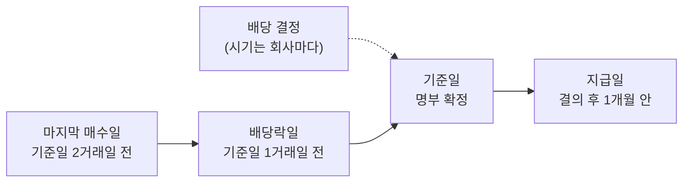

> [!GOAL]
>
> - 배당기준일 · 배당락일 · 지급일의 순서와 뜻을 설명할 수 있습니다.
> - 결제 주기(T+2)와 휴장일을 넣어 배당락일과 마지막 매수일을 계산할 수 있습니다.
> - 배당소득 세금의 큰 흐름을 짚고, Qurious 의 일정 화면에 나오는 날짜가 어디서 오는지 알 수 있습니다.

## 기준일이 12월 31일이라면 12월 30일에 산 주식도 배당을 받을까요?

받지 못합니다. 기준일이 12월 31일인 2026년 12월 결산 법인이라면 배당을 받는 마지막 매수일은 12월 28일(월)입니다. 12월 31일 목요일이 배당기준일인데 왜 이틀 전에 사야 하는지, 12월 31일은 쉬는 날인데 기준일이 어떻게 있는지를 이 장에서 날짜로 따라갑니다.

> [!NOTE]
> 이 장은 교육용 설명이며 세무 · 법률 자문이 아닙니다. 숫자는 2026-11-03 에 법령과 거래소 규정 · 국세청 안내를 열어 확인한 값이고 바뀔 수 있습니다. 신문 보도로만 확인한 내용에는 **(보도 기준)** 을, 열람한 범위 밖이라 단정하지 않는 내용에는 **(확인 필요)** 를 붙였습니다. 투자 권유가 아닙니다.

## 배당은 누가 받나요?

회사는 배당을 받을 사람을 정하려고 주주명부의 기재 변경을 멈추거나, 일정한 날(기준일)에 명부에 올라 있는 주주를 권리자로 볼 수 있습니다(상법 제354조 ①, 시행 2026-09-10 판). 명부를 멈추는 기간은 3개월을 넘지 못하고, 기준일은 권리를 행사할 날에 앞선 3개월 안의 날이어야 하며, 기간이나 날은 2주 전에 공고해야 합니다. 정관에 정해 두었다면 공고는 생략합니다(같은 조 ② ~ ④).

그래서 배당과 관련된 날짜가 세 개 있고, 서로 다른 사람이 정합니다.

**표 1. 배당의 세 날짜**

| 날짜 | 뜻 | 누가 정하나 | Qurious 수집기 |
|---|---|---|---|
| 배당기준일 | 이날 주주명부에 올라 있는 사람이 배당을 받음 | 회사 | 배당 결정 공시에서 읽음 |
| 배당락일 | 이날 산 사람부터 이번 배당을 못 받음 | 거래소가 시장조치로 알림 | 공시에 없어서 거래일 달력으로 계산 |
| 지급일 | 배당금이 실제로 들어오는 날 | 회사(총회 · 이사회) | 공시 본문에서 읽고, 결산배당은 대부분 빈칸 |

## 기준일에 사면 왜 늦나요?

주식은 체결한 날 곧바로 명부에 오르지 않고, 체결일부터 3일째(T+2)에 결제된 사람이 명부에 오릅니다([F.1 주식 · 시장 · 주문의 기본](#/p/stock-basics)). 한국거래소는 배당락을 「이익배당을 받을 권리가 소멸했음을 투자자에게 알리는 시장조치」 로 설명합니다. 보통거래는 결제에 3일째가 걸리므로 기준일 전 거래일에 매매한 주식부터 배당락이 적용됩니다(2026-11-03 기준).

거래소의 설명 예는 6월 결산 법인입니다. 6월 28일에 배당부 종가가 정해지고, 6월 29일에 배당락 조치가 있고, 6월 30일이 사업연도 마지막 날(기준일)입니다. 6월 28일까지 산 주식은 6월 30일에 결제되어 배당을 받습니다. 정리하면 기준일이 거래일일 때 **배당락일은 기준일의 한 거래일 전, 마지막 매수일은 두 거래일 전**입니다.



「2일 전」 은 달력이 아니라 거래일로 셉니다. 2026-06-30(화)이 기준일이라면 달력으로 2일 전은 일요일(6월 28일)이라 거래일이 아닙니다. 맞는 배당락일은 6월 29일(월)이고, 마지막 매수일은 6월 26일(금)입니다. 예제 [`dividend_dates.py`](/learn/examples/dividend_dates.py) 로 직접 세어 봅니다.

## 12월 31일은 쉬는 날인데 기준일을 어떻게 세나요?

거래소 규정은 12월 31일을 휴장일로 정합니다(공휴일이나 토요일이면 직전 거래일이 휴장). 기준일이 휴장일이면 **기준일 이하의 마지막 거래일을 L** 이라 두고 L 에서 셉니다. 배당락일은 L 의 한 거래일 전, 마지막 매수일은 L 의 두 거래일 전입니다. 명부에 오르려면 결제일이 기준일 이하여야 하고, 결제가 가능한 마지막 날이 L 이기 때문입니다. 2026년은 12월 30일(수)이 L 입니다.

```output
① 기준일 → 배당락일 · 마지막 매수일 (T+2, 거래일로 센다)
  기준일 2026-12-31(목)  L 2026-12-30  마지막 매수 2026-12-28(월)  배당락 2026-12-29(화)
  기준일 2026-06-30(화)  L 2026-06-30  마지막 매수 2026-06-26(금)  배당락 2026-06-29(월)
  · 규정 설명의 6월 결산 예(6/28 마지막 매수 · 6/29 배당락 · 6/30 기준일)와 같은 구조를 2022년 달력으로 확인
  기준일 2022-06-30(목)  L 2022-06-30  마지막 매수 2022-06-28(화)  배당락 2022-06-29(수)
② 달력 날짜로 세면 틀린다: 기준일 2026-06-30 에서 달력 2일 전
  달력 −2일 2026-06-28(일) (거래일 아님)  ↔  배당락일 2026-06-29(월)
```

예제의 휴장일은 연말 12월 31일 규칙과 성탄절 · 신정만 손으로 넣은 가정입니다. 규정의 6월 결산 예와 같은 구조가 나오는지는 6월 28~30일이 모두 평일인 2022년 달력으로 확인했습니다. 실제 휴장일은 거래소 공지를 따릅니다.

<figure>

<figcaption>그림 1. 2026년 연말의 배당 일정. 규칙을 적용한 계산 결과이고 휴장일은 12-25 · 12-31 · 1-1 로 가정했습니다(2026-11-03 기준).</figcaption>
</figure>

그림 1 처럼 12월 29일(화)에 산 주식은 12월 31일과 1월 1일이 쉬고 1월 2~3일이 주말이라 2027년 1월 4일(월)에 결제됩니다. 기준일(12월 31일) 뒤라 이번 배당을 받지 못합니다.

```output
③ 기준일 2026-12-31(휴장): 어느 날 산 주식이 명부에 오르나(결제일이 기준일 이하여야 한다)
  2026-12-28(월) 매수 → 결제 2026-12-30(수)  명부에 오름
  2026-12-29(화) 매수 → 결제 2027-01-04(월)  이번 배당 못 받음
  2026-12-30(수) 매수 → 결제 2027-01-05(화)  이번 배당 못 받음
```

## 배당금은 언제 들어오나요?

기준일은 누가 받는지를 정하는 날이고 돈이 들어오는 날이 아닙니다. 상법은 배당을 결의한 날부터 1개월 안에 지급하라고 정합니다. 다만 총회나 이사회가 지급 시기를 따로 정했다면 그에 따릅니다(제464조의2 ①). 배당을 청구할 권리는 5년 동안 행사하지 않으면 소멸시효가 끝납니다(같은 조 ②). 결산배당은 주주총회 뒤에 정해지는 경우가 많아 기준일(12월 31일)보다 몇 달 늦게 들어오기도 합니다. 배당금은 지급일에 현금으로 들어오므로, 이 현금으로 비중을 맞추는 [현금흐름 리밸런싱](#/p/rebalancing-methods)이 쓸 날짜는 기준일이나 배당락일이 아니라 지급일 이후입니다.

## 요즘은 순서가 달라졌다는데요?

예전에는 기준일(12월 말)을 먼저 정하고 배당액은 이듬해 총회에서 정했습니다. 2023년 법무부 유권해석 이후 의결권 기준일과 배당기준일을 나눌 수 있게 되어, 배당액을 먼저 정하고 기준일을 뒤에 정하는 회사가 늘었다고 합니다(금융위원회 보도자료 발췌 **(확인 필요)**, 발표일 미확인). 따라서 기준일이 12월 말이라는 것은 옛 교재의 습관이고, 회사의 공시에서 기준일을 직접 확인해야 합니다.

## 배당락일에 주가는 어떻게 되나요?

배당락일에는 이번 배당을 받을 권리가 떨어진 채로 거래됩니다. 그래서 다른 조건이 같다면 가격이 배당금만큼 낮은 쪽으로 움직이려는 힘이 있습니다. 하지만 실제 가격은 그날의 시장 상황에 달려 있고 배당금과 정확히 같은 액수만 내린다는 보장은 없습니다.

<figure>

<figcaption>그림 2. 설명용 합성 그림(시드 42). 실제 종목이 아니며 하락 폭이 배당금과 같다는 뜻이 아닙니다.</figcaption>
</figure>

거래소의 기준가격 규정에서 배당락에 따른 조정식이 나오는 경우는 주식배당을 예고한 종목입니다(코스닥시장 기준가격 규정 열람, 배당락 기준가 = 배당부종가 × 배당 전 주식 수 ÷ 배당 후 주식 수). 현금배당만 있는 날의 기준가를 따로 고치는지는 열람한 부분에서 확인하지 못했고 유가증권시장 규정도 확인하지 않았습니다 **(확인 필요)**. [수정주가](#/p/adjusted-price) 장은 현금배당에 거래소가 기준가를 따로 고치지 않는다고 보고, 그래서 배당락일의 하락이 가격 계열에 그대로 남아 총수익을 따로 구한다고 설명합니다.

## 결제가 T+1 로 바뀌면 달라지나요?

2026-11-02 에 거래소 · 예탁결제원 · 증권금융 · 금융투자협회가 T+1 로드맵 초안을 발표했다고 합니다(한국경제 2026-11-02 보도 **(보도 기준)**). 2028년 중 전환을 목표로 하고 확정된 것이 아닙니다. 보도에 따르면 배당 일정은 이렇게 바뀝니다.

**표 2. T+2 와 T+1 의 배당 일정 (기준일이 거래일일 때)**

| 날짜 | 지금(T+2) | T+1 초안 **(보도 기준)** |
|---|---|---|
| 마지막 배당 매수일 | 기준일의 2거래일 전 | 기준일 직전 거래일 |
| 배당락일 | 기준일의 1거래일 전 | 기준일 당일 |

```output
④ T+1 이 시행된다면(초안 로드맵 가정): 기준일 2026-12-31
  기준일 2026-12-31(목)  L 2026-12-30  마지막 매수 2026-12-29(화)  배당락 2026-12-30(수)
```

예제의 ④ 는 L 에서 세는 규칙을 T+1 에 그대로 넓힌 계산이고 휴장 기준일에 대한 공식 규정은 아닙니다. 지금(2026-11-03)은 T+2 입니다. 제도가 바뀌면 이 장의 날짜 규칙도 바뀝니다.

## 배당에는 세금이 어떻게 붙나요?

배당을 받으면 지급할 때 세금을 먼저 떼고 받는 것이 보통입니다(원천징수). 소득세법 제129조와 국세청의 「금융(이자 · 배당)소득」 안내는 일반 배당소득의 원천징수세율을 100분의 14 로 정합니다(2026-11-03 확인). 지방세법 제103조의13 은 원천징수한 소득세의 100분의 10 을 개인지방소득세로 함께 거두게 하므로 1.4% 가 더해져 합계 15.4% 를 뗍니다. 이 합계는 두 조문으로 계산한 값입니다.

이자소득과 배당소득을 합친 금융소득이 연 2천만 원 이하이고 원천징수되었다면 종합소득에서 제외됩니다(소득세법 제14조 ③ 6호). 합계가 2천만 원을 넘으면 금융소득종합과세 대상이 되어 다른 소득과 합쳐 세금을 매깁니다.

고배당 기업의 배당은 따로 분리과세하는 한시 제도가 있습니다(조세특례제한법 제104조의27, 2025-12-23 신설). 상장법인(코넥스 제외)의 직전 사업연도 배당소득이 2024 사업연도보다 줄지 않았고, 배당성향이 40% 이상이거나 25% 이상이면서 이익배당금이 전전 사업연도보다 10% 이상 늘어야 합니다. 세부 요건은 조문을 확인하세요. 2028-12-31 이 속하는 사업연도까지의 배당에 적용되고, 거주자가 신청해야 적용됩니다. 세율은 배당소득 금액 구간별로 2천만 원 이하 14% · 3억 원 이하 20% · 50억 원 이하 25% · 초과 30% 입니다(국세청 2026-03-09 보도참고자료). 2026년에 받은 배당은 2027년 5월 종합소득세 신고부터 적용됩니다. 2025년 7월의 정부안(최고 35% · 배당 5% 증가)은 국회에서 바뀌었으니, 옛 기사의 숫자와 다릅니다.

배당을 받는 것이 곧 이익은 아닙니다. 세금이 빠지고 배당락일에 가격이 내릴 수 있습니다. 주식을 팔 때의 세금은 [F.3 매매 비용과 증권거래세](#/p/trading-costs-tax)에서 다룹니다.

## Qurious 수집기는 이 날짜를 어디서 읽나요?

**표 3. 날짜가 앱에 들어오는 길**

| 날짜 | 코드 자리 | 내용 |
|---|---|---|
| 배당기준일 · 1주당 배당금 | 수집기 `collector/sources/dart.py` | DART 「현금ㆍ현물배당결정」 공시 본문에서 읽음 |
| 배당락일 | `ex_dividend_date` (같은 파일) | 기준일 이하 마지막 거래일의 한 거래일 전, 기준일이 달력 끝 뒤면 비워 둠 |
| 달력이 바뀐 뒤 | `collector/market_calendar.py` 의 `rederive_ex_dates` | 배당락일을 다시 세고 일정 행을 만듦 |
| 지급일 | `collector/corp_schedule.py` | 공시 본문의 「배당금지급 예정일자」, 결산배당은 대부분 본문에 없어 비워 둠 |
| 일정 화면 | `app/services/market_calendar.py` | 일정 종류 `dividend_record` · `dividend_ex` · `dividend_pay`, 기본 화면은 앞 둘 |

Qurious 는 배당락일을 공시에서 읽지 않고 거래일 달력으로 계산합니다. 이 장의 규칙과 `ex_dividend_date` 는 같은 결과를 냅니다(예제의 날짜로 비교했습니다). 다만 수집기의 규칙과 시장 정의의 한 칸이 T+2 를 전제하므로, 결제 주기가 바뀌면 그 두 곳을 고쳐야 합니다.

## 흔한 실수

1. **기준일에 사면 배당을 받는다고 믿기.** 기준일에 명부에 올라 있어야 하고 명부는 결제일 기준입니다. 거래일로 두 거래일 전까지 사야 합니다.
2. **배당락일을 달력 날짜로 세기.** 거래일로 셉니다. 기준일이 쉬는 날이면 L 에서 셉니다.
3. **배당락일에 가격이 배당금만큼 정확히 내린다고 믿기.** 시장이 정하는 가격이라 같은 액수라는 보장이 없습니다.
4. **배당금이 기준일에 들어온다고 믿기.** 기준일은 받을 사람을 정하는 날이고 지급은 결의일부터 1개월 안이거나 총회 · 이사회가 정한 날입니다.
5. **12월 31일에 사면 받는다고 믿기.** 12월 31일은 휴장입니다. 기준일이 12월 31일인 2026년의 마지막 매수일은 12월 28일(월)입니다.
6. **옛 기사의 세율을 그대로 쓰기.** 고배당 분리과세는 정부안의 35% · 배당 5% 증가가 국회에서 30% · 10% 로 바뀐 한시 제도입니다. 법 조문과 국세청 안내를 확인합니다.

## 정리

- 기준일은 명부를 정하는 날, 배당락일은 이날부터 사면 못 받는 날, 지급일은 현금이 들어오는 날입니다.
- 지금(T+2)은 기준일 이하 마지막 거래일 L 의 한 거래일 전이 배당락일이고 두 거래일 전이 마지막 매수일입니다.
- 기준일이 12-31 인 2026년 12월 결산은 마지막 매수일 12-28, 배당락일 12-29 입니다. T+1 은 아직 초안입니다 **(보도 기준)**.
- 배당소득은 14% 에 지방소득세 1.4% 를 더한 15.4% 를 먼저 떼고, 금융소득이 연 2천만 원을 넘으면 종합과세 대상입니다. 고배당 분리과세는 신청해야 하는 한시 제도입니다.

<details>
<summary>확인 문제 1 - 12월 결산 법인의 기준일이 2026-12-31(목, 휴장)이면 배당락일은?</summary>

12월 29일(화)입니다. 기준일 이하의 마지막 거래일 L 은 12월 30일이고 배당락일은 L 의 한 거래일 전입니다.
</details>

<details>
<summary>확인 문제 2 - 기준일이 2026-06-30(화)일 때 마지막으로 사서 배당을 받을 수 있는 날은?</summary>

6월 26일(금)입니다. 기준일의 두 거래일 전이고, 주말인 6월 27 · 28일은 거래일이 아닙니다.
</details>

<details>
<summary>확인 문제 3 - 배당금 지급이 결의일부터 한 달을 넘어도 되는 경우는?</summary>

주주총회나 이사회가 지급 시기를 따로 정한 경우입니다(상법 제464조의2 ①).
</details>

<details>
<summary>확인 문제 4 - 거래소 규정에서 배당락에 따른 기준가 조정식이 나오는 경우는?</summary>

주식배당을 예고한 종목입니다(열람한 코스닥시장 규정 기준). 현금배당만 있는 경우는 열람한 부분에서 확인하지 못했습니다.
</details>

<details>
<summary>확인 문제 5 - T+1 이 시행되면 마지막 배당 매수일은 어떻게 바뀌나요?</summary>

기준일 직전 거래일로 하루 늦어집니다. 배당락일은 기준일 당일이 됩니다. 아직 초안이고 2028년 중 전환이 목표라고 보도됐습니다 **(보도 기준)**.
</details>

## 더 읽을거리

- 상법 제354조(기준일) <https://www.law.go.kr/법령/상법/제354조> · 제464조의2(이익배당의 지급시기) <https://www.law.go.kr/법령/상법/제464조의2>. 2026-11-03 확인.
- 한국거래소 「배당락/권리락」 <https://regulation.krx.co.kr/contents/RGL/03/03010401/RGL03010401.jsp> · 코스닥시장 「기준가격 산정방식」 <https://regulation.krx.co.kr/contents/RGL/03/03020202/RGL03020202.jsp>. 2026-11-03 확인.
- 한국거래소 「매매거래제도일반」 <https://regulation.krx.co.kr/contents/RGL/03/03010100/RGL03010100.jsp> · 휴장일과 결제. 2026-11-03 확인.
- 국세청 「금융(이자 · 배당)소득」 <https://www.nts.go.kr/nts/cm/cntnts/cntntsView.do?mi=6478&cntntsId=7914>. 2026-11-03 확인.
- 소득세법 제14조 <https://www.law.go.kr/법령/소득세법/제14조> · 제129조 <https://www.law.go.kr/법령/소득세법/제129조> · 지방세법 제103조의13 <https://www.law.go.kr/법령/지방세법/제103조의13> · 조세특례제한법 제104조의27 <https://www.law.go.kr/법령/조세특례제한법/제104조의27>. 2026-11-03 확인.

**용어**

| 말 | 뜻 |
|---|---|
| 배당기준일 | 주주명부에 올라 있는 사람에게 배당을 주기로 정한 날 |
| 배당락일 | 이날부터 사면 이번 배당을 못 받는 날(기준일의 한 거래일 전, T+2 일 때) |
| 배당부 종가 | 배당락 전날, 배당을 받을 수 있는 마지막 종가 |
| 지급일 | 배당금이 계좌에 들어오는 날 |
| 주주명부 · 명부 | 회사가 주주를 기록해 두는 장부, 결제된 사람이 오름 |
| 원천징수 | 지급하는 쪽이 세금을 먼저 떼고 주는 것 |
| 분리과세 | 다른 소득과 합치지 않고 따로 세금을 매기는 것 |
| 금융소득종합과세 | 이자 · 배당 소득이 일정액을 넘으면 다른 소득과 합쳐 세금을 매기는 제도 |
