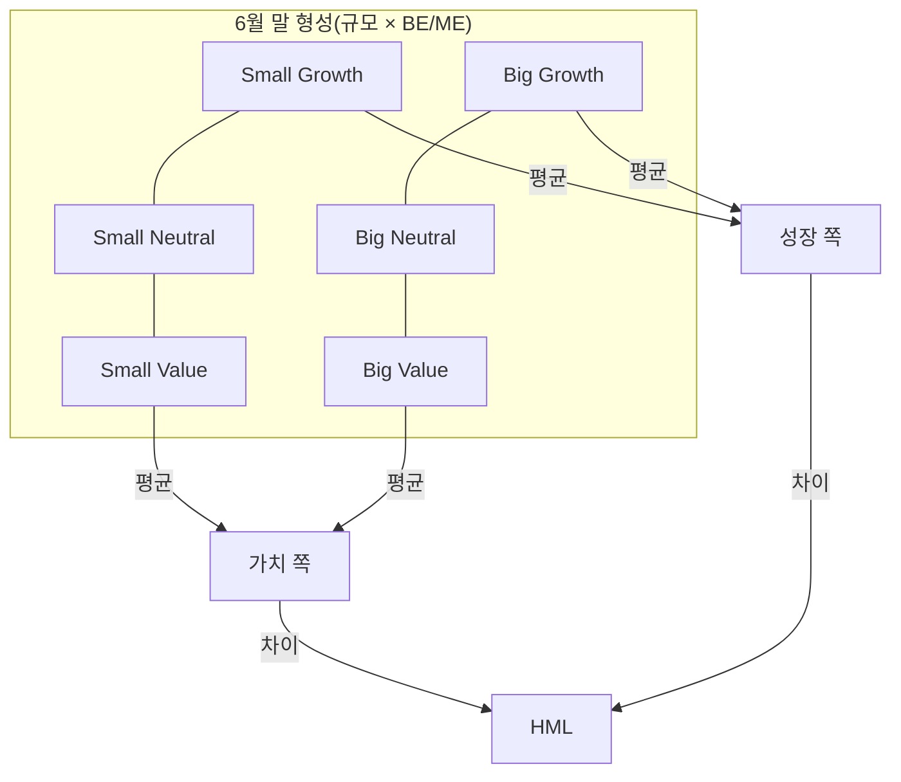
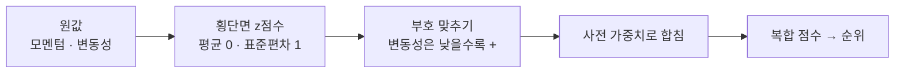

> [!GOAL]
>
> - 가치 · 모멘텀 · 퀄리티 · 저변동성 팩터의 정의와 「12-1」 같은 구성 규칙을 말할 수 있습니다.
> - 횡단면 z점수로 여러 팩터를 **미리 정한 가중치**로 합친 복합 점수와 순위를 직접 계산할 수 있습니다.
> - 생존편향 · 발표 후 감소 · 다중검정 때문에 팩터 결과를 단정하지 않는 이유를 설명하고, Qurious 의 현재 후보 순위가 팩터 스크리닝이 **아니라는 것**을 알 수 있습니다.

> [!NOTE]
> 교육용 설명이며 투자 권유가 아닙니다. 이 장의 종목과 가격은 모두 **합성 데이터**이고, 어떤 팩터가 앞으로 돈이 된다는 뜻이 아닙니다. 학술 논문은 초록 페이지나 원문 PDF 의 해당 문장까지만 확인했고(2026-11-04) 항목마다 범위를 표시했습니다.

앞 장에서 시장 전체의 **국면**을 보았습니다([11.8](#/p/regime-dynamic-allocation)). 이 장은 같은 날 같은 시장에서 **어떤 종목이 다른가**를 규칙으로 가르는 팩터 스크리닝을 다룹니다.

## 같은 날 사도 수익이 다른 종목은 무엇이 다를까요?

학계는 종목의 특징(규모 · 가치 · 과거 수익 · 수익성 등)으로 종목을 나눠 보면 평균 수익이 다르다는 규칙을 찾아 왔습니다. 이런 특징을 **팩터**라 부릅니다. 예를 들어 Jegadeesh 와 Titman(Journal of Finance 48(1), 1993)은 과거에 오른 종목을 사고 내린 종목을 파는 전략이 3~12개월 보유에서 유의한 수익을 냈다고 보고했습니다(1965~1989, 미국 NYSE · AMEX 표본, 6개월 형성 6개월 보유 전략이 연 12.01% 복리 초과수익. 초록과 결론 발췌로 확인).

하지만 **과거 표본에서 그랬다는 것**과 **앞으로도 그렇다는 것**은 다른 이야기입니다. 아래 「믿기 전에 확인할 것」 에서 다룹니다.

## 팩터는 어떻게 만들어지나요?

정렬 → 포트폴리오 → 차이, 세 단계입니다. 케네스 프렌치의 자료 라이브러리(Kenneth French Data Library, 2026-11-03 열람)가 정의를 밝힙니다.

- **가치(HML)**: 매년 6월 말에 규모(NYSE 중위수)와 장부가 대 시가 비율 BE/ME(NYSE 30 · 70 분위)로 종목을 2×3 교차해 6개 포트폴리오를 만들고, 다음 해 6월까지 보유합니다. HML 은 가치 포트폴리오 둘의 평균에서 성장 포트폴리오 둘의 평균을 뺀 값입니다. BE/ME 는 직전 회계연도 말 장부자본 ÷ 직전 12월 시가총액입니다.
- **규모(SMB)**: 작은 종목 세 포트폴리오의 평균에서 큰 종목 세 포트폴리오의 평균을 뺀 값입니다.
- **모멘텀(Mom)**: 지난 수익률(2~12개월, 최근 1개월 제외) 기준 상위 두 포트폴리오의 평균에서 하위 두 포트폴리오의 평균을 뺀 값으로, 일 단위로 형성합니다.
- **수익성 · 투자(RMW · CMA)**: 5요인 모형에서 수익성이 강한 쪽에서 약한 쪽을 뺀 것, 투자가 보수적인 쪽에서 공격적인 쪽을 뺀 것입니다.



*그림 1. HML 은 어느 칸의 평균으로 만드나(프렌치 자료 라이브러리의 설명을 그림으로 옮긴 것).*

> [!NOTE]
> 「PER 낮은 종목을 사면 가치 투자」 라는 말과 학계의 가치 팩터는 **같지 않습니다.** 학계 정의는 BE/ME 를 정해진 날(6월 말)에 정렬해 다음 해까지 보유한 결과입니다. 기준일과 보유 기간이 빠지면 다른 말입니다.

## 모멘텀의 12-1 은 왜 이렇게 자르나요?

프렌치 자료의 모멘텀은 「지난 2~12개월」 수익률로 만들고(최근 1개월 제외), 포함 조건으로 251거래일 전 가격과 21거래일 전 수익률이 있어야 합니다. 이것을 흔히 **12-1 모멘텀**(12개월 수익률에서 최근 1개월을 건너뜀)이라 부릅니다. 「12-1」 이라는 별명은 이 표기를 풀어 부른 것입니다.

「왜 최근 1개월을 건너뛰나」 에 대해 George–Hwang(2004)은 각주에서 호가 차이(bid-ask bounce)를 피하려고 순위를 매기는 시점과 보유 기간 사이를 한 달 비운다고 밝힙니다. Jegadeesh–Titman(1993)은 1주를 건너뛴 전략을 따로 시험하며 호가 차이 · 가격 압력 · 지연 반응을 이유로 듭니다(두 논문 본문 직접 확인). 다만 널리 쓰는 12-1 모멘텀 팩터가 한 달을 건너뛰는 이유가 이와 같은지는 확인하지 못해, 여기서는 **구성 규칙**만 적습니다. 예제 ①에서 `px[-1 - 21] / px[-1 - 252] - 1` 이 12-1 입니다.

## 퀄리티와 저변동성은 무엇이 다른가요?

둘 다 방어적이라 겹치지만 정의와 근거가 다릅니다.

| 팩터 | 소개되는 내용 |
|---|---|
| 퀄리티 | AQR 의 Quality Minus Junk 는 수익성 · 성장 · 안전 · 배당성향 네 부분의 지표를 각각 순위로 바꿔 z점수로 만든 뒤 평균하고, 네 부분 점수를 다시 평균해 하나의 퀄리티 점수를 만듭니다(원문 본문 직접 확인) |
| 특이변동성 | Ang 외(2006)는 3요인 모형으로 설명되지 않는 높은 특이변동성 종목의 평균 수익이 매우 낮다고 보고했습니다(초록). 이후 단기 반전으로 설명된다는 반론이 있습니다 |
| 저베타 | Frazzini 와 Pedersen(2014)은 레버리지 제약 때문에 높은 베타 자산의 알파가 낮다는 모형과 실증을 제시했습니다(초록) |

## 점수를 합쳐 순위를 매겨 봅시다

여러 팩터를 한 점수로 합치는 흔한 방법은 **횡단면 z점수**입니다. 그날 종목들 사이에서 평균을 빼고 표준편차로 나눠 팩터마다 평균 0 · 표준편차 1 로 맞춥니다. 그다음 두 가지를 정해야 합니다.

1. **부호.** 변동성은 낮을수록 좋은 점수로 쓰려면 부호를 뒤집습니다.
2. **가중치.** **결과를 보기 전에** 적어 둡니다. 결과를 본 뒤 가중치를 고르면 표본에 맞춘 우연한 최적화(데이터 스누핑)가 됩니다.



*그림 2. 팩터 점수를 합치는 흐름.*

예제 [`factor_screening.py`](/learn/examples/factor_screening.py)는 numpy 만으로 합성 8종목(시드 11)의 점수를 계산합니다. 핵심은 이렇습니다.

```python
mom = px[-1 - 21] / px[-1 - 252] - 1                       # 12-1
vol = ret[-60:].std(axis=0, ddof=1) * np.sqrt(252)          # 60일 연변동성
score = 0.5 * zscore(mom) + 0.5 * zscore(-vol)              # 변동성은 낮을수록 +, 가중치는 미리 정한 0.5 · 0.5
```

다음은 2026-11-04 에 `python -X utf8 -I factor_screening.py` 로 돌린 결과입니다(Python 3.13.14). 종목 A~H 는 합성이며 의미가 없습니다.

```output
① ~ ③ 복합 점수 (합성 8종목, 가중치 0.5 · 0.5)
   종목  모멘텀12-1  변동성  복합점수
     D     -0.085   0.214     0.53
     F      0.296   0.240     0.52
     G      0.418   0.249     0.47
     A     -0.147   0.227     0.02
     C      0.349   0.262    -0.03
     B     -0.076   0.243    -0.30
     E      0.247   0.265    -0.32
     H     -0.244   0.252    -0.89
```

D 는 모멘텀이 음수인데도 변동성이 가장 낮아 1위입니다. 한 팩터만 보면 보이지 않는 결과이고, **가중치가 바뀌면 순위도 바뀝니다.** 그래서 가중치는 보기 전에 적어 둡니다.

## 믿기 전에 확인할 것

**1. 발표되면 줄어듭니다.** McLean 과 Pontiff(Journal of Finance, 2016)는 97개 예측변수가 표본 밖에서 평균 26%, 학술 발표 뒤에는 58% 줄었다고 보고했습니다(2013년 판 초록 열람. 초기 판은 82개 · 약 10% 로 수치가 달라 이 수치만 씁니다).

**2. 많이 검정하면 우연이 섞입니다.** Harvey, Liu, Zhu(2014)는 학술지 논문과 일부 워킹페이퍼 313편에서 팩터 316개를 정리했고(논문은 이 수가 실제 팩터 수보다 적을 가능성이 크다고 덧붙입니다), 많은 검정을 고려하면 새 팩터의 t값 기준을 2.0 이 아니라 3.0 보다 크게 올려야 한다고 주장했습니다(NBER 워킹페이퍼 본문과 초록을 직접 확인. 절대 규칙은 아님).

**3. 생존편향.** 폐지된 종목이 빠진 표본으로 평균을 내면 부풀려집니다. 아래 합성 실험이 이를 보입니다. 누적 -50% 에 닿은 종목을 폐지로 보고, 폐지 포함과 살아남은 종목만의 평균을 비교합니다.


*그림 3. 생존편향 장난감 실험. 합성 데이터(시드 5, 200개 가상 종목 750일)이며 실제 종목이 아닙니다. 만든 스크립트는 `tools/learn_figs/factor-screening.py`.*

```output
④ 생존편향 장난감 실험 (합성 200종목 · 750일)
   폐지된 종목 수            : 34 / 200
   폐지 포함 평균 최종 배수  : 1.268
   살아남은 종목만 평균 배수 : 1.426
```

> [!NOTE]
> 생존 표본이 허위 지속성을 만든다는 고전 연구(Brown 외, 1992, Review of Financial Studies)는 **펀드** 표본에 대한 것입니다. 주식 스크리닝에 일반화하는 것은 이 장의 해석이며, 주식 쪽 직접 근거 연구는 이번에 찾지 못했습니다. 그래서 팩터 순위는 「그날 상장된 종목」 집합에서 매겨야 한다는 원칙을 이 장의 판단으로 적습니다.

## Qurious 는 어디까지 왔나요?

**Qurious 는 이렇게 합니다. 아직 팩터 스크리너가 없습니다.** 지금 있는 가장 가까운 것은 고정된 31종목에 대해 2년 일봉의 샤프(연환산 수익률 ÷ 연환산 변동성, 무위험수익률 0)로 순위를 매기고, 종목별 AI 예측 순위와 가중평균해 상위 8종목을 고르는 화면입니다.

| | Qurious 의 후보 순위 | 팩터 스크리닝 |
|---|---|---|
| 유니버스 | **고정 31종목**(대형주 위주) | 그날 상장된 종목 전체 |
| 점수 | 샤프 순위 + AI 예측 순위의 가중평균(순위 0~1 평균) | 팩터 z점수의 가중합 |
| 모멘텀 | 최근 달을 건너뛰지 않은 2년 평균 기반 | 12-1 |
| 가중치 | 종목별 신뢰도로 매번 달라짐 | 사전에 적어 둠 |

그래서 이 순위를 「팩터 점수」 라고 부르면 안 됩니다. 설계 문서의 방향은 가격 팩터(모멘텀 12-1 · 저변동성 · 거래대금)를 먼저 만들고 가치와 퀄리티는 재무 출처가 생긴 뒤, 그날 상장된 종목 집합으로 하는 것이지만 **아직 코드는 없습니다.** 지수 계산 쪽에는 상장폐지 종목을 마지막 거래일까지 포함하는 처리가 있어 시점 유니버스의 재료는 있으나 스크리너에는 연결되어 있지 않습니다.

> [!NOTE]
> 이 장을 쓰면서 확인했지만 고치지 않은 것(코드 확인 필요): ① 화면의 LightGBM 이라는 이름과 실제 계산(합산 점수)의 어긋남 ② 샤프의 무위험수익률 0 가정과 31종목을 고른 기준이 코드 주석에 설명되어 있지 않음.

## 흔한 실수

1. **「팩터 프리미엄은 보장된다」.** 발표 뒤 줄어드는 것이 평균입니다.
2. **「논문에서 유의했으니 진짜다」.** 많이 검정하면 t값 기준을 올려야 한다는 주장이 있습니다.
3. **「12개월 수익률 = 모멘텀」.** 표준 구성은 최근 1개월을 건너뜁니다.
4. **「PER 낮은 종목 = 가치 팩터」.** 학계 정의는 정렬 날짜와 보유 기간을 갖습니다.
5. **「지금 존재하는 종목 중에서 고르면 된다」.** 생존편향이 생깁니다.
6. **「점수는 합치면 더 좋다」.** 가중치 · 이상값 처리에 따라 결과가 크게 달라지고, 보기 전에 가중치를 적어 두지 않으면 우연한 최적화가 됩니다.
7. **「저변동성 = 퀄리티」.** 정의와 근거 논문이 다릅니다.

## 정리

1. 팩터는 정렬 → 포트폴리오 → 차이로 만들고, 정렬 날짜와 보유 기간까지가 정의입니다.
2. 여러 팩터는 횡단면 z점수 → 부호 맞추기 → **사전 가중치**로 합칩니다.
3. 팩터는 발표 뒤 약해지고, 많이 검정하면 우연이 섞이며, 폐지 종목을 빼면 평균이 부풀려집니다.
4. Qurious 의 후보 순위는 고정 31종목의 샤프 순위와 AI 예측 순위의 가중평균이고 팩터 스크리닝이 아닙니다.

<details>
<summary>확인 문제 1 — 12-1 모멘텀에서 「1」 은 무엇을 뜻하나요?</summary>

가장 최근 1개월(약 21거래일)을 건너뛴다는 뜻입니다(예제의 `px[-1 - 21]`).
</details>

<details>
<summary>확인 문제 2 — 변동성을 팩터 점수에 넣을 때 부호를 뒤집는 까닭은?</summary>

낮은 변동성을 높은 점수로 쓰기 위해서입니다(예제의 `zscore(-vol)`).
</details>

<details>
<summary>확인 문제 3 — 복합 점수의 가중치를 결과를 본 뒤에 고르면 무엇이 문제인가요?</summary>

표본에 맞춘 우연한 최적화(데이터 스누핑)가 됩니다. 그래서 가중치는 보기 전에 적어 둡니다.
</details>

<details>
<summary>확인 문제 4 — 폐지 종목을 뺀 표본으로 팩터 수익을 재면 평균은 어느 쪽으로 틀어지나요?</summary>

위쪽입니다(생존편향). 합성 실험에서 폐지 포함 1.268 이 살아남은 종목만으로는 1.426 이 됐습니다(예제 ④).
</details>

<details>
<summary>확인 문제 5 — Qurious 의 현재 후보 순위는 팩터 스크리닝인가요?</summary>

아닙니다. 고정 31종목의 샤프 순위와 AI 예측 순위의 가중평균입니다.
</details>

## 더 읽을거리

아래 자료는 2026-11-03 조사에서 열람한 것이며, 이 장을 쓰면서 다시 열지는 않았습니다. **2026-11-04 에 논문 초록 페이지와 원문 PDF 에서 이 장의 수치 문장을 직접 대조했고 항목마다 범위를 적었습니다. 이 장에 없는 수치를 쓰려면 원문을 여세요.**

- Kenneth French Data Library — <https://mba.tuck.dartmouth.edu/pages/faculty/ken.french/Data_Library/f-f_factors.html> · 팩터 정의(6포트폴리오 · 모멘텀 · 5요인). 직접 열람.
- Jegadeesh, N. · Titman, S., Journal of Finance 48(1), 65–91 (1993). 2026-11-04 원문 PDF 에서 1965~1989 NYSE · AMEX 표본과 6개월 형성 6개월 보유 전략의 연 12.01% 복리 초과수익 문장을 직접 확인.
- Harvey, C. · Liu, Y. · Zhu, H., NBER Working Paper w20592 — <https://www.nber.org/papers/w20592> · 2026-11-04 워킹페이퍼 PDF 에서 「316개 팩터를 정리했다」 와 t-ratio 3.0 초과 권고 문장을 직접 확인.
- McLean, R. D. · Pontiff, J., Journal of Finance (2016) — 97개 예측변수. 2026-11-04 ABFER 초록 페이지(워킹페이퍼 판)에서 97개 · 표본 밖 26% · 발표 뒤 58% 문장을 확인했고 저널판 본문은 열지 않았습니다.
- Ang, A. · Hodrick, R. · Xing, Y. · Zhang, X., Journal of Finance 61(1), 259–299 (2006)(NBER 초록 페이지 2026-11-04 확인) · Frazzini, A. · Pedersen, L., Journal of Financial Economics 111(1), 1–25 (2014)(초록 페이지 2026-11-04 확인).
- AQR, 「Quality Minus Junk」 워킹페이퍼. 부분 조각만 확인.
- Brown, S. · Goetzmann, W. · Ibbotson, R. · Ross, S., Review of Financial Studies 5(4), 553–580 (1992). 2026-11-04 초록 페이지에서 확인(펀드 표본).
- 이 장의 예제 [`factor_screening.py`](/learn/examples/factor_screening.py) · 재무 지표를 공시일 기준으로 쓰는 법은 [11.10](#/p/fundamental-filter-pit).

> [!NOTE]
> 확인하지 못해 단정하지 않은 것: ① Fama–French(1992 · 1993 · 2015) 논문 본문(프렌치 페이지의 정의만 사용) ② 총이익 프리미엄 ③ 널리 쓰는 12-1 모멘텀 팩터가 한 달을 건너뛰는 이유(논문 두 편의 설명은 확인) ④ 한국 시장에서의 팩터 결과 ⑤ Fu(2009) 반론의 내용.

**용어**

| 말 | 뜻 |
|---|---|
| 팩터 | 종목을 나누는 특징(가치 · 모멘텀 · 퀄리티 등)과 그에 따른 평균 수익 차이 |
| 횡단면 | 같은 날 종목들 사이의 비교 |
| z점수 | 평균을 빼고 표준편차로 나눈 값 |
| 12-1 모멘텀 | 12개월 수익률에서 최근 1개월을 건너뛴 값 |
| 복합 점수 | 여러 팩터 점수를 가중합한 점수 |
| 데이터 스누핑 | 같은 데이터로 규칙을 계속 시험해 우연한 규칙을 고르는 것 |
| 생존편향 | 폐지된 종목이 빠져 성과가 부풀려 보이는 현상 |
