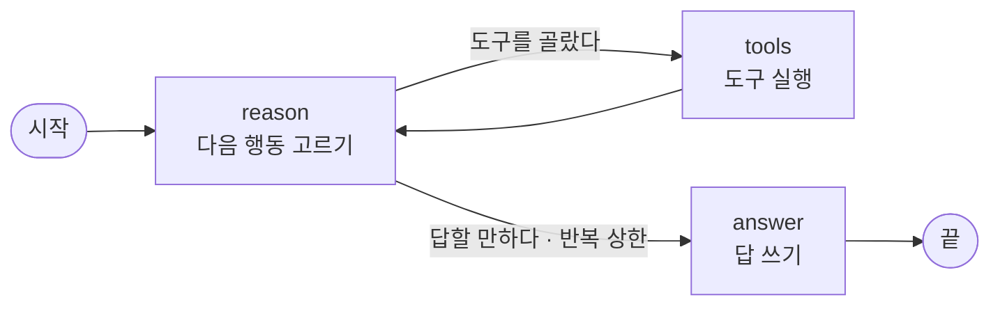

> [!GOAL]
> - 상태 · 노드 · 간선 세 가지로 에이전트가 일하는 차례를 그릴 수 있습니다.
> - 노드가 돌려준 값이 상태에 어떻게 합쳐지는지(덮어쓰기와 이어 붙이기) 설명할 수 있습니다.
> - 모델이 도구만 계속 고를 때 고리를 끊는 두 장치, 반복 상한과 재귀 한도를 구분할 수 있습니다.

> [!NOTE]
> 이 장은 초안입니다. 출력은 2026-10-20 에 직접 돌린 결과이고, 그림과 확인 문제는 다음 판에 더합니다.

## 에이전트는 RAG 와 무엇이 다른가요?

에이전트(agent)는 언어 모델이 다음에 할 일을 스스로 고르고, 고른 도구를 실행한 결과를 다시 읽으며 답에 이를 때까지 되풀이하는 프로그램입니다. [3.1 RAG](#/p/rag-basics) 의 근거 답은 「찾기 → 쓰기」 차례가 코드에 박혀 있습니다. 에이전트는 그 차례를 모델이 질문마다 정합니다.

「연 금리 3% 넘는 예금을 찾아 주세요」 라는 질문을 받으면 모델은 예금 상품 검색 도구를 고르고, 검색 결과를 읽은 뒤 답합니다. 「ETF 가 뭔가요?」 처럼 개념을 묻는 질문에는 도구 없이 바로 답합니다. 생각하고(reason), 행동하고(act), 결과를 보고 다시 생각하는 이 꼴을 ReAct 라고 부릅니다(Yao 등, 2022).

## LangGraph 는 이 고리를 어떻게 나타내나요?

LangGraph 는 에이전트가 일하는 차례를 그래프로 나타내는 라이브러리입니다. 세 가지 부품만 알면 그래프를 읽을 수 있습니다.

| 부품 | 뜻 | 앱의 상담 에이전트에서 |
|---|---|---|
| 상태(State) | 모든 노드가 함께 읽고 쓰는 값 묶음 | `AgentState` — 대화 · 고른 행동 · 도구 결과 · 반복 횟수 · 최종 답 |
| 노드(Node) | 상태를 받아 바꿀 값만 돌려주는 파이썬 함수 | `reason`(다음 행동 고르기) · `tools`(도구 실행) · `answer`(답 쓰기) |
| 간선(Edge) | 노드 다음에 어디로 갈지 | `reason` 뒤에는 조건에 따라 `tools` 또는 `answer`, `tools` 뒤에는 늘 `reason` |



그림 1. 앱의 상담 에이전트 그래프. `reason` 에서 갈림길이 생기고, `tools` 는 늘 `reason` 으로 돌아갑니다.

그래프를 조립하는 코드는 그림과 한 줄씩 맞습니다(`app/services/langgraph_agent.py` 의 `build_graph`).

```python
graph = StateGraph(AgentState)
graph.add_node("reason", reason_node)
graph.add_node("tools",  tool_node)
graph.add_node("answer", answer_node)

graph.set_entry_point("reason")
graph.add_conditional_edges(
    "reason",
    route_after_reason,
    {"tools": "tools", "answer": "answer"},
)
graph.add_edge("tools",  "reason")
graph.add_edge("answer", END)

return graph.compile()
```

`add_conditional_edges` 의 둘째 인자 `route_after_reason` 은 상태를 보고 다음 노드 이름을 돌려주는 함수입니다. 마지막 줄의 `compile()` 은 빠뜨릴 수 없습니다. LangGraph 문서도 「그래프는 컴파일한 뒤에야 쓸 수 있다」 고 따로 강조합니다.

## 노드가 돌려준 값은 상태에 어떻게 합쳐지나요?

노드는 상태 전체를 돌려주지 않습니다. 바꿀 칸만 담은 사전을 돌려주고, LangGraph 가 그 값을 상태에 합칩니다. 합치는 방법은 칸마다 정할 수 있고, 이 규칙을 리듀서(reducer)라고 부릅니다.

```python
class AgentState(TypedDict):
    # operator.add: 각 노드가 반환하는 리스트가 기존 리스트에 추가(append)됨
    messages: Annotated[list[dict], operator.add]
    steps: Annotated[list[dict], operator.add]
    observations: Annotated[list[str], operator.add]
    rag_context: str
    done: bool
    iteration: int
    final_answer: str
```

`Annotated[…, operator.add]` 를 붙인 세 칸은 노드가 돌려준 목록을 뒤에 이어 붙입니다. 붙이지 않은 칸(`done` · `iteration` 등)은 새 값으로 덮어씁니다. 그래서 `tools` 노드는 `{"observations": [obs]}` 처럼 새 결과 하나만 돌려주면 되고, 앞서 쌓인 결과는 그대로 남습니다.

## 직접 해 보기

언어 모델 없이 같은 꼴의 그래프를 돌려 봅니다. 모델 자리에 「차례로 고를 행동」 각본을 넣어, 몇 번을 돌려도 출력이 같습니다. 상태 · 노드 · 간선 · 반복 상한(`MAX_STEPS = 6`)은 앱 코드와 같고, 도구는 결과 문자열만 만듭니다.

```python
def reason(state: AgentState) -> dict:
    if guard and state["iteration"] >= MAX_STEPS:
        return {"done": True}
    action = script[min(state["iteration"], len(script) - 1)]
    return {"steps": [{"action": action}], "done": action == "final_answer",
            "iteration": state["iteration"] + 1}

def route(state: AgentState) -> str:
    if state.get("done") or (guard and state["iteration"] >= MAX_STEPS):
        return "answer"
    return "tools"
```

첫째로, 도구를 한 번 쓰고 답하는 각본(`["search_funds", "final_answer"]`)입니다. `stream(…, stream_mode="updates")` 로 노드가 끝날 때마다 받은 이름을 이어 적었습니다.

```output
langgraph 1.1.6 | python 3.12.13

[도구 한 번 쓰고 답하기]
지나간 노드: reason → tools → reason → answer
steps: ['search_funds', 'final_answer']
observations: ['search_funds 결과 1']
iteration: 2 | final_answer: 관찰 1개로 답함
```

`steps` 와 `observations` 는 노드마다 하나씩 돌려줬는데 목록으로 쌓였습니다. 리듀서 `operator.add` 가 한 일입니다.

## 모델이 도구만 계속 고르면 어떻게 되나요?

작은 로컬 모델은 「충분히 찾았으니 답하자」 를 잘 고르지 못할 때가 있습니다. 각본을 `["search_funds"]` 하나로 두면 모델이 끝없이 도구를 고르는 상황이 됩니다.

```output
[도구만 계속 고르는 모델 · 반복 상한 있음]
지나간 노드: reason → tools → reason → tools → reason → tools → reason → tools → reason → tools → reason → answer
steps: ['search_funds', 'search_funds', 'search_funds', 'search_funds', 'search_funds', 'search_funds']
observations: ['search_funds 결과 1', 'search_funds 결과 2', 'search_funds 결과 3', 'search_funds 결과 4', 'search_funds 결과 5']
iteration: 6 | final_answer: 관찰 5개로 답함
```

반복 상한이 여섯 번째 `reason` 뒤에 길을 `answer` 로 돌렸습니다. 고른 행동은 여섯 개인데 도구 결과는 다섯 개입니다. 여섯 번째로 고른 도구는 실행되지 않고, 답 노드는 그때까지 모은 결과로 답을 씁니다.

상한을 끄고 LangGraph 의 재귀 한도(`recursion_limit`)를 10 으로 낮추면 그래프가 오류로 멈춥니다.

```output
[도구만 계속 고르는 모델 · 반복 상한 없음]
지나간 노드: reason → tools → reason → tools → reason → tools → reason → tools → reason → tools
멈춤: GraphRecursionError - Recursion limit of 10 reached without hitting a stop condition. You can increase the limit by setting the `recursion_limit` config key.
```

두 장치는 하는 일이 다릅니다. 반복 상한은 우리가 정한 규칙이라 사용자에게 답을 돌려줍니다. 재귀 한도는 LangGraph 가 무한 고리를 막는 마지막 안전장치라 답 없이 예외를 던집니다. 상담 화면처럼 사용자가 기다리는 곳에서는 반복 상한을 먼저 두고, 재귀 한도는 그보다 넉넉하게 둡니다.

## 우리 서비스에서는 어떻게 쓰나요?

- 「AI 투자 상담」 화면이 `POST /api/chat` 으로 이 그래프를 부릅니다(`app/routes/chat.py`). 같은 화면의 「자동 — 근거 먼저」 방식은 법령 · 감독규정에서 근거를 찾지 못한 질문만 이 그래프로 넘기고, 그 답에 「출처 없는 일반 AI 답」 표시를 붙입니다. 가격 예측 · 매수 권유 질문은 넘기지 않습니다(`public/js/kbchat.js`).
- 질문은 그래프에 들어가기 전에 가드레일(`app/lib/guardrails.py` 의 `check_guardrails`)을 지납니다. 불법 금융 행위를 뜻하는 낱말이 있으면 그래프를 돌리지 않고 정해 둔 안내문을 돌려줍니다.
- 모델은 PC 안의 Ollama 입니다. `reason` 노드는 모델에게 JSON 한 줄을 요구하고, 읽지 못하면(`_parse_action` 이 `None`) 곧바로 답 노드로 갑니다.
- 같은 도구를 같은 인자로 다시 고르거나, 이미 「자료 없음」 을 낸 도구를 또 고르면 고리를 끊고 답으로 갑니다(`app/lib/risk_tools.py` 의 `is_repeat`). 재무 건전성 도구를 쓴 답에는 서버가 계산한 값을 끝에 붙이고, 답 속 숫자가 그 값과 다르면 경고 한 줄을 답니다(`guard_answer`).

## 흔한 실수

1. **컴파일하지 않고 부르기.** `StateGraph` 는 설계도이고, `compile()` 이 돌려준 객체가 실행기입니다.
2. **목록 칸에 리듀서를 붙이지 않기.** 붙이지 않으면 노드가 돌려준 목록이 앞 목록을 덮어써, 도구 결과가 마지막 하나만 남습니다.
3. **모델 출력이 늘 올바른 JSON 이라고 믿기.** 작은 모델은 코드 울타리(```` ``` ````)를 두르거나 앞뒤에 말을 붙입니다. 앱의 `_parse_action` 은 울타리를 벗기고 첫 `{` 부터 마지막 `}` 까지만 읽습니다.
4. **재귀 한도만 믿기.** 한도에 닿으면 사용자는 답 대신 오류를 받습니다.

## 정리

1. LangGraph 에이전트는 상태 · 노드 · 간선으로 짭니다. 갈림길은 조건 간선 하나로 나타냅니다.
2. 노드는 바꿀 칸만 돌려주고, 칸마다 정한 리듀서가 덮어쓸지 이어 붙일지 정합니다.
3. 반복 상한은 답을 돌려주고 재귀 한도는 예외를 던집니다. 사용자 앞에서는 반복 상한이 먼저입니다.

## 더 읽을거리

- LangGraph 문서 「Graph API overview」 <https://docs.langchain.com/oss/python/langgraph/graph-api>
- LangGraph 문서 「Thinking in LangGraph」 <https://docs.langchain.com/oss/python/langgraph/thinking-in-langgraph>
- Yao 등, 「ReAct: Synergizing Reasoning and Acting in Language Models」(2022) <https://arxiv.org/abs/2210.03629>
- 이 저장소 `app/services/langgraph_agent.py` · `app/lib/guardrails.py` · `app/lib/risk_tools.py`
