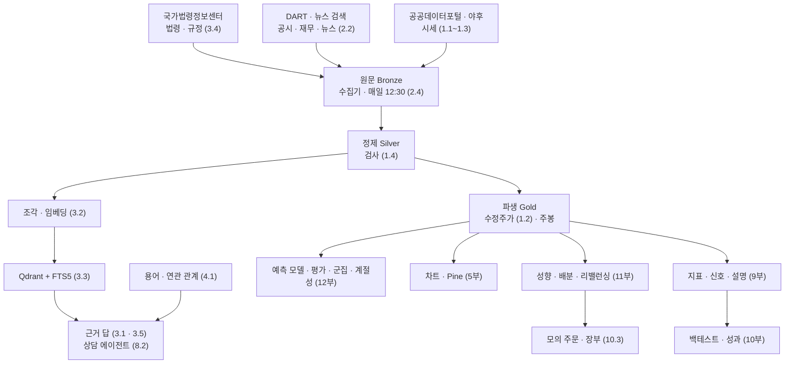

> [!GOAL]
> - Qurious 가 하는 일을 「모으고 → 쌓고 → 근거로 답하고 → 신호를 내고 → 검증하고 → 배분하고 주문한다」 는 한 흐름으로 그릴 수 있습니다.
> - 궁금한 화면이나 기능에서 출발해 먼저 읽을 장을 찾을 수 있습니다.
> - 장마다 붙은 「완성 · 초안 · 뼈대」 표시가 무엇을 뜻하는지 알 수 있습니다.

## 이 교재는 무엇을 다루나요?

Qurious 는 공식 자료를 매일 모아 검증하고, 근거가 있는 답만 하며, 비용을 뺀 성과를 모의투자로 기록하는 로보 어드바이저입니다. 이 교재는 그 서비스를 만든 기술 개념을 열두 개 부(部)로 나눠 설명합니다. 주식 · 금융상품 · 제도 같은 금융 자체의 기초는 「금융 필수 지식」 강의실과 그 보완 장(F 부)이 다룹니다.

**표 1. 부와 닿는 화면**

| 부 | 다루는 것 | 닿는 화면 |
|---|---|---|
| 1부 시세 데이터 | 봉과 OHLCV · 수정주가 · 분봉과 시간대 · 데이터 품질 검사 | 주가 차트 · 데이터 관제 |
| 2부 데이터 파이프라인 | 원문 · 정제 · 파생 세 층 · 공식 API · 데이터셋 판 · 정기 배치 · 거래일 달력 | 자료 안내 · 수집 일정 · 단계 · 일정 |
| 3부 근거 RAG | RAG · 임베딩 · 섞어 찾기 · 법령 판 · 출처 표기 · 평가 · 로컬 LLM | AI 투자 상담(근거 답) |
| 4부 지식 구조 | 시소러스 · 지식 그래프 | 용어사전 |
| 5부 차트 · Pine | Lightweight Charts · Pine Script · 웹훅 | 투자 인디케이터 · TradingView 연동 |
| 6부 파이썬 중급 | import 와 타입 힌트 · 데이터 그릇 · 약속 · 함수 · 예외 · 문자열 | 앱 코드 읽기 |
| 7부 서버 · 운영 | FastAPI · Docker Compose · 시험 코드 · 낙관적 동시성 · 저장소 · Celery | 서버 대시보드 |
| 8부 AI 에이전트 | LangChain · LangGraph 상담 에이전트 · pgvector · GraphRAG | AI 투자 상담 |
| 9부 신호와 설명 | 지표 계산 정의 · 캔들 패턴 · 다중 주기 신호 · 사건 연구 · 추천 이유 설명 | 패턴 인식 · 종목 스크리닝 · 차트 패턴 · 지지/저항 · 멀티타임프레임 |
| 10부 백테스트와 성과 | 백테스트 · 성과 지표 · 모의 주문 장부 · 테스트베드 지표 | 국내주식 모의주문 · 모의계좌 현황 · 코스콤 테스트베드 기준 |
| 11부 자산배분과 주문 | 투자성향 점수 · 리밸런싱 · 증권사 Open API · 주문 안전 | 자산배분 · 최적화 · 리밸런싱 엔진 · 증권사 API 설정 · 자동매매 현황 |
| 12부 머신러닝 모델 | 트리 모델 · 시간 순서를 지킨 모델 평가 · 종목 군집화 · 계절성 검정 | 모델 비교 · 종목 군집화 · 계절성 분석 |

## 자료는 어디서 와서 어디로 가나요?

그림 1 은 자료가 흐르는 길과, 그 길의 각 칸을 설명하는 장을 함께 보여 줍니다.

그림 1. Qurious 의 자료 흐름과 장 번호. 원문 → 정제 → 파생의 세 층(Bronze · Silver · Gold)은 python-crawling-lab 실습 저장소의 이름을 빌렸습니다.

받은 원문은 그대로 두고, 정제와 파생은 매일 원문에서 다시 만듭니다. 근거 답 · 신호 · 성과 · 배분은 모두 같은 날짜의 같은 자료를 읽습니다. 그래서 어느 화면에서 출발하든 1부와 2부가 바탕이 됩니다.

## 어떤 순서로 읽으면 되나요?

처음이라면 1부부터 차례로 읽습니다. 궁금한 화면이 있다면 표 2 에서 그 화면의 줄을 찾아 왼쪽 장부터 읽어도 됩니다.

**표 2. 궁금한 것에서 출발하는 읽는 순서**

| 궁금한 것 | 먼저 | 이어서 |
|---|---|---|
| 차트의 값이 왜 이렇게 나오나 | [1.1 봉과 OHLCV](#/p/ohlcv-bars) | [1.2 수정주가](#/p/adjusted-price) · [1.3 분봉과 시간대](#/p/intraday-timezone) |
| 상담이 어떻게 근거를 찾아 답하나 | [3.1 RAG](#/p/rag-basics) | [3.4 문서 쪼개기와 법령 판](#/p/chunking-legal-versions) · [8.2 LangGraph 상담 에이전트](#/p/langgraph-agent) |
| 매수 · 매도 신호와 그 이유 | [9.3 여러 주기 신호 합치기](#/p/multi-timeframe-signals) | [9.5 추천 이유 설명](#/p/xai-shap) |
| 백테스트 결과를 믿어도 되나 | [10.1 백테스트의 뼈대](#/p/backtest-basics) | [10.2 성과 지표 계산](#/p/performance-metrics-calc) |
| 비중을 언제 다시 맞추나 | [11.1 투자성향 점수](#/p/investor-profile-scoring) | [11.2 리밸런싱 세 방식](#/p/rebalancing-methods) |
| 예측 모델의 점수를 믿어도 되나 | [12.2 시간 순서를 지킨 모델 평가](#/p/time-ordered-model-evaluation) | [12.1 트리 모델](#/p/tree-models-lightgbm) · [9.5 추천 이유 설명](#/p/xai-shap) |
| 앱 코드를 직접 읽고 싶다 | [6.1 import 와 타입 힌트](#/p/python-import-typing) | [7.1 FastAPI](#/p/fastapi-basics) · [7.6 Celery 와 Redis](#/p/celery-task-queue) |

장 이름 옆의 표시는 장이 얼마나 채워졌는지를 뜻합니다. 「완성」 장은 아홉 칸을 모두 채운 장입니다. 「초안」 장은 본문과 직접 돌린 출력이 있고, 그림과 확인 문제가 아직 덜 채워진 장입니다. 「뼈대」 장은 다룰 질문 · 보여 줄 코드 · 참고 자료만 먼저 실은 장입니다.

## 장 하나는 어떻게 생겼나요?

완성 장은 같은 아홉 칸으로 씁니다. MDN · Google 머신러닝 단기 과정 · Hugging Face 강좌 같은 교재 사이트가 공통으로 쓰는 구성을 모은 것입니다.

1. **머리 상자** — 읽는 시간 · 수준 · 먼저 읽을 장 · 이 장에서 할 수 있게 되는 것
2. **왜 필요한가** — 문제 상황 하나, 될 수 있으면 실제로 겪거나 잰 사례
3. **정의와 비유** — 한 문장 정의와 그림
4. **동작 원리** — 단계 그림 · 표
5. **직접 해 보기** — 돌아가는 예제와 **실제로 돌린 출력**
6. **우리 서비스에서는** — 앱의 파일 · 함수 · 화면
7. **흔한 실수**
8. **정리 · 확인 문제** — 답은 접어 둡니다
9. **더 읽을거리 · 용어**

[3.1 RAG](#/p/rag-basics) 가 아홉 칸을 모두 채운 본보기입니다.

## 모르는 개념이 생기면 어떻게 하나요?

장 목록은 고정되어 있지 않습니다. 읽다가 모르는 개념이 나오면 그 이름을 알려 주세요. 다룰 장 목록에 더하고 뼈대 장부터 만든 뒤 차례로 채웁니다.

## 팀 자료는 무엇인가요?

「팀 자료」 는 이 교재 밖에서 따로 쓴 조사 메모 · 정리 글입니다. 로그인한 사람에게만 보이고, 앱에서는 읽기만 합니다. 글은 비공개 데이터셋에 올라가고, 앱은 5분마다 새 글을 받아 옵니다. 팀 자료가 비공개인 까닭은 조사 메모에 강의 자료 발췌가 섞일 수 있기 때문입니다. 공개 저장소에는 교재 · 강의 자료를 올리지 않습니다.

> [!TIP]
> 여러 사람이 같은 글을 고칠 때 말없이 덮어쓰지 않게 하는 원리가 궁금하면 [7.4 낙관적 동시성](#/p/optimistic-concurrency) 을 보세요.

## 정리

1. Qurious 는 「모으고 → 쌓고 → 근거로 답하고 → 신호를 내고 → 검증하고 → 배분하고 주문하는」 한 흐름이고, 열두 개 부가 그 흐름의 칸을 나눠 맡습니다.
2. 처음이면 1부부터, 궁금한 화면이 있으면 표 2 의 그 줄부터 읽습니다.
3. 「완성 · 초안 · 뼈대」 는 장이 얼마나 채워졌는지를 뜻합니다.

## 더 읽을거리

- MDN 「웹 개발 배우기」 — 이 교재가 장 구성을 빌린 교재 사이트 <https://developer.mozilla.org/ko/docs/Learn_web_development>
- Google 머신러닝 단기 과정 <https://developers.google.com/machine-learning/crash-course>
- Hugging Face LLM 강좌(한국어) <https://huggingface.co/learn/llm-course/ko/chapter1/1>
