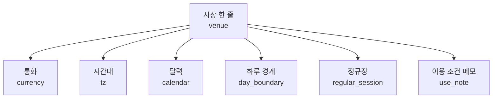
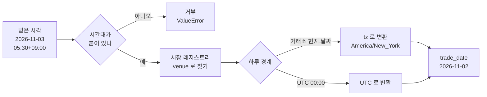

> [!GOAL]
>
> - 시장마다 통화 · 시간대 · 달력 · 하루의 경계가 다르다는 것을 말하고, 이를 레지스트리 한 곳에 두는 까닭을 설명할 수 있습니다.
> - 시간대가 붙은 시각을 거래소 현지 날짜로 바꾸고, 서머타임 전환일 앞뒤가 왜 어긋나는지 직접 계산할 수 있습니다.
> - 시장 식별 코드(MIC)와 통화 코드(ISO 4217)의 쓰임과 한계(코인 · USDT)를 알고, 데이터 이용 조건도 시장마다 달라 같이 적어 두는 이유를 말할 수 있습니다.

> [!NOTE]
> 이 장의 미국 · 코인 시장은 Qurious 에서 아직 **계획 중이거나 일회 수집본**입니다(아래 「Qurious 는 이렇게 합니다」). 외부 사실은 2026-11-03 에 열람한 공식 자료와 계산 결과이며, 거래 시간 · 규칙은 바뀔 수 있으니 실제 사용 전에 공식 안내를 확인하세요. 교육용 설명이며 투자 · 법률 자문이 아닙니다.

[2.5](#/p/trading-calendar)에서 한국 거래일 달력을 만들었습니다. 이 장은 거기에 **다른 시장을 더할 때** 무엇이 어긋나는지를 다룹니다.

## 삼성전자와 애플 일봉을 한 표에 합치면 무엇이 어긋날까요?

가장 먼저 어긋나는 것은 날짜입니다. 한국 시각으로 2026-11-03(화) 05:30 은 서울에서는 11월 3일이지만 뉴욕에서는 아직 11월 2일(월) 저녁입니다. 「그날의 봉」 이 어느 날짜냐가 시장마다 다릅니다. 이 한 가지 때문에 두 시장의 일봉을 같은 날짜 열로 맞추면 **하루씩 밀려 비교될** 수 있습니다.

그 밖에도 어긋나는 것이 많습니다.

| 어긋나는 것 | 예 |
|---|---|
| 통화 | 원(KRW) · 달러(USD) · 코인 거래소의 견적 자산(USDT 등) |
| 시간대 | 서울 · 뉴욕(서머타임 있음) · UTC |
| 달력 | 한국 휴장일 · 미국 휴장일 · 24시간 시장 |
| 하루의 경계 | 거래소 현지 날짜 · UTC 00:00 |
| 이용 조건 | 공공누리 · 라이선스 · 약관 |

## 시장 레지스트리는 무엇이고 왜 한 곳에 두나요?

**레지스트리**는 시장마다 위 칸들을 한 줄씩 적어 둔 목록입니다. 시장이 늘 때마다 코드 곳곳에 「if 미국이면 …」 을 끼워 넣는 대신, 목록에 한 줄을 더하면 나머지 코드는 그 목록을 읽어 움직이게 하려는 것입니다.



*그림 1. 시장 레지스트리 한 줄의 칸(단순화).*

일봉 표에는 `venue`(시장) · `currency`(통화) · `tz`(시간대) 칸을 더하고, **같은 종목 코드가 다른 시장에 있을 수 있어** 기본 키에 `venue` 를 넣습니다. 예를 들어 국내 `005930` 과 미국 티커가 한 표에서 부딪히지 않게 하려는 것입니다.

## 시장은 어떤 이름으로 부르나요?

거래소를 가리키는 표준 코드가 **MIC**(Market Identifier Code)이고, ISO 10383 이 정합니다(ISO 20022 등록기관 안내). 공식 CSV 에는 운영 MIC 와 그 아래 세그먼트 MIC 의 구분이 있습니다. 2026-11-03 에 이 CSV 를 내려받아 대조한 결과입니다.

| 시장 | 코드 | 비고 |
|---|---|---|
| 한국거래소(주식) | `XKRX` | 운영 MIC. 코스닥 · 코넥스는 독립 운영 MIC 가 아니라 `XKRX` 아래 세그먼트 `XKOS` · `XKON` |
| 뉴욕증권거래소 | `XNYS` | 운영 MIC |
| 나스닥 | `XNAS` | 운영 MIC. 아래 세그먼트(`XNMS` · `XNGS` · `XNCM` 등)가 있음 |
| 넥스트레이드 | `NXTE` | 별도 운영 MIC, 분류는 대체거래시스템 |

「코인 거래소는 MIC 가 없다」 는 말은 **틀립니다.** 바이낸스(`BNCX`)처럼 있는 곳이 있고, 업비트 · 빗썸 · 코빗은 같은 목록에서 이름을 찾지 못했습니다. 정확한 말은 「없는 곳이 있다」 입니다. 그래서 Qurious 레지스트리는 주식에는 MIC 를, 코인에는 거래소 · 마켓 이름(`BINANCE_SPOT_USDT` · `UPBIT`)을 키로 씁니다. 참고로 Python 의 `exchange_calendars` 도 달력을 MIC 이름으로 정의합니다(`XNYS` · `XKRX` 지원).

> [!NOTE]
> 코스닥 종목에 `XKOS` 를 붙이면 「시장(운영 MIC)」 과 「게시판(세그먼트)」 을 섞게 됩니다. Qurious 는 시장은 `XKRX` 로 두고 코스닥 · 코넥스는 `boards`(게시판) 칸으로 나눕니다.

## 통화는 어떻게 적나요?

통화 코드는 ISO 4217 입니다. 2026-09-17 자 SIX 목록(ISO 4217 등록 관리기관)에서 KRW 는 숫자 코드 410 · **소수 자릿수 0**, USD 는 840 · **소수 자릿수 2** 입니다. 그래서 금액 열에 정수와 실수를 한 열에 섞으면 안 됩니다. 예제 ③이 `Decimal` 로 통화별 자릿수에 맞추는 모양을 보입니다.

**USDT 는 ISO 4217 코드가 아닙니다.** 같은 목록에 항목이 없고 민간 스테이블코인의 티커입니다. `currency` 칸에 넣을 수는 있지만 「견적 자산」 이라고 따로 밝혀야 합니다.

## 시간대와 서머타임은 어떻게 다루나요?

시간대는 `Asia/Seoul` · `America/New_York` 같은 IANA 이름으로 적습니다(IANA tz 데이터베이스, 2026-11-03 열람 기준 최신판 2026f). 두 가지를 알아 둡니다.

- **한국은 서머타임이 없습니다.** tz 데이터베이스에 따르면 마지막 서머타임은 1987~1988년이고 1961-08-10 이후 UTC+9 입니다.
- **미국은 3월 둘째 일요일부터 11월 첫째 일요일까지** 서머타임입니다(15 U.S.C. §260a). 2026년은 3월 8일부터 11월 1일까지입니다. 서머타임 중 뉴욕은 UTC-4, 표준시 중은 UTC-5 라서 한국과의 시차가 13시간 ↔ 14시간으로 바뀝니다.

그래서 뉴욕 16:00 마감은 한국 시각으로 서머타임 중 05:00, 표준시 중 06:00 이고, **한국 날짜로는 항상 다음 날**입니다. 2026-11-01 전후로 한 시간이 밀립니다. 예제 ②가 계산합니다.

```output
② 뉴욕 16:00 마감의 한국 시각
   뉴욕 2026-10-30 마감 → KST 2026-10-31 05:00
   뉴욕 2026-11-02 마감 → KST 2026-11-03 06:00
   뉴욕 2026-03-06 마감 → KST 2026-03-07 06:00
   뉴욕 2026-03-09 마감 → KST 2026-03-10 05:00
```

> [!WARNING]
> Python 의 `zoneinfo` 는 시간대 데이터를 **스스로 갖고 있지 않습니다.** 시스템의 IANA 데이터를 먼저 찾고 없으면 PyPI 의 `tzdata` 를 씁니다. 윈도우는 보통 시스템 데이터가 없어 `tzdata` 가 필요하고, 없으면 `ZoneInfoNotFoundError` 가 납니다. 그래서 예제는 이 오류가 나면 무엇을 하라고 알려 주고 멈춥니다.

서머타임이 끝나는 날 새벽에는 같은 시각이 **두 번** 나옵니다. 2026-11-01 01:30 뉴욕은 처음(EDT)과 한 시간 뒤(EST)에 각각 한 번씩입니다. `zoneinfo` 는 `fold=0` 이면 전환 이전 오프셋을, `fold=1` 이면 이후 오프셋을 씁니다. 예제 ④입니다.

```output
④ 2026-11-01 01:30 뉴욕은 두 번 나온다
   fold=0 → UTC-0400 (EDT)
   fold=1 → UTC-0500 (EST)
```

## 「하루」 는 어디서 시작하나요?

주식은 **거래소 현지 날짜**로 하루를 셉니다(뉴욕 봉은 뉴욕 날짜). 코인 일봉은 **UTC 00:00** 에 경계가 있습니다. 업비트 문서의 일봉 응답에는 UTC 시작과 KST 시작이 함께 나오고 KST 가 9시간 앞이라, 경계는 UTC 00:00 = 한국 09:00 입니다. 바이낸스 klines 는 `timeZone` 기본값이 0(UTC)이고, 지정하면 구간이 그 시간대로 해석됩니다. 「일봉이 UTC 00:00 에 바뀐다」 는 문장이 바이낸스 문서에 따로 있는 것은 아니고 기본 시간대에서 **추론한** 것입니다.


*그림 2. 한국 시각 축에 옮긴 세 시장의 하루(도식). 공식 시간표를 옮겨 그린 것이며 시세가 아닙니다. 미국 구간은 자정을 넘어 오른쪽 끝에서 이어집니다. 만든 스크립트는 `tools/learn_figs/multi-market-registry.py`.*

봉 시각에서 거래일을 구하는 흐름은 이렇습니다. **시간대 표시가 없는 시각은 받지 않습니다.** 어느 나라 시각인지 모르는 값을 짐작하지 않기 위해서입니다.



*그림 3. 봉 시각 → 거래일. 값 예는 같은 시각을 뉴욕 기준으로 변환한 결과입니다.*

예제 ①이 같은 순간이 시장마다 다른 거래일이 되는 것을 보입니다.

```output
① 같은 순간 2026-11-03T05:30:00+09:00
   XKRX               → 거래일 2026-11-03
   XNYS               → 거래일 2026-11-02
   BINANCE_SPOT_USDT  → 거래일 2026-11-02
   시간대 없는 시각 → 시간대 표시가 없는 시각이다: '2026-11-03T05:30:00' — 어느 시간대인지 먼저 밝힌다
```

## 휴장일은 시장마다 어떻게 얻나요?

한국은 [2.5](#/p/trading-calendar)의 달력을 씁니다. 미국은 NYSE 안내(2026-11-03 열람)에 따르면 2026년 휴장일이 10일(1-1 · 1-19 · 2-16 · 4-3 · 5-25 · 6-19 · 7-3 · 9-7 · 11-26 · 12-25)이고 11-27 · 12-24 에는 13:00(동부)에 조기 종료합니다. 정규장은 09:30~16:00 이고, 장 전 · 장 후 시간은 거래소마다 다릅니다(예: NYSE 는 6:30 부터 주문만 쌓고 9:30 에 개장 경매, Arca 는 04:00~09:30).

나스닥의 휴장일 원문은 이번에 열지 못했습니다. 「NYSE 와 같다」 는 관례이지 확인이 아닙니다. 그래서 Qurious 는 **미국 달력 줄을 만들지 않고** `CalendarUnavailable` 로 알립니다. 모르는 것을 지어내지 않는 선택입니다. 24시간 시장(코인)은 「매일 거래」 로 둡니다.

## 같은 종목이 거래소 둘에서 거래되면?

한국도 이제 정규장 하나가 아닙니다. KRX 정규장 09:00~15:30 외에 KRX 애프터마켓(16:00~20:00, 2026-09-14 신설)과 넥스트레이드(프리 08:00~08:50 · 메인 09:00:30~15:20 · 애프터 15:40~20:00)가 있습니다. 넥스트레이드 공식 페이지는 증권사가 최선집행 기준으로 KRX · NXT 중 유리한 곳에 주문을 낸다고 설명합니다. 그래서 **같은 종목의 가격이 여러 곳에서 나올 수** 있고, 일봉의 「종가」 가 어느 시장 기준인지 밝혀야 합니다. KRX 안내문은 조회일이 오늘이면 종가에 지연 애프터마켓 가격이 섞일 수 있다고도 알립니다.

Qurious 레지스트리는 정규장(09:00~15:30)만 두고 애프터마켓과 NXT 는 아직 칸에 없습니다. 결제 주기(T+2)도 바뀔 수 있습니다. 보도에 따르면 2026-11-02 에 거래소가 T+1 로드맵 초안을 발표했고 시행 목표는 2028년 중이며 확정일은 없습니다. 배당락 규칙은 이 칸만 고치면 되도록 레지스트리에 칸으로 두었습니다.

## 데이터는 가져다 써도 되나요?

시장마다 이용 조건이 다릅니다. 레지스트리의 `use_note` 칸이 그 한계를 함께 적습니다.

| 출처 | 조건(2026-11-03 열람) |
|---|---|
| 바이낸스 Vision | CC BY-NC-SA 4.0. 상업 이용은 별도 서면 계약. 약관은 학술 연구 · 비수익 교육 프로젝트 · 개인 비운영 백테스트를 허용하고 **실시간 자기매매 · 자동 상업 주문 · 대가 받는 신호 배포 · 상업용 봇 통합은 금지**. 2차 저작물은 같은 라이선스를 유지 |
| 업비트 시세 API | IP 기준 그룹별 초당 10회. 캔들 6종이 한 그룹을 공유. 체결이 없는 구간은 그 캔들이 응답에 없음 |

업비트 일봉에서 「체결이 없으면 캔들이 없다」 는 점은 **빈 날을 0 으로 채우지 말아야** 한다는 뜻입니다.

## Qurious 는 이렇게 합니다

**Qurious 는 이렇게 합니다.** 수집기의 시장 레지스트리(`collector/markets.py`)에 5줄이 있습니다.

| 시장 | 통화 · 시간대 | 하루 경계 | 정규장 | 상태 |
|---|---|---|---|---|
| `XKRX` | KRW · 서울 | 거래소 현지 | 09:00~15:30 | live(매일 수집) |
| `XNYS` · `XNAS` | USD · 뉴욕 | 거래소 현지 | 09:30~16:00 | planned(아직 안 받음) |
| `BINANCE_SPOT_USDT` | USDT · UTC | UTC 00:00 | 24시간 | stored(비공개 저장소에 일회 수집본) |
| `UPBIT` | KRW · UTC | UTC 00:00 | 24시간 | local_only(각자 로컬 · 표시만, 팀 저장소에 쌓지 않음) |

상태 네 가지의 뜻: live(수집기가 매일 돈다) · stored(일회 수집본이 있다) · planned(아직 안 받는다) · local_only(팀에 나누지 않는다). 레지스트리를 불러올 때 `zoneinfo` 로 시간대 이름을 검증하고, 코인은 정규장이 없는지, 연환산 일수가 365 인지도 검사합니다.

> [!NOTE]
> 이 장을 쓰면서 확인했지만 고치지 않은 것(코드 확인 필요): ① 레지스트리 주석에 「코인은 MIC 가 없어」 라는 일반화가 있습니다. 바이낸스처럼 MIC 가 있는 곳이 있으므로 문구가 틀립니다(키가 자체 이름이라 동작에는 문제 없음). ② 바이낸스 라이선스의 **금지 용도**(자기매매 · 신호 배포)가 `use_note` 에 아직 없습니다. ③ 환율 출처와 고정값 처리는 이번에 열지 않았습니다.

## 흔한 실수

1. **「코인 거래소는 MIC 가 없다」.** 있는 곳도 있습니다.
2. **「USDT 는 통화 코드다」.** ISO 4217 에 없습니다.
3. **「미국 종가는 한국 시각으로도 같은 날짜」.** 한국 날짜로는 항상 다음 날이고 서머타임 전환 앞뒤로 한 시간 밀립니다.
4. **「한국에도 서머타임이 있다」.** 마지막은 1987~1988년입니다. 바뀌는 쪽은 미국입니다.
5. **「한국 주식의 종가는 하루 한 개」.** 애프터마켓과 넥스트레이드가 겹쳐 가격이 여러 곳에서 나옵니다.
6. **「오늘」 의 뜻이 같다.** 한국은 서울 날짜, 미국은 뉴욕 날짜, 코인 일봉은 UTC 00:00 경계입니다.
7. **「미국 장 전 거래는 모두 04:00 부터」.** 거래소마다 다릅니다.

## 정리

1. 통화 · 시간대 · 달력 · 하루 경계 · 이용 조건이 시장마다 다르므로 한 곳(레지스트리)에 모읍니다.
2. 시간대 없는 시각은 거부하고, 시장의 기준에 따라 거래일을 셉니다.
3. 뉴욕 마감은 한국 날짜로 다음 날 05:00(서머) 또는 06:00(표준)입니다.
4. 모르는 달력은 지어내지 않고 모른다고 알립니다.
5. 같은 종목이 여러 거래소에서 거래되면 일봉 종가의 기준 시장을 밝힙니다.

<details>
<summary>확인 문제 1 — 뉴욕 2026-11-02(월) 정규장 종가(16:00)는 한국 시각으로 언제인가요?</summary>

2026-11-03 06:00 입니다. 11월 1일에 서머타임이 끝나 EST(UTC-5)가 되어 시차가 14시간입니다(예제 ②).
</details>

<details>
<summary>확인 문제 2 — 한국 시간대 <code>Asia/Seoul</code> 도 서머타임 때문에 날짜 계산을 따로 조심해야 하나요?</summary>

아닙니다. 마지막 서머타임은 1987~1988년이고 지금은 UTC+9 고정입니다. 바뀌는 쪽은 미국입니다.
</details>

<details>
<summary>확인 문제 3 — 「바이낸스 일봉의 2026-11-03」 은 한국 시각으로 언제 시작하나요?</summary>

기본 시간대가 UTC 이므로 2026-11-03 09:00 KST(UTC 00:00)로 추론합니다. 업비트 일봉은 문서에서 같은 경계를 직접 확인했습니다.
</details>

<details>
<summary>확인 문제 4 — USDT 를 <code>currency</code> 칸에 넣어도 되나요?</summary>

칸에 넣을 수는 있지만 ISO 4217 코드가 아니므로 「견적 자산」 이라고 따로 밝혀야 합니다.
</details>

<details>
<summary>확인 문제 5 — 시간대 표시가 없는 시각 <code>2026-11-03T05:30:00</code> 을 받으면 어떻게 하나요?</summary>

거래일을 계산하지 않고 거부합니다. 어느 시간대인지 모르는 값을 짐작하면 날짜가 하루 어긋날 수 있습니다(예제 ①).
</details>

## 더 읽을거리

아래 자료는 2026-11-03 조사에서 열람한 자료이며, 이 장을 쓰면서 다시 열지는 않았습니다. 시간 · 규칙은 바뀔 수 있습니다.

- ISO 20022 등록기관, Market Identifier Codes — <https://www.iso20022.org/market-identifier-codes> · 공식 CSV(운영 · 세그먼트 구분). [2026-11-04 원문 확인] 공식 CSV 2,889행에서 XKRX · XKOS · XKON · XNYS · XNAS · NXTE · BNCX 를 대조, 업비트 · 빗썸 · 코빗은 목록에 없음
- SIX, ISO 4217 통화 목록(list-one.xml) — <https://www.six-group.com/dam/download/financial-information/data-center/iso-currrency/lists/list-one.xml> · KRW · USD 자릿수.
- IANA tz 데이터베이스 — <https://data.iana.org/time-zones/tzdb/NEWS> · Python `zoneinfo` — <https://docs.python.org/3/library/zoneinfo.html>. [2026-11-04 원문 확인] 최신판 2026f(2026-10-27) · `Asia/Seoul` 은 zone1970.tab 에서 확인 · `zoneinfo` 문서에서 tzdata 대체와 `fold` 확인
- 15 U.S.C. §260a — <https://www.law.cornell.edu/uscode/text/15/260a> · 미국 서머타임. [2026-11-04 원문 확인]
- NYSE, Holidays & Trading Hours — <https://www.nyse.com/markets/hours-calendars>. [2026-11-04 원문 확인] 2026 휴장일 · 11-27 조기 종료
- 업비트 개발자 문서 — <https://docs.upbit.com/kr/reference/list-candles-days> · <https://docs.upbit.com/kr/reference/rate-limits> [2026-11-04 원문 확인: 일봉에 UTC · KST 시작 칸 · 체결이 없으면 캔들 없음 · 시세 요청 수는 candle 그룹 IP 당 초당 10회]. 바이낸스 Spot API — <https://developers.binance.com/docs/binance-spot-api-docs/rest-api/market-data-endpoints> [2026-11-04 공식 API 문서 원문(GitHub)에서 `timeZone` 기본값 0(UTC) 확인]. Binance Vision 약관 — <https://data.binance.vision/Binance_Vision-Terms_of_Use.pdf> [2026-11-04 PDF 에서 CC BY-NC-SA 4.0 · 허용 · 금지 용도 문장 확인].
- 넥스트레이드 시장개요 — <https://www.nextrade.co.kr/marketOverview/content.do>. [2026-11-04 원문 확인]
- 이 장의 예제 [`market_dates.py`](/learn/examples/market_dates.py) · 한국 거래일 달력은 [2.5](#/p/trading-calendar) · 분봉 시간대는 [분봉과 시간대](#/p/intraday-timezone).

> [!NOTE]
> 확인하지 못해 단정하지 않은 것: ① 나스닥 휴장일 · 조기 종료의 원문 ② NYSE 배당락 규칙의 조 번호 ③ KRX 시간외 종가매매 개편 후 정확한 시각 ④ 한국 T+1 로드맵의 거래소 원문과 시행일 ⑤ 업비트 이용약관 본문 ⑥ 원/달러 시장 시간 · 매매기준율 산정 방식의 최신 공지(이번에 단정하지 않음).

**용어**

| 말 | 뜻 |
|---|---|
| 시장 레지스트리 | 시장마다 통화 · 시간대 · 달력 · 하루 경계 · 이용 조건을 한 줄씩 적은 목록 |
| MIC | 거래소를 가리키는 표준 코드(ISO 10383) |
| 운영 MIC · 세그먼트 MIC | 거래소 전체의 코드 · 그 아래 시장 구획의 코드 |
| ISO 4217 | 통화 코드 표준(KRW · USD 등) |
| 견적 자산 | 코인 가격을 매기는 기준 자산(USDT 등) |
| IANA 시간대 | `Asia/Seoul` 같은 시간대 이름의 표준 목록 |
| 서머타임 | 여름에 시계를 한 시간 앞당기는 제도 |
| `fold` | 서머타임 종료 때 두 번 나오는 시각 중 어느 쪽인지 가리키는 값 |
| 거래일(`trade_date`) | 그 시장의 기준으로 센 봉의 날짜 |
