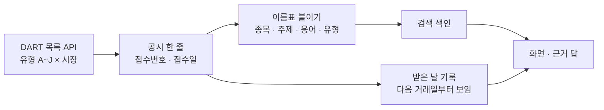
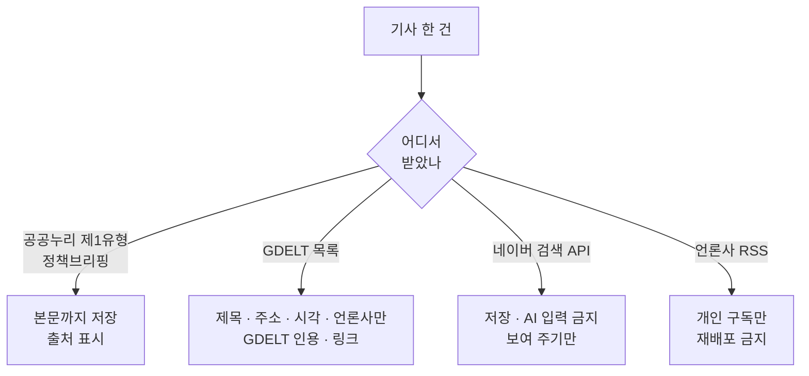

> [!GOAL]
>
> - 공시와 뉴스에서 「접수일 · 처음 알 수 있었던 날 · 쓸 수 있는 첫날」 을 구별하고, 왜 미래 정보를 쓰지 않도록 「다음 거래일」 규칙을 두는지 설명할 수 있습니다.
> - 공시 · 정책뉴스 · 언론사 기사 · 검색 API 의 이용 조건이 서로 다르다는 것을 알고, 출처마다 무엇을 저장해도 되는지 표로 정리할 수 있습니다.
> - 공시 제목에서 정정 말머리와 기간을 떼어 내고, 종목 · 공시 유형 · 주제 이름표를 규칙으로 붙이는 방법을 설명할 수 있습니다.

> [!NOTE]
> 이 장은 교육용 설명이며 **법률 자문이 아닙니다.** 약관과 법령은 바뀔 수 있어 열람한 날(2026-11-03)을 적었습니다. 판결은 사실만 적었고 「합법 · 불법」 을 판정하지 않습니다. 실제로 수집하거나 재게시하기 전에 각 출처의 최신 안내를 확인하세요.

[2.2](#/p/public-api-basics)에서 API 를 부르는 법을, [2.4](#/p/batch-scheduling)에서 매일 돌리는 법을 보았습니다. 이 장은 그 API 로 받는 **공시와 뉴스**를 어떻게 읽고(받은 날), 어디까지 쓸지(이용 조건), 어떻게 정리할지(이름표)를 다룹니다.

## 같은 공시가 두 번 올라오면 어떤 것이 맞을까요?

공시는 고쳐서 다시 냅니다. OpenDART 공시검색 응답의 보고서 이름 머리에는 `[기재정정]` · `[첨부정정]` · `[첨부추가]` · `[변경등록]` · `[연장결정]` · `[발행조건확정]` · `[정정명령부과]` · `[정정제출요구]` 같은 말머리가 붙습니다. 개발가이드는 기본값(`last_reprt_at`=N)에서 정정 보고서를 포함해 모두 찾는다고 설명합니다. 비고(`rm`) 칸의 「정」 은 이후 정정신고가 있으니 관련 보고서를 참조하라는 표시입니다.

> [!NOTE]
> 「정정본은 새 접수번호로 온다」 는 문장은 개발가이드에 없습니다. 우리 팀이 실제 응답을 여러 건 보고 확인한 **관찰**이고, 가이드가 보장하는 규칙은 아닙니다.

그래서 Qurious 는 정정본을 원본에 덮어쓰지 않고 **둘 다 남깁니다.** 머리의 `[...]` 는 `revision` 칸으로, 정기보고서의 `(YYYY.MM)` 은 `period` 칸으로 떼어 둡니다. 예제 ①이 이 나누기를 보입니다(실제 수집기 규칙을 줄여 옮긴 합성 예제).

```output
① 제목 나누기
   '사업보고서 (2025.12)' -> ('사업보고서', '', '2025-12')
   '[기재정정]사업보고서 (2025.12)' -> ('사업보고서', '기재정정', '2025-12')
   '[첨부추가][기재정정]반기보고서 (2026.06)' -> ('반기보고서', '첨부추가 · 기재정정', '2026-06')
   '주요사항보고서(유상증자결정)' -> ('주요사항보고서(유상증자결정)', '', '')
```

## 공시는 언제부터 「안 것」 으로 칠까요?

백테스트에서 과거의 어느 날 **알 수 없었던** 값을 쓰면 성적이 좋아 보입니다(미래 참조). 공시의 「안 날」 을 정확히 적어야 하는 까닭입니다. 그런데 공시검색 응답의 칸은 `corp_cls` · `corp_name` · `corp_code` · `stock_code` · `report_nm` · `rcept_no` · `flr_nm` · `rcept_dt`(YYYYMMDD) · `rm` 아홉 개이고 **시각 칸이 없습니다.** 접수일(날짜)만 압니다.

한편 하루는 길게 이어집니다. 언론 보도에 따르면 거래소의 공시 접수 시간은 07:30~18:00 이고, KRX 애프터마켓이 20:00 까지 열려도 접수 시간은 늘리지 않았습니다. 장이 닫혀도 거래는 계속됩니다(KRX 규정 · 넥스트레이드 시장개요).


*그림 1. 공시가 접수되는 시간과 거래되는 시간(도식). 공식 시간표를 그린 것이며 공시 원자료가 아닙니다. 거래소 공시 접수 시간(빗금)은 언론 인용입니다. 만든 스크립트는 `tools/learn_figs/news-disclosure-collection.py`.*

접수 시각을 모르니 「그날 장 중에 나왔는지, 마감 뒤에 나왔는지」 를 가를 수 없습니다. 그래서 **보수적으로** 접수일의 다음 거래일부터 쓸 수 있다고 둡니다. 이것은 법이나 거래소 규정이 아니라 미래 정보를 쓰지 않으려는 **관행**입니다. 예제 ②가 계산합니다(휴장일은 예시).

```output
② 접수일 -> 쓸 수 있는 첫날(다음 거래일)
   접수 20261002 -> 2026-10-06
   접수 20261008 -> 2026-10-12
   접수 20261012 -> 2026-10-13
```

세 가지 날짜를 구분하세요.

| 이름 | 뜻 | Qurious 의 칸 |
|---|---|---|
| 접수일 | 공시가 제출된 날(시각 없음) | `rcept_dt` |
| 처음 알 수 있었던 날 | 그 값이 실린 보고서의 접수일 | `known_at` |
| 쓸 수 있는 첫날 | 접수일의 다음 거래일 | `available_from`(근사면 `available_from_approx`) |

재무제표는 한 가지가 더 있습니다. 재무 API 는 정정이 있으면 가장 최근 정정본의 값을 주는 것으로 팀이 관찰했습니다(이 장을 쓰면서 다시 재지 않았습니다). 그러면 정정 **뒤의 값**이 정정 **전 날짜**에 보이게 될 수 있습니다. 그래서 `known_at`(이 값이 실린 보고서의 접수일)과 `first_known_at`(그 기간 보고서가 처음 나온 날)를 따로 둡니다. 코드 주석은 과거분이 정정본 값뿐이라 `first_known_at` ≤ 날 < `known_at` 사이에는 「뒤에 고쳐진 값」 을 쓰게 된다고 한계를 밝혀 둡니다.

## 공시는 어떻게 받아 쌓나요?

공시 목록 API 를 **공시 유형 A~J × 시장**으로 나눠 부릅니다(유형: A 정기 · B 주요사항 · C 발행 · D 지분 · E 기타 · F 외부감사 · G 펀드 · H 자산유동화 · I 거래소 · J 공정위). 한도와 반영 시점은 이렇습니다(OpenDART FAQ · 2026-11-03 열람).

| 항목 | 내용 |
|---|---|
| 개인 키 한도 | 하루 20,000건. 서비스별이 아니라 오픈API 83종 전체 합계 |
| 과도 접속 | 분당 1,000회 이상 크롤링이면 그 IP 를 1시간 차단 |
| 반영 시점 | 공시원본 · 사업보고서 재무정보는 제출 후 15분. 정기보고서 마감일 등은 지연될 수 있어 익영업일 안에 반영 |
| 제공 범위 | 공시목록 · 원문은 전체 기간, 사업보고서 주요정보 · 재무정보는 2015년 사업보고서부터 |

사업자등록증과 IP 를 등록한 기업은 일부 서비스의 한도가 없다는 안내도 있지만 우리 팀은 개인 키라 해당하지 않습니다. 우리 수집기는 호출 간격을 0.25초(분당 240회 이하)로 두고, 반영이 늦을 수 있어 **최근 3일을 다시 받습니다.** 한도 앞에서 멈추는 이유는 [2.2](#/p/public-api-basics)와 같습니다.



*그림 2. 공시가 이름표를 달고 화면까지 가는 길.*

## 이름표는 무엇이고 어떻게 붙이나요?

이름표(태그)는 공시와 기사를 **찾고 묶기 위한 표시**입니다. 네 가지입니다.

| 종류 | 붙이는 법 | 예 |
|---|---|---|
| 종목(symbol) | 공시는 DART 의 종목코드 칸 그대로, 뉴스는 상장사 이름 사전(가장 긴 이름부터) | 삼성전자 → 6자리 코드 |
| 주제(topic) | 「넣을 낱말 · 뺄 낱말」 규칙(21개) | 「주요사항보고서(유상증자결정)」 → 증자 |
| 용어(term) | 용어사전의 표제어 · 다른 이름이 제목에 그대로 나올 때 | 자기주식취득결정 |
| 유형(dtype) | 공시 유형 글자 A~J | 정기보고서 → A |

규칙은 단순해서 **틀릴 수 있습니다.** 「감자(자본감소)」 주제에서 「감자칩」 은 빼야 하고, 「합병 · 분할」 주제에서는 「주식분할」 을 빼야 해서 규칙에 「뺄 낱말」 이 있고 뺄 낱말이 우선합니다. 비상장 회사는 이름표 대상이 아닙니다.

### 코드가 셋이나 있습니다

| 이름 | 길이 | 누구의 것 | 비고 |
|---|---|---|---|
| `corp_code`(고유번호) | 8자리 | DART 공시대상회사(**비상장 포함**) | OpenDART 개발가이드 |
| `stock_code`(종목코드 · 단축코드) | 6자리 | **상장사만** | 2024-01-01 부터 일부에 영문자가 섞이기 시작했다는 KRX 공지가 있음(공지 제목만 확인) |
| 표준코드(ISIN 꼴) | 12자리 | 증권 하나하나 | 한국거래소의 표준코드시스템이 부여해 통보 |

공시를 종목에 잇는 키는 상장사만 다루면 6자리 `stock_code`, 비상장까지 다루면 8자리 `corp_code` 를 쓰고 앞의 것은 보조 칸으로 둡니다. 예제 ④는 길이와 모양으로 종류를 알아봅니다(코드는 형식을 보이려는 예시).

```output
④ 코드 종류:
   00126380 -> 고유번호(corp_code · 비상장 포함)
   005930 -> 종목코드(stock_code · 상장사)
   A00593 -> 종목코드(stock_code · 상장사)
   KR7005930003 -> 표준코드(ISIN 꼴 · 12자리)
```

## 뉴스는 어디까지 가져다 써도 되나요?

출처마다 조건이 다릅니다. 모두 **2026-11-03 열람** 기준입니다.

| 출처 | 조건의 핵심 | Qurious 의 처리 |
|---|---|---|
| 정책브리핑 정책뉴스 | 공공데이터포털에 「공공저작물: 출처표시(제1유형)」 로 올라 있고 기사마다 `KoglType` 이 옴. 텍스트는 자유 이용이지만 **사진 · 이미지는 제3자 저작권이 있어 사전 협의** | 유형이 「1」 인 기사만 본문을 둠. 아니면 제목 · 부제 · 주소만. 사진은 받지 않음. 출처 「정책브리핑 · 공공누리 제1유형」 표시 |
| GDELT | 모든 데이터셋을 제한 없이 무료로 쓸 수 있고 재배포도 가능하지만, 사용 · 재배포할 때 **GDELT Project 인용과 웹사이트 링크**를 포함해야 함 | 한국어 기사의 제목 · 원문 주소 · 시각 · 언론사만 저장. 본문 · 요약 없음 |
| 네이버 검색 API | 결과를 제공하는 목적으로만 사용 · 가공 없이 독립 노출 · 출처 표시와 원본 링크 필요. **복사 · 저장 · 캐싱, 제3자 제공, AI 입력 · 학습 · 평가, 광고 · 수익 창출 금지.** 서버 임시 보관은 이력 조회 목적 최대 21일 | 쓰지 않음(이 약관과 RSS 제한 때문에 GDELT 목록으로 대체). 신규 신청은 2026-07-30 에 중단됐고 기존 이용자는 2027-06-30 까지라고 약관 부칙에 있음 |
| 언론사 RSS | 한국언론진흥재단 이용규칙: RSS 는 개인 PC 등에서 **개인적으로 구독**하는 데 그쳐야 하고 공중 배포 · 재(再)RSS 는 금지 | 쓰지 않음 |



*그림 3. 기사를 어디까지 두는가(Qurious 의 갈림길).*

### 「링크만 두면 안전」 일까요?

흔한 오해입니다. 한국언론진흥재단 이용규칙에서 자유롭게 쓸 수 있다고 한 **단순링크**는 링크 대상 사이트의 **메인 페이지(초기화면)** 를 링크하는 것입니다. 개별 기사 링크(직접링크)는 지금까지 법원이 복제 · 전송으로 보지 않았지만, 업무적 · 상업적으로 이용해 이득을 얻으면 부당이득이나 불법행위 손해배상 책임이 따져질 수 있다고 같은 규칙이 적습니다. 프레임링크는 불법행위 책임이 있을 수 있다고도 합니다. 이용규칙은 2018년 개정본이고 크롤링이나 AI 학습을 직접 다루는 문장은 없습니다.

그래서 이 장은 「제목 + 원문 링크만 두면 무조건 안전」 이라고 하지 않습니다. 우리 구현은 GDELT 가 제공하는 기사 메타데이터(제목 · 주소)이고, 그 이용 조건은 GDELT 쪽에 따로 있습니다.

## 「공공누리」 와 「공공데이터」 는 같은 말인가요?

아닙니다. **공공누리**는 공공기관이 저작물에 붙이는 이용허락 표시이고, 유형이 다섯입니다(공공누리 안내 · 2026-11-03 열람).

| 유형 | 출처 표시 | 상업적 이용 | 변경(2차적 저작물) |
|---|---|---|---|
| 0 | 불필요 | 가능 | 가능 |
| 1 | 필요 | 가능 | 가능 |
| 2 | 필요 | **금지** | 가능 |
| 3 | 필요 | 가능 | **금지** |
| 4 | 필요 | **금지** | **금지** |

「공공누리면 상업 이용도 된다」 는 오해가 많습니다. 2 · 4유형은 상업적 이용 금지이고, 3 · 4유형은 변경 금지입니다. 1~4유형과 함께 표시하는 **AI 유형**은 「인공지능 학습용 데이터」 목적이면 쓸 수 있다는 병행 표시로(제0유형과는 병행 불가), 동일 · 유사 산출물 방지와 학습 데이터 재판매 금지 같은 조건이 붙습니다.

같은 기관 안에서도 방침이 갈립니다. 국가데이터처는 공공누리 표시가 있는 저작물만 별도 허락 없이 자유 이용하게 하고 **표시가 없으면 담당자와 협의**하라고 합니다. KOSIS 통계표는 상업 이용을 포함해 무료로 쓰고 다시 배포할 수 있지만(출처 명시, 임의 변경 · 왜곡 금지) 국제 · 북한 통계는 비상업 목적만입니다. 한국은행은 홈페이지 정보에 저작권이 있다고 하고, 공공데이터법에 따라 공표한 **제공대상 공공데이터 목록**은 자유 이용, 목록 밖 정보는 링크나 심층링크만 가능하다고 합니다. ECOS 가 그 목록에 드는지는 확인하지 못했습니다. 이용 조건이 바뀌어도 변경 전에 이용한 사용자는 목적을 바꾸지 않는 한 계속 쓸 수 있다고 하지만(공공누리 안내), 조건을 어기면 이용허락이 즉시 끝납니다.

예제 ③은 Qurious 의 규칙, 곧 「제1유형일 때만 본문을 둔다」 를 보입니다.

```output
③ 공공누리 유형 -> 본문 저장: {'1': True, '3': False, '': False}
```

## 크롤링은 해도 되나요?

이 장은 「된다 · 안 된다」 를 판정하지 않고 **사실과 순서**만 적습니다.

1. **약관과 한도를 먼저 읽습니다.** OpenDART 이용약관은 이용횟수 허용량을 제한하고 과도한 접속으로 운영을 저해하면 이용을 제한할 수 있다고 하며(제10조), 인증키를 제3자가 이용하게 해서는 안 된다고 합니다(제19조). 그래서 팀원은 각자 키로 돌립니다.
2. **robots.txt 는 허락이 아닙니다.** IETF 의 RFC 9309 는 이 규칙이 접근 권한을 부여하는 수단이 아니고 보안을 대신하지 않는다고 적습니다. 한국 법령이 robots.txt 위반의 효력을 정한 문장은 찾지 못했습니다.
3. **판결은 사실로만 읽습니다.** 대법원이 2022-05-12 에 선고한 2021도1533 은 경쟁 회사의 모바일 앱용 API 서버를 크롤링한 형사 사건으로, 상고가 기각되어 무죄가 확정됐습니다. 판결문은 정보통신망법의 접근권한을 서비스제공자가 부여 · 제한하고, 제한 여부는 보호조치나 이용약관 등 객관적으로 드러난 여러 사정을 종합해 판단한다고 설명합니다. 그렇다고 「크롤링은 합법」 이라는 뜻은 아닙니다. 같은 분쟁의 민사 1심은 부정경쟁행위로 보고 손해배상을 인정했습니다(서울중앙지법 2021-08-19, 항소 표시가 있고 항소심 결과는 확인하지 못했습니다).
4. **API 로 받았다고 재배포가 허용되는 것은 아닙니다.** OpenDART FAQ 는 공공데이터라 공개 · 활용이 제한되지 않지만 재배포 · 재가공의 책임은 이용자에게 있다고 합니다.

> [!WARNING]
> 흔한 착오 하나. 「2021도1533 은 잡코리아와 사람인 사건」 이라는 설명이 돌지만 이 사건은 다른 사건입니다(대법원 주요판결 공지로 확인). 그 사건의 대법원 확정 번호는 자료마다 엇갈려 이 장에서 다루지 않았습니다.

## Qurious 는 이렇게 합니다

**Qurious 는 이렇게 합니다.** 출처마다 「이용 조건」 과 「받는 때」 를 사람 말로 적은 표(`data_guide.json`)를 앱의 자료 안내에 보입니다. 예를 들어 금융위 시세는 공공누리 제4유형, 정책브리핑은 기사별 유형, GDELT 는 제목 · 주소만, 국가데이터처 보도계획은 「공공누리 표시가 없다」 로 적습니다. 국가데이터처 보도계획은 날짜와 이름만 다시 적고 원문 HTML 은 보관하지 않습니다.

> [!NOTE]
> 이 장을 쓰면서 확인했지만 고치지 않은 것(코드 확인 필요): ① 단축코드에 영문자가 섞여도 `symbol` 형식 검사가 통과시키는지 ② GDELT 인용과 링크가 화면 어디에 있는지 ③ 정책브리핑이 요청한 「직접 링크 시 저작권정책 링크」 의 구현 여부 ④ 한국은행 일정이 「제공대상 공공데이터 목록」 에 드는지. 이 장의 작성 범위 밖이라 결과 보고에만 남깁니다.

## 흔한 실수

1. **「링크는 자유다」.** 자유인 「단순링크」 는 메인 페이지 링크입니다.
2. **「공공누리면 상업 이용이 된다」.** 유형마다 다릅니다. 사진 · 이미지는 따로 협의하라는 곳도 있습니다.
3. **「공시는 올라온 다음 날 반영된다」.** 「다음 거래일」 은 법이 아니라 보수적 관행입니다.
4. **「API 로 받았으니 재배포도 된다」.** 재배포 · 재가공의 책임은 이용자입니다.
5. **「robots.txt 만 지키면 된다」.** 허락이 아니고 약관과 보호조치도 함께 봐야 합니다.
6. **「종목코드와 고유번호는 같다」.** 8자리 · 6자리 · 12자리가 모두 다른 코드입니다.
7. **「정정 공시는 원본을 덮는다」.** 새 접수번호로 따로 오는 것이 관찰입니다. 둘 다 남기고 「받은 날」 을 따로 적습니다.

## 정리

1. 공시에는 접수일만 있고 시각이 없습니다. 쓸 수 있는 첫날은 보수적으로 **다음 거래일**로 둡니다(관행).
2. 정정본은 새 접수번호로 따로 오므로 덮어쓰지 않고 `known_at` 과 `first_known_at` 으로 구분합니다.
3. 뉴스의 이용 조건은 출처마다 다르고, 저장 범위(본문 · 제목과 주소 · 저장 안 함)가 거기서 정해집니다.
4. 이름표는 규칙으로 붙이므로 틀릴 수 있고 「뺄 낱말」 로 보정합니다.
5. 법 · 약관은 바뀝니다. 확인일을 적고, 판정하지 않고 사실을 적습니다.

<details>
<summary>확인 문제 1 — 금요일 17:50 에 접수된 공시를 쓰는 백테스트에서, 보수적 규칙은 그 공시를 언제부터 쓰게 하나요?</summary>

다음 거래일(월요일)부터입니다. 응답에 접수 시각이 없고 애프터마켓 · 넥스트레이드가 20시까지 거래해서 접수 시각만으로는 장 중인지 가릴 수 없기 때문입니다(예제 ②).
</details>

<details>
<summary>확인 문제 2 — <code>KoglType</code> 이 3 인 정책뉴스는 본문을 저장해도 되나요?</summary>

Qurious 의 규칙은 제1유형만 본문을 둡니다. 제3유형은 변경 금지라 요약 · 가공이 문제될 수 있어 제목 · 부제 · 주소만 둡니다(예제 ③). 실제 이용은 해당 기사의 표시를 확인하세요.
</details>

<details>
<summary>확인 문제 3 — 네이버 검색 API 로 받은 기사 제목을 우리 DB 에 몇 주 쌓아도 되나요?</summary>

약관상 데이터의 복사 · 저장 · 캐싱이 금지이고, 서버 임시 보관은 이력 조회 목적으로 최대 21일입니다. 그래서 Qurious 는 저장하지 않습니다.
</details>

<details>
<summary>확인 문제 4 — 「단순링크는 자유」 라는 규칙은 개별 기사 주소에도 적용되나요?</summary>

아닙니다. 이용규칙의 단순링크는 메인 페이지 링크이고, 개별 기사 링크는 상업적 이용 시 책임이 따져질 수 있다고 적혀 있습니다.
</details>

<details>
<summary>확인 문제 5 — 고유번호 · 종목코드 · 표준코드는 각각 몇 자리이고, 비상장 회사도 가지는 것은?</summary>

8 · 6 · 12자리입니다. 비상장까지 포함하는 것은 고유번호(`corp_code`)이고 종목코드는 상장사만 가집니다(예제 ④).
</details>

## 더 읽을거리

아래 자료는 2026-11-03 조사에서 열람했고, 표시한 것은 2026-11-04 에 원문으로 다시 대조했습니다. 약관과 방침은 바뀔 수 있습니다. **판결과 법령은 요지만 옮겼으니 인용하기 전에 원문을 확인하세요.**

- 금융감독원 OpenDART 이용약관 · FAQ — <https://opendart.fss.or.kr/intro/terms.do> · <https://opendart.fss.or.kr/cop/bbs/selectArticleList.do?bbsId=B0000000000000000002> · 한도 · 반영 시점 · 재배포 책임. [2026-11-04 약관 제10조 ④ · 제19조 ② · ⑤ 원문 확인 · FAQ 답변 본문은 이번에 열지 못함]
- OpenDART 개발가이드(공시검색) — <https://opendart.fss.or.kr/guide/detail.do?apiGrpCd=DS001&apiId=2019001> · 응답 칸 · 공시 유형 · 정정 말머리. [2026-11-04 원문 확인: 응답 칸 · `rcept_dt` · 정정 말머리 · `last_reprt_at` 기본 N]
- NAVER API 서비스 이용약관 — <https://developers.naver.com/products/terms/> · 저장 · AI 금지 · 신규 신청 중단. [2026-11-04 원문 확인: 2026-10-07 개정 · 캐싱 금지 · 서버 보관 21일 · 2027-06-30]
- 한국언론진흥재단 「디지털 뉴스콘텐츠 이용규칙」 — <https://www.kpf.or.kr/front/board/boardContentsView.do?board_id=291&contents_id=855b0c963b5c4a42ba6b26d06c7186d4> · 단순링크 · RSS. [2026-11-04 원문 확인: 단순링크 = 메인 페이지 · 프레이밍 · RSS]
- GDELT — <https://www.gdeltproject.org/about.html> · 이용 조건과 인용. [2026-11-04 원문 확인: 제한 없는 사용 · 재배포 시 인용과 링크 포함]
- 정책브리핑 저작권정책 — <https://www.korea.kr/guide/copyRight.do> · 공공데이터포털 정책뉴스 API — <https://www.data.go.kr/data/15095335/openapi.do>. [2026-11-04 원문 확인: 제1유형 · 사진 · 이미지 별도 · 정책뉴스 API 의 제1유형 · 개발계정 1,000]
- 공공누리 — <https://www.kogl.or.kr/info/license.do> · 국가데이터처 저작권정책 — <https://www.mods.go.kr/menu.es?mid=a10706000000> · 한국은행 저작권보호방침 — <https://www.bok.or.kr/portal/main/contents.do?menuNo=200228> · KOSIS 이용지침 — <https://kosis.kr/serviceInfo/useGuide.do>. [2026-11-04 원문 확인: 공공누리 0~4유형 · AI 유형 · 국가데이터처 · 한국은행 · KOSIS 방침]
- IETF, RFC 9309 — <https://www.rfc-editor.org/rfc/rfc9309.html> · 대법원 주요판결(2021도1533, 2022-05-12) — <https://www.scourt.go.kr/supreme/news/NewsViewAction2.work?seqnum=8456&gubun=4>. [2026-11-04 RFC 9309 원문 확인 · 대법원 판결 페이지는 동적 화면이라 이번에 열지 못함]
- 이 장의 예제 [`disclosure_basics.py`](/learn/examples/disclosure_basics.py) · 거래 시간은 [2.5](#/p/trading-calendar).

> [!NOTE]
> 확인하지 못해 단정하지 않은 것: ① 정정공시의 효력 시점을 정한 공식 문장 ② 거래소 공시 접수 시간의 공식 규정 문구(언론 인용) ③ 공공데이터법 일부 조항의 법제처 원문 ④ 표준코드의 구성 규칙과 영문자 혼용 시행일의 공식 문구 ⑤ 한국은행 ECOS 의 제공대상 목록 포함 여부 ⑥ 네이버 약관 2026-10-07 개정의 변경 내용.

**용어**

| 말 | 뜻 |
|---|---|
| 접수일(`rcept_dt`) | 공시가 제출된 날. 시각은 없음 |
| 정정 공시 | 이미 낸 공시를 고쳐 다시 내는 것. 말머리로 구분 |
| 미래 참조 | 그때 알 수 없었던 정보를 써서 성과가 좋아 보이게 되는 오류 |
| `known_at` | 그 값이 실린 보고서의 접수일 |
| 이름표(태그) | 종목 · 주제 · 용어 · 유형으로 찾고 묶기 위한 표시 |
| 공공누리 | 공공기관 저작물의 이용허락 표시(0~4유형 + AI 유형) |
| 단순링크 | 이용규칙에서 자유롭다고 한 링크. 사이트의 메인 페이지를 가리키는 것 |
| 단축코드 | 6자리 종목코드 |
