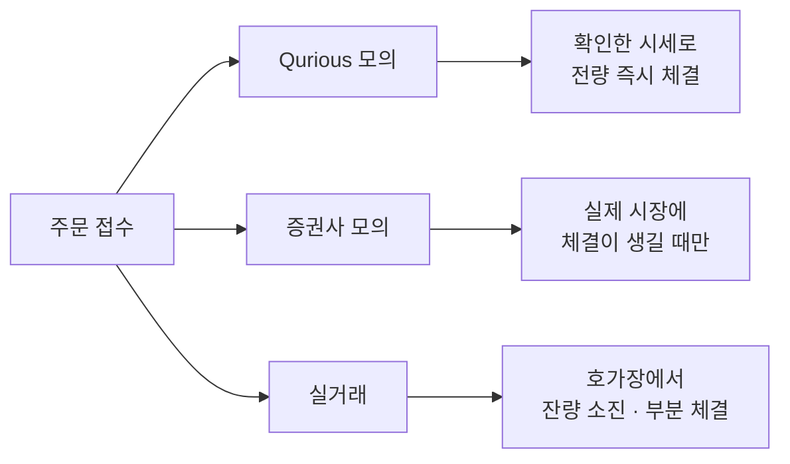

> [!GOAL]
>
> - 모의투자가 실거래와 다르게 처리하는 세 가지(체결 규칙 · 시간 · 비용)를 말할 수 있습니다.
> - 시장가 주문이 호가 잔량을 소진하며 평균 체결가가 밀리는 것(슬리피지)을 계산으로 보일 수 있습니다.
> - Qurious 의 모의 체결이 증권사 모의투자 규정과 어디서 다른지 짚을 수 있습니다.

이 장은 모의투자 수익률을 읽을 때 무엇을 의심해야 하는지 다룹니다. 하루 거래 시간과 호가단위는 [F.1 주식 · 시장 · 주문의 기본](#/p/stock-basics), 비용은 [F.3 매매 비용과 증권거래세](#/p/trading-costs-tax)에 있습니다.

> [!NOTE]
> 규정 숫자는 2026-11-03 에 공식 페이지를 직접 열어 확인한 값이고 바뀔 수 있습니다. 보도로만 확인해 공식 공지를 보지 못한 내용에는 **(보도 기준)** 을 붙였습니다. 호가창과 출력은 손으로 정한 합성 데이터이고 교육용이며 투자 권유가 아닙니다.

## 모의투자 수익률을 그대로 믿어도 될까요?

모의투자는 실제 시세를 보면서 가상의 돈으로 주문하는 연습입니다. 주문이 실제 시장에 나가지 않으므로 수익률이 실거래와 달라질 수 있는 곳이 세 군데 있습니다.

1. **체결 규칙.** 주문이 얼마나, 어떤 가격에 체결되는가.
2. **시간.** 어느 시각의 주문이 체결되는가.
3. **비용.** 수수료 · 세금 · 슬리피지(보던 가격과 체결 가격의 차이)를 어떻게 뗐는가.

한국투자증권의 모의투자 대회규정도 「실제 시장에서의 체결과 약간 다를 수 있다」 고 밝힙니다. 같은 주문이 세 곳에서 어떻게 처리되는지 한눈에 보면 이렇습니다.



## 호가장에서 주문은 어떻게 체결되나요?

실거래에서 주문은 호가장에 들어가 가격 우선 · 시간 우선으로 짝을 찾습니다([F.1](#/p/stock-basics)). 호가장에는 가격마다 사려는 수량과 팔려는 수량, 곧 호가 잔량이 쌓여 있습니다. 그래서 세 가지 일이 생깁니다.

- **부분 체결.** 그 가격의 잔량이 내 수량보다 적으면 그만큼만 체결되고 나머지는 다음 호가로 넘어가거나 남습니다.
- **미체결.** 지정가보다 시장 가격이 불리하게 움직이면 주문이 체결되지 못한 채 남습니다.
- **내 주문이 호가를 움직입니다.** 큰 주문은 잔량을 줄이고 가격을 밀어 올립니다.

## 시장가로 많이 사면 평균 체결가가 왜 밀리나요?

시장가 주문은 가격을 정하지 않고 지금 나와 있는 가장 좋은 가격부터 잔량을 쓸어 담습니다. 합성 매도 호가창으로 계산해 봅니다([`paper_vs_real.py`](/learn/examples/paper_vs_real.py)).

```output
① 합성 매도 호가창에서 시장가 매수 (최우선 매도호가 10,000원 · 5단계 잔량 합계 8,600주)
   10,000원  잔량   300주
   10,010원  잔량   500주
   10,020원  잔량   800주
   10,050원  잔량 2,000주
   10,100원  잔량 5,000주
     100주  평균 10,000.00원   +0.0bp  추가 지불         0원
     300주  평균 10,000.00원   +0.0bp  추가 지불         0원
   1,000주  평균 10,009.00원   +9.0bp  추가 지불     9,000원
   5,000주  평균 10,052.20원  +52.2bp  추가 지불   261,000원
  10,000주  평균 10,072.21원  +72.2bp  추가 지불   621,000원  미체결 1,400주
  5,000주를 10,020원 지정가로: 체결 1,600주 · 평균 10,013.12원 · 미체결 3,400주
```


*그림 1. 시장가 주문이 호가를 쓸어 가는 모습. 합성 데이터(손으로 정한 호가창)이며 1bp 는 0.01% 입니다.*

「추가 지불」 은 전량을 최우선 호가(10,000원)에 샀을 때보다 더 낸 금액입니다. 100주는 최우선 호가 안에서 끝나 슬리피지가 없고, 5,000주는 호가 5단계를 먹어 평균가가 52.2bp 밀립니다. 10,000주는 이 호가창의 모든 잔량(8,600주)을 소진하고도 1,400주가 남습니다(이 합성 호가창에는 더 높은 호가가 없습니다. 남은 수량이 실제 시장에서 어떻게 되는지는 이 예제가 다루지 않습니다). 지정가로 10,020원까지만 사겠다고 하면 가격은 지키지만 체결이 1,600주로 줄어듭니다. [F.13](#/p/stop-loss-take-profit)의 스톱 리밋과 같은 거래입니다.

이 차이가 슬리피지입니다. 슬리피지는 주문하려고 본 가격과 실제 평균 체결가의 차이이고, 주문이 클수록 · 호가 잔량이 얇을수록 큽니다. 한국거래소는 애프터마켓에서 시장가를 낼 수 없게 해 두었습니다(아래 시간표 절). Qurious 의 비용 모델은 슬리피지를 측정하지 않고 편도 10bp 로 가정합니다([F.3](#/p/trading-costs-tax)).

## 증권사 모의투자는 실제와 무엇이 다른가요?

한국투자증권의 모의투자 대회규정(2026-11-03 열람)이 가장 큰 차이로 꼽는 것은 체결입니다. 현재가보다 더 적극적인 가격으로 주문해도 바로 체결되지 않고, 실제 시장에서 체결이 생겨야 그 체결가로 체결된다고 합니다. 규정은 까닭도 적습니다. 실제 체결을 무시하고 현재가에서 계속 체결시키면 거래가 없는 현재가로도 계속 매매할 수 있는 문제가 생기기 때문이라고 합니다.

**표 1. 증권사 모의투자(한국투자증권)와 실거래**

| 구분 | 증권사 모의투자 | 실거래 |
|---|---|---|
| 시세 | 실제 시장의 실시간 시세. 내 주문은 시세에 영향을 주지 않음 | 내 주문이 호가 · 잔량에 영향을 줌 |
| 체결 | 주문 접수 뒤 실제 시장의 체결량을 기준으로 체결 | 호가장에서 가격 · 시간 순서로 체결 |
| 시간 | 정규시장 09:00~15:30. 시간외매매는 불가 | 시간외종가 · 애프터마켓 등이 있음 |
| 호가 유형 | 지정가 · 시장가 · 최유리 · 최우선. 조건부지정가 · IOC · FOK 는 적용 안 함 | 증권사 · 거래소가 허용하는 주문 조건이 더 많음 |
| 신용 · 공매도 | 불가(현금 매수 · 매도 · 현금미수만) | 증권사 · 상품별 별도 요건(증권사 안내 확인) |
| 결제 | 3일 결제(미수 가능) | 보통거래는 체결일부터 3일째([F.1](#/p/stock-basics)) |
| 종목 제한 | 현재가 1,000원 미만 매수 금지 · 총발행 10만 주 미만 매매 금지 | 거래정지 · 투자경고 등 시장 조치로 제한 |

상한가 매수와 하한가 매도는 규정이 따로 정합니다. 실제 시장의 잔량대비 체결량의 비율을 주문에 적용해 {(실제 체결량 ÷ 총호가잔량) × 주문수량} × 0.1 을 계산하고, 단주 미만은 버립니다.

```output
② 증권사 모의의 상한가 매수 체결 수량 = {(실제체결량 ÷ 총호가잔량) × 주문수량} × 0.1, 단주 미만 버림
  총호가잔량 500,000주 · 실제 체결량  3,000주 · 주문 3,000주  →  모의 체결 1주
  총호가잔량 500,000주 · 실제 체결량 30,000주 · 주문 3,000주  →  모의 체결 18주
  총호가잔량 500,000주 · 실제 체결량  3,000주 · 주문   100주  →  모의 체결 0주
```

첫 줄은 규정에 실린 예(1.8 에서 버림 1주)이고, 나머지 두 줄은 같은 식에 다른 숫자를 넣은 것입니다. 규정은 실제 시장과의 차이 때문에 이 두 경우를 따로 처리한다고만 적습니다. 실제 체결량이 작으면 주문이 크더라도 체결은 0주가 될 수 있습니다.

## 하루 시간표: 언제 주문이 체결되나요?

같은 시각에 주문해도 어디서 체결되는지가 다릅니다. 그림 2 는 거래소와 증권사 모의, Qurious 의 규칙을 한 줄에 놓은 것입니다. 하루의 전체 거래 시간은 [F.1](#/p/stock-basics)의 표에 있습니다.


*그림 2. 시각별로 주문이 체결되는 곳. 실거래는 한국거래소 규정(2026-11-03 열람), 증권사 모의는 한국투자증권 대회규정, Qurious 는 코드를 읽은 결과입니다.*

한국거래소 규정에서 확인한 것은 이렇습니다. 시간외종가는 15:40 부터 16:00 까지 당일 종가로 체결되고(호가는 15:30 부터 접수), 애프터마켓은 16:00 부터 20:00 까지 접속매매로 당일 기준가의 ±30% 안에서 지정가 · 최우선지정가 · 최유리지정가로만 거래합니다. 정규장의 서킷브레이커는 애프터마켓에서 작동하지 않습니다. 애프터마켓이 2026-09-14 에 시작되고 기존 시간외 단일가(16:00~18:00)가 없어졌다는 내용은 증권사 공지와 여러 보도가 같게 전하지만 **(보도 기준 · 공식 공지 확인 필요)**, 거래소 공지 원문은 열지 못했습니다. 옛 글과 용어집에는 시간외 단일가가 그대로 적혀 있을 수 있으니 날짜를 확인하세요.

증권사 모의투자는 규정에 「시간외매매는 불가」 라고 적혀 있고, 익일 예약주문은 당일 15:40 부터 다음 날 07:30 까지 받습니다. 애프터마켓을 따로 언급하지는 않습니다. 장이 닫힌 뒤 나온 소식을 보고 그날 종가로 체결해 버리면 그때는 알 수 없던 정보로 거래한 셈이 되는데, 이런 일을 막는 것이 시간외 불가의 한 가지 효과입니다(예시를 든 설명이며 규정이 밝힌 까닭은 아닙니다).

## Qurious 의 모의 체결은 어떻게 처리하나요?

Qurious 의 일반 모의 주문은 시장가로, 체결 직전에 다시 받은 시세로 장부를 정산합니다(2026-11-03 기준 · 코드 읽기). 화면도 「시장가(즉시 체결)」 이고 「미체결 · 취소는 지원하지 않습니다」 라고 알려 줍니다.

**표 2. Qurious 는 이렇게 합니다 · 실제 시장과 증권사 모의는 이렇습니다**

| 구분 | Qurious 는 이렇게 합니다 | 실제 시장 · 증권사 모의 |
|---|---|---|
| 체결 방식 | 호가 잔량 · 거래량을 보지 않고 확인한 시세로 전량 즉시 체결. 부분 체결 · 미체결이 없음 | 실거래는 잔량 소진 · 부분 체결. 증권사 모의는 실제 체결이 있어야 체결 |
| 체결 가격 | 증권사 키를 연결했으면 증권사 조회 값, 아니면 지연 시세(화면 안내는 약 20분). 1,000원 이상은 정수 단가이고 슬리피지를 더하지 않음 | 호가를 소진한 평균가(슬리피지 포함) |
| 장 밖 주문 | 막지 않고 마지막 종가로 체결하며 「장 닫힘」 을 표시만 함. 스탑 발동만 정규장에서 | 증권사 모의는 시간외 불가 |
| 비용 | 수수료 0.0140527% · 유관기관 비용 0.0036396% · 코스피 매도세 0.20%. 슬리피지는 정산에 넣지 않음 | 증권사 모의 규정은 수수료 0.0142% · 세금 0.20% |
| 시작 금액 | 1억 원(코드의 기본값). 초기화하면 회차가 1 올라감 | 증권사 모의는 1,000만 · 3,000만 · 5,000만 · 1억 · 5억 원 중 선택 |

Qurious 의 모의 수익률은 이 방향으로 낙관적일 수 있습니다. 큰 수량이 시세 그대로 체결되고, 얇은 호가의 슬리피지가 없고, 장 밖에도 체결되기 때문입니다. 얼마나 낙관적인지는 측정하지 않았습니다. 스탑 주문은 장 밖에도 등록할 수 있고 발동은 확정된 거래일의 정규장에서만 합니다. 발동하면 정해 둔 가격이 아니라 그때 확인한 시세로 체결되어 갭이 나면 더 나쁜 가격이 됩니다([F.13](#/p/stop-loss-take-profit)).

## 대회 규칙은 왜 따로 있나요?

모의투자 대회는 참가자를 같은 조건에서 견주려고 규칙을 둡니다. 한국투자증권 규정은 투자 원금을 1,000만 · 3,000만 · 5,000만 · 1억 · 5억 원 중에서, 기간을 1 · 2 · 3개월 중에서 고르게 하고 한번 정하면 바꿀 수 없다고 적습니다. 수익률을 왜곡할 수 있는 초저가주(1,000원 미만) 같은 종목은 매매를 제한합니다. 순위는 투자 수익률로 매기고, 총평가금액(예수금과 당일 매매 대금, 유가증권 평가금액에서 당일 수수료와 제세금을 뺀 값)을 투자 원금과 견줘 계산합니다.

돈을 넣고 뺄 수 있는 계좌의 수익률은 단순 비교가 불공정해집니다. 시간가중수익률(TWR)은 구간별 수익률을 곱해 이어서 외부 입출금의 영향을 없앱니다(GIPS 용어집의 정의를 옮기면 가치 변화를 반영하고 외부 현금흐름의 영향을 없애는 방법입니다).

```output
③ 시간가중수익률 (손으로 정한 숫자): 100 에서 시작 → +10% → 100 입금 → -10%
  최종 189 · 넣은 돈 200 → 단순 수익률 -5.5%
  시간가중수익률 -1.0%
```

각 구간의 성과는 +10% 와 −10% 이고 이를 이은 시간가중수익률은 −1.0% 입니다. 단순 수익률 −5.5% 에는 돈을 넣은 시점의 영향이 섞여 있습니다.

## 흔한 실수

1. **모의투자 수익률이 실전 수익률이라고 믿기.** 체결 · 시간 · 비용이 다르면 같은 신호도 다른 결과가 됩니다.
2. **시장가는 현재가에 산다고 믿기.** 수량이 클수록 여러 호가에 걸쳐 체결되어 평균가가 밀립니다.
3. **시간외 단일가가 지금도 16~18시에 있다고 믿기.** 2026-09-14 에 애프터마켓으로 바뀌었다는 보도가 있습니다 **(보도 기준)**.
4. **모의에서 스탑을 걸었으니 그 가격에 팔린다고 믿기.** 스탑은 발동 조건이고 체결가는 그때의 시세입니다.
5. **장 밖에도 체결되는 모의 주문을 편리한 기능으로만 보기.** 종가 뒤의 정보를 반영한 가격으로 거래하는 결과가 될 수 있습니다.
6. **증권사 모의투자의 규칙과 Qurious 의 규칙이 같다고 보기.** 증권사 모의는 실제 체결이 있어야 하고, Qurious 는 즉시 전량 체결합니다.

## 정리

1. 모의투자는 체결 규칙 · 시간 · 비용 세 곳에서 실거래와 다릅니다. 규정이 어디서 다른지 먼저 읽습니다.
2. 시장가 주문은 호가 잔량을 소진하며 평균가가 밀립니다. 이 차이가 슬리피지이고, 주문이 클수록 큽니다.
3. 증권사 모의는 실제 체결이 있어야 체결하고 시간외매매를 막습니다. Qurious 는 확인한 시세로 즉시 전량 체결하고 장 밖 주문도 막지 않습니다.
4. 대회 규칙은 같은 조건에서 견주려는 장치이고, 입출금이 있으면 시간가중수익률로 견줍니다.

<details>
<summary>확인 문제 1 — 상한가에 매수 주문 3,000주를 냈고 실제 체결량 3,000주, 총 매수 잔량 500,000주였습니다. 증권사 모의 규정이면 몇 주 체결되나요?</summary>

1주입니다. (3,000 ÷ 500,000) × 3,000 × 0.1 = 1.8 이고 단주 미만은 버립니다.
</details>

<details>
<summary>확인 문제 2 — 현재가 10,200원인데 모의투자로 10,500원에 사자고 주문하면 바로 체결되나요?</summary>

증권사 모의 규정에서는 바로 체결되지 않고, 실제 시장에서 체결이 생길 때 그 체결가로 체결됩니다. 실제 체결을 무시하고 현재가로 계속 체결시키면 거래 없는 가격으로 매매할 수 있는 문제가 생기기 때문입니다.
</details>

<details>
<summary>확인 문제 3 — 이 장의 합성 호가창에서 시장가 5,000주를 사면 평균 체결가와 기준가 대비 슬리피지는?</summary>

평균 10,052.20원이고 기준가(10,000원)보다 52.2bp 불리합니다. 호가 5단계를 소진하기 때문입니다.
</details>

<details>
<summary>확인 문제 4 — 한국거래소 애프터마켓에서 쓸 수 없는 주문 유형은?</summary>

시장가입니다. 지정가 · 최우선지정가 · 최유리지정가만 낼 수 있습니다(규정 2026-11-03 열람).
</details>

<details>
<summary>확인 문제 5 — Qurious 에서 일반 모의 주문과 스탑 주문은 장 시간 처리가 어떻게 다른가요?</summary>

일반 주문은 장 밖에도 막지 않고 마지막 종가로 체결하며 화면에 「장 닫힘」 을 표시합니다. 스탑은 등록은 장 밖에도 되지만 발동은 확정된 거래일의 정규장에서만 합니다(코드 읽기 기준).
</details>

## 더 읽을거리

- 한국투자증권 모의투자 「대회규정」 — <https://securities.koreainvestment.com/main/research/virtual/_static/TF07da040000.jsp> · 본문은 <https://vts3.koreainvestment.com/vts/#/rule> 에 있습니다. 체결 · 시간 · 호가 유형 · 상한가 체결 규칙 · 순위. 2026-11-03 확인.
- 한국거래소 KRX 규정 「시간외종가/애프터마켓」 — <https://regulation.krx.co.kr/contents/RGL/03/03010301/RGL03010301.jsp> · 시간외종가 · 애프터마켓 시간 · 호가 유형 · 가격제한폭. 2026-11-03 확인.
- GIPS Standards for Firms(2020) 용어집 — <https://www.gipsstandards.org/wp-content/uploads/2021/03/2020_gips_standards_firms.pdf> · 시간가중수익률의 정의. 2026-11-03 확인.
- 이 장의 예제 [`paper_vs_real.py`](/learn/examples/paper_vs_real.py) · 하루 거래 시간은 [F.1](#/p/stock-basics), 손절 주문은 [F.13](#/p/stop-loss-take-profit).

**용어**

| 말 | 뜻 |
|---|---|
| 모의투자 | 실제 시세로 가상의 돈을 굴려 보는 연습. 주문은 실제 시장에 나가지 않음 |
| 체결 · 미체결 | 주문이 짝을 찾은 것 · 찾지 못해 남아 있는 것 |
| 호가 잔량 | 호가 가격마다 쌓여 있는 사려는 · 팔려는 수량 |
| 슬리피지 | 주문하려고 본 가격과 실제 평균 체결가의 차이 |
| 시간외 단일가 | 옛 제도. 정규장 뒤 16:00~18:00 에 주문을 모아 한 가격으로 체결. 폐지됨 **(보도 기준)** |
| 대체거래소(NXT) | 한국거래소와 따로 운영하는 거래 장소. 시간과 종목은 [F.1](#/p/stock-basics) |
| 시간가중수익률 | 구간별 수익률을 곱해 이어 외부 입출금의 영향을 없앤 수익률 |
| 회차 | Qurious 모의 계좌를 초기화할 때마다 1씩 오르는 번호 |
