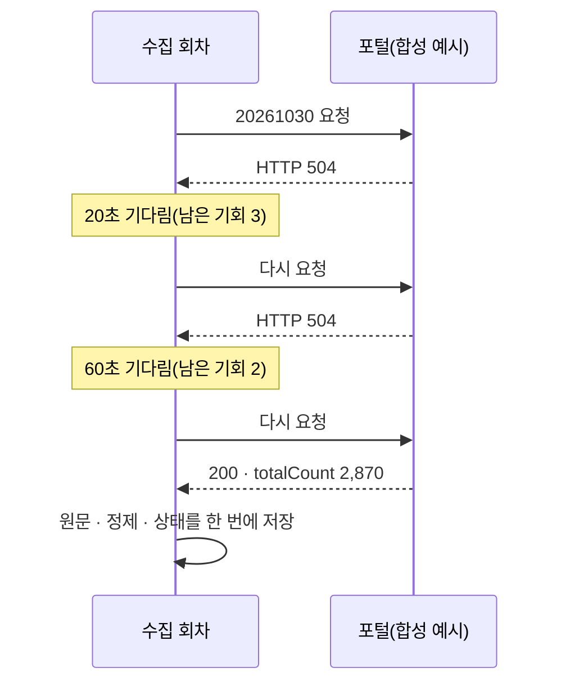

> [!GOAL]
>
> - 인증키를 코드 · 로그에 남기지 않고 쓰는 방법과, 이미 인코딩된 키를 또 인코딩하면 왜 안 되는지 설명할 수 있습니다.
> - 하루 한도 안에서 필요한 호출 수와 일수를 계산하고, 한도 앞에서 **미리** 멈추는 까닭을 말할 수 있습니다.
> - 실패를 일시 오류와 영구 오류로 나눠 일시 오류만 상한 안에서 다시 부르는 함수를 쓸 수 있습니다.

이 장은 [2.1 원문 · 정제 · 파생](#/p/data-layers)에서 본 「받아서 원문으로 남기기」 앞 단계, 곧 **API 를 부르는 일**을 다룹니다. 증권사 API 의 토큰 · 모의/실전 주소 · 주문 유량은 [11.3 증권사 Open API 기초](#/p/broker-api-basics)가, 재시도해도 같은 결과가 되게 하는 성질(멱등성)은 [2.4 정기 배치](#/p/batch-scheduling)가 맡습니다.

> [!NOTE]
> 이 장의 외부 사실은 2026-11-03 조사에서 열람한 자료를 기준으로 하며, 한도 · 오류 코드는 출처마다 다르고 바뀔 수 있습니다. 실제로 쓰기 전에 각 기관의 공식 안내를 확인하세요. 우리 코드를 인용한 곳은 2026-11-03 기준입니다.

## 공공 API 에는 왜 키와 한도가 있나요?

공공데이터포털 · OpenDART · 한국은행 ECOS 같은 곳은 누가 얼마나 부르는지 알아야 서버를 지킬 수 있어서 **인증키**를 발급하고 **호출 한도**를 둡니다. 한도의 크기는 출처마다, 심지어 같은 포털 안에서도 API 마다 다릅니다.

| 출처 | 확인한 한도 | 근거와 단서 |
|---|---|---|
| 공공데이터포털 「주식시세정보」 | 개발계정 10,000 | 해당 API 의 상세 페이지 기준. 운영계정은 활용사례를 등록해 증가를 신청할 수 있다고만 나오고 수치는 없습니다. **다른 API 상세 페이지에는 1,000 같은 값도 보입니다** |
| OpenDART | 「일반적으로」 하루 20,000건 | 요청 제한 초과(상태 020)가 일반적으로 20,000건 이상 요청에서 난다는 개발가이드 문장. 개인 · 기업 구분은 그 페이지에 없습니다 |
| 한국은행 ECOS | 확인 못 함 | 개발명세 본문을 열지 못했습니다 |

그래서 **문서에 적힌 한도를 믿기 전에, 응답이 알려 주는 값을 먼저 봅니다.** 포털은 응답 헤더 `X-RateLimit-Limit` · `X-RateLimit-Remaining` 으로 한도와 남은 횟수를 알려 주고, 우리 수집기는 이 값을 읽습니다(아래 「Qurious 는 이렇게 부릅니다」). 헤더가 없는 출처는 우리가 직접 세야 합니다.

## 인증키는 어디에 두고, 왜 다시 인코딩하면 안 되나요?

키는 **코드가 아니라 환경변수**에 둡니다. 「코드를 언제든 공개해도 자격증명이 새지 않는가」 가 12-factor 앱 설정 원칙의 잣대입니다. Qurious 도 키를 저장소 루트의 `.env`(git 에 올리지 않음)에서 읽습니다.

> [!WARNING]
> 키가 새는 길은 코드만이 아닙니다. 한국은행 ECOS 는 샘플 주소(`/api/StatisticSearch/{키}/{xml|json}/kr/…`)에서 보듯 키가 **주소 경로**에 들어갑니다. 이때 요청 라이브러리의 예외 글(`Max retries exceeded with url: /api/StatisticSearch/<키>/…`)에 키가 그대로 실립니다. 그래서 로그에 안 찍었으니 안전하다고 생각하면 안 됩니다. Qurious 는 밖으로 나가는 글을 모두 `scrub()` 로 거치고, 예외는 원래 예외를 잇지 않고(`from None`) 다시 던집니다.

공공데이터포털은 Encoding 키와 Decoding 키를 함께 보여 줍니다. Encoding 키는 `+` `/` `=` 가 이미 `%2B` `%2F` `%3D` 로 바뀐 값입니다. 이 값을 `params={"serviceKey": 키}` 로 넘기면 라이브러리가 한 번 더 인코딩해 `%` 가 `%25` 가 되고, 서버는 **다른 문자열**을 받습니다. 예제 ①이 이 변환을 그대로 보입니다.

```output
① 풀어서 넣으면: serviceKey=AbC%2Bdef%2FGhi%3D%3D
  그대로 넣으면: serviceKey=AbC%252Bdef%252FGhi%253D%253D
```

우리 코드는 키를 읽는 즉시 `urllib.parse.unquote()` 로 한 번 풉니다(`collector/config.py` `portal_key`).

> [!NOTE]
> 포털의 Encoding · Decoding 키 안내 문서와 키 반영 시간은 이번 조사에서 공식 페이지로 확인하지 못했습니다. 위 내용은 **우리가 겪은 현상**(2026-09-17 팀 기록: 키를 이중 인코딩하자 403 과 코드 30 이 왔음)과 예제 실행 결과에 근거합니다.

## 응답이 성공인지 어떻게 아나요?

「HTTP 200 이면 성공」 이 아닙니다. 우리가 부르는 세 출처가 서로 다르게 틀립니다.

- **포털**: 정상 응답도 결과 코드가 `00` 이고, 하루치가 없을 때도 `00` 에 `totalCount=0` 으로 옵니다. 우리 코드 주석은 실패가 HTTP 200 으로 올 수도 있다고 경고합니다.
- **ECOS**: 잘못된 키도 HTTP 200 이고, 본문의 `RESULT.CODE`(예: `INFO-100`)로 가릅니다.
- **KIS**: 유량 초과(`EGW00201`)가 HTTP 500 에 빈 결과로 온다고 우리 코드 안내문에 적혀 있습니다. 자세한 것은 [11.3](#/p/broker-api-basics)에서 봅니다.

그래서 **상태 코드와 본문 결과 코드를 함께** 봅니다. OpenDART 의 상태 코드는 000 정상 · 010 미등록 키 · 011 사용 중지 키 · 013 조회된 데이터 없음 · 020 요청 제한 초과 같은 것들입니다(2026-11-03 열람). 포털의 오류 코드 표(20 키 누락 · 22 일일 호출 초과 · 23 초당 초과 · 30 미등록 키 · 31 사용 기한 만료)는 **한 API 페이지의 표**를 기준으로 한 것이니 다른 API 에서 다시 확인하세요.

### 0건은 무슨 뜻인가요?

반대로 「0건이면 요청이 틀린 것」 도, 「0건이면 늘 정상」 도 위험합니다.

- 포털은 휴장일과 「거래일인데 아직 안 올라온 날」 을 똑같이 `totalCount=0` 으로 줍니다(우리 실측 2026-09-19 11:00: 9월 18일 금요일이 아직 0건).
- ECOS 는 없는 항목 코드도 `INFO-200`(해당 데이터 없음)으로 옵니다. 주말 창과 같은 답이라, 거래일이 든 긴 창이 비어 오면 실패로 셉니다.
- OpenDART 의 013 은 정상으로 통과시킵니다.

0건의 뜻은 **출처마다, 날짜의 성격마다** 다릅니다. 예제 ②가 합성 응답으로 이 판정을 보입니다.

## 하루 한도 안에서 며칠이 걸리나요?

호출 설계에 따라 하루와 일 년이 갈립니다. 우리 포털 수집은 **하루치 전종목을 한 번에** 받는 API 를 날짜마다 한 번 부릅니다. 6년 반(거래일 1,648일)이면 1,648 호출이고, 하루 한도 10,000 의 약 16.5% 입니다. 하루에 끝납니다. 종목마다 따로 불렀다면 하루치 약 2,870행 기준으로 4,729,760 호출이라 한도 안에서 473일이 걸립니다.


*그림 1. 필요한 일수 비교. 합성 계산 — 거래일 1,648 · 하루치 2,870행 · 하루 한도 10,000 은 collector 의 실측 값이고, 일수는 호출 수 ÷ 한도를 올림한 것입니다. 만든 스크립트는 `tools/learn_figs/public-api-basics.py`.*

```output
③ 한도 셈 (하루 한도 10,000)
  날짜별 1회  : 1,648 호출 = 한도의 16.5% → 1일
  종목·날짜별 : 4,729,760 호출 → 473일
```

## 실패하면 다시 불러도 되나요?

**일시 오류만** 다시 부릅니다. 기다리면 풀릴 수 있는 신호와, 다시 불러도 같은 답이 오는 신호를 가르는 표입니다.

| 신호 | 다시 부르나 | Qurious 의 예 |
|---|---|---|
| 408 · 5xx · 시간 초과 · 연결 끊김 | 기다린 뒤, 상한 안에서 | 포털 수집(`_transient`) |
| 429(요청이 너무 많음) | 예. `Retry-After` 가 있으면 그만큼 | 포털 429 도 일시 오류에 포함 |
| 키 오류 · 권한 · 잘못된 값 | 아니요 — 먼저 고쳐야 함 | DART 010 · 011 · 100 은 예외로 멈춤 |
| 하루 한도 초과 | 아니요 — 내일 | DART 020 은 별도 예외 · 포털은 미리 멈춤 |
| 정상인데 0건 | 출처 · 날짜 성격에 따라 | 포털 0건은 보류했다가 10일 뒤 휴장 확정 |

이 분류는 Google Cloud Storage 의 재시도 지침(408 · 429 · 5xx 응답과 소켓 시간 초과 · TCP 끊김을 재시도할 만한 일시적 문제로 분류)과 같은 방향입니다. 한도 초과를 백오프로 몇 번 더 부르는 것은 같은 오류만 돌려받고 한도를 태울 뿐입니다.

### 기다리는 시간은 어떻게 정하나요?

간격을 늘려 가며 기다리는 방식이 **지수 백오프**입니다. urllib3 의 `Retry` 는 `backoff_factor × 2^(이전 재시도 수)` 로 간격을 셉니다(기본 factor 는 0, 최대 120초). 여기에 **지터**(무작위 흩뜨림)를 더하는 이유를 AWS Architecture Blog 는 이렇게 설명합니다. 같은 간격으로 물러나면 재시도가 다시 겹쳐 충돌하므로 무작위로 흩어야 하고, 이 글이 비교한 시뮬레이션(여러 클라이언트가 같은 행을 동시에 고치려는 경합 상황)에서 지터 없는 지수 백오프가 분명히 가장 나쁜 방식이었다는 것입니다.

또 Amazon Builders' Library 는 **재시도가 이기적이라고** 경고합니다. 서버가 과부하일 때 재시도는 부하를 더 키우고, 여러 계층이 각자 재시도하면 아래 계층의 부하가 곱해집니다. 토큰 버킷으로 로컬 재시도를 제한하는 방법을 소개하고, 부작용이 있는 호출은 API 를 멱등하게 설계해 안전하게 다시 부를 수 있게 하라고 권합니다.

서버가 직접 기다릴 시간을 알려 줄 때도 있습니다. HTTP `Retry-After` 의 값은 날짜이거나 응답을 받은 뒤 기다릴 초 수(예: 120)입니다(RFC 9110). 429(RFC 6585)와 503(RFC 9110)에 이 헤더를 넣을 수 있습니다. 헤더가 있으면 **내 계산값이 아니라 서버가 정한 값을 따릅니다.** urllib3 는 기본으로 이 헤더를 존중합니다.



*그림 2. 일시 오류 뒤 성공하는 흐름. 우리가 2026-11-02 에 겪은 포털 HTTP 504 를 일반화한 **합성 예시**이고, 숫자는 실제 응답이 아닙니다.*

## 데이터가 한 번에 안 들어오면요?

대부분의 공공 API 는 `numOfRows`(한 쪽 크기)와 `pageNo`(쪽 번호)로 나눠 줍니다. 포털 「주식시세정보」 요청 변수에도 있고 응답의 `totalCount` 로 전체 행 수를 알 수 있습니다. 전체가 한 쪽보다 크면 쪽을 넘기며 모두 받는 것이 일반적인 방법입니다.

Qurious 는 **순회하지 않고 멈춥니다.** 하루치 전종목이 약 2,870행이라 `numOfRows=3000` 에 한 번에 들어오기 때문입니다. 응답의 `totalCount` 가 이 값을 넘으면 오류로 멈추고 그 날을 수집된 것으로 표시하지 않습니다. 조용히 자르면 종목 일부가 영영 빠진 채 「성공」 으로 남기 때문입니다. 순회 코드를 만들지 않은 선택이며, 범위가 바뀌면 이 안전망이 먼저 알려 줍니다.

## 직접 해 보기

예제 [`public_api_basics.py`](/learn/examples/public_api_basics.py)는 표준 라이브러리만으로 다섯 가지를 합성 응답에 돌립니다(외부 접속 없음 · 실제로 기다리지 않고 기다림의 **합**만 셈). 핵심인 재시도 부분만 줄이면 이렇습니다.

```python
TRANSIENT = {408, 429, 500, 502, 503, 504}

def retry_fixed(statuses, waits=(20, 60, 120, 300)):   # 고정 기다림 표 — 표가 바닥나면 포기
    waited = 0
    for i, st in enumerate(statuses):
        if st == 200:
            return f"성공 (시도 {i + 1}회, 기다림 합 {waited}초)"
        if st not in TRANSIENT:
            return f"영구 오류 {st} — 재시도하지 않음 (시도 {i + 1}회)"
        if i >= len(waits):
            return f"포기 — 기다림 합 {waited}초 후 error 로 기록"
        waited += waits[i]
```

다음은 2026-11-04 에 `python -X utf8 -I public_api_basics.py` 로 돌린 결과입니다(Python 3.13.14).

```output
② 응답 판정
  포털  HTTP 200 결과코드 00 totalCount=0 → 정상 0건 — 휴장일이거나 아직 안 올라온 날(구분 안 됨)
  포털  HTTP 200 결과코드 00 totalCount=2870 → 정상 2870건
  포털  HTTP 200 결과코드 30 → 실패 — 결과 코드가 00 이 아님
  ECOS HTTP 200 결과코드 INFO-100 → 실패 — HTTP 200 인데 본문 INFO-100
  ECOS HTTP 200 결과코드 INFO-200 → 데이터 없음 — 짧은 창이면 정상, 거래일이 든 긴 창이면 실패로 센다
  DART HTTP 200 결과코드 013 → 조회된 데이터 없음 — 정상 답
  DART HTTP 200 결과코드 020 → 한도 초과 — 재시도하지 않고 오늘은 멈춤
④ 재시도 — 고정 기다림 표(20·60·120·300초)
  일시 오류 뒤 성공: 성공 (시도 3회, 기다림 합 80초)
  키 오류: 영구 오류 401 — 재시도하지 않음 (시도 1회)
  계속 실패: 포기 — 기다림 합 500초 후 error 로 기록
④ 재시도 — 지수 백오프 + Full Jitter(시드 7)
  일시 오류 뒤 성공: 성공 (시도 4회, 기다림 합 3.2초)
  키 오류: 영구 오류 401 — 재시도하지 않음 (시도 1회)
  계속 실패: 포기 — 기다림 합 12.4초
⑤ 쪽 넘기기
  하루치 2,870행 → 한 번에 들어옴 — 2,870행
  하루치 3,001행 → 멈춤 — totalCount 3,001 > numOfRows 3,000: 이 날은 수집된 것으로 표시하지 않음
```

두 재시도 방식의 차이를 눈여겨보세요. 고정 표는 **총 기다림의 상한이 미리 정해져** 있고(500초), 지터 방식은 기다림이 무작위라 합이 매번 다릅니다. 둘 다 키 오류(401)는 한 번 부르고 멈춥니다.

## Qurious 는 이렇게 부릅니다

**Qurious 는 이렇게 합니다.** 수집기(`collector/`)가 위 원칙을 이렇게 지킵니다(2026-11-03 기준 코드).

| 하는 일 | 방식 |
|---|---|
| 키 | 저장소 루트 `.env` 에서 읽고 포털 키는 읽는 즉시 `unquote()`. 키가 없으면 무엇을 하라고 알려 주는 오류를 냅니다 |
| 호출 간격 | 포털 호출 사이 0.35초. 「규약에 적힌 값이 아니라 상대 서버를 배려하는 값」 이라고 주석에 적혀 있습니다 |
| 남은 횟수 | 응답 헤더의 남은 횟수를 읽습니다. 문서값이 아니라 응답이 알려 주는 값을 믿고, 헤더가 없으면 모르는 것으로 두고 간격만 지킵니다 |
| 한도 앞에서 멈추기 | 부르기 **전에** 남은 횟수가 예비분(300) 아래면 멈춥니다. 바닥까지 쓰면 그날 사람이 손으로 확인할 몫도 없어지기 때문입니다. 한도 10,000 은 응답 헤더 실측값(2026-09-19)입니다 |
| 일시 오류 | 포털 5xx · 429 · 통신 실패만 같은 회차 안에서 20 · 60 · 120 · 300초 기다리며 다시 부릅니다. **이 표를 회차 전체가 나눠 씁니다.** 앞 날이 다 쓰면 뒤 날은 바로 포기합니다(포털이 계속 죽어 있다는 뜻). 합 약 8분입니다 |
| 영구 오류 | DART 020(한도 초과)은 별도 예외로 멈춥니다. 「더 부르면 전부 같은 오류로 돌아온다. 유량만 태운다」 는 이유가 코드에 적혀 있습니다. DART 는 남은 횟수 헤더가 없어 한도(20,000)를 우리가 셉니다 |
| 0건 | 곧바로 확정하지 않고 보류합니다. 10일이 지나도 비면 휴장으로 확정하고, 최근이면 다시 확인합니다 |
| 실패 기록 | 실패도 날짜별 상태 표에 남겨 다음 실행이 **그 날만** 다시 받습니다 |

계기가 있었습니다. 2026-11-02 12:31 에 포털이 HTTP 504 를 돌려주자 회차가 한 번만 요청하고 포기해, 10월 30일 종가를 하루 늦게 받았습니다. 그 뒤 위의 기다림 표가 들어갔습니다.

### 교과서와 다른 점

| 교과서 | Qurious | 비고 |
|---|---|---|
| 지수 백오프 + 지터 | 고정 기다림 표 4칸 · 지터 없음 | 이유는 코드에 기록이 없습니다(총 약 8분이라는 상한만 적혀 있음). 이유를 추측해 적지 않습니다 |
| 쪽 넘기기 | 순회하지 않고 `totalCount` 가 넘치면 멈춤 | 하루치 전종목이 한 번에 들어오는 API 라서 |
| `Retry-After` 존중 | 코드에서 읽지 않음 | `collector/` 에서 이 헤더를 검색한 결과 없음. 포털이 이 헤더를 주는지는 확인 못 했습니다 |

> [!NOTE]
> robots.txt 는 접근 **권한을 주는 수단이 아닙니다**. IETF 의 robots 규약(RFC 9309)은 이것이 접근 제한이나 보안의 대체물이 아니라고 적습니다. 막혀 있는 곳을 긁지 않는 것은 보안 장치가 아니라 **상대 서버의 요청을 존중하는 규칙**입니다. Qurious 는 기관이 API 로 내려주는 데이터만 원문으로 남깁니다([2.1](#/p/data-layers)).

## 흔한 실수

1. **「HTTP 200 이면 성공」.** 출처마다 오류가 200 으로 오기도 합니다. 본문 결과 코드를 함께 봅니다.
2. **「0건이면 요청이 틀렸다 / 0건이면 정상이다」.** 둘 다 틀릴 수 있습니다. 출처 · 날짜의 성격을 같이 봅니다.
3. **「실패하면 무조건 재시도」.** 영구 오류와 한도 초과는 다시 불러도 같은 답이고 한도만 태웁니다.
4. **「지수 백오프면 충분」.** 지터가 없으면 같은 시각에 깨어난 클라이언트들이 계속 겹칠 수 있습니다. 다만 혼자 하루 한 번 도는 배치에서는 이득이 작습니다.
5. **「timeout 은 기본으로 있다」.** requests 는 기본으로 시간 제한이 없습니다. 호출마다 지정합니다. 우리 포털 호출은 90초, KIS 는 20초를 둡니다.
6. **「Encoding 키를 params 에 그대로 넣는다」.** 두 번 인코딩돼 다른 키가 됩니다.
7. **「키를 로그에 안 찍었으니 안전」.** 키가 주소에 들어가는 API 는 예외 글에 실립니다.
8. **「robots.txt 는 보안 장치」.** 규약 스스로 아니라고 적습니다.

## 정리

1. 키는 환경변수에 두고, 로그 · 예외 글에서 가립니다. 이미 인코딩된 키는 한 번 풀어서 넣습니다.
2. 하루 한도는 문서 값보다 **응답이 알려 주는 값**을 믿고, 바닥나기 전에 미리 멈춥니다. 호출 설계(날짜별 vs 종목별)가 일수를 좌우합니다.
3. 응답은 HTTP 상태와 본문 결과 코드를 함께 봅니다. 0건의 뜻은 출처마다 다릅니다.
4. 일시 오류만 상한 안에서 다시 부르고, 서버가 `Retry-After` 를 주면 따릅니다. 영구 오류와 한도 초과는 다시 부르지 않습니다.
5. 한 번에 안 들어오면 조용히 자르지 않습니다. 순회하든 멈추든 「일부가 빠진 채 성공」 만은 막습니다.

<details>
<summary>확인 문제 1 — Encoding 키를 <code>params={"serviceKey": 키}</code> 에 그대로 넣었더니 키 오류가 났습니다. 왜인가요?</summary>

이미 퍼센트 인코딩된 값이라 라이브러리가 한 번 더 인코딩해 `%2B` 가 `%252B` 가 되고, 서버가 받는 문자열이 달라지기 때문입니다. 한 번 풀어서(`unquote`) 넣습니다(예제 ①).
</details>

<details>
<summary>확인 문제 2 — 하루치 전종목을 날짜당 1회로 받으면 거래일 1,648일은 하루 한도 10,000 의 몇 %인가요?</summary>

1,648 ÷ 10,000 = 16.48% 로 하루에 끝납니다(예제 ③). 종목마다 따로 불렀다면 4,729,760 호출이라 473일이 걸립니다.
</details>

<details>
<summary>확인 문제 3 — OpenDART 013, 포털 <code>totalCount=0</code>, ECOS <code>INFO-200</code> 중 무조건 재시도할 것은?</summary>

없습니다. 셋 모두 「없다」 는 정상 답입니다. 다만 거래일이 든 긴 창이 비어 오면(ECOS) 실패로 세는 규칙처럼 **창의 성격**을 같이 봅니다.
</details>

<details>
<summary>확인 문제 4 — 503 에 <code>Retry-After: 120</code> 이 왔습니다. 내 지수 백오프 계산값이 8초라면 얼마나 기다리나요?</summary>

서버가 정한 120초를 따릅니다. 이 헤더의 값은 응답을 받은 뒤 기다릴 초 수입니다(RFC 9110). urllib3 도 기본으로 존중합니다.
</details>

<details>
<summary>확인 문제 5 — 일일 한도 초과 오류를 받았습니다. 백오프로 몇 번 더 시도하나요?</summary>

시도하지 않습니다. 같은 오류만 돌아오고 한도만 태웁니다. 오늘은 멈추고 진행 상태를 저장해 내일 이어 갑니다.
</details>

## 더 읽을거리

아래 자료는 2026-11-03 조사에서 열람한 1차 자료이며, 이 장을 쓰면서 다시 열지는 않았습니다. **2026-11-04 에 AWS · Google · urllib3 · requests 문서는 원문 페이지에서 직접 대조했고 항목마다 범위를 적었습니다.**

- 공공데이터포털, 금융위원회 「주식시세정보」 — <https://www.data.go.kr/data/15094808/openapi.do> · 개발계정 10,000 · 요청 변수 · 오류 코드 표.
- OpenDART 개발가이드(공시검색) — <https://opendart.fss.or.kr/guide/detail.do?apiGrpCd=DS001&apiId=2019001> · 상태 코드와 요청 제한.
- IETF, RFC 9110 「HTTP Semantics」 — <https://www.rfc-editor.org/rfc/rfc9110.html> · `Retry-After` · 503.
- IETF, RFC 6585 — <https://www.rfc-editor.org/rfc/rfc6585.html> · 429.
- IETF, RFC 9309 「Robots Exclusion Protocol」 — <https://www.rfc-editor.org/rfc/rfc9309.html> · 접근 권한 수단이 아니라는 설명.
- AWS Architecture Blog, 「Exponential Backoff And Jitter」 — <https://aws.amazon.com/blogs/architecture/exponential-backoff-and-jitter/> · 지터를 더하는 이유와 방식 비교(2026-11-04 원문 확인: Full · Equal · Decorrelated 비교, 지터 없는 방식이 가장 나쁨).
- Amazon Builders' Library, 「Timeouts, retries, and backoff with jitter」 — <https://builder.aws.com/content/3EumjoZascWd1oZiEgL8ORlv3qE/timeouts-retries-and-backoff-with-jitter> · 재시도의 이기성 · 여러 계층의 재시도 · 토큰 버킷 · 멱등 API(2026-11-04 원문 확인).
- Google Cloud, Cloud Storage 「Retry strategy」 — <https://docs.cloud.google.com/storage/docs/retry-strategy> · 재시도 가능 상태 분류(2026-11-04 원문 확인: 408 · 429 · 5xx · 소켓 시간 초과 · TCP 끊김).
- Requests, Quickstart — <https://requests.readthedocs.io/en/latest/user/quickstart/> · timeout(2026-11-04 원문 확인: 거의 모든 운영 코드의 거의 모든 요청에 지정하라고 안내).
- urllib3, util 레퍼런스(`Retry`) — <https://urllib3.readthedocs.io/en/stable/reference/urllib3.util.html> · `backoff_factor` · `Retry-After` 존중(2026-11-04 원문 확인: factor 기본 0 · 최대 120초 · Retry-After 존중 기본 True).
- The Twelve-Factor App, 「Config」 — <https://12factor.net/config> · 자격증명은 환경변수로.
- 이 장의 예제 [`public_api_basics.py`](/learn/examples/public_api_basics.py) · 응답이 말이 되는지 보는 법은 [1.4](#/p/data-quality-check) · 거래일과 휴장일은 [2.5](#/p/trading-calendar).

> [!NOTE]
> 한국은행 ECOS 개발명세의 오류 코드 표와 요청 건수 제한, 포털의 `Retry-After` 제공 여부, 포털 Encoding · Decoding 키 공식 안내는 **확인하지 못해** 이 장에서 단정하지 않았습니다.

**용어**

| 말 | 뜻 |
|---|---|
| 인증키(serviceKey) | 누가 부르는지 알리는 값. 코드가 아니라 환경변수에 둠 |
| Encoding 키 | `+` `/` `=` 가 이미 `%2B` `%2F` `%3D` 로 바뀐 키. 다시 인코딩하면 다른 값이 됨 |
| 호출 한도 | 하루(또는 초당)에 부를 수 있는 횟수의 상한 |
| 예비분 | 한도를 바닥까지 쓰지 않으려고 남겨 두는 호출 수 |
| 일시 오류 | 기다리면 풀릴 수 있는 오류(408 · 429 · 5xx · 시간 초과) |
| 영구 오류 | 다시 불러도 같은 답이 오는 오류(키 · 권한 · 잘못된 값 · 한도 초과) |
| 지수 백오프 | 실패할 때마다 기다림을 배로 늘리는 방식 |
| 지터 | 기다림을 무작위로 흩뜨려 재시도가 겹치지 않게 하는 것 |
| Retry-After | 서버가 「이만큼 뒤에 다시 오라」 고 알려 주는 HTTP 헤더 |
| numOfRows · pageNo · totalCount | 한 쪽 크기 · 쪽 번호 · 전체 행 수(포털 요청 · 응답 변수) |
