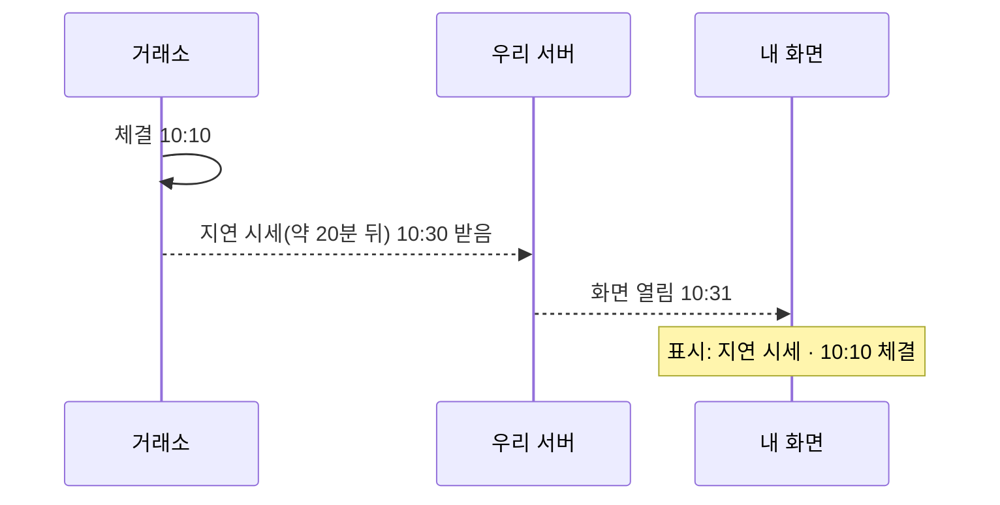
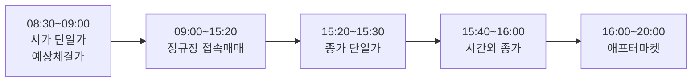
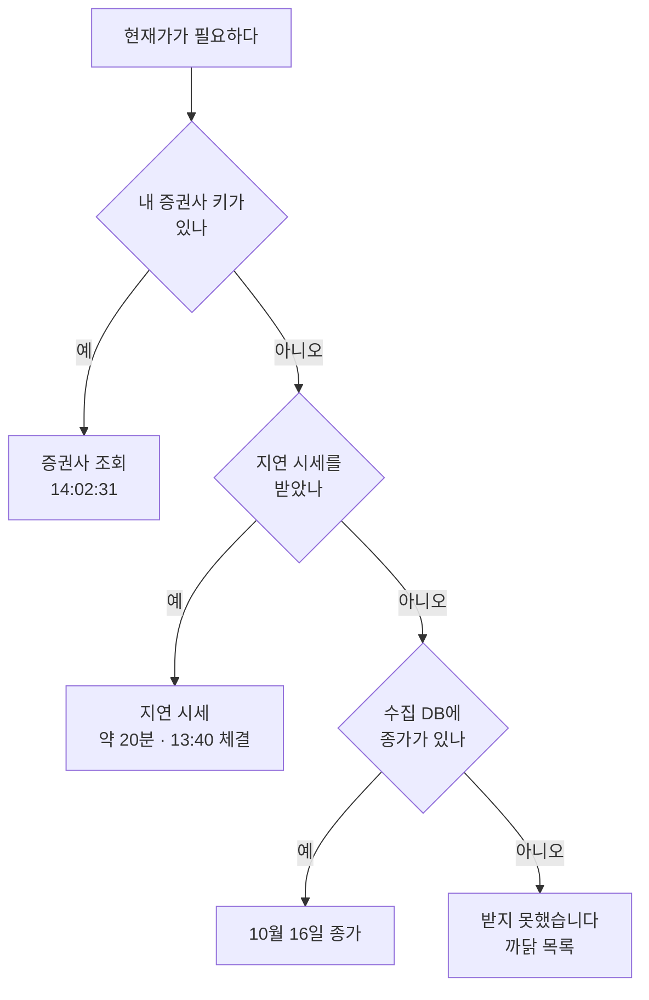

> [!GOAL]
>
> - 화면의 「현재가」 가 실시간 · 지연 시세 · 지난 종가 중 무엇인지 **출처와 시각**으로 구별할 수 있습니다.
> - 한국 하루의 시간 구조(단일가 · 정규장 · 시간외 · 애프터마켓 · 넥스트레이드)와 그 속에서 「종가」 가 어떻게 확정되는지 설명할 수 있습니다.
> - 시세를 다시 보여 주거나 저장할 때 이용 조건(개인 · 자기 화면 · 제3자 제공 금지)이 왜 중요한지 말할 수 있습니다.

> [!NOTE]
> 시간표와 이용 조건은 2026-11-03 에 열람한 공식 자료 기준이며 바뀔 수 있습니다. 이 장은 교육용이고 투자 · 법률 자문이 아닙니다. **「실시간」 이라는 말은 거래소와 정보이용 계약이 있는 곳이 쓰는 말입니다.** 이 장의 그림과 예제는 합성 데이터이며 실제 시세를 쓰지 않았습니다.

[2.5](#/p/trading-calendar)에서 한국 하루의 시간표를, [분봉과 시간대](#/p/intraday-timezone)에서 시각의 시간대를 보았습니다. 이 장은 그 위에서 **화면에 보이는 값 하나가 언제의 값인가**를 묻습니다.

## 화면의 현재가가 실제와 달랐던 까닭은?

팀 조사서(2026-10-19)에는 인디케이터 화면의 「현재가」 가 실제와 달랐던 사례가 적혀 있습니다. 화면이 **수집 DB 의 마지막 종가를 「현재가」 로 보인** 것으로 코드를 따라 좁힌 **추정**이며, 로그로 확인한 것은 아닙니다. 어느 쪽이든 교훈은 같습니다. 「현재가」 라는 이름표 하나에 서로 다른 값이 섞이면, 사용자는 그 값이 몇 시의 것인지 알 수 없습니다.

## 「현재가」 는 정확히 무슨 값인가요?

흔히 「가장 최근에 **체결된** 가격」 이라고 설명합니다. 그런데 이 장을 쓰면서 KRX · 금융투자협회 · 금융감독원의 용어사전에서 이 정의 문장을 **찾지 못했습니다.** 통합 시세 안내문 등으로만 뒷받침되므로 이 장은 정의를 지어내지 않고 「최근 체결가로 안내된다」 정도로 씁니다.

두 가지는 구별합니다.

- **체결가 vs 호가.** 시세는 체결 중심이고, 호가는 사려는 · 팔려는 가격입니다(미국 투자자 보호 사이트 investor.gov 의 설명).
- **단일가 구간.** 시가(08:30~09:00)와 종가(15:20~15:30) 결정 구간은 호가를 모아 한 가격으로 체결합니다(KRX 안내 기준). 체결 전 화면에는 **예상체결가**만 나옵니다. 이 구간에는 「현재가」 가 바뀌지 않거나, 바뀐다면 예상값입니다.

## 실시간 · 지연 · 종가는 무엇이 다른가요?

같은 값이라도 세 시각이 있습니다. **체결 시각**(거래소에서 거래가 이뤄진 때), **받은 시각**(우리 서버가 받은 때), **화면을 연 시각**입니다. 값의 나이는 「화면을 연 시각 − 체결 시각」 입니다.



*그림 1. 한 값의 세 시각(합성 예시).*

그래서 **지연 시세에서는 20분이 곧 나이**입니다. 예제 ③이 계산합니다.

```output
③ 값의 나이: 20 분 (체결 10:10, 조회 10:30)
```


*그림 2. 지연 시세의 모양. 합성 데이터(시드 11)로 만든 가상 가격이며 실제 종목 · 시세가 아닙니다. 만든 스크립트는 `tools/learn_figs/quote-now-realtime.py`.*

「지연」 이 몇 분인지를 누가 정하는지도 확인해 둘 만합니다. 코스콤 · KRX 의 시세 이용 정책서(2024-01-01 판)는 지연 정보를 데이터피드로 제공하려면 사전 승인이 필요하다고 하지만 **열람한 범위에서는 지연 분 수의 정의가 정책서에 없습니다.** KRX 정보데이터시스템 · 네이버 증권 · 넥스트레이드 공식 사이트 화면에는 「20분 지연」 표기가 보이고, 야후 파이낸스 도움말은 코스피 · 코스닥 종목을 20분(제공사 ICE Data Services)으로 안내합니다. 미국은 나스닥 용어집이 지연 시세를 거래 후 「15분, 때로 20분」 지나 보여 주는 호가로 설명합니다. 한편 미국 SEC Rule 603 은 통합 시세 표시 의무이지 15분 지연의 근거가 아닙니다(FINRA 안내 기준이며, 15분 지연을 정한 규칙으로 설명하는 곳은 찾지 못했습니다).

## 한국 시장은 하루에 값이 몇 번 바뀌나요?

KRX 규정(2026-11-03 열람)과 넥스트레이드 시장개요 기준입니다. 호가 접수 시작은 KRX 규정이 08:30, 증권사 공지 한 곳이 08:20 으로 달라 단정하지 않습니다.



*그림 3. KRX 하루의 값이 바뀌는 구간(시각표 도식). 같은 시간에 넥스트레이드는 프리 08:00~08:50 · 메인 09:00:30~15:20 · 애프터 15:40~20:00 입니다.*

- **정규장 종가는 15:30 에 확정**됩니다. 종가 단일가는 마감 후 임의의 시각에 끝납니다.
- 그러나 **2026-09-14 부터** KRX 애프터마켓(16:00~20:00, 가격제한폭 ±30%, 시장가 주문 불가)과 넥스트레이드 애프터에서 가격이 계속 움직입니다. 「마감 뒤 현재가 = 종가」 는 **조건부**입니다.
- KRX 전종목 시세 화면의 주석은 당일 조회 시 「종가」 에 20분 지연으로 애프터마켓 가격도 나올 수 있고, 과거 일자의 종가 · 시가 · 고가 · 저가는 **정규시장(09:00~15:30) 기준**이라고 밝힙니다.

예제 ①이 시각을 구간으로 바꿉니다(합성 날짜).

```output
① 시각 → 구간
   2026-10-08 08:45 → 시가 단일가(예상체결가만)
   2026-10-08 10:00 → 정규장 접속매매
   2026-10-08 15:25 → 종가 단일가(예상체결가만)
   2026-10-08 15:35 → 거래 없음
   2026-10-08 15:50 → 시간외 종가
   2026-10-08 17:00 → 애프터마켓 접속매매
   2026-10-08 20:00 → 거래 없음
   2026-10-09 10:00 → 휴장
   2026-10-10 10:00 → 휴장
```

## 거래소가 둘이면 현재가는 어느 쪽 값인가요?

한국에는 KRX 와 넥스트레이드(NXT)가 있습니다. 증권사 · 서비스 안내를 모은 바로는 **통합 현재가는 KRX · NXT 중 더 최근에 체결된 가격**으로 안내되고 거래량 · 거래대금은 합산됩니다. KRX 와 NXT 모두 상장된 종목은 통합 시세가 기본이고, NXT 에서 거래할 수 없는 종목은 NXT 시세에서 KRX 의 직전 체결가에 멈춘다고 합니다. 전일가와 다음 날 기준가는 항상 KRX 종가라고 안내됩니다. 다만 이 설명은 증권사 약관이나 거래소 공식 문서가 아니라 서비스 FAQ · 보도 · 검색 발췌에 근거하므로 **~로 안내된다** 정도로만 받아들입니다. 한국투자증권 Open API 에서 시장 구분 코드가 J(KRX) · NX(NXT) · UN(통합)이라는 설명도 2차 자료이고 공식 원문은 확인하지 못했습니다.

결국 「현재가」 라는 한 낱말이 **어느 시장의 값**인지 밝혀야 합니다.

## 지연 시세와 지난 종가는 어디서 오나요?

공공데이터포털 금융위원회 「주식시세정보」(수집 DB 종가의 원천)는 이렇게 밝힙니다(2026-10-28 수정본 열람). 「일 1회」, 「실시간이 아니며」, 「기준일자로부터 영업일 하루 뒤 오후 1시 이후」입니다. 금요일 종가는 월요일 낮에 받습니다. 같은 쪽에 메타 칸 「업데이트 주기: 실시간」 과 설명 첫 문장 「실시간 시세 정보를 제공」 이라는 모순된 표기도 있지만 본문의 「실시간이 아니며」 가 정본입니다.

| 값 | 언제 확정되나 | 근거 |
|---|---|---|
| 정규장 종가 | 15:30(종가 단일가 15:20~15:30 뒤) | KRX 규정 안내 |
| 공공데이터 종가 | 기준일 다음 영업일 13시 이후 | 공공데이터포털 |
| 시간외 종가 | 15:40~16:00 | KRX 규정 |
| 애프터마켓 가격 | 16:00~20:00 계속 움직임 | KRX 규정 |

## 시세를 가져다 써도 되나요?

시세에도 이용 조건이 있습니다(코스콤 · KRX 시세 이용 정책서 2024-01-01 판 외). 요지만 적습니다.

| 주제 | 정책서의 요지 |
|---|---|
| 개인가입자 | 자연인 · 비즈니스 목적이 아님 · 「자기 자산의 관리 또는 투자 목적에 한하여」 · 제3자에게 정보를 분배하거나 제공하지 않을 것 |
| 웹 체결가 서비스 | 일반 대중 대상은 호가 정보 제외 · 조회 방식만. API · DDE 같은 가공 · 저장 · 재분배 수단은 엄격히 금지 |
| 비조회형 이용 | 알고리즘 · 프로그램매매 · 가공 지표 산출은 코스콤에 신고하고 이용료 부과 |
| 발췌 인용 | 한두 숫자를 비정기적으로 전하는 것은 허용 틀. 정기 업데이트가 따르면 안 됨 |

그 밖에 공공데이터포털 주식시세정보는 공공누리 **제4유형**(출처표시 + 상업적 이용 금지 + 변경 금지)이고 「상업적 목적 여부와 상관없이 제3자 무단 제공 및 재배포가 엄격히 금지」입니다. 야후 파이낸스 도움말은 「표시되거나 제공되는 정보를 재배포하지 말 것」(원문 영어)과 「거래나 투자 목적이 아님」을 지금도 적고 있습니다. 한국투자증권 제휴 안내는 시세 이용 시 거래소와의 정보이용계약을 확인하라고 안내합니다(2026-11-04 원문 확인).

그래서 「지연 시세니까 다시 보여 줘도 된다」 는 생각은 위험합니다. 지연이어도 데이터피드로 제공하려면 승인이 필요하고, 공공누리 제4유형과 야후 약관은 재배포를 막습니다. 이 장이 이용 조건을 해석하거나 허용 여부를 판단하지는 않습니다. 실제로 쓰기 전에 각 출처의 최신 조건을 확인하세요.

## Qurious 는 이렇게 합니다

**Qurious 는 이렇게 합니다.** 「현재가」 는 서버 한 곳(`app/services/quote_now.py`)에서 만듭니다. 판단 · 백테스트 · 학습은 **저장 자료**를 쓰고, 실행 직전 확인과 화면 표시만 지금 값을 씁니다. 코드와 문서에서 「실시간」 이라는 낱말을 쓰지 않는 것을 원칙으로 하고, 실시간 값은 저장하지 않고 사람 · 종목별로 10초 메모리 저장본만 둡니다.



*그림 4. 현재가를 찾는 순서(단순화).*

| 출처 이름 | 화면 글 | 뜻 |
|---|---|---|
| `kis_user` | 증권사 조회 · 14:02:31 | 내 증권사 키로 그 순간 조회 |
| `kis_gateway` | 증권사 연계 조회 · 14:02 | 강사님 게이트웨이 경유 |
| `delayed` | 지연 시세(약 20분) · 13:40 체결 | 야후 경유 |
| `collector` | 10월 16일 종가 | 공공데이터 일 1회 |

예제 ④가 출처 · 시각을 화면 글 한 줄로 만드는 모양을 보입니다.

```output
④ 화면 글
   증권사 조회 · 10:30:00
   지연 시세(약 20분) · 10:10 체결
   10월 30일 종가
```

수집 DB 종가의 날짜가 마지막으로 끝난 거래일보다 오래됐으면 「10월 30일 종가는 반영 전」 이라고 알립니다. 공공데이터가 다음 영업일 오후 1시 이후에 오기 때문입니다. 모의 주문이 체결되기 직전에는 그 사람의 증권사 키가 있으면 현재가를 다시 받아 바꾸고, 없으면 받아 둔 값에 출처 · 시각만 붙입니다.

### 우리 코드가 공식과 어긋나는 곳

> [!WARNING]
> 이 장을 쓰면서 코드를 읽고 확인한 것이며 **고치지 않았습니다**(작성 범위 밖). 확인 날짜는 2026-11-03 입니다.
>
> 1. `market_state`(`open` / `closed` 판정)가 **요일과 09:00~15:30 시각만** 보고 공휴일을 보지 않습니다. 같은 규칙을 직접 돌려 보니 평일 공휴일 10:00 에도 `open` 이 나왔습니다(예제 ②).
> 2. 15:30~20:00 을 `closed` 로 보는데, 그 시간에 KRX 애프터마켓과 넥스트레이드는 열려 있습니다.
> 3. 같은 파일의 `last_closed_trading_day` 는 휴장 표를 보므로 **내부 판정이 서로 다릅니다.** 휴장 표가 2026년까지여서 2027년 이후에는 평일을 모두 거래일로 봅니다(주석이 인정).
> 4. 화면 딱지가 「실시간 · 정규장」 이라고 쓰는 곳이 있어 「실시간 낱말을 쓰지 않는다」 는 원칙과 어긋나고, 강사님 게이트웨이 값까지 같은 딱지로 묶습니다.
> 5. 어느 시장(KRX · NXT · 통합)의 값인지는 응답에 담기지 않습니다.

예제 ②가 1번과 2번을 보입니다.

```output
② 요일 + 시각만 / 달력까지
   2026-10-08 10:00 → open / open
   2026-10-09 10:00 → open / closed
   2026-10-10 10:00 → closed / closed
   2026-10-08 15:35 → closed / closed
   2026-10-08 17:00 → closed / closed
```

두 번째 줄(공휴일)에서 두 판정이 갈립니다. 마지막 줄 17:00 은 애프터마켓이 열려 있는 시각인데 둘 다 `closed` 입니다. 이 구분이 「장 마감」 이라는 라벨의 정확성을 정합니다.

## 흔한 실수

1. **「15:30 이후 현재가는 오늘 종가다」.** 애프터마켓과 넥스트레이드에서 20:00 까지 가격이 움직입니다. 다음 날 기준가는 KRX 정규장 종가로 안내됩니다.
2. **「통합 현재가 = KRX 값」.** KRX · NXT 중 더 최근에 체결된 값으로 안내됩니다.
3. **「공공데이터 종가 칸의 『업데이트 주기: 실시간』 을 믿는다」.** 같은 쪽 본문은 「실시간이 아니며 하루 뒤 오후 1시 이후」 입니다.
4. **「지연 시세면 다시 보여 줘도 된다」.** 지연 정보도 승인이 필요하고 재배포를 막는 조건이 있습니다.
5. **「Rule 603 이 15분 지연을 정한다」.** 통합 시세 표시 의무이고 지연은 거래소 · 벤더의 정책입니다.
6. **「화면의 시각 = 체결 시각」.** 체결 · 받은 · 화면을 연 시각이 다릅니다.
7. **「실시간이라는 낱말은 아무 때나 써도 된다」.** 계약이 있는 곳이 쓰는 말입니다.
8. **「단일가 구간에도 현재가가 바뀐다」.** 체결 없이 예상체결가만 나옵니다.

## 정리

1. 「현재가」 는 체결 · 받은 · 화면 시각이 다른 값이므로 **출처와 시각을 함께** 밝힙니다.
2. 정규장 종가는 15:30 에 확정되지만 애프터마켓과 넥스트레이드가 20:00 까지 이어집니다.
3. 통합 현재가와 전일가 설명은 공식 문서가 아니라 서비스 안내라서 「~로 안내된다」 로 받아들입니다.
4. 시세는 개인 · 자기 화면 · 제3자 제공 금지가 기본이고, 지연 시세도 재배포 조건이 따로 있습니다.
5. 판정 함수는 달력(휴장일)과 연장 거래 시간을 함께 봐야 합니다.

<details>
<summary>확인 문제 1 — 금요일 18:00(KRX 애프터마켓 시간)에 화면의 「현재가」 칸에 오늘 종가를 보이면 맞나요?</summary>

아닙니다. 정규장 종가는 15:30 에 확정되지만 16:00~20:00 애프터마켓에서 가격이 또 움직입니다. 종가인지 현재 값인지 밝혀야 합니다.
</details>

<details>
<summary>확인 문제 2 — 공공데이터포털 주식시세정보의 금요일 종가는 언제 받을 수 있나요?</summary>

다음 영업일(월요일) 오후 1시 이후입니다. 쪽 본문에 「실시간이 아니며」 라고 적혀 있습니다.
</details>

<details>
<summary>확인 문제 3 — 야후로 받은 한국 종목의 지연은 몇 분이고, 그 정보를 화면에 다시 보여 줘도 되나요?</summary>

야후 도움말은 코스피 · 코스닥을 20분(제공사 ICE Data Services)으로 안내하고, 표시되는 정보의 재배포를 하지 말라고 적습니다(2026-11-03 열람). 이용 조건을 확인하세요.
</details>

<details>
<summary>확인 문제 4 — <code>market_state</code> 가 요일과 시각만 본다면 2026-10-09(금, 한글날) 10:00 에 무엇이라 답하나요?</summary>

`open` 입니다. 한글날은 휴장이므로 틀립니다. 휴장 표를 함께 봐야 합니다(예제 ②).
</details>

<details>
<summary>확인 문제 5 — 체결 시각 10:10, 조회 10:30 이면 이 값의 나이는?</summary>

20분입니다. 화면을 연(조회한) 시각에서 체결 시각을 뺍니다(예제 ③).
</details>

## 더 읽을거리

아래 자료는 2026-11-03 조사에서 열람한 자료이며, 이 장을 쓰면서 다시 열지는 않았습니다. **야후 도움말(`.KS` · `.KQ` 20분 · ICE Data Services · 재배포 금지)과 나스닥 용어집(15분, 때로 20분)은 2026-11-04 에 원문 페이지에서 직접 대조했습니다. 나머지는 인용 전에 원문을 대조하세요.**

- 코스콤 · KRX, 시세 이용 정책서(Market Data Usage Policies, 2024-01-01 판) — <https://data.krx.co.kr/inc/datasale/Market%20Data%20Usage%20Polices_ko.pdf>(2024-01-01 판 · 2026-11-04 직접 열람. 옛 주소 data.koscom.co.kr/policy 는 404).
- KRX 정보데이터시스템, 전종목 시세 화면의 주석 — <https://data.krx.co.kr>(2026-11-03 열람 · 이번에 다시 열지 못함: 화면이 동적으로 그려짐).
- 한국거래소 규정 — <https://regulation.krx.co.kr/contents/RGL/03/03020401/RGL03020401.jsp>(시장의 개폐) · RGL03010301(시간외종가/애프터마켓).
- 넥스트레이드 시장개요 — <https://www.nextrade.co.kr/marketOverview/content.do> (2026-11-04 원문 확인). KRX Data Marketplace 개인투자자 안내(실시간 또는 지연시세정보 20분 혹은 종가) — <https://openapi.krx.co.kr/contents/OPP/DATA/OPPDATA003.jsp> (2026-11-04 원문 확인).
- 공공데이터포털, 금융위원회 주식시세정보 — <https://www.data.go.kr/data/15094808/openapi.do>.
- 야후 파이낸스 도움말(시세 지연) — <https://help.yahoo.com/kb/SLN2310.html>. Nasdaq 용어집(실시간 시세) — <https://www.nasdaq.com/glossary/r/real-time> (2026-11-04 원문 확인).
- investor.gov, 「Stock Quotes」 — 호가와 체결의 구별(미국).
- 이 장의 예제 [`quote_now_basics.py`](/learn/examples/quote_now_basics.py) · 시간대와 분봉은 [분봉과 시간대](#/p/intraday-timezone) · 거래일 달력은 [2.5](#/p/trading-calendar).

> [!NOTE]
> 확인하지 못해 단정하지 않은 것: ① 「현재가」 의 거래소 · 협회 공식 정의 ② KRX 「20분 지연」 의 근거 문서 ③ 통합 현재가 · 전일가 설명의 증권사 약관 · 거래소 공식 설명 ④ 한국투자증권 현재가 API 의 실전 · 모의 차이 · 유량 · 웹소켓 한도 ⑤ 한국투자증권 약관 조항 ⑥ 호가접수 시작 시각(08:20 대 08:30) ⑦ 공공데이터 주식시세정보 종가에 애프터마켓이 반영되는지.

**용어**

| 말 | 뜻 |
|---|---|
| 현재가 | 화면이 「지금 값」 으로 보이는 가격. 이 장에서는 최근 체결가로 안내되는 값 |
| 체결가 · 호가 | 거래가 이뤄진 가격 · 사려는 / 팔려는 가격 |
| 단일가 | 호가를 모아 한 가격으로 체결하는 방식(시가 · 종가 결정 때) |
| 예상체결가 | 단일가 구간에 체결 전 화면에 나오는 예상 가격 |
| 지연 시세 | 거래 후 정해진 시간이 지나 보여 주는 시세(20분 · 15분 등) |
| 종가 | 정규장이 끝났을 때 확정되는 가격(15:30) |
| 애프터마켓 | KRX 의 16:00~20:00 시간외 거래(2026-09-14 신설) |
| 넥스트레이드(NXT) | 한국의 대체거래소. KRX 와 병행 운영 |
| 통합 시세 | KRX · NXT 중 더 최근에 체결된 값으로 안내되는 시세 |
| 값의 나이 | 화면을 연 시각 − 체결 시각 |
