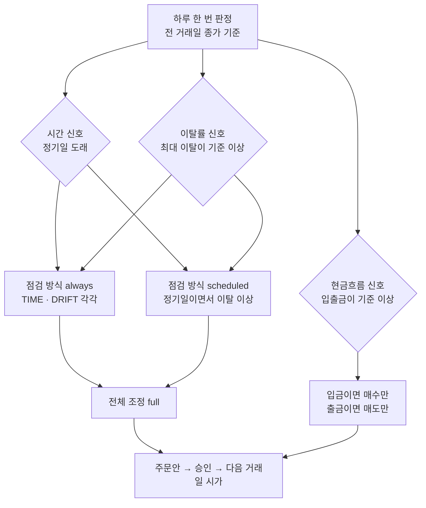

> [!GOAL]
>
> - 리밸런싱이 필요한 까닭을 「비중은 저절로 바뀐다」 는 숫자 예로 설명하고, 목적이 수익이 아니라 위험 수준을 지키는 것임을 말할 수 있습니다.
> - 시간 · 이탈률 · 현금흐름 세 신호가 각각 언제 켜지는지, 이탈률을 「늘」 볼 때와 「정기일에만」 볼 때 판정이 어떻게 달라지는지 구분할 수 있습니다.
> - 점검 주기와 이탈 기준이 거래 횟수에 미치는 영향을 표와 합성 실험으로 읽고, 앱의 기본 기준(5%p · 10만 원)이 무엇을 뜻하는지 설명할 수 있습니다.

이 장은 비중을 되돌리는 규칙을 다룹니다. 목표 비중이 어디서 나오는지는 [11.1 투자성향 점수](#/p/investor-profile-scoring), 모델로 비중을 정하는 방법은 [11.5 평균-분산 최적화](#/p/mean-variance-optimization)에서 시작합니다.

> [!NOTE]
> 가격 · 수량 · 수익률은 예로 정한 값과 난수로 만든 합성 데이터이고 교육용입니다. 출력은 2026-11-03 에 예제 [`rebalance_rules.py`](/learn/examples/rebalance_rules.py) 를 돌린 결과입니다. 과거의 성과는 앞날의 수익을 보장하지 않습니다.

## 리밸런싱은 무엇이고 왜 하나요?

리밸런싱(rebalancing)은 시장이 움직여 달라진 자산 비중을 처음 정한 목표 비중으로 되돌리는 일입니다. 목표를 주식 60% · 채권 35% · 현금 5% 로 정하고 1,000만 원을 나눠 담았다고 합시다. 그 뒤 주식이 30% 오르고 채권이 3% 내렸습니다. 아무것도 사고팔지 않았는데 비중이 이렇게 바뀝니다.

```output
① 비중은 저절로 바뀝니다 (목표 STOCK 60% · BOND 35% · 현금 5% · 합성 가격)
[처음] 총자산 10,000,000원
  BOND  지금 35.00% · 목표 35.0% · 벗어남 +0.00%p
  STOCK 지금 60.00% · 목표 60.0% · 벗어남 +0.00%p
  현금  지금 5.00% · 목표 5.0% · 벗어남 +0.00%p
  가장 크게 벗어남 0.00%p · 기준 5.0%p 이상: False
[주식 +30% · 채권 -3% 뒤] 총자산 11,695,000원
  BOND  지금 29.03% · 목표 35.0% · 벗어남 -5.97%p
  STOCK 지금 66.70% · 목표 60.0% · 벗어남 +6.70%p
  현금  지금 4.28% · 목표 5.0% · 벗어남 -0.72%p
  가장 크게 벗어남 6.70%p · 기준 5.0%p 이상: True
```

주식 비중이 66.70% 가 되었습니다. 다음 하락장을 처음 정한 것보다 주식을 6.7%p 더 들고 맞는다는 뜻입니다. 현금과 채권도 목표에서 벗어났고, 그중 가장 크게 벗어난 값(6.70%p)이 이탈의 크기입니다.

리밸런싱의 목적은 수익을 늘리는 데 있지 않고 처음 감당하기로 한 위험 수준을 지키는 데 있습니다. Vanguard 의 연구(2010)도 리밸런싱 전략의 가장 큰 목표를 수익 극대화가 아니라 목표 배분 대비 위험을 줄이는 것이라고 밝힙니다. 이 연구에서 한 번도 되돌리지 않은 60/40 포트폴리오는 평균 주식 비중이 84% 까지 올라 위험이 커졌습니다(아래 표 2).

## 언제 되돌리나요?

되돌리기를 시작하는 신호는 세 가지입니다.

**표 1. 세 신호**

| 신호 | 켜지는 때 | 장점 | 단점 | Qurious 기본값 |
|---|---|---|---|---|
| 시간(TIME) | 정한 주기(월 · 분기 · 연)의 첫 거래일 | 규칙이 단순하고 잊지 않음 | 거의 안 벗어났어도 거래할 수 있음 | 꺼짐 |
| 이탈률(DRIFT) | 목표와의 차이 중 가장 큰 값이 기준(%p) 이상 | 필요할 때만 거래해 비용이 적음 | 비중을 자주 확인해야 함 | 5.0%p |
| 현금흐름(CASHFLOW) | 입금 · 출금으로 생긴 남는 현금이나 모자란 현금이 기준 금액 이상 | 새 돈으로 비중을 맞춰 매도가 적음 | 입출금이 없으면 켜지지 않음 | 100,000원 |

세 신호가 판정에서 만나는 길을 그리면 이렇습니다.



## 비중은 어떻게 비교하나요?

비중은 종목마다 지금 평가액을 총자산으로 나눠 구하고, 목표와의 차이를 만분율(bp, 0.01%p) 정수로 바꿔 비교합니다.

```python
def bp(percent: float) -> int:
    return int((Decimal(str(percent)) * 100).quantize(Decimal("1"), rounding=ROUND_HALF_UP))
```

66.6951…% 같은 소수를 그대로 기준 5%p 와 견주면 경계에서 계산 오차로 판정이 흔들릴 수 있어 정수로 바꿔 비교합니다. 현금도 목표(100% − 종목 목표 합)가 있어 같은 방식으로 셉니다.

두 가지를 짚어 둡니다.

- **「이상」 에서 켜집니다.** 정확히 5.0%p 벗어난 경우도 신호가 켜집니다. 위 출력의 「기준 5.0%p 이상」 도 같은 뜻입니다.
- **기준은 절대 %p 입니다.** 목표 60% 에서 5%p 는 55% ~ 65% 입니다. 「상대 5%」 라면 57% ~ 63% 로 훨씬 좁습니다. Qurious 는 목표와의 차이를 %p 로만 보고 상대 비율은 쓰지 않습니다. Vanguard 연구도 기준을 비중 자체의 차이(「5 percentage points」)로 쓰고 있습니다.

## 이탈률은 늘 보나요, 정기일에만 보나요?

앱은 이탈률을 확인하는 방식을 둘 중에서 고르게 합니다. `always` 는 이탈률을 판정할 때마다 보고, `scheduled` 는 정기일에만 이탈률을 봅니다. 위 예(이탈 6.70%p · 기준 5%p)를 두 방식에 넣어 봅니다.

```output
② 신호 판정 (현금흐름 없음)
  정기일  이탈률  always                scheduled
  아님    이상    ['DRIFT']             []
  도래    이상    ['TIME', 'DRIFT']     ['TIME', 'DRIFT']
  도래    미만    ['TIME']              []
  아님    미만    []                    []
```

정기일이 아닌 날 `scheduled` 는 아무것도 하지 않습니다. 정기일이 와도 이탈이 기준 미만이면 거래하지 않으므로, 「정기일이지만 거의 안 벗어났다」 면 움직이지 않습니다. 거래를 가장 적게 하는 설정입니다.

Vanguard 의 분류와 맞춰 보면 세 가지가 있습니다. **시간만**(정한 날마다 무조건 되돌림), **이탈률만**(매일 확인해 기준을 넘으면 되돌림), **시간 + 이탈률**(정한 날에만 확인해 기준 이상일 때 되돌림, 날 사이에 기준을 넘어도 그때는 안 함)입니다. 앱의 `scheduled` 가 마지막과 같고, 시간 신호를 꺼 두고 `always` 로 쓰면 이탈률만에 가깝습니다. `scheduled` 는 시간 주기와 이탈률을 둘 다 켠 설정에서만 저장됩니다. 정기일이 없는 `scheduled` 는 아무 때도 켜지지 않기 때문입니다.

## 얼마나 자주 해야 하나요?

두 자료로 읽어 봅니다.

**Vanguard 2010 — 실제 시장 자료.** 미국 주식 · 채권 지수의 1926 ~ 2009 년 자료로 60/40 포트폴리오를 규칙별로 되돌려 본 시험입니다. 세금과 거래비용은 없고, 입출금은 없으며, 비중은 정확히 60/40 으로 시작합니다.

**표 2. Vanguard 시험 결과 (60/40 · 1926 ~ 2009 · 세금 · 비용 없음)**

| 규칙 | 되돌린 횟수 | 평균 주식 비중 | 변동성 | 수익(연) |
|---|---|---|---|---|
| 월 점검 · 기준 없음 | 1,008 | 60.1% | 12.1% | 8.5% |
| 분기 점검 · 기준 없음 | 335 | 60.2% | 12.2% | 8.6% |
| 연 점검 · 기준 없음 | 83 | 60.5% | 11.9% | 8.6% |
| 월 점검 · 5% 이상 | 58 | 61.2% | 12.2% | 8.6% |
| 분기 점검 · 5% 이상 | 50 | 60.9% | 12.1% | 8.8% |
| 연 점검 · 5% 이상 | 28 | 60.7% | 11.8% | 8.6% |
| 연 점검 · 10% 이상 | 15 | 63.0% | 12.1% | 8.7% |
| 한 번도 안 되돌림 | 0 | 84.1% | 14.4% | 9.1% |

표에서 읽을 것은 셋입니다.

1. 되돌린 횟수가 1,008 번에서 28 번으로 줄어도 변동성은 12.1% 에서 11.8% 로 거의 같습니다. 거래마다 수수료와 세금이 드는데 위험을 붙잡는 효과는 비슷하므로, 횟수가 줄면 같은 효과를 더 싸게 얻습니다.
2. 한 번도 안 되돌리면 평균 주식 비중이 84.1% 로 올라 변동성이 14.4% 가 됩니다. 수익은 오히려 9.1% 로 더 높았습니다. 이 기간에는 주식이 채권보다 더 올라 비중이 커진 쪽이 더 벌었기 때문입니다. 되돌리는 일은 수익을 늘리는 것이 아니라 위험을 목표에 붙잡아 두는 일입니다.
3. Vanguard 는 최적의 주기나 기준은 없다고 결론짓습니다. 월 · 분기 · 연 사이의 위험조정 수익은 의미 있게 다르지 않고 횟수와 비용만 크게 달랐습니다. 그래서 대부분의 투자자에게는 연 1 ~ 2회 점검에 5% 기준이 위험 관리와 비용 사이의 합리적인 균형일 것이라고 하고, 세금이나 시간 부담이 크면 연 1회를 권합니다. 미국 지수의 옛 자료에서 얻은 결론이므로 우리 시장 · 세금 · 상품에서 같다는 보장도, 누구에게 권하는 말도 아닙니다.

이 연구에는 위 표 밖의 결과도 있습니다. 매일 확인하는 「이탈률만」 규칙을 1989 ~ 2009 년 자료로 시험하면 기준 0% 는 5,323 회, 기준 10% 는 4 회 되돌립니다. 이 방식의 단점은 매일 확인해야 한다는 점입니다. 포트폴리오가 받은 배당과 이자를 비중이 모자란 자산군에 넣기만 하는 「수입」 방식은 되돌리는 거래가 0 회인데도 평균 주식 비중 61.0% · 변동성 11.3% · 수익 8.5% 였습니다(같은 기간 · 같은 가정, 입출금 없음). 현금흐름 방식이 거래를 줄이는 뿌리가 이 생각입니다.

**합성 실험 — 같은 질문을 난수로.** 표 2 는 미국 시장 한 번의 역사입니다. 같은 질문을 난수로 1,000 번 되풀이해 봅니다. 주식 연 7% · 변동성 16%, 채권 연 3% · 변동성 5%, 서로 독립인 월 수익률로 20년을 만들고 규칙마다 평균을 냅니다. `rebalance_rules.py` 의 마지막 부분입니다.

```output
⑤ 규칙별 비교 (합성 데이터 · 주식 연 7% 변동성 16% · 채권 연 3% 변동성 5% · 서로 독립 · 1,000경로 × 240개월 평균 · 시드 11 · 비용 없음)
  규칙                       횟수    평균 주식%    최대 이탈%p    매매액%    연변동성%
  안 함                     0.0      65.1       20.3       0     10.6
  시간 12개월              20.0      60.3        9.1      66      9.8
  시간 3개월               80.0      60.1        5.4     128      9.8
  이탈률 5%p(월 점검)       9.7      60.3        6.7      56      9.8
  이탈률 2%p(월 점검)      43.2      60.1        4.4     116      9.8
  시간 12개월 + 5%p         5.6      60.6       10.4      43      9.9
  현금흐름만(매달 입금 1)   0.0      60.8       11.0       0      9.9
```

표의 열은 이렇습니다. 횟수는 20년 동안 되돌린 횟수, 평균 주식 % 는 주식 비중의 평균, 최대 이탈 %p 는 20년 중 가장 크게 벗어난 값의 평균, 매매액 % 는 20년 동안 사고판 금액(한쪽)의 합이 평균 자산의 몇 % 인지, 연변동성 % 는 월 수익률로 잰 연 변동성입니다. 마지막 줄의 현금흐름 규칙은 자산 100 으로 시작해 매달 1 을 목표보다 모자란 쪽에 넣기만 합니다(팔지 않음).


*그림 1. 같은 경로 위에서 세 방식이 하는 일. 합성 데이터(시드 11의 첫 경로)이며 회색 선은 아무것도 안 한 경우입니다.*


*그림 2. 규칙별 되돌린 횟수와 가장 크게 벗어난 값. 합성 데이터(시드 11)의 1,000경로 평균입니다.*

읽는 법은 이렇습니다. 이탈률 5%p 규칙은 12개월 시간 규칙의 절반 정도(9.7 회 대 20 회)로 되돌리고도 더 작게 벗어났습니다(6.7%p 대 9.1%p). 시간 규칙은 시장이 조용한 해에도 되돌리고, 이탈률 규칙은 필요할 때만 되돌리기 때문입니다. 월 1 회만 확인하므로 이탈이 5%p 를 조금 넘긴 뒤에 되돌려 평균 최대 이탈이 5 를 넘습니다. 확인 간격이 길수록 이 차이가 커집니다. 현금흐름만 쓰면 한 번도 팔지 않고도 최대 이탈이 11.0%p 로 줄지만, 입금이 계속될 때만 가능합니다. 이 결과는 독립인 정규분포 수익률이라는 한 가지 가정에서 나온 것이어서, 모든 시장에서 같다는 뜻은 아닙니다.

## 주문안은 어떻게 만드나요?

신호가 켜지면 목표 금액과 지금 금액의 차이를 주문으로 바꿉니다. 차례는 이렇습니다.

1. 종목마다 차액 = 총자산 × 목표 비중 − 지금 평가액
2. 차액을 가격으로 나눠 정수 수량을 구합니다(주식은 1주 단위).
3. 매도를 먼저 두고 매수를 나중에 둡니다. 판 돈으로 사야 현금이 모자라지 않습니다.
4. 매수는 현금 목표(이 예에서는 5%)를 남기는 만큼만 하고, 최소 주문금액(기본 10,000원)보다 작은 주문은 뺍니다.
5. 주문마다 수수료 · 세금을 계산합니다.

```output
④ 주문안 (STOCK 600주 × 13,000원 · BOND 350주 × 9,700원 · 최소 주문금액 10,000원 · ETF 로 가정)
  SELL STOCK 60주 × 13,000원 · 비용 138원
  BUY  BOND  71주 × 9,700원 · 비용 122원
  주문 뒤 현금(추정) 591,040원 · 비용 합 260원
```

종목을 ETF 로 가정해 증권거래세가 없는 경우로 계산했습니다(2026-11-03 기준 수수료 · 청산 수수료만). 주식 종목이었다면 매도 쪽에 증권거래세가 더해집니다([F.3 매매 비용과 증권거래세](#/p/trading-costs-tax)). 가격이 없는 종목은 주문에서 빠지고 이유가 남습니다.

## 입금 · 출금은 어떻게 다루나요?

현금흐름 신호는 남는(또는 모자란) 현금과 아직 배분하지 않은 입출금 예산 가운데 작은 금액이 기준 이상일 때 켜집니다. 둘의 부호가 같아야 합니다. 입금이면 남는 현금이 생기고, 출금이면 현금이 모자란 상황이 생기는데, 두 부호가 다르면 입금이 매도 주문을, 출금이 매수 주문을 만드는 일이 생기기 때문입니다.

```output
③ 현금흐름 신호 (기준 100,000원)
  입금 300만 원            → 켜짐 True · 쓸 수 있는 돈 3,000,000원 · 계획 buy_only
  입금 5만 원              → 켜짐 False · 쓸 수 있는 돈 50,000원 · 계획 buy_only
  출금 예산인데 남는 현금  → 켜짐 False · 쓸 수 있는 돈 0원 · 계획 sell_only
```

300만 원을 입금하면 `buy_only`, 곧 「사기만 하는 계획」 이 됩니다. 이미 가진 종목을 팔지 않고 새 돈으로 모자란 비중을 채웁니다. 출금이면 `sell_only` 입니다. 시간이나 이탈률 신호가 함께 켜지면 전체 조정(`full`)이 되어 팔고 사는 주문이 모두 나올 수 있습니다.

## 우리 서비스에서는 어떻게 쓰나요?

**Qurious 는 이렇게 합니다.**

- 기본 설정은 이탈률 5.0%p(입력 범위 0.5 ~ 50%p, 0.5%p 단위) · 시간 신호 꺼짐 · 현금흐름 기준 100,000원 · 최소 주문금액 10,000원 · 자동 실행 꺼짐입니다. 자동 실행이 꺼져 있으면 제안만 기록하고, 사용자가 화면에서 승인해야 주문이 나갑니다.
- 시간 신호를 켜면 주기(월 · 분기 · 연)의 첫 거래일 09:00(KST)부터 점검합니다.
- 계획에 없는 종목은 기본으로 관리 대상 총자산과 이탈 판정에서 뺍니다.
- 예약 작업이 5분마다 판정할 준비가 됐는지 확인하고, 판정은 거래일마다 한 번만 기록합니다([7.6 Celery 와 Redis](#/p/celery-task-queue)).
- 판단은 전 거래일 종가로 하고, 체결은 다음 거래일 시가로 예약합니다. 한 사용자의 판정과 주문은 같은 잠금 안에서 돌아 같은 현금을 두 번 쓰지 않습니다.
- 자산배분 모델이 낸 결과를 목표로 쓰려면 목표 편집안으로 가져와 확인한 뒤 직접 저장합니다. 저장하기 전에는 기존 플랜이 그대로이고, 가져온 편집안의 자동 실행은 꺼집니다.

**교과서와 다른 곳.** Vanguard 연구는 자산군(주식 · 채권) 비중을 보지만 앱은 종목별 목표와 현금을 모두 봅니다. 연구는 세금 · 비용이 없는 이상적인 경우이고, 앱은 주문마다 수수료와 세금을 계산합니다. 연구는 입출금이 없고, 앱은 입출금 예산을 따로 두어 이월합니다.

## 흔한 실수

1. **기준을 너무 좁게 잡기.** 표 2 에서 기준 없는 월 점검(1,008 회)과 5% 기준(58 회)의 변동성은 거의 같았습니다. 기준이 좁을수록 거래가 잦아지고 비용과 세금이 쌓입니다.
2. **5%p 를 상대 5% 로 읽기.** 목표 60% 의 5%p 는 55 ~ 65%, 상대 5% 는 57 ~ 63% 입니다. 앱의 기준은 절대 %p 입니다.
3. **리밸런싱이 수익을 늘린다고 믿기.** 표 2 에서 한 번도 안 되돌린 쪽의 수익(9.1%)이 더 높았습니다. 되돌리는 일은 위험 수준을 지키는 도구입니다.
4. **리밸런싱이 손실을 막아 준다고 여기기.** 하락만 이어지는 시장에서는 떨어지는 자산을 계속 사게 되어 손실이 커질 수 있습니다.
5. **정기일이 오면 늘 거래한다고 생각하기.** `scheduled` 는 정기일에도 이탈이 기준 미만이면 거래하지 않습니다.
6. **입금하면 무조건 신호가 켜진다고 생각하기.** 남는 현금과 입출금 예산이 같은 부호이고 작은 쪽이 기준 이상이어야 합니다.
7. **매수부터 내기.** 판 돈이 들어오기 전에 사면 현금이 모자라 주문이 실패합니다.

## 정리

1. 리밸런싱은 시장이 바꾼 비중을 목표로 되돌려 처음 정한 위험 수준을 지키는 일입니다. 수익을 늘리는 일이 아닙니다.
2. 신호는 시간 · 이탈률 · 현금흐름 셋입니다. 이탈 기준은 절대 %p 이고 정확히 기준만큼 벗어나도 켜집니다. `scheduled` 는 정기일과 이탈률이 함께 맞아야 움직입니다.
3. 한 연구에서 되돌리는 횟수는 크게 줄어도 위험은 거의 같았습니다. 최적의 주기는 없고 비용 · 세금 · 시간을 함께 따져 정합니다.
4. 주문안은 차액 → 정수 수량 → 매도 먼저 → 현금 목표 · 최소 금액 → 비용 차례로 만듭니다. 입금은 매수만, 출금은 매도만 만드는 것이 기본입니다.

<details>
<summary>확인 문제 1 — 목표 주식 60% 인데 지금 66.7% 입니다. 기준 5%p 의 이탈률 신호는 켜지나요?</summary>

켜집니다. 차이 6.7%p 가 기준 5%p 이상입니다. 정확히 65.0% 여도 5.0%p 이므로 「이상」 에서 켜집니다.
</details>

<details>
<summary>확인 문제 2 — scheduled 설정에서 정기일이 아닌 날 이탈이 8%p 이면 어떻게 되나요?</summary>

움직이지 않습니다. 정기일과 이탈 기준 이상이 함께 맞아야 합니다. always 였다면 이탈률 신호만 켜집니다.
</details>

<details>
<summary>확인 문제 3 — 월 1,008 회 되돌린 규칙과 연 28 회 되돌린 규칙의 변동성이 거의 같다면 어느 쪽의 비용이 클까요?</summary>

월 1,008 회 쪽입니다. 위험을 붙잡는 효과는 비슷한데 횟수가 36배입니다. 거래마다 수수료와 세금이 들기 때문에 비용은 횟수에 따라 커집니다.
</details>

<details>
<summary>확인 문제 4 — 입금 30만 원은 매수만 만드나요, 매도도 만드나요?</summary>

현금흐름 신호만 켜졌다면 매수만 만드는 계획입니다. 시간이나 이탈률 신호가 함께 켜진 경우에는 전체 조정이 되어 매도도 나올 수 있습니다.
</details>

<details>
<summary>확인 문제 5 — 이 장의 합성 실험에서 이탈률 5%p 규칙의 평균 최대 이탈이 5%p 보다 큰 까닭은?</summary>

월 1 회만 확인하기 때문입니다. 확인한 날 5%p 를 넘어 있으면 되돌리는데, 그 사이에 이미 더 벗어났을 수 있습니다. 확인 간격이 길수록 이 차이가 커집니다.
</details>

## 더 읽을거리

- Jaconetti, Kinniry, Zilbering (2010.7), 「Best practices for portfolio rebalancing」, Vanguard Research — <https://indexacapital.com/bundles/unaiadvisor/docs/papers/2010-Vanguard-Best-practices-for-portfolio-rebalancing.pdf> · 표 2 와 이 장의 Vanguard 서술의 출처(2010년 7월 판, 제3자 서버에 올라 있는 사본을 열람했고 Vanguard 서버의 원본과는 대조하지 않았습니다). 2015년 개정판은 자산 구성과 기간이 달라 숫자가 다르므로 섞어 읽지 않습니다. 2026-11-03 확인.
- 이 장의 예제 [`rebalance_rules.py`](/learn/examples/rebalance_rules.py) · 앱의 계산은 `app/services/rebalance_policy.py`.
- 목표 비중 · 비용은 [11.1](#/p/investor-profile-scoring) · [F.3](#/p/trading-costs-tax).

**용어**

| 말 | 뜻 |
|---|---|
| 리밸런싱 | 달라진 자산 비중을 목표 비중으로 되돌리는 일 |
| 이탈(drift) | 지금 비중이 목표 비중에서 벗어난 정도. 이 장은 %p 의 절댓값으로 셉니다 |
| 이탈 기준(threshold) | 이 값 이상 벗어나면 되돌리기 신호가 켜지는 경계 |
| %p | 퍼센트 포인트. 60% 와 65% 의 차이는 5%p |
| bp | 0.01%p. 만분율 정수로 바꿔 비교합니다 |
| always · scheduled | 이탈률을 판정할 때마다 보는 방식 · 정기일에만 보는 방식 |
| buy_only · sell_only · full | 매수만 · 매도만 · 전체 조정 계획 |
