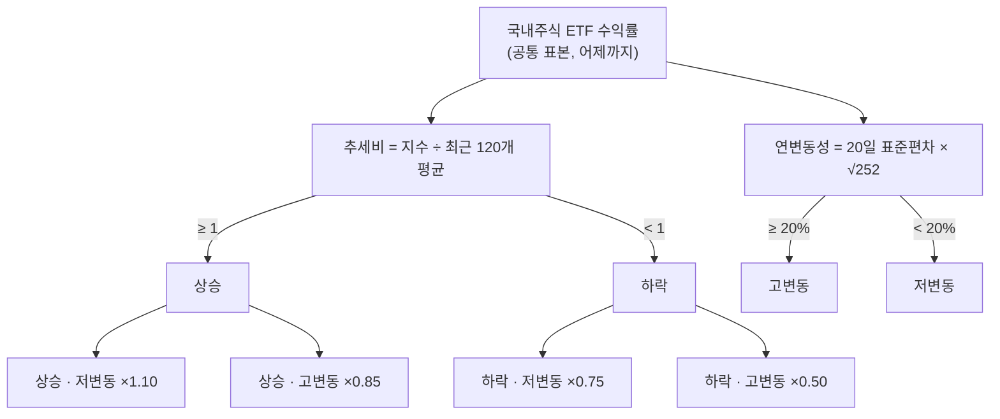

> [!GOAL]
>
> - 시장 국면을 「추세 × 변동성」 두 축으로 나누는 규칙을 직접 계산할 수 있습니다.
> - 국면 판정이 왜 「그날까지의 데이터」만 써야 하는지 반례로 설명할 수 있습니다.
> - Qurious 의 국면 배분이 연구가 검증한 정책이 아니라 **프로젝트의 명시적 규칙**임을 말할 수 있습니다.

> [!NOTE]
> 교육용 설명이며 투자 권유가 아닙니다. 이 장의 수익률 · 비중은 모두 **합성 데이터**이고, 학술 논문은 초록 페이지나 원문 PDF 의 해당 문장까지만 확인했습니다(2026-11-04, 아래 「더 읽을거리」). 국면별 배수 · 경계는 이 앱이 정한 값이며 어떤 논문이 정해 준 값도 아닙니다.

[리밸런싱 방법](#/p/rebalancing-methods)은 목표 비중으로 **어떻게 되돌릴지**를 다뤘습니다. 이 장은 그 목표 비중 자체를 **시장 상황에 따라 바꿀 때** 무엇을 조심해야 하는지를 봅니다.

## 시장이 바뀌면 포트폴리오도 바뀌어야 할까요?

정적 배분은 시장이 어떻든 정한 비중을 유지합니다. 동적 배분은 시장 상태를 보고 비중을 조절합니다. 학계에서는 국면전환 모형으로 이 문제를 푼 연구가 있습니다. Ang 과 Bekaert 의 논문(Review of Financial Studies 15(4), 2002)은 국면이 있는 시장에서 동적 포트폴리오를 어떻게 고를지 풀었고, 변동성이 큰 약세장에서 시장 간 상관이 오르는 현상을 모형에 넣었습니다. 초록에 따르면 결론은 국제 분산이 국면이 있어도 유효하며, **국면을 무시하는 비용은 주식만 담을 때는 작고 무위험자산을 함께 담을 때 커진다**는 것입니다.

한 가지 조심할 점이 있습니다. 이런 연구는 「동적 배분이 수익을 늘린다」 는 보장이 아닙니다. 비용의 크기가 조건에 따라 다르다는 결론이고, 변동성이 높을 때 위험 노출을 줄이는 방식이 샤프 비율을 높였다는 Moreira 와 Muir 의 연구(Journal of Finance 72(4), 2017)도 **과거 표본**의 결과입니다.

## 국면은 어떻게 나누나요?

크게 두 갈래가 있습니다.

| 방식 | 설명 | 특징 |
|---|---|---|
| 임계값 규칙 | 추세나 변동성이 기준을 넘는지로 가름 | 단순하고 설명하기 쉬움. 기준은 사람이 정함 |
| 국면전환 모형 | 국면이 확률적으로 바뀐다고 보고 확률을 추정(Hamilton 1989 의 마르코프 연쇄가 출발점으로 인용됨) | 확률을 주지만 모형이 복잡함 |

Hamilton 의 논문은 초록과 통계 라이브러리 문서의 소개로만 확인했고 본문은 열지 못했습니다. 이 장은 임계값 규칙만 계산해 보고, 국면전환 모형은 이름만 다룹니다.

추세 쪽에는 널리 알려진 단일 규칙도 있습니다. Faber(2007)는 월말 종가가 10개월 단순이동평균보다 위면 보유하고 아래면 현금으로 가는 규칙을 제시했다고 소개됩니다. 다만 이 규칙의 성과 서술이 논문 판마다 다르게 인용되어(이동평균 아래 구간의 수익이 「얼마나 낮다」 는 숫자가 갈림) 이 장에서는 **숫자를 쓰지 않습니다.**

## 우리 앱은 네 국면을 어떻게 판정하나요?

Qurious 는 국내주식 대용 ETF(KODEX 200)의 수익률로 두 가지를 잽니다.

- **추세비** = 누적 지수의 마지막 값 ÷ 최근 120개 값의 평균. 1 이상이면 상승, 미만이면 하락.
- **연변동성** = 최근 20일 수익률의 표준편차(표본, ddof=1) × √252. 20% 이상이면 고변동, 미만이면 저변동.

두 조건을 곱해 네 국면이 나오고 국면마다 **주식 비중 배수**가 정해져 있습니다.



*그림 1. 네 국면 판정(Qurious 앱의 규칙). 120일 · 20% · 배수는 프로젝트가 정한 값입니다.*

국면 판정에는 네 자산군(국내주식 · 해외주식 · 국내채권 · 대체자산)의 **공통 표본**을 씁니다. 결측 날짜를 걸러 낸 뒤의 수익률이고, 국면은 최소 120개가 있어야 판정합니다. 기준일은 **어제**(KST)까지로 잘라 오늘 진행 중인 봉을 넣지 않습니다.

## 국면이 정해지면 비중은 어디서 어디로 가나요?

주식(국내 + 해외) 비중을 배수만큼 바꾸고 그만큼을 다른 자산에서 가져오거나 보냅니다.

- 주식을 **늘릴 때**는 국내채권과 현금에서 각 비중에 **비례해** 가져옵니다.
- 주식을 **줄일 때**는 줄어든 몫을 국내채권 70% · 현금 30% 로 보냅니다. 대체자산은 손대지 않습니다.

이 70/30 도 프로젝트가 정한 값입니다. 합성 기준 비중으로 손으로 풀어 보면 이렇습니다.


*그림 2. 합성 기준 비중(국내주식 30 · 해외주식 30 · 국내채권 25 · 대체자산 10 · 현금 5)에서 국면 배수를 적용한 결과. 합성 예시이며 실제 계좌가 아닙니다. 만든 스크립트는 `tools/learn_figs/regime-dynamic-allocation.py`.*

## 미래를 훔쳐보지 않으려면?

국면은 지나고 나서 보면 뚜렷해 보입니다. 하지만 **그날의 판정에 그날 이후의 데이터가 섞이면** 백테스트가 부풀려집니다. 국면전환 모형에서는 두 확률을 구별합니다. 필터링 확률은 그 시점까지의 데이터만 쓰고, 평활 확률은 표본 전체를 씁니다(statsmodels 문서의 설명). 평활 확률로 과거를 분류하면 오늘 쓸 수 없는 정보가 들어갑니다.

임계값 규칙에서는 **그날까지의 데이터만** 쓰도록 자르는 것이 방법입니다. 아래 예제 ②는 200일 뒤의 값을 전부 5% 로 바꿔도 200일째까지의 판정이 같은지를 봅니다.

## 직접 해 보기

예제 [`regime_allocation.py`](/learn/examples/regime_allocation.py)는 numpy 만으로 판정과 자금 이동을 계산합니다(합성 수익률 · 시드 7). 핵심만 줄이면 이렇습니다.

```python
index = np.cumprod(1 + r)
ratio = float(index[-1] / index[-120:].mean())            # 추세비
vol = float(r[-20:].std(ddof=1) * np.sqrt(252))            # 연변동성
key = ("up" if ratio >= 1 else "down") + "_" + ("high" if vol >= 0.20 else "low")
```

다음은 2026-11-04 에 `python -X utf8 -I regime_allocation.py` 로 돌린 결과입니다(Python 3.13.14).

```output
① 시간이 흘러 국면이 바뀐다 (합성 수익률)
   200일째까지: {'key': 'up_low', 'trend_ratio': 1.0124, 'vol_pct': 8.3, 'mult': 1.1}
   240일째까지: {'key': 'down_high', 'trend_ratio': 0.7879, 'vol_pct': 31.7, 'mult': 0.5}
② 200일 뒤 값을 5% 로 바꿔도 200일째 판정이 같은가: True
③ 자금 이동 (합성 기준 비중, %)
   기준      : {'국내주식': 30, '해외주식': 30, '국내채권': 25, '대체자산': 10, '현금': 5}
   ×0.5(하락·고변동): {'국내주식': 15.0, '해외주식': 15.0, '국내채권': 46.0, '대체자산': 10.0, '현금': 14.0}
   ×1.1(상승·저변동): {'국내주식': 33.0, '해외주식': 33.0, '국내채권': 20.0, '대체자산': 10.0, '현금': 4.0}
```

①은 **시간이 흘러 국면이 바뀐 것**이지 미래 참조가 아닙니다. 200일째에는 상승 · 저변동(배수 1.1)이었다가 240일째에는 하락 · 고변동(배수 0.5)이 됐습니다. ②가 「미래 참조가 없다」 의 증거입니다. 둘을 섞어서 읽지 마세요. 만약 전 구간 표본으로 임계값을 정했다면 ②는 `False` 가 되어 과거 판정이 바뀝니다.

## 이 규칙이 말하지 않는 것

**Qurious 는 이렇게 합니다.** 국면을 계산해 목표 비중으로 **저장**하고, 사용자가 그 결과를 가져와 저장하면 리밸런싱 목표가 됩니다. 사용자가 **국면 자동 갱신을 명시적으로 켠** 플랜은 그 뒤 준비된 일봉에서 국면이 바뀔 때 목표와 변경 이력이 갱신됩니다. 켜지 않은 플랜의 목표는 저절로 바뀌지 않습니다. 목표를 갱신하는 것과 주문을 내는 것은 **다른 일**입니다. 그리고 아래는 이 규칙이 **하지 않는 것**입니다.

- **연구가 검증한 정책이 아닙니다.** 120일 · 20% · 1.1 / 0.85 / 0.75 / 0.5 · 70/30 은 모두 프로젝트가 정한 값이고, 설계 문서도 외부에서 검증된 최적 정책이라고 주장하지 않는다고 밝힙니다. 이 경계가 한국 시장의 실제 분포에서 어디쯤인지는 통계로 확인하지 않았습니다.
- **국면이 바뀐다고 주문이 곧바로 나가지는 않습니다.** 자동 갱신을 켠 플랜에서도 바뀌는 것은 목표 비중과 변경 이력입니다. 앱 모의투자(PAPER) 장부의 주문 예약 · 정산은 리밸런싱 실행 설정을 따릅니다. 리밸런싱 조건과 주문 수량이 충족될 때 자동 예약이 꺼져 있으면 제안이, 켜져 있으면 예약이 만들어지고, 그 단계에서는 바로 체결하지 않습니다(조건이 없으면 제안도 생기지 않을 수 있습니다). 증권사(KIS) 주문은 별도 자동매매 경로이며 국면 목표 변경으로 직접 전송되지 않습니다. 자동 갱신을 켜지 않은 플랜은 목표도 저절로 바뀌지 않습니다.
- **국면전환 확률 모형이 아닙니다.** 확률을 추정하지 않고 임계값 두 개의 곱입니다.
- **국내주식 하나로 판정합니다.** 해외주식이나 채권의 국면은 보지 않습니다.
- **대용 ETF 종가를 씁니다.** 지수가 아니라 ETF 종가이고, 배당과 기업행동은 조정하지 않습니다.
- **다른 모델과 결과 비중의 제약이 일부 다릅니다.** 기준 비중을 넣을 때는 모든 모델이 합계 100% · 0.1% 단위 · 음수 없음 · 현금 제외 자산군 1~95% 검사를 받고, 결과도 음수 없이 합계 100% 입니다. 다른 세 모델은 계산 결과에도 자산군별 1~95% 상·하한을 걸지만, 국면 모델은 국면별 조정을 한 **뒤의 결과**에 이 상·하한을 적용하지 않습니다.

## 흔한 실수

1. **「국면은 지나고 보면 뚜렷하다」.** 전 구간으로 칠하면 미래가 섞입니다.
2. **「이동평균 아래는 반드시 하락」.** 이동평균 규칙은 늦고 자주 뒤집힐 수 있으며 거래비용을 따로 따져야 합니다.
3. **「국면별 배수는 연구가 정해 준 값」.** 프로젝트의 명시적 규칙입니다.
4. **「동적 배분이면 수익이 늘어난다」.** 연구도 과거 표본의 결과이며 보장하지 않습니다.
5. **「국면이 바뀌면 계좌가 알아서 바뀐다」.** 자동 갱신을 명시적으로 켠 플랜에서만 목표 비중이 바뀌고, 그때도 바뀌는 것은 목표입니다. 앱 모의투자 장부의 주문은 별도 설정에 따르고, 증권사 주문으로 직접 전송되지 않습니다.
6. **「국내주식이 전 세계 국면을 대표한다」.** 이 규칙은 그렇게 보지만 한계입니다.

## 정리

1. 국면은 추세 × 변동성 임계값으로 나눌 수 있고, 국면마다 주식 비중 배수를 둡니다.
2. 판정은 **그날까지(어제까지)의 데이터만** 써야 합니다. 이를 확인하는 방법은 미래 값을 바꿔도 과거 판정이 같은지 보는 것입니다.
3. 주식을 줄이면 채권 70% · 현금 30% 로 옮깁니다. 이 값은 프로젝트가 정했습니다.
4. 이 규칙은 연구가 검증한 정책이 아니며, 국면 변화에 따른 목표 갱신은 사용자가 자동 갱신을 켠 플랜에만 적용됩니다(주문은 별도).

<details>
<summary>확인 문제 1 — 추세비 0.97 · 연변동성 25% 이면 어느 국면이고 배수는?</summary>

추세비가 1 미만이라 하락, 연변동성이 20% 이상이라 고변동입니다. 하락 · 고변동이고 배수는 ×0.5 입니다.
</details>

<details>
<summary>확인 문제 2 — 국면 판정을 전 구간 표본으로 하면 무엇이 문제인가요?</summary>

과거 날짜의 판정이 미래 데이터에 의존해 백테스트가 부풀려집니다(미래 참조).
</details>

<details>
<summary>확인 문제 3 — 국면 모델이 주식 비중을 줄일 때 늘어나는 자산은?</summary>

국내채권이 줄어든 몫의 70%, 현금이 30% 를 받습니다. 대체자산은 그대로입니다(예제 ③).
</details>

<details>
<summary>확인 문제 4 — 「국면 배수 0.5 는 논문이 검증한 값」 은 맞나요?</summary>

아닙니다. 프로젝트의 명시적 규칙이고 외부에서 검증된 최적 정책이라고 주장하지 않습니다.
</details>

<details>
<summary>확인 문제 5 — 국면이 바뀌면 사용자의 리밸런싱 목표가 자동으로 바뀌나요?</summary>

사용자가 국면 자동 갱신을 명시적으로 켠 플랜에서는 바뀝니다. 준비된 일봉에서 국면이 바뀌면 목표와 변경 이력이 갱신됩니다. 켜지 않았다면 계산 결과를 가져와 직접 저장해야 반영됩니다. 어느 쪽이든 목표를 갱신하는 것과 주문을 내는 것은 구분합니다.
</details>

## 더 읽을거리

아래 자료는 2026-11-03 조사에서 열람한 것이며, 이 장을 쓰면서 다시 열지는 않았습니다. **2026-11-04 에 초록과 Faber 원문 PDF 의 규칙 문장을 직접 대조했습니다. 식이나 표 수치를 쓰려면 원문을 직접 여세요.**

- Ang, A. · Bekaert, G., 「International Asset Allocation with Regime Shifts」, Review of Financial Studies 15(4), 1137–1187 (2002) — <https://econpapers.repec.org/RePEc:oup:rfinst:v:15:y:2002:i:4:p:1137-1187> · 2026-11-04 초록 원문 확인(상관이 오르는 약세장 · 국제 분산의 가치 · 국면을 무시하는 비용).
- Moreira, A. · Muir, T., 「Volatility-Managed Portfolios」, Journal of Finance 72(4), 1611–1644 (2017) — NBER Working Paper w22208. 2026-11-04 NBER 초록 페이지에서 확인(변동성이 높을 때 위험을 줄인 관리형 포트폴리오의 알파 · 샤프 비율).
- Faber, M., 「A Quantitative Approach to Tactical Asset Allocation」, Journal of Wealth Management 9(4), 69–79 (2007) — SSRN 962461. 2026-11-04 원문 PDF 에서 「월 가격 > 10개월 단순이동평균이면 매수, 아니면 현금」 규칙과 월말 갱신 문장을 직접 확인(성과 수치는 쓰지 않음).
- Hamilton, J., Econometrica 57(2) (1989) — 초록(성장률의 불연속한 국면 전환)과 statsmodels 문서의 소개(마르코프 전환 모형을 도입한 선구적 논문)로 확인했고 본문은 열지 못했습니다.
- statsmodels 문서, Markov switching autoregression — 필터링 확률과 평활 확률의 구별.
- 이 장의 예제 [`regime_allocation.py`](/learn/examples/regime_allocation.py) · 리밸런싱은 [11.2](#/p/rebalancing-methods) · 리스크 패리티는 [11.6](#/p/risk-parity-min-variance).

> [!NOTE]
> 확인하지 못해 단정하지 않은 것: ① 위 논문들의 식과 표 수치 ② Kritzman 등(2012)의 국면 전환 논문은 검색하지 않음 ③ 120일 · 20% 경계가 한국 시장의 실제 분포에서 갖는 위치 ④ Moreira–Muir 에 대한 후속 반론의 내용 ⑤ 지금 앱이 내는 국면 값(서버를 돌려 확인하지 않음).

**용어**

| 말 | 뜻 |
|---|---|
| 시장 국면 | 추세 · 변동성 등으로 나눈 시장의 상태 |
| 동적 자산배분 | 시장 상태에 따라 목표 비중을 바꾸는 방식 |
| 추세비 | 지수 ÷ 최근 일정 기간 평균. 1 이상이면 상승 추세로 봄 |
| 연변동성 | 일간 수익률의 표준편차를 1년 길이로 환산한 값 |
| 국면전환 모형 | 시장이 몇 개 국면 사이를 확률적으로 오간다고 보는 모형 |
| 필터링 · 평활 확률 | 그 시점까지만 쓴 추정 · 표본 전체를 쓴 추정 |
| 미래 참조 | 그날 알 수 없던 정보를 써서 성과가 부풀려지는 오류 |
