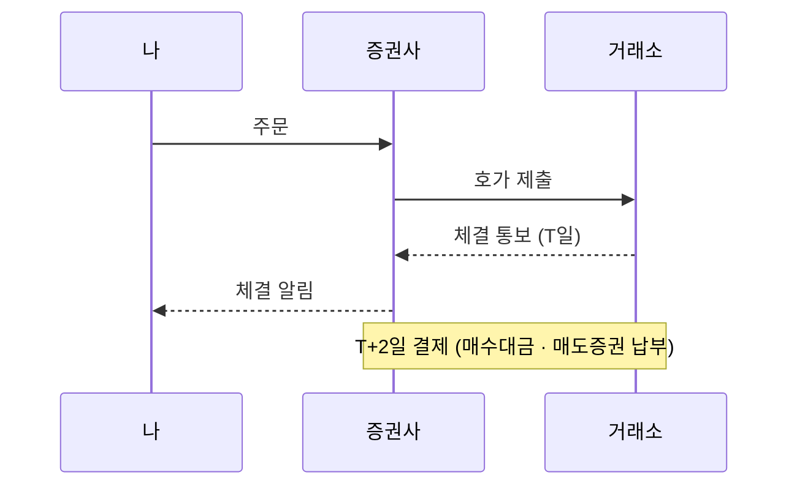

> [!GOAL]
>
> - 정규장 · 시간외 · 애프터마켓의 시간과 체결 방식을 표 한 장으로 말할 수 있습니다.
> - 호가단위와 가격제한폭으로 하루 상한가 · 하한가를 직접 계산할 수 있습니다.
> - 체결일과 결제일(T+2)의 차이를 날짜로 계산하고, 배당 · 세금에 왜 걸리는지 짚을 수 있습니다.

## 평일 오후 4시 반에도 주문을 낼 수 있나요?

한국 주식의 정규장은 평일 09:00~15:30 입니다(2026-11-03 기준). 그런데 규정상 거래 시간은 이 앞뒤로 더 있습니다. 한국거래소(KRX)는 장이 열리기 전 08:30~08:40 에 전일 종가로 체결하는 시간외종가 매매를 받고, 장이 끝난 뒤 15:40~16:00 에는 당일 종가로 체결하는 시간외종가 매매를 받습니다. 대체거래소 넥스트레이드(NXT)는 08:00 부터 문을 엽니다.

> [!NOTE]
> 이 장의 숫자는 2026-11-03 에 한국거래소 규정과 NXT 홈페이지를 직접 열어 확인한 값입니다. 거래 규칙은 바뀔 수 있으니 거래 전에 공식 안내를 확인하세요. 신문 보도로만 확인해 공식 공지를 보지 못한 내용에는 **(보도 기준)** 을, 열람한 범위 밖이라 단정하지 않는 내용에는 **(확인 필요)** 를 붙였습니다. 이 장은 교육용 설명이며 투자 권유가 아닙니다.

**표 1. 평일 하루의 거래 시간 (2026-11-03 기준)**

| 시간 | 어디서 | 무엇 | 방식 · 비고 |
|---|---|---|---|
| 08:00~08:50 | NXT | 프리마켓 | 홈페이지 표기 시간 |
| 08:30~08:40 | KRX | 장 시작 전 시간외종가 | 전일 종가로 체결 |
| 08:30~09:00 | KRX | 시가 동시호가 | 주문을 모아 시가를 정함 |
| 09:00~15:20 | KRX | 정규장 접속매매 | 가격 우선 · 시간 우선 |
| 09:00:30~15:20 | NXT | 메인마켓 | 홈페이지 표기 시간 |
| 15:20~15:30 | KRX | 종가 단일가 | 주문을 모아 종가를 정함 |
| 15:40~16:00 | KRX | 장 종료 후 시간외종가 | 당일 종가로 체결(호가 접수는 15:30부터) |
| 15:40~20:00 | NXT | 애프터마켓 | 홈페이지 표기 시간 |
| 16:00~20:00 | KRX | 애프터마켓 **(보도 기준 · 2026-09-14 시작)** | 접속매매 · 지정가 · 최우선 · 최유리 호가만 |

<figure>

<figcaption>그림 1. 하루 안의 거래 시간. KRX 규정 거래시간표와 NXT 홈페이지 표기(2026-11-03 열람)로 그렸습니다. 애프터마켓의 시작일은 보도 기준입니다.</figcaption>
</figure>

KRX 의 애프터마켓 16:00~20:00 은 열람한 규정의 특례 시간표에 있고, 이 시간에는 당일 기준가의 ±30% 안에서 지정가 · 최우선지정가 · 최유리지정가 호가만 낼 수 있습니다. 시장가 · 중간가 · 스톱지정가는 낼 수 없습니다. 대상은 주권 · 외국주권 · 주식예탁증권 · 리츠 등이고 열람한 대상 목록에는 ETF · ETN 이 없습니다. 거래정지 · 투자경고 · 투자위험 · 관리종목 등은 제외됩니다. 시작일이 2026-09-14 이고 기존 시간외 단일가(16:00~18:00)가 이때 없어졌다는 내용은 증권사 공지와 여러 보도가 같게 전하지만 **(다수 보도 기준 · 공식 공지 확인 필요)**, 거래소 공지 원문은 열지 못했습니다. 열람한 거래시간표에는 시간외 단일가가 없습니다. 옛 교재와 블로그에는 16:00~18:00 단일가가 그대로 적혀 있을 수 있으니 글의 날짜를 확인하세요. KRX 프리마켓 도입이 2027년 말로 미뤄졌다는 보도도 있지만 **(보도 기준)** 확정으로 읽지 않습니다.

## 코스피 · 코스닥 · 코넥스는 무엇이 다른가요?

법령은 주식시장을 유가증권시장(보통 코스피라 부릅니다) · 코스닥 · 코넥스로 나눕니다. 증권거래세법 시행령 제5조도 이 세 시장을 따로 적어 세율을 다르게 정합니다(2026-01-02 시행 판). 거래 방식은 같지만 하루 가격제한폭과 세금이 다릅니다.

**표 2. 시장 세 곳의 하루 가격제한폭 (2026-11-03 기준)**

| 시장 | 기준가격 대비 하루 제한폭 |
|---|---|
| 유가증권시장(코스피) | 상하 30% |
| 코스닥 | 상하 30% |
| 코넥스 | 상하 15% |

30% 는 2015-06-15 부터이고 그 전에는 정액제에서 6%(1995-04-01) → 8%(1996-11-24) → 12%(1998-03-02) → 15%(1998-12-07) 로 넓어져 왔습니다. 정리매매 종목 · ELW · 신주인수권증서와 증권에는 제한이 없고, 레버리지 ETF 는 배율만큼 넓어집니다. 세 시장의 세금 차이는 [F.3 매매 비용과 증권거래세](#/p/trading-costs-tax)에서 다룹니다.

## 내 주문은 어떻게 체결되나요?

호가는 「이 가격에 사겠습니다 · 팔겠습니다」 라고 내는 주문 가격입니다. 가격을 적어 내는 주문이 지정가, 가격을 적지 않고 지금 나와 있는 가장 좋은 가격에 바로 체결해 달라는 주문이 시장가입니다. 정규장의 접속매매는 가격 우선 · 시간 우선으로 체결합니다. 사려는 주문은 높은 가격부터, 팔려는 주문은 낮은 가격부터 짝을 짓고, 가격이 같으면 먼저 낸 주문이 앞섭니다.

**표 3. 체결 예 (예로 정한 값)** 매도 주문 세 건이 쌓여 있을 때 「10,100원에 200주 사기」 를 지정가로 냅니다. 이 예에서는 먼저 쌓인 매도 주문의 가격으로 체결된다고 단순하게 봅니다.

| 매도 주문 | 낸 시각 | 가격 | 수량 | 내 주문 200주와의 체결 |
|---|---|---:|---:|---|
| A | 09:00:01 | 10,050 | 100 | 100주 체결 (가격이 가장 낮고 먼저) |
| B | 09:00:05 | 10,050 | 150 | 100주 체결 (같은 가격이면 나중, 50주 남음) |
| C | 09:00:02 | 10,100 | 300 | 체결 없음 (이미 200주가 채워짐) |

주문 가격은 호가단위의 배수여야 합니다. 주권의 호가단위는 가격대마다 다릅니다(2026-11-03 기준). 매매수량단위는 주권 1주(2014-06-02 개정) · ETF 1주 · ELW 10증권이고, ETF · ETN 의 호가단위는 2천 원 미만 1원, 2천 원 이상 5원입니다.

**표 4. 주권의 호가단위와 호가단위 ÷ 가격**

| 가격대 | 호가단위 | 구간 안 호가단위 ÷ 가격 |
|---|---:|---|
| 2천 원 미만 | 1원 | 1,999원에서 0.050%, 가격이 낮을수록 커짐 |
| 2천 원 이상 5천 원 미만 | 5원 | 0.100%~0.250% |
| 5천 원 이상 2만 원 미만 | 10원 | 0.050%~0.200% |
| 2만 원 이상 5만 원 미만 | 50원 | 0.100%~0.250% |
| 5만 원 이상 20만 원 미만 | 100원 | 0.050%~0.200% |
| 20만 원 이상 50만 원 미만 | 500원 | 0.100%~0.250% |
| 50만 원 이상 | 1,000원 | 0.200% 이하 |

세 번째 열은 규정 표의 값으로 직접 계산한 것입니다. 가격이 구간 경계를 넘으면 한 칸의 상대 크기가 갑자기 커집니다. 1,999원에서 1원이던 호가단위가 2,000원에서는 5원이 되어, 한 칸이 가격의 0.050% 에서 0.250% 로 뜁니다. 한 칸이 클수록 사려는 가격과 팔려는 가격 사이가 벌어지기 쉽고, 그만큼 즉시 사고팔 때 부담이 커질 수 있습니다.

```output
② 호가단위 ÷ 가격: 구간 경계 바로 아래와 위
     1,999원  단위     1원  0.050%
     2,000원  단위     5원  0.250%
     4,995원  단위     5원  0.100%
     5,000원  단위    10원  0.200%
    19,990원  단위    10원  0.050%
    20,000원  단위    50원  0.250%
    49,950원  단위    50원  0.100%
    50,000원  단위   100원  0.200%
   199,900원  단위   100원  0.050%
   200,000원  단위   500원  0.250%
   499,500원  단위   500원  0.100%
   500,000원  단위 1,000원  0.200%
```

<figure>

<figcaption>그림 2. 호가단위 ÷ 가격. KRX 호가가격단위 표(2026-11-03 열람)로 계산한 값이며 실제 시세가 아닙니다.</figcaption>
</figure>

## 하루에 얼마나 움직일 수 있나요?

가격제한폭은 하루 동안 움직일 수 있는 범위입니다. 기준이 되는 가격은 원칙적으로 직전 거래일의 종가이고, 권리락이나 액면 변경이 있는 종목은 별도 기준가를 씁니다. 한도는 기준가 × 0.3 에서 기준가가 속한 가격대의 호가단위 미만을 잘라 냅니다. 코스닥 규정의 예로 기준가 9,940원이면 한도 9,940 × 0.3 = 2,982원을 10원 단위로 잘라 2,980원이고, 상한가는 12,920원, 하한가는 6,960원입니다. 상한가를 기준가 × 1.3 으로 계산하면 12,922원이 되어 호가단위에 맞지 않습니다. 예제 [`trading_basics.py`](/learn/examples/trading_basics.py) 로 직접 계산해 봅니다.

```python
def price_limit(base: int, pct: int = 30) -> tuple[int, int, int]:
    tick = tick_size(base)
    limit = base * pct // 100 // tick * tick          # 정수 계산 · 호가단위 미만을 자른다
    return limit, base + limit, base - limit
```

```output
① 상한가 · 하한가: 코스닥 규정의 예(기준가 9,940원, 호가단위 10원)
  한도 9,940 × 30% = 2,982 → 호가단위 10원 미만 자름 → 2,980
  상한가 12,920  하한가 6,960
  코넥스(±15%)로 계산하면 1,490 / 11,430 / 8,450
③ 구간 경계에 걸친 기준가 19,990원
  한도 5,990  상한가 후보 25,980 (호가단위에 맞나: False)  하한가 후보 14,000 (True)
  → 이런 기준가는 규정에서 상 · 하한가의 절사 방식을 따로 확인해야 한다
```

위 출력의 ③ 처럼 기준가가 호가단위 구간 경계 가까이에 있으면 이 단순한 계산이 호가단위에 맞지 않는 값을 냅니다. 규정은 상한가와 하한가도 호가단위 미만을 자른다고 쓰고 있지만, 어느 가격대의 단위를 쓰는지는 열람한 부분에서 확인하지 못했습니다 **(확인 필요)**. 그래서 이 예제는 규정의 예와 같은 경우만 보증합니다.

시장 전체에 급락이 오면 거래를 멈추는 장치도 있습니다. 유가증권시장 규정의 서킷브레이커는 코스피 지수가 전일 종가보다 8% · 15% · 20% 이상 내리고 1분 동안 이어지면 단계별로 작동합니다. 1단계와 2단계는 거래를 20분 멈추고, 3단계가 되면 그날 거래를 끝냅니다. 각 단계는 하루 한 번만 작동하고, 장 종료 40분 전 이후에는 1 · 2단계가 작동하지 않습니다. 정규장 중에만 작동하며 애프터마켓에서는 작동하지 않는다고 규정에 적혀 있습니다(2026-11-03 기준). 종목별 변동성완화장치와 사이드카는 이 장에서 다루지 않습니다.

## 체결과 결제는 왜 날짜가 다른가요?

체결은 주문이 짝을 찾은 순간이고, 결제는 대금과 주식이 실제로 오가는 일입니다. 보통거래는 체결일(T)부터 3일째(T+2)에 매수한 사람이 대금을, 매도한 사람이 주식을 내고 증권사가 거래소와 결제합니다(2026-11-03 기준). 3일째라는 말은 거래일로 센다는 뜻입니다. 토요일 · 일요일 · 공휴일 · 근로자의 날 · 12월 31일(공휴일이나 토요일이면 직전 거래일)처럼 거래소가 쉬는 날은 세지 않습니다.



연말을 예로 계산합니다. 2025-12-25 는 성탄절, 2025-12-31 은 연말 휴장, 2026-01-01 은 신정입니다(예제의 휴장일은 손으로 넣은 가정입니다).

```output
④ 체결일 → 결제일(T+2): 연말 휴장 · 신정을 건너뛴다
  체결 2025-12-24(수) → 결제 2025-12-29(월)
  체결 2025-12-26(금) → 결제 2025-12-30(화)
  체결 2025-12-29(월) → 결제 2026-01-02(금)
  체결 2025-12-30(화) → 결제 2026-01-05(월)
  T+1 가정(아직 시행 전 · 초안 로드맵)이면 체결 2025-12-29(월) → 결제 2025-12-30(화)
```

2025-12-29(월)에 산 주식은 12-30 이 T+1 이고 12-31 · 1-1 이 쉬어서 2026-01-02(금)에 결제됩니다. 결제일은 배당을 받을 권리가 생기는 날이라([F.2 배당 기준일 · 배당락일 · 지급일](#/p/dividend-dates)) 같은 연말이라도 어느 날 샀는지에 따라 결과가 갈립니다. 증권거래세의 세율을 고르는 양도 시기도 결제되는 때입니다(증권거래세법 시행령 제2조). 자세한 것은 [F.3](#/p/trading-costs-tax)에서 다룹니다.

2026-11-02 에 한국거래소 · 예탁결제원 · 증권금융 · 금융투자협회가 T+1(체결 다음 날 결제)로 바꾸는 로드맵 초안을 발표했다고 합니다. 2028년 중 전환을 목표로 하고 일정표상 2028년 하반기 이후일 수 있다는 내용입니다(한국경제 2026-11-02 보도 **(보도 기준)**). 확정된 것이 아니므로 지금은 T+2 입니다.

## 대체거래소(NXT)가 생기면 무엇이 달라지나요?

넥스트레이드(NXT)는 2025-03-04 에 출범한 우리나라 최초의 대체거래소(ATS)입니다. 금융위원회 보도자료에 따르면 한국거래소와 통합해 관리하고, 가격 변동폭은 KRX 전일 종가 기준 ±30%, 청산 · 결제는 T+2 입니다. 가격이 따로 노는 별개 시장이 아니라 같은 기준가와 같은 결제 주기를 쓰는 또 하나의 거래 장소입니다.

거래 시간은 NXT 홈페이지가 2026-11-03 에 표기한 프리마켓 08:00~08:50 · 메인마켓 09:00:30~15:20 · 애프터마켓 15:40~20:00 입니다(출범 때 2025-02 보도자료에는 애프터마켓이 15:30 시작이었습니다). 메인마켓이 끝나는 15:20 과 애프터마켓이 시작하는 15:40 사이의 운영 방식은 홈페이지 표기만으로는 확인하지 못했습니다 **(확인 필요)**. 거래소가 둘이라 증권사 주문에는 거래소를 고르는 칸이 있고 KRX · NXT · SOR(증권사가 거래소를 골라 보내는 방식) 가운데 하나를 정합니다. 수수료도 거래소별로 다를 수 있어 증권사 안내를 확인해야 합니다.

## Qurious 는 어디까지를 다루나요?

Qurious 는 정규장을 기준으로 삼습니다. 앱의 코드가 가정하는 것과 위 규정을 견주면 아래와 같습니다.

**표 5. 앱이 가정하는 것과 규정**

| 앱의 동작 | 앱이 가정하는 것 | 규정과 견줌 |
|---|---|---|
| 주문 게이트웨이의 `is_krx_market_open` | 평일 09:00~15:30, 내장 2026 휴장 달력 | 정규장과 같음 |
| 설정 `STOCK_COIN_TRADE_ENFORCE_MARKET_HOURS` | 기본값으로 켜져 있고 이 시간 밖에서는 실주문을 보내지 않음 | 정규장 밖에도 거래 시간이 있지만 앱은 쓰지 않음 |
| 현재가 화면의 `market_state` | 요일과 09:00~15:30 만 보고 열림 · 닫힘을 정함, 공휴일은 보지 않음(코드 주석) | 애프터마켓 시간에는 「닫힘」 으로 나옴 |
| 증권사 모의 주문 어댑터 | 거래소를 KRX 로 고정해 보냄 | 주문 결과 기록에는 KRX · NXT · SOR 구분 칸이 있으나 주문은 KRX 로만 보냄 |
| 수집기의 시장 정의 | 정규장 09:00~15:30, 배당락은 기준일 한 거래일 전(T+2 전제) | 결제 주기가 바뀌면 이 칸만 고침 |

백테스트와 모의투자가 체결 가격을 어떻게 잡는지는 기능마다 다릅니다. 모의투자 그림자 일지는 다음 거래일 시가로 가상 체결하고, 투자 연구의 백테스트는 오늘 신호를 다음 날 수익률에 적용하며 체결 시점을 종가(기본) 또는 다음 시가로 고르게 되어 있습니다. 결과를 읽을 때는 그 기능이 어떤 가정을 쓰는지부터 확인하세요([10.1 백테스트의 뼈대](#/p/backtest-basics)).

## 흔한 실수

1. **「주식은 9시~3시 반에만 거래된다」 고 믿기.** KRX 만 해도 08:30 시간외종가 · 정규장 · 15:40 시간외종가가 있고 16:00~20:00 애프터마켓 **(보도 기준)** 이 있으며, NXT 는 08:00 부터입니다.
2. **시간외 단일가가 아직 있다고 믿기.** 열람한 규정 시간표에는 없고 2026-09-14 에 애프터마켓으로 바뀌었다는 보도가 있습니다 **(보도 기준)**.
3. **상한가를 전일 종가 × 1.3 으로 구하기.** 한도(× 0.3)를 호가단위 미만에서 자른 뒤 더합니다. 9,940원이면 12,920원입니다.
4. **체결되면 곧 내 주식(내 현금)이라고 생각하기.** 체결과 결제는 다릅니다. 체결 후 T+2 에 결제되고 배당 권리가 결제일에 걸립니다.
5. **가격제한폭이 모든 종목에 30% 라고 생각하기.** 코넥스는 15%, 정리매매는 제한이 없고, 레버리지 ETF 는 배율만큼 넓습니다.
6. **T+1 이 시작됐다고 생각하기.** 2026-11-02 에 나온 것은 초안 로드맵 **(보도 기준)** 이며 지금은 T+2 입니다.
7. **NXT 는 별개 시장이라 가격이 따로 논다고 생각하기.** 가격제한 기준은 KRX 전일 종가이고 결제 주기도 같습니다.

## 정리

- 정규장은 09:00~15:30 이고 그 앞뒤에 시간외종가 · 애프터마켓 **(보도 기준)** · NXT 시간대가 있습니다. Qurious 는 정규장만 씁니다.
- 주문 가격은 호가단위의 배수이고, 구간 경계에서 호가단위의 상대 크기가 뜁니다.
- 하루 범위는 기준가 ± (기준가 × 비율, 호가단위 미만 절사)입니다. 코스피 · 코스닥 30%, 코넥스 15%.
- 체결일에서 T+2 거래일 뒤가 결제일입니다. T+1 은 아직 초안입니다 **(보도 기준)**.

<details>
<summary>확인 문제 1 - 기준가 9,940원인 코스닥 종목의 상한가는?</summary>

12,920원입니다. 한도 9,940 × 0.3 = 2,982원을 호가단위(이 가격대는 10원) 미만에서 잘라 2,980원이고, 9,940 + 2,980 = 12,920원입니다.
</details>

<details>
<summary>확인 문제 2 - 2025-12-29(월)에 산 주식의 결제일은? (2025-12-31 휴장, 2026-01-01 공휴일)</summary>

2026-01-02(금)입니다. 12-30 이 T+1 이고, 12-31 휴장 · 1-1 신정을 건너뛰어 1-2 가 T+2 입니다.
</details>

<details>
<summary>확인 문제 3 - 정규장이 끝난 16:30 에 KRX 에서 주문을 낼 수 있나요?</summary>

열람한 규정에는 16:00~20:00 애프터마켓이 있어 접속매매로 지정가 · 최우선 · 최유리 주문을 낼 수 있습니다. 시작일(2026-09-14)은 보도 기준입니다. 다만 Qurious 의 주문 게이트웨이는 정규장 밖에서는 실주문을 보내지 않습니다.
</details>

<details>
<summary>확인 문제 4 - 코넥스 종목의 하루 가격제한폭은?</summary>

기준가격 대비 상하 15% 입니다. 유가증권시장과 코스닥은 30% 입니다.
</details>

<details>
<summary>확인 문제 5 - T+1 결제는 언제부터 시행되나요?</summary>

확정되지 않았습니다. 2026-11-02 에 나온 초안 로드맵은 2028년 중 전환을 목표로 한다고 보도됐습니다 **(보도 기준)**. 지금은 T+2 입니다.
</details>

## 더 읽을거리

- 한국거래소 KRX 규정/제도 「매매거래제도일반」 <https://regulation.krx.co.kr/contents/RGL/03/03010100/RGL03010100.jsp> · 거래시간표 · 호가가격단위 · 매매수량단위 · 가격제한폭 · 결제. 2026-11-03 확인.
- 한국거래소 「시간외매매 특례」 <https://regulation.krx.co.kr/contents/RGL/03/03010301/RGL03010301.jsp> · 시간외종가 · 애프터마켓. 2026-11-03 확인.
- 코스닥시장 가격제한폭 <https://regulation.krx.co.kr/contents/RGL/03/03020201/RGL03020201.jsp> · 코넥스시장 가격제한폭 <https://regulation.krx.co.kr/contents/RGL/03/03030207/RGL03030207.jsp>. 2026-11-03 확인.
- 서킷브레이커 <https://regulation.krx.co.kr/contents/RGL/03/03010402/RGL03010402.jsp> · 접속매매 <https://regulation.krx.co.kr/contents/RGL/03/03010203/RGL03010203.jsp>. 2026-11-03 확인.
- 금융위원회 대체거래소 출범 보도자료 <https://www.fsc.go.kr/no010101/83953> · NXT 홈페이지 <https://nextrade.co.kr/main.do>. 2026-11-03 확인.

**용어**

| 말 | 뜻 |
|---|---|
| 호가 · 호가단위 | 사거나 팔려고 내는 가격 · 낼 수 있는 가격의 최소 간격 |
| 지정가 · 시장가 | 가격을 정해 내는 주문 · 가격 없이 지금 가장 좋은 가격에 내는 주문 |
| 접속매매 · 단일가 | 주문이 들어오는 대로 가격 · 시간 우선으로 체결 · 주문을 모아 한 가격으로 체결 |
| 동시호가 | 시가나 종가를 정하기 전에 주문을 모으는 시간 |
| 기준가격 | 하루 가격 범위의 기준(원칙은 직전 거래일 종가) |
| 가격제한폭 · 상한가 · 하한가 | 하루 움직일 수 있는 범위 · 그 위 끝 · 아래 끝 |
| 체결 · 결제 · T+2 | 주문이 짝을 찾음 · 대금과 주식이 오감 · 체결일 포함 3일째 거래일 |
| 시간외종가 | 정규장 밖에 정해진 종가로 체결하는 거래 |
| 애프터마켓 · 대체거래소(NXT) | 장 종료 뒤 접속매매 시간 · KRX 와 따로 운영하는 거래 장소 |
| 서킷브레이커 | 지수가 크게 내리면 거래를 멈추는 장치 |
