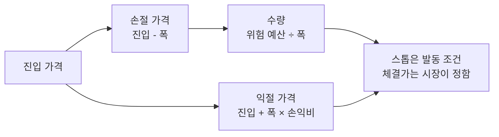

> [!GOAL]
>
> - 손절 · 익절 가격이 체결 가격이 아니라 발동 조건임을 설명하고, 갭이 났을 때 무슨 일이 생기는지 계산할 수 있습니다.
> - 위험 비율(%)로 수량을 거꾸로 구하는 식을 쓰고, 손절 폭이 달라지면 수량이 어떻게 바뀌는지 보일 수 있습니다.
> - 켈리 기준의 직관을 말하고, 실제로는 왜 분수 켈리나 고정 비율을 쓰는지 설명할 수 있습니다.

이 장은 거래를 시작하기 전에 정해 둘 세 가지, 곧 손절 가격 · 익절 가격 · 수량을 다룹니다. 비용을 넣은 손익비와 본전 승률은 [F.11 성과 지표 읽는 법](#/p/reading-performance-metrics), 매매 비용은 [F.3 매매 비용과 증권거래세](#/p/trading-costs-tax)에 있습니다.

> [!NOTE]
> 교육용 설명이며 투자 권유가 아닙니다. 그림과 출력의 난수 실험은 합성 데이터이고, 가격 · 계좌 숫자는 손으로 정한 예입니다. 과거의 성과는 앞날의 수익을 보장하지 않습니다.

## 왜 매수하기 전에 손절 가격부터 정할까요?

주식을 산 뒤에는 「조금만 더 보자」 라는 마음이 생기기 쉽습니다. Odean(1998)은 한 대형 할인 증권사의 계좌 10,000개의 거래 기록을 분석해, 투자자들이 손실 난 종목보다 이익 난 종목을 파는 쪽을 뚜렷하게 선호한다는 것을 보였습니다(논문 초록 기준). 손실 난 투자를 너무 오래 들고 이익 난 투자를 너무 일찍 파는 경향이고, 그 뒤의 수익률로도 정당화되지 않았다고 초록은 적습니다. 이 연구가 손절 규칙이 이긴다는 증거는 아닙니다. 다만 사고 난 뒤의 판단이 흔들리기 쉬우니, 틀렸다고 인정할 가격을 **사기 전에** 숫자로 정해 두자는 근거가 됩니다.

거래 전에 정할 것은 셋이고 서로 이어져 있습니다. 손절 가격에서 수량이 정해지고, 손절 거리에 손익비를 곱하면 익절 가격이 나옵니다.



## 손절 가격에 걸어 두면 그 가격에 팔릴까요?

아닙니다. 미국 SEC 투자자 사이트의 설명에 따르면, 스톱 주문(stop order)은 가격이 스톱 가격에 닿으면 **시장가 주문으로 바뀌는** 주문입니다. 스톱 가격은 체결 가격이 아니라 주문을 깨우는 방아쇠이고, 체결 가격은 그 순간 남아 있는 호가에 따라 스톱 가격에서 크게 벗어날 수 있다고 합니다. 짧은 장중 급락에도 발동해 그날 종가보다 훨씬 나쁜 가격에 체결될 수 있고, 증권사마다 마지막 체결가로 발동을 판단하는지 호가로 판단하는지가 다르다고도 안내합니다.

가격을 지키려고 스톱 리밋(stop-limit) 주문을 쓰면 반대 문제가 생깁니다. 스톱 가격에 닿으면 지정가 주문이 되어 리밋 가격 이상으로만 체결되는데, 시장이 그 가격을 지나쳐 버리면 아예 체결되지 않을 수 있습니다. SEC 의 예는 스톱 3달러 · 리밋 2.5달러입니다.

손으로 정한 갭 예를 봅니다. 50,000원에 50주를 사고 손절가를 48,000원으로 정했는데 다음 날 시가가 45,000원으로 시작하면, 스톱은 발동하고 시장가이므로 45,000원 근처에서 팔립니다. 계획한 손실은 1주 2,000원(총 100,000원)이었지만 실제 손실은 1주 5,000원(총 250,000원)이어서 계획의 2.5배입니다(비용 제외). 손절을 걸어 두었다고 손실이 계획대로 끝나는 것이 아닙니다.

국내에서 손절을 어떻게 거는지는 증권사마다 다릅니다. 증권사가 조건을 감시하다 주문을 내 주는 서비스는 상품마다 감시 시간 · 가격 기준 · 지속 기간이 다르니 해당 증권사의 안내를 확인해야 합니다(이 장은 국내 거래소의 스톱 주문 규정을 확인하지 못했습니다).

## 손절선은 어떻게 정하나요?

가장 단순한 방법은 진입가에서 일정 %를 빼는 고정 % 손절입니다. 문제는 종목마다 하루 흔들림이 다르다는 점입니다. 하루 수익률의 표준편차가 2% 인 난수 가격 경로 10,000개에서, 진입 뒤 20일 안에 종가가 손절 폭에 닿는 비율을 셉니다([`position_sizing.py`](/learn/examples/position_sizing.py)).

```output
① 20일 안에 종가가 손절 폭에 닿을 확률 (합성 데이터 · 평균 0 · 일 표준편차 2% · 경로 10,000개 · 시드 42)
  진입가 대비 -1% 손절   81.4%
  진입가 대비 -2% 손절   73.7%
  진입가 대비 -4% 손절   57.6%
  진입가 대비 -6% 손절   43.2%
  진입가 대비 -8% 손절   30.8%
```


*그림 1. 손절 폭과 터치 확률. 합성 데이터(시드 42)이며 실제 종목의 값이 아닙니다.*

하루 흔들림보다 좁은 손절은 아무 일 없이 평범하게 움직이는 가격에도 대부분 걸립니다. 그래서 종목의 평소 흔들림에 맞춰 폭을 정하는 방법이 쓰이고, 대표가 ATR 손절입니다. ATR(Average True Range, 평균 진폭)은 하루 값폭, 곧 고가와 저가의 차이에 전날 종가와의 간격까지 넣은 진폭(TR)을 14일 동안 평활한 평균입니다(Qurious 는 TradingView 의 ta.atr 과 같은 Wilder 평활을 씁니다). 손절 폭은 ATR 에 배수 k 를 곱해 정하고, 진입할 때 한 번 정해 그대로 둡니다. 배수 2 같은 값은 관행으로 쓰이며 학술적 근거는 이 장에서 찾지 못했습니다.

**표 1. 손절선 정하는 방법**

| 방법 | 손절선 | 좋은 점 | 약한 점 |
|---|---|---|---|
| 고정 % | 진입가 × (1 − 폭%) | 단순하고 설명이 쉬움 | 종목마다 흔들림이 달라 어떤 종목엔 너무 좁음 |
| ATR × k | 진입가 − ATR × k | 종목의 평소 흔들림에 맞춤 | 배수 k 와 ATR 기간은 정해야 하는 값 |
| 추적 | 가격이 오르면 따라 올라가고 내리면 고정 | 이익을 일부 지킴 | 흔들림에 걸려 일찍 나갈 수 있음 |

추적 손절(trailing stop)은 SEC 설명에 따르면 스톱 가격을 시장가에서 일정 금액이나 비율만큼 떨어진 곳에 두고, 유리한 방향으로 움직이면 따라 움직이고 불리한 방향으로는 고정해 두는 방식입니다. 일정 기간 안에 오르지 않으면 정리하는 시간 기준도 있지만 이 장은 소개만 합니다.

## 익절은 어디에 둘까요?

손절 거리에 손익비를 곱한 만큼 위에 둡니다. 손절 폭이 2,000원이고 손익비 1.5 를 목표로 하면 익절 폭은 3,000원이어서, 50,000원에 산 주식의 익절가는 53,000원입니다. 고정 비율로 +1.5% 익절 · −1.0% 손절을 정하는 방식도 같은 손익비 1.5 입니다.

문제는 비용입니다. 이익은 비용만큼 줄고 손실은 비용만큼 커집니다. [F.11](#/p/reading-performance-metrics)의 계산을 그대로 가져오면 같은 익절 · 손절이 이렇게 바뀝니다.

```output
② 익절 +1.5% · 손절 -1.0% 를 비용 뒤 비율로 (코스피 · 2026-11-03 비용 모델 · 슬리피지는 가정)
  슬리피지  0bp  익절 +1.2611%  손절 -1.2330%  손익비 1.0228  본전 승률 49.4359%
  슬리피지 10bp  익절 +1.0586%  손절 -1.4305%  손익비 0.7400  본전 승률 57.4709%
```

비용 전에는 승률 40% 면 본전이던 규칙이, 슬리피지 10bp(편도 0.10%, 가정)를 넣으면 57.5% 를 넘겨야 본전입니다. 승률 45% 라면 기대값은 0.45 × 1.0586 − 0.55 × 1.4305 ≈ −0.31% 입니다. 「미리 정한 규칙」 이라고 해서 기대값이 양수인 것은 아닙니다. 익절만 서둘러 앞당기면 손익비가 내려가는데, 앞에서 본 처분 효과가 이 방향입니다.

## 한 번에 얼마나 살까요?

같은 100만 원어치를 사도 손절 폭이 다르면 잃는 돈이 다릅니다. 그래서 「얼마어치 살까」 가 아니라 「이 거래에서 얼마까지 잃어도 되나」 를 먼저 정하고 수량을 거꾸로 구하는 방법을 씁니다. 이것이 위험 기준 수량(고정 비율 위험)입니다.

- 위험 예산 = 평가 자산 × 위험 %
- 수량 = 위험 예산 ÷ (진입가 − 손절가)

자산 1,000만 원, 위험 1%, 진입 50,000원, 손절 48,000원이면 위험 예산은 100,000원이고 수량은 50주입니다. 손절에 걸리면 약 100,000원, 곧 자산의 1% 를 잃습니다. 비용과 슬리피지를 넣으면 1주를 사서 손절가에 파는 손실이 커지므로 수량이 줄어듭니다.

```output
③ 위험 1% 수량 (자산 10,000,000원 · 진입 50,000원 · 손절 48,000원 · 위험 예산 100,000원)
  비용 없는 식  100,000 ÷ 2,000 = 50주
  슬리피지  0bp  1주 예상 손실 2,113.3원  위험 상한 47주  최종 47주
  슬리피지 10bp  1주 예상 손실 2,211.3원  위험 상한 45주  최종 45주
```

손절 폭을 바꾸면 수량이 반대로 움직입니다. 폭이 두 배가 되면 수량은 절반이 됩니다.

```output
④ 같은 위험(자산의 1%)이라도 손절 폭이 넓을수록 수량이 줄어든다 (진입 50,000원 · 비용 전 · 비중 상한 30%)
  손절 폭 1,000원( 2.0%)  위험 기준 100주  투입 5,000,000원  비중 상한 적용  60주
  손절 폭 2,000원( 4.0%)  위험 기준  50주  투입 2,500,000원  비중 상한 적용  50주
  손절 폭 4,000원( 8.0%)  위험 기준  25주  투입 1,250,000원  비중 상한 적용  25주
  손절 폭 8,000원(16.0%)  위험 기준  12주  투입   600,000원  비중 상한 적용  12주
```


*그림 2. 같은 위험, 다른 수량. 손으로 정한 계좌 숫자이며 비용은 넣지 않았습니다.*

손절 폭이 좁으면 위험 기준 수량이 커져서, 한 종목에 자산의 절반을 넣는 모양이 되기도 합니다. 그래서 Qurious 는 위험 · 현금 · 1회 예산 · 종목 비중(기본 30%) 네 상한을 함께 보고 가장 작은 값을 수량으로 씁니다. 0주가 나오는 것도 정상 결과입니다.

```output
⑤ 손절 폭이 좁아 위험 기준 수량이 커지면 다른 상한이 먼저 막는다 (슬리피지 10bp · 1회 예산 3,000,000원)
  손절 폭 2,000원  상한 [위험 45 현금 199 예산 59 비중 60]  → 45주 (막은 상한: 위험)
  손절 폭   500원  상한 [위험 139 현금 199 예산 59 비중 60]  → 59주 (막은 상한: 예산)
```

위험 1% 는 흔히 쓰이는 값으로 알려져 있지만 학술적이거나 공식적인 근거는 이 장에서 찾지 못했습니다. Qurious 가 정한 기본값이고 설정 범위는 0 초과 5 이하입니다. 위험 기준 수량도 만능은 아니어서, 손절가에 실제로 팔려야만 손실이 위험 예산에 머뭅니다. 갭이 나면 위험 예산을 넘습니다.

## 켈리 기준은 무엇이고 왜 그대로 쓰지 않나요?

켈리 기준(Kelly criterion)은 같은 내기를 되풀이할 때 자본의 몇 %를 걸어야 장기 성장이 가장 빠른가에 답합니다. Kelly(1956)는 가진 돈을 매번 전부 거는 사람은 계속하면 확률 1로 빈털터리가 된다는 점에서 출발해, 매번 일정 비율을 거는 전략의 장기 성장률을 구했습니다. Thorp(2006)가 정리한 최적 비율은 이길 확률 p, 걸린 돈에 대한 순이익 배수 b, 질 확률 q = 1 − p 일 때 다음과 같습니다.

- f\* = (b × p − q) ÷ b
- 이기면 건 돈만큼 더 받고 지면 건 돈을 잃는 동액 베팅(b = 1)이면 f\* = p − q

이길 확률이 0.53 인 동전이면 f\* = 0.06 이어서 자본의 6% 를 겁니다. 성장률 곡선은 f\* 에서 가장 높고, f\* 의 두 배를 걸면 성장이 거의 0 으로 떨어집니다. 같은 동전 던지기를 세 비율에 모두 적용해 1,000번 걸어 보면 다음과 같습니다.

```output
⑥ 켈리 (이길 확률 0.53 · 동액 베팅)  f* = 0.06
  이론 평균 로그 성장률 g(f)  0.5배 +0.00135  1배 +0.00180  2배 -0.00002
  절반 켈리 ÷ 풀 켈리 = 0.75
  동전 1,000번 × 2,000번 반복 (합성 데이터 · 시드 42, 같은 던지기를 세 비율에 모두 씀)
  0.5배 f=0.03  평균 로그 성장률 +0.00137  고점 대비 최대 낙폭 중앙값 49.7%
  1배   f=0.06  평균 로그 성장률 +0.00183  고점 대비 최대 낙폭 중앙값 78.9%
  2배   f=0.12  평균 로그 성장률 +0.00005  고점 대비 최대 낙폭 중앙값 98.5%
```


*그림 3. 켈리 비율의 성장률과 낙폭. 왼쪽은 계산식이고 오른쪽은 합성 데이터(시드 42)입니다.*

절반만 걸어도 이론 성장률은 풀 켈리의 0.75 인데 낙폭의 중앙값은 78.9% 에서 49.7% 로 줄었습니다. 2배를 걸면 이론 성장이 거의 0 인데 낙폭은 98.5% 에 이릅니다. 출력의 시뮬레이션 성장률이 이론값에서 조금씩 벗어나는 것은 반복 횟수가 유한한 데서 오는 오차입니다(2배에서 −0.00002 대 +0.00005).

실무에서 켈리를 그대로 쓰지 않는 까닭은 둘입니다.

1. **우위를 정확히 모릅니다.** Thorp(2006, 7.3절)는 우위를 실제의 두 배로 잘못 추정한 채 추정한 켈리 비율의 1.5배를 걸면 장기 성장률이 음수가 되어 파산에 이른다고 보였습니다. 동전은 p 를 알지만 주식은 p 도 b 도 추정값입니다.
2. **낙폭이 큽니다.** Thorp 의 연속 모형(무위험 수익률 0)에서 절반 켈리는 성장률이 풀 켈리의 3/4 이고, 시작 자본의 절반으로 한 번이라도 떨어질 확률이 1/2 에서 1/8 로 줄어듭니다. 이 숫자는 연속 모형의 계산이라 위 동전 시뮬레이션의 낙폭(고점 대비)과 나란히 놓고 비교하지 않습니다.

Thorp 는 켈리 계산이 불확실성을 반영하는 만큼 분수 켈리가 신중한 선택이라고 설명합니다(7장 사례 연구). 이 장의 위험 기준 수량처럼 잃어도 되는 금액에서 출발하는 방법도 같은 쪽의 해결책입니다.

## 손절은 정말 손실을 줄일까요?

손절은 꼬리를 자르지만 평균을 올려 준다는 보장은 없습니다. Kaminski · Lo(2014)는 손절 규칙이 기대수익과 변동성에 더하거나 덜어내는 크기를 재는 분석 틀을 제안하고, 일간 선물 자료에서는 표본 간격이 긴 경우 일부 손절 규칙이 기대수익을 올리면서 변동성을 크게 줄일 수 있었다고 보고합니다(초록 기준 · 본문 확인 필요). 그러니 효과는 조건에 따라 다르다고 읽어야 하고, 「언제나 손실이 준다」 도 「언제나 수익을 깎는다」 도 아닙니다.

아래는 가장 단순한 경우 하나입니다. 일 수익률이 서로 무관한 난수이고 평균이 0 이거나 조금 양수인 가격에, 진입가 대비 종가가 −10% 이하가 된 날 팔고 나머지 기간은 현금으로 두는 규칙을 적용합니다.

```output
⑦ 손절 -10% 규칙 유무 (합성 데이터 · 60일 · 일 표준편차 2% · 경로 20,000개 · 시드 42 · 손절 뒤는 현금)
  하루 평균 +0.00%  손절 발동 48.0%  평균 보유 +0.01% 손절 -0.12%  하위 5% 보유 -23.1% 손절 -12.3%
  하루 평균 +0.05%  손절 발동 41.3%  평균 보유 +3.06% 손절 +2.29%  하위 5% 보유 -20.8% 손절 -12.1%
```

평균이 0 일 때는 두 평균이 비슷하고, 평균이 양수면 손절한 쪽의 평균이 낮아집니다(+3.06% 에서 +2.29%). 반면 하위 5% 경계는 −23.1% 에서 −12.3% 로 얕아집니다. 줄어든 것은 최악의 경우이고 평균이 아닙니다. 가격에 추세가 있는지 · 얼마나 자주 발동하는지에 따라 결과가 달라지므로 이 합성 결과를 실제 시장에 그대로 옮길 수 없습니다.

## Qurious 는 어디까지 하고, 무엇이 가정인가요?

Qurious 는 이 장의 세 가지를 모두 갖추고 있지만 기능마다 쓰는 규칙이 다릅니다(2026-11-03 기준 · 코드 읽기).

**표 2. Qurious 는 이렇게 합니다 · 교과서와 다른 곳**

| 곳 | Qurious 는 이렇게 합니다 | 읽을 때 |
|---|---|---|
| 자동매매 손절 | 새 요청의 기본은 ATR × 2, 진입 때 고정. 이미 저장된 설정은 % 로 유지 | 폭이 % 로 정해진 줄 알면 어긋남 |
| 자동매매 수량 | 기본은 고정 예산, 위험 기준 수량(기본 1%)은 선택, 첫 진입만 지원 | 추가 매수는 안 함 |
| 손절 판정 주기 | 자동매매 사이클(기본 10분)마다 현재가가 손절선 이하인지 비교. 전략 카드(판 2)를 고른 자동매매는 해당하지 않고, 현재가가 아니라 종가로 판단 | 주기 사이의 움직임은 못 봄 |
| 손절 매도와 한도 | 손절 매도도 일 주문 수와 같은 종목 · 방향 쿨다운 관문을 지남(기본 20건 · 30분) | 한도가 차면 손절이 막힐 수 있음 |
| 공격 모드(기본 꺼짐) | 평균단가 대비 +1.5% 익절 · −1.0% 손절의 고정 %. 사이클당 매도 수 상한에 닿으면 손절선에 닿은 종목도 그 사이클엔 건너뜀 | 비용 뒤 손익비 0.74 |
| 모의 스탑 | 가격은 사용자가 직접 정함. 등록은 장 밖에도, 발동은 정규장에만 | 발동하면 그때 확인한 시세로 체결 |
| 백테스트(전략 카드) | ATR 손절 · 손익비 익절(카드 값 1.5~3.0) · 위험 % 수량 · 종가로 판정하고 다음 거래일 시가에 체결 | 판정한 종가와 체결가(다음 시가)가 다를 수 있음. 손절선은 진입가 아래, 익절선은 위라 한 종가가 둘을 함께 넘을 수 없음 |

한도가 손절보다 먼저 걸릴 수 있다는 점은 이 장의 「미리 정해 둔다」 와 충돌합니다. 손절을 한도에서 예외로 두지 않는 것은 Qurious 의 현재 가정이어서, 한도가 찬 날의 손절은 막힐 수 있다는 점을 알아 두어야 합니다. 또 자동매매는 증권사에서 받은 현재가 출처가 확인되지 않으면 손절 판단을 보류하고 그 사유를 남깁니다.

## 흔한 실수

1. **손절을 걸어 두면 그 가격에 반드시 판다고 믿기.** 스톱은 발동 조건이고, 갭 · 빈 호가에서는 훨씬 나쁜 가격에 체결됩니다.
2. **손절 폭을 좁게 하면 더 안전하다고 보기.** 하루 흔들림보다 좁으면 평범한 움직임에 자주 걸려 거래와 비용만 쌓입니다.
3. **같은 예산이면 같은 위험이라고 보기.** 손절 폭이 다르면 잃는 돈이 다릅니다. 위험을 먼저 정하고 수량을 구합니다.
4. **익절은 서두르고 손절은 미루기.** 손익비가 내려가 본전 승률이 올라갑니다. 비용까지 넣어 따집니다.
5. **켈리 비율을 정확한 정답으로 쓰기.** 우위를 잘못 추정하면 과다 베팅이 되고 낙폭이 큽니다. 분수로 줄입니다.
6. **손절은 언제나 손실을 줄인다고 믿기.** 줄어드는 것은 최악의 경우이고 평균이 아닙니다. 가정에 따라 평균은 낮아지기도 합니다.

## 정리

1. 손절 · 익절 가격은 발동 조건이고, 체결 가격은 그 순간의 호가가 정합니다. 갭이 나면 계획한 손실을 넘습니다.
2. 손절 폭은 종목의 평소 흔들림(ATR)에 맞추고 진입 때 정합니다. 너무 좁으면 평범한 움직임에 걸립니다.
3. 수량 = 위험 예산 ÷ (진입가 − 손절가). 손절 폭이 넓을수록 수량은 줄고, 현금 · 예산 · 비중 상한이 함께 막습니다.
4. 켈리는 우위를 정확히 안다는 가정에서 최적이어서 절반 이하로 줄여 씁니다. Qurious 는 기능마다 규칙이 다르고 손절 매도도 주문 한도를 지납니다.

<details>
<summary>확인 문제 1 — 자산 1,000만 원, 위험 1%, 진입 50,000원, 손절 48,000원입니다(비용 무시). 몇 주 살 수 있나요?</summary>

위험 예산은 100,000원이고 1주당 손실은 2,000원이므로 100,000 ÷ 2,000 = 50주입니다. 매수 · 매도 비용과 슬리피지 10bp 를 넣으면 1주당 예상 손실이 약 2,211원으로 늘어 45주가 됩니다.
</details>

<details>
<summary>확인 문제 2 — 손절가 48,000원인데 다음 날 시가가 45,000원입니다. 스톱이 발동하면 대략 얼마에 팔리고, 50주라면 손실은 계획의 몇 배인가요?</summary>

스톱은 발동하면 시장가가 되므로 45,000원 근처에서 팔립니다. 계획한 손실은 2,000원 × 50주 = 100,000원이고 실제는 5,000원 × 50주 = 250,000원으로 2.5배입니다(비용 제외).
</details>

<details>
<summary>확인 문제 3 — 절반 켈리가 풀 켈리보다 나은 점과 잃는 점은?</summary>

성장률은 이론상 풀 켈리의 3/4 로 줄지만 큰 낙폭이 크게 줄고, 우위를 과대추정했을 때의 위험도 작아집니다. 이 장의 동전 실험에서 낙폭 중앙값은 78.9% 에서 49.7% 로 줄었습니다.
</details>

<details>
<summary>확인 문제 4 — 익절 +1.5% · 손절 −1.0%, 슬리피지 10bp 일 때 승률 45% 의 기대값은?</summary>

비용 뒤 이익 +1.0586%, 손실 −1.4305% 이므로 0.45 × 1.0586 − 0.55 × 1.4305 ≈ −0.31% 입니다. 본전 승률 57.47% 에 못 미칩니다.
</details>

## 더 읽을거리

- SEC Investor.gov 「Stop, Stop-Limit, and Trailing Stop Orders – Investor Bulletin」 — <https://www.investor.gov/introduction-investing/general-resources/news-alerts/alerts-bulletins/investor-bulletins-15> · 스톱 · 스톱 리밋 · 추적 스톱. 미국 설명입니다. 2026-11-03 확인.
- Terrance Odean, 「Are Investors Reluctant to Realize Their Losses?」(1998), *Journal of Finance* 53(5) — <https://faculty.haas.berkeley.edu/odean/papers/disposition/disposition.html> · 초록. 2026-11-03 확인.
- J. L. Kelly Jr., 「A New Interpretation of Information Rate」(1956), *Bell System Technical Journal* — <https://www.princeton.edu/~wbialek/rome/refs/kelly_56.pdf> · 일정 비율 베팅. 2026-11-03 확인(일부).
- Edward O. Thorp, 「The Kelly Criterion in Blackjack, Sports Betting, and the Stock Market」(2006) — <https://gwern.net/doc/statistics/decision/2006-thorp.pdf> · f\* 공식 · 7.3절 분수 켈리. 2026-11-03 확인.
- Kaminski, Lo, 「When do stop-loss rules stop losses?」(2014), *Journal of Financial Markets* 18 — <https://econpapers.repec.org/RePEc:eee:finmar:v:18:y:2014:i:c:p:234-254> · 초록만 확인, 본문 확인 필요. 2026-11-03 확인.
- 이 장의 예제 [`position_sizing.py`](/learn/examples/position_sizing.py) · 비용 뒤 손익비는 [F.11](#/p/reading-performance-metrics), 백테스트의 체결 가정은 [F.12](#/p/can-you-trust-a-backtest), 모의 체결은 [F.9](#/p/paper-vs-real-trading).

**용어**

| 말 | 뜻 |
|---|---|
| 손절 · 익절 | 손실을 정해 둔 곳에서 끊는 매도 · 이익을 정해 둔 곳에서 확정하는 매도 |
| 스톱 주문 | 가격이 스톱 가격에 닿으면 주문이 나가는 조건부 주문. 발동하면 시장가 |
| 스톱 리밋 | 발동하면 지정가가 되는 스톱. 가격은 지키지만 체결이 안 될 수 있음 |
| ATR | 하루 진폭의 14일 평균. 손절 폭을 종목의 평소 흔들림에 맞출 때 씀 |
| 손익비 | 평균 이익 ÷ 평균 손실. 손절 거리에 곱해 익절가를 정함 |
| 위험 기준 수량 | 위험 예산 ÷ (진입가 − 손절가)로 구한 수량 |
| 켈리 비율 | 반복 베팅의 장기 로그 성장률을 가장 크게 하는 비율. f\* = (b·p − q) ÷ b |
