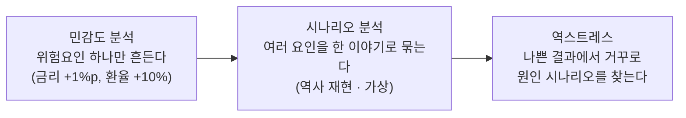

> [!GOAL]
>
> - 민감도 분석 · 시나리오 분석 · 역스트레스의 차이를 예와 함께 설명할 수 있습니다.
> - 합성 포트폴리오에 주식 급락 · 금리 상승 충격을 넣어 손익을 자산별로 나눠 계산할 수 있습니다.
> - 시나리오 결과를 「그럴듯한가 · 한도에 닿는가 · 한계는 무엇인가」 세 질문으로 읽고, Qurious 에 아직 스트레스 엔진이 없다는 것을 정확히 말할 수 있습니다.

> [!NOTE]
> 교육용 설명이며 투자 권유가 아닙니다. 이 장의 **비중 · 충격 · 듀레이션 · 한도는 모두 예시로 정한 합성 값**이고 어떤 감독기관의 시나리오도 아닙니다. 외부 사실은 2026-11-03 에 열람한 공식 문서와 검색 결과이며, 한국 사례의 수치는 원문을 열지 못해 쓰지 않았습니다.

[11.6](#/p/risk-parity-min-variance)에서 위험을 분산 · 위험 기여로 나눴습니다. 그러나 평균과 표준편차는 **드물지만 큰 충격**을 잘 보여 주지 않습니다. 이 장은 그런 충격을 일부러 넣어 보는 스트레스 검증을 다룹니다.

## 평소의 지표가 못 보여 주는 것은 무엇일까요?

표준편차는 보통의 흔들림을 재고, 위기에는 자산 간 상관이 오르는 경향이 알려져 있습니다([11.8](#/p/regime-dynamic-allocation)에서 본 Ang 과 Bekaert 의 초록도 변동성이 큰 약세장에서 시장 간 상관이 오르는 현상을 모형에 넣었습니다). 평소의 지표로는 「주식이 크게 떨어지고 금리도 오르는」 날의 손실이 보이지 않습니다. 그래서 **가정한 충격을 직접 넣어 손익을 계산**해 봅니다.

## 스트레스 테스트에는 어떤 종류가 있나요?

바젤위원회(BCBS)의 「스트레스 테스트 원칙」(2018-10, 문서 d450)은 스트레스 테스트가 **민감도 분석**부터 **시나리오 분석**, **역스트레스 테스트**까지 포함한다고 설명합니다(서론 각주, 문서 직접 열람).



*그림 1. 스트레스 테스트의 세 층(BCBS 원칙 문서의 순서).*

- **민감도 분석**: 금리 한 요인만 +1%p 움직이면 손익이 얼마나 바뀌는가.
- **시나리오 분석**: 주식 급락 · 금리 상승 · 환율 변동을 **한 이야기**로 묶어 포트폴리오 손익을 본다. 과거 위기를 재현하는 것과 가상의 미래 사건이 있습니다.
- **역스트레스**: 먼저 나쁜 결과(손실 한도 미달 같은 것)를 정해 두고, 거꾸로 그 결과를 만드는 시나리오를 찾습니다(BIS 위험관리 모듈의 설명을 검색 발췌로 확인).

## 감독기관은 어떻게 하나요?

BCBS 의 2018년 문서는 스트레스 테스트 원칙을 **아홉 개**로 정하고 2009년 원칙을 교체했습니다(목적 · 거버넌스 · 위험관리 도구 · 중요 위험과 심각한 충격 · 자원 · 데이터 · 모형 · 검토 · 소통). 4번 원칙의 핵심은 시나리오가 **충분히 심각하되 그럴듯해야**(sufficiently severe but plausible) 한다는 것입니다. 역사적 사건과 가상의 미래 사건을 모두 고려하고, 역사 데이터에 심각한 위기가 없으면 역사에 기대지 않은 시나리오가 필요할 수 있다고 합니다.

이 원칙은 **은행과 감독당국용**이고 일반 투자자의 포트폴리오에 직접 적용되는 규정이 아닙니다(은행 자본 적정성이 목적. 적용 범위에 대한 이 설명은 이 장의 해석입니다). 미국 연준도 해마다 시나리오를 공개합니다. 2026년 시나리오 페이지(2026-11-04 열람)에는 기준(baseline) 시나리오와 최악(severely adverse) 시나리오가 함께 실려 있고, 은행의 스트레스 테스트는 최악 시나리오에 견줍니다. 다만 이 장은 연준 시나리오의 **수치를 쓰지 않습니다.** 요약 도구로만 확인한 값이 뉴스 보도와 달랐고 원문 표를 읽지 못했기 때문입니다. 한국은행 금융안정보고서의 거시 스트레스 테스트 결과도 원문을 열지 못해 수치를 쓰지 않았습니다.

## 직접 계산해 봅시다

예제 [`stress_test_basics.py`](/learn/examples/stress_test_basics.py)는 세 가지를 합성 값으로 계산합니다. 먼저 채권입니다. 금리가 오르면 채권 가격은 **듀레이션만큼 떨어집니다.** 수정듀레이션 D 와 볼록성 C 로 가격 변화율을 근사하는 표준식은 다음과 같습니다(채권 교재의 일반 지식이며 이번에 교재 원문을 열지는 않았습니다).

```python
def bond_change(duration, convexity, dy):                 # ΔP/P 근사 = -D·Δy + ½·C·(Δy)²
    return -duration * dy + 0.5 * convexity * dy ** 2
```


*그림 2. 금리 변화 -2%p ~ +3%p 에서의 채권 가격 변화 근사. 합성 계산(듀레이션 5 · 볼록성 40 은 예시)이며 실제 채권이 아닙니다. 만든 스크립트는 `tools/learn_figs/stress-test-scenarios.py`.*

다음은 2026-11-04 에 `python -X utf8 -I stress_test_basics.py` 로 돌린 결과입니다(Python 3.13.14).

```output
① 민감도 — 채권 가격 변화(듀레이션 5 · 볼록성 40, 합성)
   금리 -2%p → 가격 +10.80%  (듀레이션만: +10.00%)
   금리 +0%p → 가격 +0.00%  (듀레이션만: +0.00%)
   금리 +1%p → 가격 -4.80%  (듀레이션만: -5.00%)
   금리 +3%p → 가격 -13.20%  (듀레이션만: -15.00%)
② 시나리오 — 주식 급락 + 금리 +1%p + 대체자산 +5% (합성)
   시나리오 · 충격 · 손익(%p)
   국내주식   비중   30%  충격 -30.00%  손익  -9.00%p
   해외주식   비중   30%  충격 -25.00%  손익  -7.50%p
   국내채권   비중   30%  충격  -4.80%  손익  -1.44%p
   대체자산   비중   10%  충격  +5.00%  손익  +0.50%p
   합계 손익 -17.44%  (가정한 조건에서의 손익이며 일어날 확률이 아니다)
③ 낙폭 vs 한도 (합성 250일 · 충격일 1회 · 가상 한도 -15%)
   최대낙폭 -28.28%  → 한도 -15% 에 닿음
```

①은 **민감도 분석**입니다. 볼록성을 넣으면 금리가 오를 때 손실이 조금 줄고 내릴 때 이익이 조금 늘어납니다. ②는 **시나리오 분석**입니다. 포트폴리오 손익은 비중 × 충격의 합이고, 합성 포트폴리오는 -17.44% 입니다. 이 표의 칸(시나리오 · 충격 조건 · 손익 · 대응)은 결과를 기록하는 흔한 양식이기도 합니다. ③은 충격일이 낙폭을 얼마나 키우는지를 보입니다.

## 결과는 어떻게 읽나요?

세 질문으로 읽습니다.

1. **그럴듯한가.** 충격이 클수록 좋은 테스트가 아닙니다. 비현실적으로 큰 충격은 의사결정에 쓸 수 없습니다. 「심각하되 그럴듯하게」 입니다.
2. **한도에 닿는가.** 시나리오 손익이나 낙폭을 미리 정한 손실 한도와 견줍니다(예제 ③의 한도 -15% 는 개념을 보이려는 가상값이며 정당화하는 외부 기준을 찾지 못했습니다). 한도는 보기 전에 정해 둡니다.
3. **한계는 무엇인가.** 스트레스 손실은 **확률이 붙은 예측이 아니라 가정한 조건에서의 손익**입니다. 「-17%」 는 그런 손실이 날 가능성이 높다는 말이 아닙니다. 또 **통과했다고 안전한 것이 아닙니다.** 시나리오나 한도가 틀리면 알 수 없습니다.

## Qurious 는 어디까지 왔나요?

**Qurious 에는 아직 스트레스 엔진이 없습니다.** 급락 · 금리 · 환율 시나리오를 넣어 포트폴리오 손실과 손실 한도를 계산해 보는 기능은 요구로만 있고 구현되지 않았습니다. 따라서 「앱에 이런 화면이 있다」 고 쓰지 않습니다. 코드에서 닿는 것은 스트레스 결과를 읽을 때 쓸 수 있는 기존 부품 둘뿐입니다.

| 부품 | 하는 일 | 스트레스 테스트인가 |
|---|---|---|
| 최대낙폭 계산 | 누적 배수 시계열의 최대 낙폭(음수 비율) | 아닙니다. 결과를 「낙폭 대 한도」 로 읽는 데 쓸 수 있는 부품 |
| 일손실 한도(기본 3%) | 자동매매 가상 장부의 당일 손실이 한도를 넘으면 비상 정지와 알림 | 아닙니다. **실시간 안전장치**입니다 |

두 가지를 헷갈리지 마세요. 일손실 한도는 **지금 일어나는 손실**을 막는 장치이고 스트레스 테스트는 **일어날 수 있는 손실**을 미리 계산해 보는 일입니다. 예제 ③의 가상 한도(누적 낙폭 -15%)도 이 앱의 일손실 한도와 다른 값입니다.

## 흔한 실수

1. **「스트레스 테스트 = 과거 최악의 날 재현」.** 역사 시나리오는 한 종류일 뿐이고 가상 시나리오 · 민감도 · 역스트레스도 있습니다.
2. **「충격이 클수록 좋은 테스트」.** 그럴듯해야 합니다.
3. **「스트레스 손실 = 예상 손실」.** 확률이 아닌 가정한 조건의 손익입니다.
4. **「주식이 -30% 면 포트폴리오도 -30%」.** 비중 · 채권 · 상관이 섞입니다.
5. **「채권은 금리가 올라도 안전」.** 금리가 오르면 듀레이션만큼 가격이 떨어집니다.
6. **「스트레스를 통과했으니 안전」.** 그 시나리오에 한정된 결과입니다.

## 정리

1. 스트레스 테스트는 민감도 → 시나리오 → 역스트레스의 세 층이 있습니다.
2. 시나리오는 충분히 심각하되 그럴듯해야 하고, 결과는 확률이 아니라 가정한 조건의 손익입니다.
3. 포트폴리오 손익은 비중 × 충격의 합이고, 채권은 듀레이션(과 볼록성)으로 근사합니다.
4. 결과는 「그럴듯함 · 한도 · 한계」 로 읽고, 한도는 보기 전에 정합니다.
5. Qurious 에는 스트레스 엔진이 없고 일손실 한도는 다른 장치입니다.

<details>
<summary>확인 문제 1 — 바젤 스트레스 원칙은 몇 개이고 4번 원칙의 핵심은?</summary>

아홉 개입니다. 4번 원칙은 시나리오가 충분히 심각하되 그럴듯해야 한다는 것입니다.
</details>

<details>
<summary>확인 문제 2 — 금리 +1%p 한 요인만 움직이는 테스트는 어떤 종류인가요?</summary>

민감도 분석입니다.
</details>

<details>
<summary>확인 문제 3 — 듀레이션 5 · 볼록성 40 채권의 금리 +1%p 가격 변화 근사는?</summary>

-5 × 0.01 + 0.5 × 40 × 0.0001 = -4.8% 입니다(예제 ①).
</details>

<details>
<summary>확인 문제 4 — 「이 시나리오 손실이 -17%」 는 17% 손실이 날 확률이 높다는 뜻인가요?</summary>

아닙니다. 가정한 조건에서의 손익일 뿐 확률에 관한 말이 아닙니다.
</details>

<details>
<summary>확인 문제 5 — 이 앱의 일손실 한도 3% 는 스트레스 테스트인가요?</summary>

아닙니다. 실시간 안전장치(비상 정지)이고, 스트레스 엔진은 구현되지 않았습니다.
</details>

## 더 읽을거리

아래 자료는 2026-11-03 조사에서 열람한 것이며, 이 장을 쓰면서 다시 열지는 않았습니다. **감독기관 시나리오의 수치는 원문 표를 읽지 못해 쓰지 않았으니 필요하면 원문 표를 직접 보세요. 2026-11-04 에는 BIS 정의와 연준 페이지 구성을 직접 대조했고, BCBS 2018 문서는 PDF 접근이 막혀 이번에는 다시 열지 못했습니다.**

- Basel Committee on Banking Supervision, 「Stress testing principles」(2018-10, d450) — <https://www.bis.org/bcbs/publ/d450.pdf> · 아홉 개 원칙, 심각하되 그럴듯한 시나리오. 문서 직접 열람.
- BIS, 위험관리 모듈 RMA30 — <https://www.bis.org/committees/bcbs/basel-consolidated-guidelines/module/rma/30> · 역스트레스(2026-11-04 원문 확인: 사전에 정한 나쁜 결과에서 그것을 만드는 시나리오를 찾는 과정).
- 미국 연준, 스트레스 테스트 시나리오 — <https://www.federalreserve.gov/publications/2026-stress-test-scenarios.htm> · 2026-11-04 원문 페이지 확인(기준 시나리오와 최악 시나리오 구성).
- 이 장의 예제 [`stress_test_basics.py`](/learn/examples/stress_test_basics.py) · 위험 기여는 [11.6](#/p/risk-parity-min-variance) · 국면에 따른 비중 조절은 [11.8](#/p/regime-dynamic-allocation).

> [!NOTE]
> 확인하지 못해 단정하지 않은 것: ① 2009년 원칙과 2018년 원칙의 차이 ② 한국은행 금융안정보고서의 시나리오 변수와 결과 ③ 연준 2026 시나리오의 수치 ④ 한국 시장의 과거 급락 수치(뉴스 수준만 확인해 쓰지 않음) ⑤ 듀레이션 · 볼록성 식의 교재 원문 ⑥ 손실 한도의 크기를 정당화하는 외부 기준.

**용어**

| 말 | 뜻 |
|---|---|
| 스트레스 테스트 | 심한 충격을 가정해 손익이나 건전성을 계산해 보는 일 |
| 민감도 분석 | 위험요인 하나만 움직여 영향을 보는 것 |
| 시나리오 분석 | 여러 요인을 한 이야기로 묶어 영향을 보는 것 |
| 역스트레스 | 나쁜 결과를 먼저 정하고 그것을 만드는 시나리오를 거꾸로 찾는 것 |
| 듀레이션 | 금리 변화에 대한 채권 가격의 민감도 |
| 볼록성 | 금리 변화가 클 때 듀레이션 직선 근사를 보정하는 값 |
| 최대낙폭 | 누적 수익이 고점에서 가장 크게 떨어진 비율 |
