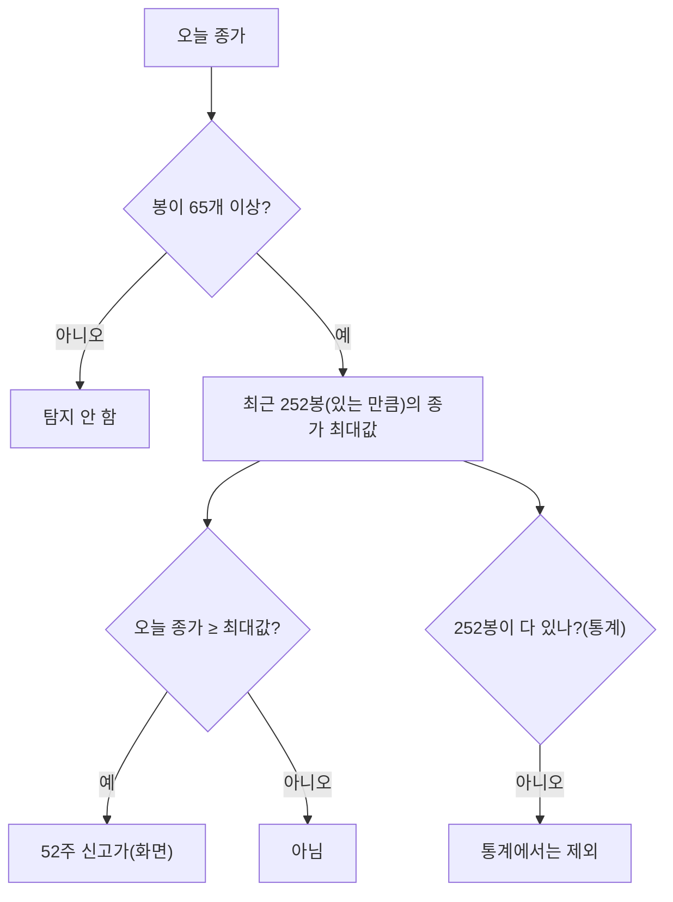

> [!GOAL]
>
> - 이동평균 배열(정배열)과 52주 신고가가 각각 무엇을 계산하는지, 어떤 선택(기간 · 종가 대 고가 · 도달 대 근접)이 결과를 바꾸는지 설명할 수 있습니다.
> - 합성 가격으로 정배열 · 신고가 조건을 직접 계산하고, 봉이 모자란 종목의 처리를 확인할 수 있습니다.
> - 이 조건들이 수익을 보장하지 않는 **후행 요약**이라는 점과 Qurious 의 현재 구현 범위를 정확히 말할 수 있습니다.

> [!NOTE]
> 교육용 설명이며 투자 권유가 아닙니다. 이 장의 가격은 모두 **합성 데이터**이고 「정배열이면 오른다」 는 뜻이 아닙니다. 학술 논문은 초록 페이지나 원문 PDF 의 해당 문장까지만 확인했고(George–Hwang 제외) 범위는 「더 읽을거리」 에 적었습니다.

[11.9](#/p/factor-screening)에서 재무 · 가격 팩터로 종목을 점수화했습니다. 이 장은 가격 모양에 조건을 걸어 **그날 조건에 맞는 종목을 고르는** 기술적 스크리닝을 다룹니다. 조건을 통과한 뒤의 수익을 통계로 보는 일은 [패턴 사건 연구](#/p/pattern-event-study)가 맡습니다.

## 하루에 수천 종목을 어떻게 걸러 볼까요?

**스크리닝**은 그날 전체 종목(횡단면)에서 정해 둔 조건에 맞는 종목을 골라내는 일입니다. 눈으로는 못 보는 양이라 조건을 규칙으로 적습니다. 이 장의 조건은 두 가지입니다. 이동평균선이 어떤 순서로 놓였는가(정배열), 오늘 가격이 최근 1년 가운데 가장 높은가(52주 신고가)입니다.

## 이동평균선이 위에서부터 순서대로 놓이면?

**단순 이동평균**은 최근 n일 종가의 평균입니다. 처음 n-1일은 평균을 낼 만큼 봉이 없어 값이 비어 있습니다. 120일선은 119번째 날까지 비어 있습니다. **정배열**은 짧은 선이 긴 선보다 위에서부터 순서대로 놓인 상태(예: 5일 > 20일 > 60일)이고 반대는 역배열입니다.

> [!WARNING]
> 정배열의 **기간 조합은 규정이 아니라 관행**입니다(5 · 20 · 60 또는 5 · 20 · 60 · 120 등). 한국거래소나 금융투자협회 같은 공신력 있는 용어 정의를 이번 조사에서 찾지 못했습니다. Qurious 의 용어 사전에도 항목은 있지만 정의와 식 칸이 비어 있고 코드에는 정배열 판정 함수가 **없습니다.** 이 장은 정의를 하나 정해서 계산해 보되 관행이라고 밝힙니다.

이동평균은 과거 가격을 평균한 **후행 지표**라서 현재 상태를 요약하는 도구로 쓰는 것이 일반적입니다(비공식 자료의 설명). 정배열은 이미 오른 뒤의 모양입니다.


*그림 1. 합성 가격(시드 3)에서 5 > 20 > 60 > 120 순서가 되는 날(연한 초록 음영). 실제 종목이 아니며 기간 조합은 관행입니다. 만든 스크립트는 `tools/learn_figs/technical-screening.py`.*

## 52주 신고가는 어떻게 세나요?

세 가지를 정해야 합니다.

1. **창의 길이.** 52주를 달력 52주로 볼지 거래일로 볼지. Qurious 는 **252거래일**을 씁니다. 휴장일 수가 해마다 달라 정확히 같은 기간은 아닙니다.
2. **가격 종류.** 종가인지 장중 고가인지. Qurious 는 **종가**입니다. 증권사 앱의 52주 최고가는 장중 고가인 경우가 많아 다를 수 있습니다.
3. **도달인가 근접인가.** 오늘이 최고인가(참 · 거짓), 최고가의 95% 이상인가(비율). Qurious 는 **도달**만 봅니다.

봉이 모자랄 때의 처리도 정의의 일부입니다. 예제 ②는 같은 합성 가격에서 252봉이 다 있을 때만 판정하는 방식과, 65봉부터 있는 만큼의 창으로 판정하는 방식을 비교합니다.

## 직접 해 보기

예제 [`technical_screening.py`](/learn/examples/technical_screening.py)는 numpy 만으로 이동평균 · 정배열 · 신고가를 계산합니다. 핵심은 이렇습니다.

```python
ma = [sma(c, k) for k in (5, 20, 60, 120)]                    # 처음 k-1 봉은 nan
ok &= a > b                                                   # 짧은 선 > 긴 선, 이웃한 선끼리 모두
hit_full  = np.sum(c >= rolling_max(c, 252, min_periods=252))  # 252봉이 다 있을 때만
hit_short = np.sum(c >= rolling_max(c, 252, min_periods=65))   # 65봉부터 있는 만큼의 창
```

다음은 2026-11-04 에 `python -X utf8 -I technical_screening.py` 로 돌린 결과입니다(Python 3.13.14).

```output
① 정배열(5>20>60>120) 일수: 106 / 평가 가능 181
② 52주 신고가 — 252봉이 다 있을 때만: 16 | 65봉부터 있는 만큼의 창: 37
   마지막 종가 ÷ 최근 252봉 최고가: 0.968
③ 합성 10종목에 정의를 달리 적용한 오늘(마지막 날) 통과 수
   정배열 3선(5>20>60)       : 3 / 10
   정배열 4선(5>20>60>120)   : 1 / 10
   52주 신고가 도달            : 1 / 10
   52주 신고가 95% 근접        : 1 / 10
```

세 가지를 읽을 수 있습니다.

- 정배열은 **평가 가능한 181일 중 106일**입니다. 앞의 119일은 120일선이 없어 판정 자체를 못 합니다.
- 같은 가격에서 신고가가 **16일 대 37일**로 갈립니다. 창을 어떻게 잡느냐가 사건 수를 두 배 넘게 바꿉니다.
- 합성 10종목에서 정배열을 3선으로 정의하면 3개, 4선으로 정의하면 1개가 통과합니다. **정의를 고르는 것이 결과를 바꿉니다.** (신고가 도달과 95% 근접은 이 합성 10종목에서는 같은 1개였지만 다른 경우도 있습니다.)

## 연구는 무엇을 말하고 무엇을 말하지 않나요?

- Brock, Lakonishok, LeBaron(Journal of Finance 47(5), 1992)은 이동평균과 거래범위 돌파 두 규칙을 다우존스 지수 1897~1986년 자료로 검정했고, 초록에 따르면 매수 신호 뒤 수익이 매도 신호 뒤보다 높고 변동성은 낮았으며, 수익이 네 가지 영가설(랜덤워크 · AR(1) · GARCH-M · EGARCH)과 맞지 않는다고 보고했습니다.
- George 와 Hwang(Journal of Finance 59(5), 2004)은 52주 신고가에 **가까운 정도**가 미래 수익을 예측한다는 주장을 폈다고 소개됩니다(검색 발췌 수준이며 본문의 식은 읽지 못했습니다).
- 반대편 증거도 있습니다. Park 와 Irwin(Journal of Economic Surveys 21(4), 2007)은 기술적 분석 수익성 연구를 개관하며 **대부분의 연구가 데이터 스누핑이나 사후 규칙 선택 같은 검정상 결함**이 있다고 지적합니다(초록). 같은 저자들의 후속 연구(Journal of Futures Markets 30(7), 2010)는 미국 선물시장 17개 가운데 데이터 스누핑을 보정한 뒤 최고 규칙이 통계적으로 유의한 경제적 수익을 낸 시장이 두 곳뿐이었다고 보고합니다(1985~2004, 초록 직접 확인).
- Faber(2007)의 월말 종가 대 10개월 이동평균 규칙도 자주 인용되지만 판마다 성과 서술이 달라 이 장은 숫자를 쓰지 않습니다.

결론은 **「연구가 어느 한쪽을 증명했다」 가 아니라** 「결과가 규칙 · 시장 · 기간에 민감하고, 많이 시험한 규칙 가운데 골랐다면 우연이 섞였을 수 있다」 입니다. 한국 시장에서 정배열이나 52주 신고가가 어떤 성과를 냈는지는 이번에 조사하지 않았습니다.

## 우리 코드에서 같은 이름이 다르게 쓰이는 곳

**Qurious 는 이렇게 합니다.** 종목 하나의 차트에서 패턴을 탐지하는 기능이 있고, 같은 이름이 곳곳에서 약간씩 다르게 쓰입니다(2026-11-03 기준 코드).

| 이름 | 어디서 | 정의 |
|---|---|---|
| 52주 신고가(화면 탐지) | 패턴 탐지기 | 봉이 **65개 이상**이면 최근 252봉(있는 만큼)의 종가 최대값 이상일 때 |
| 52주 신고가(통계) | 패턴 통계 | **252봉이 다 있을 때만** 판정 |
| 골든크로스 ① | 종목 점수 | **MA5 / MA20** 교차 |
| 골든크로스 ② | 패턴 탐지기 | **MA20 / MA60** 교차, 최근 5봉 안 |
| 골든크로스 ③ | 투자 조사 스크리닝 | **MA5 / MA20** 교차(점수 규칙은 ①과 다름) |

그래서 같은 「52주 신고가」 의 사건 수가 화면과 통계에서 어긋날 수 있고, 같은 「골든크로스」 라는 이름을 서로 다른 화면이 다르게 셉니다. 또 52주 신고가는 「근접」(비율)이 아니라 「도달」(참 · 거짓)만 봅니다. 거기에 **전 종목을 매 거래일 거르는 스크리너는 아직 없습니다.** 지금은 종목 하나씩 탐지하고, 종목을 점수화하는 스크리닝은 규칙(RSI · 이동평균 · 볼린저 · 앙상블)을 대표 종목에 적용한 점수이지 정배열이나 52주 조건으로 거르는 필터가 아닙니다.

> [!NOTE]
> 이 장을 쓰면서 확인했지만 고치지 않은 것(코드 확인 필요): ① 정배열의 프로젝트 정의가 없음 ② 화면 탐지(65봉부터)와 통계(252봉부터)의 최소 봉 수가 다름 ③ 골든크로스 정의 세 가지 ④ 52주 신고가가 도달만 보고 근접을 보지 않음.



*그림 2. 52주 신고가 판정의 두 갈래(화면 탐지 대 통계).*

## 조건을 통과했다고 끝이 아닌 이유

1. 정배열이나 신고가는 **이미 오른 뒤의 상태**를 요약합니다. 조건을 통과한 뒤 어떻게 되는지는 별도의 증거입니다.
2. 조건을 많이 시험할수록 우연히 좋아 보이는 규칙을 고를 가능성이 커집니다([11.9](#/p/factor-screening)의 다중검정).
3. 스크리닝은 **후보를 좁히는 단계**일 뿐입니다. 비용 · 위험 · 비중은 따로 정해야 합니다.

## 흔한 실수

1. **「정배열 = 상승 보장」.** 후행 요약이고 예측력은 규칙 · 시장 · 기간에 따라 다릅니다.
2. **「정배열의 기준은 하나」.** 기간 조합은 관행이라 정의를 바꾸면 통과 수가 크게 달라집니다(예제 ③).
3. **「52주 = 52 캘린더 주」.** Qurious 는 252거래일입니다.
4. **「52주 신고가는 장중 고가 기준」.** Qurious 는 종가 기준입니다.
5. **「신고가 = 신고가 근접」.** 도달(참 · 거짓)과 근접(비율)은 다른 조건입니다.
6. **「이동평균은 이름이 같으면 같은 값」.** 봉이 모자란 앞부분은 비어 있어 판정을 못 합니다.
7. **「골든크로스는 하나」.** 같은 코드 안에서도 세 정의가 있습니다.
8. **「조건에 맞는 종목 = 살 종목」.** 후보를 좁힐 뿐입니다.

## 정리

1. 정배열과 52주 신고가는 모두 **정의를 고르는 일**(기간 · 종가 대 고가 · 도달 대 근접 · 봉 수)이고, 정의가 결과를 바꿉니다.
2. 봉이 모자란 종목은 판정을 못 하거나 짧은 창으로 판정하게 되므로 처리 규칙을 밝혀야 합니다.
3. 이 조건들은 후행 요약이며, 연구는 어느 한쪽을 증명하지 않고 데이터 스누핑 문제가 큽니다.
4. Qurious 에는 전 종목 스크리너가 아직 없고, 같은 이름의 지표가 곳곳에서 약간씩 다르게 정의되어 있습니다.

<details>
<summary>확인 문제 1 — 이동평균은 왜 처음 몇 봉이 비어 있나요?</summary>

n일 평균을 내려면 n개의 봉이 모여야 하기 때문입니다. 120일선은 119번째 날까지 비어 있습니다(예제 ①).
</details>

<details>
<summary>확인 문제 2 — Qurious 의 52주 신고가는 장중 고가 기준인가요?</summary>

아닙니다. 종가 기준이고 도달(오늘 종가가 최근 252봉 종가 최대값 이상)만 봅니다.
</details>

<details>
<summary>확인 문제 3 — 상장 100일째 종목은 화면 탐지에서 52주 신고가가 나올 수 있나요?</summary>

65봉 이상이면 있는 만큼의 창으로 나올 수 있습니다. 통계는 252봉이 모두 있어야 하므로 제외합니다(예제 ②의 16 대 37).
</details>

<details>
<summary>확인 문제 4 — 「정배열이면 오른다」 는 맞나요?</summary>

아닙니다. 정배열은 이미 오른 뒤의 상태를 요약하며, 이 분야는 데이터 스누핑 문제가 있어 결과를 단정하지 않습니다.
</details>

<details>
<summary>확인 문제 5 — 앱에서 골든크로스 정의는 몇 가지인가요?</summary>

코드 위치 기준 세 가지입니다(MA5/MA20 두 곳, MA20/MA60 한 곳).
</details>

## 더 읽을거리

아래 자료는 2026-11-03 조사에서 열람한 것이며, 이 장을 쓰면서 다시 열지는 않았습니다. **2026-11-04 에 초록 페이지와 Faber 원문 PDF 를 직접 대조했습니다. George–Hwang 은 이번에 열지 못했으니 수치는 원문을 확인하세요.**

- Brock, W. · Lakonishok, J. · LeBaron, B., 「Simple Technical Trading Rules and the Stochastic Properties of Stock Returns」, Journal of Finance 47(5), 1731–1764 (1992) — <https://econpapers.repec.org/RePEc:bla:jfinan:v:47:y:1992:i:5:p:1731-64> · 2026-11-04 초록 원문 확인.
- George, T. · Hwang, C.-Y., Journal of Finance 59(5), 2145–2176 (2004) — 검색 발췌 수준(2026-11-04 초록 페이지 접근 실패로 원문 대조 못 함).
- Park, C.-H. · Irwin, S., 「What Do We Know About the Profitability of Technical Analysis?」, Journal of Economic Surveys 21(4), 786–826 (2007) — <https://ideas.repec.org/a/bla/jecsur/v21y2007i4p786-826.html> · 2026-11-04 초록 확인.
- Faber, M., Journal of Wealth Management 9(4), 69–79 (2007) — SSRN 962461. 2026-11-04 원문 PDF 에서 「월 가격 > 10개월 SMA 이면 매수, 아니면 현금」 규칙 문장을 확인.
- 이 장의 예제 [`technical_screening.py`](/learn/examples/technical_screening.py) · 조건 통과 뒤의 통계는 [패턴 사건 연구](#/p/pattern-event-study) · 팩터 점수는 [11.9](#/p/factor-screening).

> [!NOTE]
> 확인하지 못해 단정하지 않은 것: ① 정배열의 공신력 있는 정의 ② George–Hwang 논문 본문의 식 ③ 한국 시장에서의 성과 ④ 후속 연구의 수치(2차 요약) ⑤ 전 종목 신호 기록 설계와 이 장의 「전 종목 거르기」가 겹치는 범위.

**용어**

| 말 | 뜻 |
|---|---|
| 스크리닝 | 전체 종목에서 조건에 맞는 종목을 골라내는 일 |
| 단순 이동평균 | 최근 n일 종가의 평균 |
| 정배열 · 역배열 | 짧은 이동평균이 위에서부터 놓인 상태 · 그 반대 |
| 52주 신고가 | 최근 1년 가운데 가장 높은 가격에 닿은 것 |
| 골든크로스 | 짧은 이동평균이 긴 이동평균을 위로 뚫는 것 |
| 후행 지표 | 과거 가격으로 만들어 현재 상태를 뒤늦게 요약하는 지표 |
| 데이터 스누핑 | 같은 데이터로 규칙을 계속 시험해 우연한 규칙을 고르는 것 |
