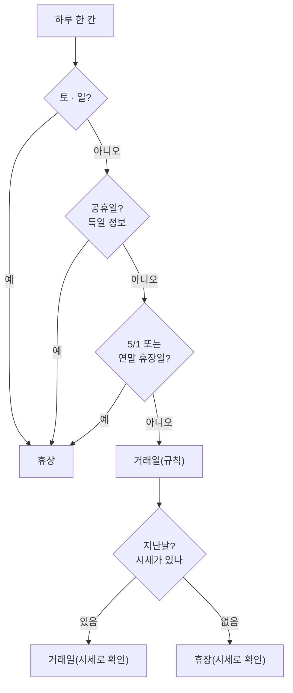
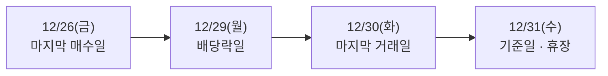
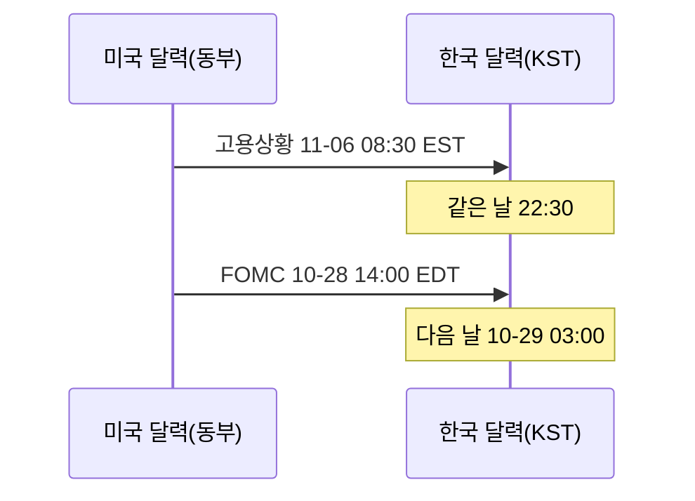
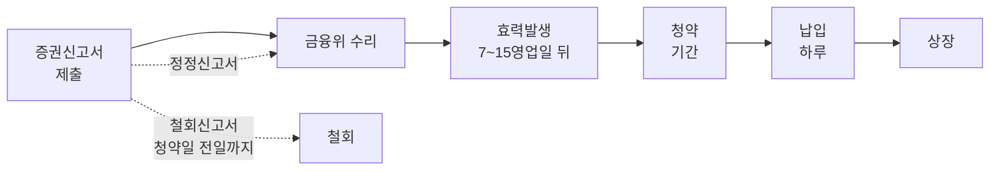

> [!GOAL]
>
> - 거래일 달력을 규칙(주말 · 공휴일 · 거래소 휴장)으로 만들고 「다음 거래일」 을 계산할 수 있습니다.
> - 「두 번째 목요일 · 휴장이면 앞 거래일」 같은 규칙으로 파생 만기와 배당락일을 날짜로 구할 수 있습니다.
> - 일정마다 확정 · 예정 · 규칙 계산을 나눠 적는 까닭과, 공식 일정도 바뀐다는 것을 사례로 설명할 수 있습니다.

이 장은 [2.4 정기 배치](#/p/batch-scheduling)가 「오늘이 거래일이어야 도는 일」 을 돌릴 때 쓰는 달력을 다룹니다. 배당 날짜를 더 자세히 보려면 [배당 기준일 · 배당락일 · 지급일](#/p/dividend-dates), 시간대는 [분봉과 시간대](#/p/intraday-timezone), 파생상품 자체는 [선물 · 옵션](#/p/derivatives-futures-options)을 보세요.

> [!NOTE]
> 한국거래소(KRX)와 각 기관의 공식 화면을 2026-11-03 에 열람한 내용 기준입니다. **휴장일 · 시간 · 규칙은 바뀔 수 있으므로 거래할 때는 공식 공지를 확인하세요.** 이 장은 교육용이며 투자 · 법률 자문이 아닙니다. 법령은 조문 문장을 옮기지 않고 요지만 적었습니다.

## 오늘이 거래일인지 어떻게 알까요?

토 · 일이 아니고 거래소가 쉬는 날이 아닌 날입니다. 그런데 **공휴일과 거래소 휴장일은 같지 않습니다.** KRX 규정이 정하는 휴장일은 토요일, 관공서 공휴일, 노동절(5월 1일), 연말 1일간(공휴일 · 토요일 제외), 그리고 거래소가 필요하다고 인정하는 날입니다.

- **연말 휴장은 「12월 31일」 이 아닙니다.** 규정은 「연말의 1일간」 이고, 실제로는 2022년 12월 30일 · 2023년 12월 29일 · 2024년 12월 31일 · 2025년 12월 31일 · 2026년 12월 31일(예정) · 2028년 12월 29일입니다(KRX 규정과 휴장일 표). 12월 31일이 토 · 일이면 앞 평일입니다.
- **5월 1일은 2026년부터 법정 공휴일 「노동절」** 입니다(2025년 11월 법 개정, 고용노동부 보도자료). KRX 2026년 표에는 옛 이름 「근로자의날」 로 적혀 있지만 휴장은 같습니다. 2027년 5월 1일은 토요일이라 5월 3일(월)이 대체 휴장입니다.
- **임시 휴장도 있습니다.** 2026년 6월 3일은 전국동시지방선거일이라 KRX 표에 임시공휴일로 올라 있습니다.
- **개장 시각이 바뀌는 날도 있습니다.** 보도에 따르면 2026년 1월 2일은 증권 정규장이 10:00 에 열렸고 종료는 15:30 그대로였습니다. 수능일(2027학년도는 2026-11-19)의 증시 개장 시각 공지는 이 장을 쓸 때 찾지 못했습니다. 매년 공지로 정해지므로 확인합니다.

KRX 2026년 평일 휴장일은 17일이고 2027년은 16일입니다(2026-11-03 열람). 달마다 수가 다르고 해마다 달라집니다.


*그림 1. 월별 평일 휴장일 수. 공식 표 — 한국거래소 증시일정 > 휴장일(2026-11-03 열람)을 월별로 센 것이며 시세 데이터가 아닙니다. 만든 스크립트는 `tools/learn_figs/trading-calendar.py`.*

## 거래일 달력은 어떻게 만드나요?

Qurious 의 수집기는 규칙을 **세 겹**으로 쌓습니다. 주말, 공휴일(한국천문연구원 특일 정보), 거래소 휴장(5월 1일 · 연말)입니다. 지난날은 한 번 더 **시세가 있었는지**로 확인하고, 미래는 규칙으로 「예정」 을 적습니다.



*그림 2. 거래일 달력의 규칙 세 겹과 시세 확인.*

이 달력이 쓰이는 곳은 많습니다. 「매월 첫 거래일에 리밸런싱」 은 이 달력의 다음 거래일 계산이고([리밸런싱 방법](#/p/rebalancing-methods)), 정기 배치가 빈 날을 채울 때 휴장일을 건너뛰는 것([2.4](#/p/batch-scheduling))도 같은 달력입니다. 예제 ①이 다음 거래일을 계산합니다(휴장일 표는 합성이 아니라 공식 표의 사본입니다).

```output
① 2026-12-24 의 다음 거래일: 2026-12-28 | 2026-12-30 의 다음 거래일: 2027-01-04
```

12월 25일(휴장)과 주말을 건너뛰어 12월 28일이고, 12월 30일 다음은 12월 31일(휴장) · 1월 1일(휴장) · 주말을 건너뛴 2027년 1월 4일입니다.

### 하루의 시간 구조는요?

KRX 규정(2026-11-03 열람)은 정규시장 호가 접수를 08:30~15:30, 매매를 09:00~15:30 으로 정합니다. 시간외 종가는 장전 08:30~08:40(전일 종가)과 장후 15:40~16:00(당일 종가)입니다. 2026-09-14 에 KRX **애프터마켓**(16:00~20:00, 가격제한폭 당일 기준가 ±30%, 시장가 주문 불가)이 새로 생겼고, 보도에 따르면 16:00~18:00 시간외단일가는 같은 날 폐지됐습니다. 대체거래소 넥스트레이드는 프리 08:00~08:50, 메인 09:00:30~15:20, 애프터 15:40~20:00 으로 따로 운영합니다(홈페이지 시장개요). 시간은 바뀔 수 있으므로 적용 전에 확인하세요.

## 「매월 둘째 목요일」 은 어떻게 날짜가 되나요?

KRX 상품 화면(2026-11-03 열람)에 따르면 코스피200 **선물**의 결제월은 3 · 6 · 9 · 12월이고 최종거래일은 결제월의 두 번째 목요일입니다. 공휴일이면 순차적으로 앞당겨지고, 최종결제일은 그다음 거래일이며 현금 결제입니다. **옵션**은 매월 만기가 있고(유럽형, 최종거래일에만 권리 행사) 최종거래일 규칙은 같습니다. 그래서 3 · 6 · 9 · 12월에는 선물과 옵션이 같은 날 만기를 맞습니다.

| 상품 | 결제월 | 최종거래일 | 휴장이면 |
|---|---|---|---|
| 코스피200 선물 | 3 · 6 · 9 · 12월 | 두 번째 목요일 | 앞 거래일로 당김 |
| 코스피200 옵션(월물) | 매월 | 두 번째 목요일 | 앞 거래일로 당김 |
| 코스피200 위클리(목) | 매주 | 목요일 | 앞 거래일로 당김 |
| 코스피200 위클리(월) | 매주 | 월요일 | **뒤 거래일로 미룸** |

최종거래일의 거래는 정규 08:45~15:45 중 15:20 에 끝납니다. 그러나 최종결제가는 15:20 이후 10분(15:20~15:30) 사이에 정해지는 코스피200 종가 지수라는 것이 KRX 안내의 해석입니다. 거래가 끝난 시각과 결제가가 정해지는 시각은 다릅니다.

예제 ②가 규칙을 코드로 씁니다. 2027년 5월은 두 번째 목요일 5월 13일이 휴장이라 5월 12일로 당겨집니다.

```output
② 월물 최종거래일 (두 번째 목요일, 휴장이면 앞 거래일)
   2026-11: 둘째 목요일 2026-11-12 → 최종거래일 2026-11-12
   2026-12: 둘째 목요일 2026-12-10 → 최종거래일 2026-12-10
   2027-05: 둘째 목요일 2027-05-13 → 최종거래일 2027-05-12  ← 둘째 목요일이 휴장이라 앞당김
```

> [!NOTE]
> Qurious 는 월물(두 번째 목요일) 만기를 일정에 넣지만 **위클리 옵션의 월 · 목 만기는 일정에 아직 없습니다.** 위클리 옵션의 최종거래일 거래 종료 시각은 증권사 안내에서만 보아 이 장에서 쓰지 않았습니다.

## 배당 일정은 왜 날짜가 셋일까요?

배당을 받으려면 **기준일**에 주주 명부에 올라 있어야 합니다. 주식을 사면 결제까지 시간이 걸려서, 현행 결제주기 T+2(체결 후 2영업일)에서는 기준일 앞 2거래일까지 사야 명부에 오릅니다. 그래서 날짜가 셋입니다.

| 날짜 | 뜻 | 계산 |
|---|---|---|
| 마지막 매수일 | 이날까지 사야 기준일 명부에 오름 | 기준일 앞 2거래일 |
| 배당락일 | 이날 새로 산 사람은 배당 권리가 없음(KRX 규정의 정의) | 기준일 앞 1거래일 |
| 기준일 | 명부에 오르는 날 | 공시로 정해짐 |

연말에는 12월 31일이 휴장이고 **결제일에서도 빠지기** 때문에 날짜가 당겨집니다. 보도에 따르면 2025년에는 12월 결산 상장사의 배당락일이 12월 29일이었고 12월 26일까지 사야 배당을 받을 수 있었습니다. 2024년은 배당락일 12월 27일이었습니다. 2026년은 12월 31일이 휴장이면 마지막 거래일이 12월 30일이므로 같은 계산으로 12월 29일(화)이 되지만, 이것은 **규칙으로 계산한 값**이고 KRX 공지는 12월 중순에 나옵니다. 예제 ④가 이 계산을 보입니다.

```output
④ 12월 말 기준일 → 배당락일(계산)
   기준일 2024-12-31 → 배당락일 2024-12-27
   기준일 2025-12-31 → 배당락일 2025-12-29
   기준일 2026-12-31 → 배당락일 2026-12-29
```



*그림 3. 2025년 12월 결산 배당의 날짜 순서(도식). 날짜를 줄 세운 그림이며 시세가 아닙니다.*

### 결제가 T+1 로 바뀌나요?

보도에 따르면 2026-11-02 에 거래소 · 예탁결제원 등이 T+1 전환 로드맵 초안을 발표했고, 이르면 2028년 중 전환을 추진한다고 합니다. 시행일은 의견수렴 뒤 확정될 예정이며(KRX 홈에는 의견 제출 기간이 2026-12-18 까지로 표시됨) 지금은 **T+2 가 현행**입니다. 미국은 2024년 5월 28일에 T+1 로 바뀌었습니다(미국 증권거래위원회 보도자료). 또 KRX 규정 화면의 결제 서술에는 옛 「3일째 결제」 시대의 문구가 남아 있어 현행 T+2 와 맞지 않습니다. 날짜 계산은 T+2 로 합니다. 제도가 바뀌면 이 계산도 바뀝니다.

## 경제지표와 중앙은행 일정은 어디서 오나요?

| 일정 | 출처(공식) | 알아 둘 점 |
|---|---|---|
| 한국 경제지표 | 국가데이터처(옛 통계청) 보도계획 | 소비자물가 · 고용 · 산업활동 등은 월별 패턴이 있음. 표의 「비고」 열이 비어 있어 **변경 표시가 없음**. 행사 · 홍보 자료도 섞여 있음 |
| 미국 고용 · 물가 | 노동통계국(BLS) 일정 | 시각은 모두 미국 동부 시각. 고용보고서 · 소비자물가는 08:30 |
| 미국 GDP 등 | 경제분석국(BEA) 일정 | 8:30(동부) 중심, 일부 10:00 |
| 미국 FOMC | 연준 FOMC 달력 | 2026년 8회. 결정 · 성명은 둘째 날 14:00(동부) |
| 한국은행 금통위 | 한국은행 보도자료 | 기준금리 결정회의 8회(2026-11-26 이 다음 결정일). 금융안정회의 4회는 별개. 보도자료에는 날짜만 있고 시각이 없음 |

**같은 발표가 두 달력에 놓이는 법**도 주의해야 합니다. 미국 발표는 현지 시각으로 적혀 있어서 한국 달력에 얹으면 시각과 날짜가 달라집니다.



*그림 4. 같은 발표를 한국 시각으로 바꾸기(계산).*

미국 서머타임은 2026년 3월 8일부터 11월 1일까지입니다(NIST). 서머타임 중 08:30 발표는 한국 시각 21:30 이고 11월 1일 이후에는 22:30 입니다. FOMC 는 한국 날짜로 다음 날 새벽입니다. 예제 ⑤가 이 변환을 시간대 데이터베이스 없이 UTC 오프셋으로 계산합니다.

```output
⑤ 미국 발표의 한국 시각
   FOMC 2026-10-28 14:00(EDT) → 2026-10-29 03:00 KST
   고용상황 2026-11-06 08:30(EST) → 2026-11-06 22:30 KST
```

> [!WARNING]
> 출처마다 **이용 조건이 다릅니다.** BLS 는 연락처 없는 로봇을 차단할 권리를 명시하고, 국가데이터처 보도계획은 공공누리 표시를 찾지 못해 날짜와 이름만 다시 적고 원문은 보관하지 않으며, 한국은행은 「제공대상 공공데이터」 밖의 정보를 링크 형태로 제한합니다. 일정이 그 목록에 있는지는 확인하지 못했습니다. 일정을 긁어 오기 전에 각 출처의 이용 조건을 확인하세요([2.2](#/p/public-api-basics)).

## 공모 청약과 납입 일정은 어떻게 읽나요?

증권을 새로 발행해 일반에게 파는 모집 · 매출은 증권신고서를 금융위원회에 제출해 수리되어야 하고, 수리된 날부터 정해진 기간이 지나야 효력이 발생합니다(자본시장법 제119조, 제120조의 요지). **효력발생이 내용의 진실성이나 정부의 보증을 뜻하지는 않습니다.** 금융감독원 기업공시 길라잡이에 따르면 효력발생 기간은 상장법인 일반공모 · 주주우선공모 10일, 주주배정 · 제3자배정 7일, 비상장 주식 15일(영업일 기준)입니다.



*그림 5. 증권신고서에서 납입까지(요지). 효력발생 기간은 증권 종류마다 다릅니다.*

일정은 한 번 정해지면 끝이 아닙니다. 실제 KIND 공시에는 유상증자 정정으로 납입일이 2026-05-15 에서 06-12 로, 구주주 청약일과 상장 예정일도 함께 뒤로 밀린 사례가 있습니다. 정정으로 날짜가 「-」(미정)이 된 공시도 있습니다. 그래서 Qurious 는 청약 일정에 「증권신고서 기준 · 정정될 수 있음」 을 붙입니다. 상장일과 비상장 IPO 일정은 아직 달력에 없고 유상증자 중심입니다.

## 「확정」 과 「예정」 은 어떻게 다른가요?

같은 일정이라도 얼마나 믿을 수 있는지가 다릅니다. Qurious 의 일정 화면은 세 단계로 구분합니다(**확정 · 예정 · 규칙으로 계산**). 휴장일은 지난날이라 시세로 확인했으면 「확정」, 아직 오지 않은 날을 규칙으로 구했으면 「예정」 입니다. 만기와 배당락일처럼 달력에서 계산한 날짜는 「규칙으로 계산」, DART 공시로 알려진 배당 기준일은 「확정」 으로 적습니다(2026-11-03 기준 코드).

> [!IMPORTANT]
> 경제지표와 공모 일정의 「확정」 은 **날짜가 지났다**는 뜻이지, 그 발표가 실제로 열렸는지 확인했다는 뜻이 아닙니다. 공식 일정도 바뀝니다. 미국 BLS 는 2025년 정부 셧다운 때 9월분 고용상황 발표를 10월 3일에서 11월 20일로 미뤘고 10월분은 취소했습니다. 국가데이터처 보도계획에는 변경 표시 칸이 비어 있습니다.

## Qurious 는 이렇게 합니다

**Qurious 는 이렇게 합니다.** 수집기의 달력은 규칙 세 겹 + 시세 확인(그림 2)으로 만들고, 만기와 배당락일은 그 달력에서 계산합니다. 일정 종류는 14가지이고, 칩 설명에는 「일정은 사정에 따라 바뀔 수 있습니다」 같은 문구가 붙습니다.

> [!NOTE]
> **「이 장의 코드가 항상 옳다」 가 아닙니다.** 이 장을 쓰면서 확인했지만 고치지 않은 것이 있습니다. ① 앱 한 곳에는 2026년 휴장일 17일이 손으로 적힌 목록이 따로 있어 수집기 달력과 **정본이 둘**입니다. ② 5월 1일의 이름이 옛 「근로자의 날」 로 적혀 있습니다. ③ 2027-05-03 같은 대체 휴장은 특일 정보가 실어 줘야 달력에 들어옵니다(실려 오는지는 확인하지 못했습니다). ④ 위클리 옵션 만기가 일정에 없습니다. 이 항목들은 이 장을 쓰는 작업의 범위 밖이라 「코드 확인 필요」 로 남겨 둡니다.

## 흔한 실수

1. **「연말 휴장은 12월 31일」.** 연말 1일간이고 해마다 다릅니다(2022 12-30 · 2023 12-29).
2. **「5월 1일은 근로자의 날이라 쉰다」.** 2026년부터 법정 공휴일 노동절이고 대체 휴장이 붙을 수 있습니다.
3. **「파생 만기는 둘째 목요일뿐」.** 위클리 옵션은 월 · 목 따로 있고, 휴장이면 월요일은 뒤로, 목요일은 앞으로 이동합니다.
4. **「거래가 끝나는 15:20 에 결제가도 정해진다」.** 결제가는 15:20~15:30 에 정해지는 종가 지수입니다.
5. **「시간외단일가가 있다」.** 보도에 따르면 2026-09-14 에 폐지됐고 애프터마켓이 생겼습니다.
6. **「T+1 은 곧 바뀐다」.** 한국은 로드맵 초안 단계이고 배당락일 계산은 지금 T+2 기준입니다.
7. **「공식 일정표는 확정이다」.** 셧다운 · 정정 · 예산 공백으로 바뀐 사례가 있습니다.
8. **「미국 발표는 늘 한국 시각 21:30」.** 서머타임 중에만입니다.

## 정리

1. 거래일 = 주말도 공휴일도 거래소 휴장도 아닌 날입니다. 공휴일과 거래소 휴장은 같지 않습니다.
2. 만기와 배당락일은 달력 위의 규칙으로 계산하되, 거래소 공지가 나오면 공지가 정본입니다.
3. 미국 발표는 현지 시각이므로 한국 달력으로 바꿀 때 서머타임을 확인합니다.
4. 일정마다 확정 · 예정 · 규칙 계산을 나눠 적고, 공식 일정도 바뀔 수 있음을 함께 알립니다.

<details>
<summary>확인 문제 1 — 2027년 5월 월간 옵션의 최종거래일은 언제인가요?</summary>

2027-05-12(수)입니다. 두 번째 목요일인 5월 13일이 휴장이라 앞 거래일로 당깁니다(예제 ②).
</details>

<details>
<summary>확인 문제 2 — 12월 결산 상장사의 2026년 말 배당락일 예상일은? (12월 31일 휴장, T+2 가정)</summary>

12월 29일(화)입니다. 마지막 거래일 12월 30일의 한 거래일 전입니다. 단 이것은 규칙으로 계산한 값이고 공식 공지는 12월 중순에 나오니 확인합니다(예제 ④).
</details>

<details>
<summary>확인 문제 3 — 뉴욕 11월 6일(금) 08:30 고용상황 발표는 한국 시각으로 몇 시인가요?</summary>

같은 날 22:30 입니다. 11월 1일에 서머타임이 끝나 시차가 14시간입니다(예제 ⑤).
</details>

<details>
<summary>확인 문제 4 — 증권신고서가 정정되면 청약 일정은 어떻게 되나요?</summary>

바뀔 수 있습니다. 정정으로 납입일과 상장 예정일이 함께 밀리거나 미정이 된 공시 사례가 있습니다.
</details>

<details>
<summary>확인 문제 5 — 달력에 「확정」 이라고 적힌 지난 경제지표 발표일은 그날 실제로 열렸다는 뜻인가요?</summary>

아닙니다. 우리 코드는 날짜가 지났으면 「확정」 으로 두며, 열렸는지 확인한 것이 아닙니다.
</details>

## 더 읽을거리

아래 자료는 2026-11-03 조사에서 열람한 1차 자료이며, 이 장을 쓰면서 다시 열지는 않았습니다. 화면 · 조문은 바뀔 수 있습니다.

- 한국거래소, 증시일정 > 휴장일 — <https://open.krx.co.kr/contents/MKD/01/0110/01100305/MKD01100305.jsp> · 2026 · 2027 평일 휴장일(2026-11-03 열람. **2026-11-04 에는 표가 동적으로 그려져 다시 대조하지 못했으니** 연도를 골라 직접 확인하세요).
- 한국거래소, 규정 「시장의 개폐」 — <https://regulation.krx.co.kr/contents/RGL/03/03020401/RGL03020401.jsp> · 휴장일 규정과 매매 시간(2026-11-04 원문 확인 — 이 주소는 **코스닥시장** 규정 화면이며 휴장일 · 정규시장 호가 08:30~15:30 · 매매 09:00~15:30 을 확인).
- 한국거래소, 규정 「시간외종가/애프터마켓」 — RGL03010301 · 시간외 종가와 애프터마켓(2026-11-04 원문 확인 — 유가증권시장 화면: 시간외종가 08:30~08:40 · 15:40~16:00, 애프터마켓 16:00~20:00 · 가격제한폭 ±30%).
- 한국거래소, 코스피200 선물 · 옵션 상품 화면 — <https://open.krx.co.kr/contents/OPN/01/01040201/OPN01040201.jsp> · 결제월 · 최종거래일(2026-11-04 원문 확인: 두 번째 목요일 · 최종결제일은 다음 거래일 · 최종거래일은 15:20 종료).
- 한국거래소, 규정 「배당락/권리락」 — RGL03010401 · 배당락의 정의(2026-11-04 원문 확인: 화면의 결제 서술은 옛 「3일째 결제」 문구).
- 넥스트레이드 시장개요 — <https://www.nextrade.co.kr/marketOverview/content.do> (2026-11-04 원문 확인: 프리 08:00~08:50 · 메인 09:00:30~15:20 · 애프터 15:40~20:00).
- 미국 노동통계국, 발표 일정 — <https://www.bls.gov/schedule/news_release/> · 연준 FOMC 달력 — <https://www.federalreserve.gov/monetarypolicy/fomccalendars.htm> · 경제분석국 — <https://www.bea.gov/news/schedule>.
- NIST, 서머타임 — <https://www.nist.gov/pml/time-and-frequency-division/popular-links/daylight-saving-time-dst>.
- 금융감독원 기업공시 길라잡이 — <https://dart.fss.or.kr/info/main.do?menu=230> · 증권신고서와 효력발생.
- 이 장의 예제 [`trading_calendar.py`](/learn/examples/trading_calendar.py) · 정기 배치는 [2.4](#/p/batch-scheduling).

> [!NOTE]
> 확인하지 못해 단정하지 않은 것: ① KRX 업무규정 조문 번호 · 원문 ② 2026-11-19 수능일의 개장 시각 ③ 시가 단일가 접수 시작 시각 ④ 한국 T+1 로드맵 원문(보도 근거) ⑤ 한국은행 금통위의 시각 ⑥ 법령(상법 · 자본시장법 일부)의 법제처 원문 본문 ⑦ OpenDART 증권신고서 API 의 반영 주기와 일부 값 형식 ⑧ 2026년 말 배당락일의 KRX 공식 공지.

**용어**

| 말 | 뜻 |
|---|---|
| 거래일 | 거래소가 시장을 여는 날. 공휴일과 같지 않음 |
| 휴장일 | 거래소가 시장을 열지 않는 날 |
| 최종거래일 | 선물 · 옵션 월물이 마지막으로 거래되는 날 |
| 최종결제가 | 만기 때 정산에 쓰는 가격(코스피200 종가 지수) |
| 기준일 | 배당 · 권리를 받을 주주를 확정하는 날 |
| 배당락일 | 이날 새로 산 사람은 배당 권리가 없는 날 |
| T+2 | 체결 후 2영업일에 결제하는 방식 |
| 서머타임 | 여름에 시계를 1시간 앞당기는 제도. 미국은 3월 둘째 일요일~11월 첫째 일요일 |
| 확실도 | 일정이 확정 · 예정 · 규칙 계산 중 어느 단계인지 |
| 증권신고서 | 증권을 공모하기 전에 금융위에 내는 신고서 |
