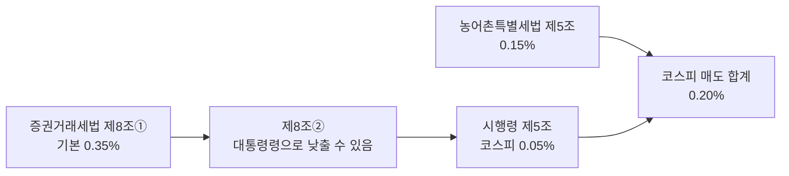
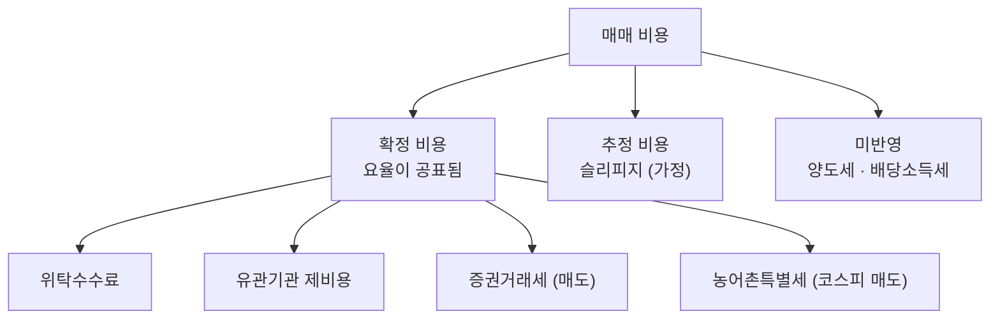

> [!GOAL]
>
> - 매수와 매도의 비용이 왜 다른지, 세금이 어느 조문에서 오는지(법 → 시행령 → 농어촌특별세) 설명할 수 있습니다.
> - 2025년과 2026년의 세율 차이로 같은 매매의 비용이 얼마나 달라지는지 직접 계산할 수 있습니다.
> - Qurious 비용 모델이 확정 · 추정 · 미반영을 어떻게 나누는지 읽고, 백테스트에 비용을 넣지 않으면 왜 틀리는지 말할 수 있습니다.

## 100만 원어치를 사고팔면 비용이 얼마일까요?

코스피 주식을 100만 원어치 사는 데는 약 177원이 듭니다. 같은 금액을 파는 데는 2026년 기준 약 2,177원이 듭니다(슬리피지 제외). 사는 쪽에는 없는 세금이 파는 쪽에만 붙기 때문입니다.

> [!NOTE]
> 이 장은 교육용 설명이며 세무 · 법률 자문이 아닙니다. 세율은 바뀔 수 있고 2026-11-03 이후의 개정은 확인하지 않았습니다. 법령 숫자는 이날 국가법령정보센터에서 열어 확인한 값이고, 신문 보도로만 확인한 내용에는 **(보도 기준)** 을, 열람한 범위 밖이라 단정하지 않는 내용에는 **(확인 필요)** 를 붙였습니다. 수수료와 슬리피지는 법이 정한 값이 아니라 Qurious 의 설정값입니다.

```output
① 거래대금 1,000,000원: 비용 내역(원) · 슬리피지 제외
  매수(어디서나)  수수료 140.5  유관기관 36.4  합계 176.9
  매도 코스피 2025  수수료 140.5  유관기관 36.4  거래세 0.0  농특세 1500.0  합계 1676.9  왕복 0.1854%
  매도 코스피 2026  수수료 140.5  유관기관 36.4  거래세 500.0  농특세 1500.0  합계 2176.9  왕복 0.2354%
  매도 코스닥 2026  수수료 140.5  유관기관 36.4  거래세 2000.0  농특세 0.0  합계 2176.9  왕복 0.2354%
  매도 코넥스 2026  수수료 140.5  유관기관 36.4  거래세 1000.0  농특세 0.0  합계 1176.9  왕복 0.1354%
```

위 출력은 [`trading_costs.py`](/learn/examples/trading_costs.py) 의 결과입니다. 세율은 Qurious 비용 모델의 값을 옮겨 적었고, 수수료와 유관기관 제비용은 아래 6절에서 설명합니다.

<figure>

<figcaption>그림 1. 100만 원어치를 사고팔 때의 비용. 막대는 계산 결과이고 점선 상자(슬리피지 편도 10bp)는 측정값이 아닌 가정입니다.</figcaption>
</figure>

## 주식을 팔면 어떤 세금이 붙나요?

증권거래세와 농어촌특별세(농특세)는 주식을 판 금액(양도가액)에 붙습니다. 사는 쪽에는 수수료만 있습니다. 2026-01-01 이후 양도분의 매도 세금은 시장마다 이렇게 정해집니다.

**표 1. 시장별 매도 세금 (2026년, 거래대금 대비)**

| 시장 | 증권거래세 | 농어촌특별세 | 합계 |
|---|---:|---:|---:|
| 유가증권시장(코스피) | 0.05% | 0.15% | 0.20% |
| 코스닥 | 0.20% | 없음 **(보도 기준)** | 0.20% |
| 코넥스 | 0.10% | 없음 **(보도 기준)** | 0.10% |

코스피와 코스닥은 칸이 달라서 헷갈리지만 합계는 같습니다. 농특세가 코스피에만 붙는다는 점은 2025-12-01 입법예고 보도로 확인했고 농특세법 시행령의 「증권시장」 범위 조문은 열지 못했습니다 **(확인 필요)**. 세금 말고도 위탁수수료와 유관기관 제비용이 매수와 매도에 모두 붙습니다.

## 세율은 법에 있나요, 시행령에 있나요?

법만 읽으면 틀린 숫자가 나옵니다. 증권거래세법 제8조 ① 은 기본 세율을 1만분의 35(0.35%)로 적습니다. 하지만 같은 조 ② 가 자본시장 육성을 위해 긴급히 필요하면 증권시장 주권에 한정해 종목별로 대통령령으로 세율을 낮추거나 0 으로 할 수 있다고 맡깁니다(탄력세율). 실제 세율은 증권거래세법 시행령 제5조에 있습니다. 2026-11-03 에 열람한 법령정보센터 판(2026-01-02 시행 표기)은 유가증권시장 주권 1만분의 5, 코넥스 1만분의 10, 코스닥과 금융투자협회를 거쳐 양도하는 주권(K-OTC)은 1만분의 20 이라고 적습니다. 농특세는 농어촌특별세법 제5조 ① 이 증권시장에서 거래된 증권의 양도가액에 1만분의 15(0.15%)로 정합니다.



법령정보센터에서 시행령 제5조를 열면 2026-01-02 시행 판으로 보입니다. 그 판은 직제 개정이 겹친 판의 날짜이고, 세율을 바꾼 개정(2025-12-31 공포)은 2026-01-01 부터 시행됩니다(시행령 부칙). 판을 고르는 방법은 [문서 쪼개기와 법령 판 고르기](#/p/chunking-legal-versions)에서 다룹니다.

## 2025년과 2026년은 무엇이 달랐나요?

코스피의 증권거래세가 2025년에는 0% 였다가 2026년에 0.05% 로 돌아왔습니다. 농특세 0.15% 는 그대로여서, 코스피 매도 세금 합계는 2025년 0.15% 에서 2026년 0.20% 로 약 33% 늘었습니다.

```output
② 코스피 매도 세금 합계: 2025 → 2026
  2025 0.15%  →  2026 0.20%  (매도 세금 +33%)
```

「2025년 거래세는 0」 이라고만 외우면 틀립니다. 0 이었던 것은 코스피의 **증권거래세**이고, 농특세는 남아 있었습니다.

**표 2. 매도 세금 합계의 해마다 변화 (Qurious 세율표 값)**

| 적용 시작 | 코스피 합계 | 코스닥 합계 | 확인 수준 |
|---|---:|---:|---|
| 2019-06-03 | 0.25% | 0.25% | 시행령 개정이유 열람 |
| 2021-01-01 | 0.23% | 0.23% | 2차 자료 **(확인 필요)** |
| 2023-01-01 | 0.20% | 0.20% | 해설 자료 **(확인 필요)** |
| 2024-01-01 | 0.18% | 0.18% | 해설 자료 **(확인 필요)** |
| 2025-01-01 | 0.15% | 0.15% | 해설 자료 **(확인 필요)** |
| 2026-01-01 | 0.20% | 0.20% | 법령 열람 |

<figure>

<figcaption>그림 2. 연도별 매도 세금 합계(%). Qurious 세율표의 값입니다. 2019.6~ 거래세(시행령 개정이유)와 2026~ 은 법령에서 확인했고, 2023~2025 는 해설 자료, 연한 2021~ 막대는 2차 자료입니다.</figcaption>
</figure>

## 세율이 바뀌는 날은 언제를 기준으로 고르나요?

> [!WARNING]
> **Qurious 는 이렇게 가정합니다.** 비용 모델의 `tax_rates` 와 백테스트용 `KrxCostModel` 은 일봉 한 줄의 날짜(체결일)로 그해 세율을 고릅니다.
>
> **공식은 이렇습니다.** 증권거래세법 시행령 제2조 제1호는 증권시장에서 거래된 주권의 양도 시기를 「그 양도가액이 결제되는 때」 로 정합니다. 세율을 바꾼 시행령 개정(2019년 · 2026년)의 부칙도 시행 이후 주권을 「양도하는」 분부터 새 세율을 적용한다고 적습니다(2026-11-03 열람).

결제일은 체결일보다 늦습니다([F.1](#/p/stock-basics)). 연말에 이 차이가 해를 가릅니다. 2025-12-29(월)에 체결한 매도는 12-31 휴장과 1-1 신정 때문에 2026-01-02 에 결제됩니다.

```output
④ 연말 경계: 2025-12-29(월)에 체결한 코스피 매도 1,000,000원의 세금
  체결일 2025-12-29 → 결제일 2026-01-02
  체결일로 세율을 고르면 1,500원  /  결제일로 고르면 2,000원  (차이 500원)
```

그래서 2025-12-29 와 12-30 체결분은 2026년 세율이 적용되는데, 체결일로 고르는 Qurious 는 2025년 세율을 씁니다. 2019년 인하 때도 시행일(6월 3일)에 결제되는 5월 30일 체결분부터 새 세율이 적용됐다고 보도됐습니다 **(보도 기준)**. 2024-01-01 · 2023-01-01 같은 다른 경계도 같은 원리로 2~3거래일 어긋날 수 있습니다. 일봉 백테스트 전체로 보면 영향은 작지만, 경계일의 비용을 따지는 계산에서는 알아 둘 필요가 있습니다. Qurious 는 이 차이를 아직 보정하지 않습니다.

> [!WARNING]
> **Qurious 는 이렇게 가정합니다.** `TAX_SCHEDULE` 의 첫 줄(2019-06-02 이전)은 코넥스 거래세를 0.10% 로 둡니다. 코드 주석도 이 구간은 재확인이 필요하다고 적었습니다.
>
> **공식은 이렇습니다.** 증권거래세법 시행령의 개정이유(2019-05-28)는 코넥스 거래세를 0.3퍼센트에서 0.1퍼센트로 낮춘다고 적습니다. 같은 개정에서 유가증권시장은 0.15% 에서 0.1% 로, 코스닥은 0.3% 에서 0.25% 로 내렸습니다. 그러니 2019-06-03 이전의 코넥스는 앱이 실제보다 낮게 계산합니다. 영향은 그 이전 구간의 코넥스 종목을 백테스트할 때만 있습니다.

## 수수료는 얼마인가요?

위탁수수료는 법이 정한 값이 아니라 증권사가 정합니다. 같은 증권사에서도 계좌 종류와 거래소에 따라 다릅니다. Qurious 의 설정값은 한국투자증권 온라인 계좌의 안내 요율(KRX 편도 0.0140527%, NXT 0.0130527%)을 한 예로 옮긴 것입니다. 코드 주석의 기준일은 2025-10-27 이고 증권사 원문은 이 장에서 열지 않았습니다 **(확인 필요)**. 주석은 영업점 계좌가 0.147%, 오프라인 0.491% 처럼 10배 넘게 차이 날 수 있다고도 적습니다. 그러니 이 숫자를 다른 계좌의 수수료로 쓰면 안 됩니다.

유관기관 제비용은 거래소 등에 내는 비용입니다. Qurious 는 KRX 주권 원가로 알려진 0.0036396%(매수 · 매도 모두)를 씁니다 **(확인 필요)**. 2025-12-15 부터 두 달간 거래소가 주식거래 수수료를 한시 인하했다는 보도가 있고 그 뒤 연장 여부는 확인하지 못했습니다 **(보도 기준)**. 그래서 이 값은 해마다 달라질 수 있습니다.

## 양도소득세 · 금융소득종합과세 · 금투세는요?

매매 비용과 별개로, 주식을 팔아 번 차익에는 양도소득세가 붙을 수 있습니다. 소득세법 시행령 제157조(2026-10-01 시행 판)는 대주주를 이렇게 정합니다. 직전 사업연도 말 기준 종목별 시가총액이 50억 원 이상이거나, 지분율이 코스피 1% · 코스닥 2% · 코넥스 4% 이상인 경우입니다. 2025년에 기준을 10억 원으로 되돌리는 안이 나왔다가 50억 원을 유지한다고 발표됐다는 보도가 있어, 옛 기사의 숫자와 다를 수 있습니다 **(보도 기준)**. 대주주가 아닌 개인이 장내에서 상장주식을 팔아 번 차익에는 양도소득세가 붙지 않는 것으로 알려져 있으나, 현행 소득세법을 이 장에서 직접 확인하지 못했습니다 **(확인 필요)**. 금융투자소득세(금투세) 조문(소득세법 제87조의2부터 제87조의27까지)은 2024-12-31 에 삭제되어 지금은 없습니다(시행 2026-07-01 판 열람). 배당소득의 세금은 [F.2 배당 기준일 · 배당락일 · 지급일](#/p/dividend-dates)에서 다룹니다.

## 슬리피지는 왜 가정으로 둘 수밖에 없나요?

슬리피지는 내가 보던 가격과 실제 체결 가격 사이의 차이입니다. 호가 데이터가 없으면 직접 측정할 수 없습니다. Qurious 의 기본값은 편도 10bp(0.10%)이고 이것은 측정값이 아니라 가정입니다. 슬리피지 10bp 를 넣으면 코스피 2026 왕복 비용이 0.2354% 에서 0.4354% 로 0.20%p 늘어납니다.

```output
③ 슬리피지 편도 10bp 를 가정하면: 코스피 2026 왕복
  슬리피지 없음 0.2354%  →  있음 0.4354%  (왕복 +0.20%p)
```

## Qurious 비용 모델은 어떻게 계산하나요?

Qurious 는 비용을 성격이 다른 세 층으로 나눠 섞지 않습니다.



핵심 함수 세 개가 같은 요율표(`TAX_SCHEDULE` 와 수수료 상수)를 씁니다. `cost_rate` 는 편도 비용률로 매수 = 수수료 + 유관기관비 + 슬리피지, 매도 = 매수 + 증권거래세 + 농특세입니다. `order_costs` 는 한 주문의 금액을 세목별로 쪼개 계산하며 슬리피지를 넣지 않습니다. 체결가가 이미 슬리피지를 포함한 실제 결과이기 때문입니다. 백테스트용 `KrxCostModel` 은 보유 비중의 변화를 매수분과 매도분으로 갈라 매도에만 세금을 붙입니다. 슬리피지를 넣는 `cost_rate` 와 넣지 않는 `order_costs` 를 섞어 비교하면 숫자가 어긋납니다.

ETF · ETN 은 거래세를 0 으로 계산합니다. 증권거래세 시행령 제5조가 세율을 정하는 대상이 「주권」 이고 ETF 수익증권은 과세대상이 아니라고 보기 때문입니다 **(확인 필요, 법 제1조 · 제2조 미열람)**. 리츠 · 인프라펀드는 법인이 발행한 주권이라 과세대상으로 계산한다고 코드 주석이 설명합니다 **(확인 필요)**. 증권사 정산이 원 단위 절사인지는 규정 원문을 확인하지 않아 기본으로 절사하지 않습니다.

## 비용을 빼면 성과가 얼마나 달라지나요?

매매가 잦을수록 비용이 쌓입니다. 코스피 2026 기준 왕복 비용을 순자산에 단순히 곱해 보면 다음과 같습니다. 계산 예이며 성과를 전망하거나 보장하지 않습니다.

```output
⑤ 한 해에 왕복 N회 하면: 코스피 2026, 순자산 대비 비용(단순 곱)
  연  1회  슬리피지 없음  0.235%  슬리피지 10bp 가정  0.435%
  연  2회  슬리피지 없음  0.471%  슬리피지 10bp 가정  0.871%
  연 12회  슬리피지 없음  2.825%  슬리피지 10bp 가정  5.225%
  연 24회  슬리피지 없음  5.649%  슬리피지 10bp 가정 10.449%
```

백테스트가 이 비용을 빼지 않으면 잦은 매매 전략일수록 결과가 실제보다 좋게 나옵니다. 매도 세금이 2025년 0.15% 에서 2026년 0.20% 로 바뀐 것을 무시하면 어긋납니다. 0.20% 를 2025년 구간에도 쓰면 그 구간의 매도 세금이 약 33% 부풀고, 0.15% 를 2026년 구간에 쓰면 25% 줄어듭니다([10.1 백테스트의 뼈대](#/p/backtest-basics)).

## 흔한 실수

1. **거래세를 사고팔 때 둘 다 내는 것으로 알기.** 증권거래세와 농특세는 매도에만 붙습니다.
2. **세율이 법에 있다고 알고 0.35% 로 답하기.** 실제 세율은 시행령 제5조에 있고 법의 0.35% 는 기본 세율입니다.
3. **코스피가 코스닥보다 세금이 싸거나 비싸다고 말하기.** 합계는 같습니다(0.20%). 칸이 다를 뿐입니다.
4. **「2025년 거래세는 0」 이라고만 외우기.** 코스피 증권거래세만 0 이었고 농특세 0.15% 가 남아 합계는 0.15% 였습니다.
5. **연도 경계에 체결일 기준으로 세율을 고르기.** 법이 정한 양도 시기는 결제되는 때라서 연말 체결분은 다음 해 세율일 수 있습니다.
6. **수수료가 어디서나 같다고 보기.** 증권사 · 계좌 종류 · 거래소에 따라 다릅니다.
7. **슬리피지를 계산하면 정확한 값이 나온다고 보기.** 호가 데이터 없이는 측정할 수 없어 가정이고, 결과 옆에 가정이라고 밝혀야 합니다.

## 정리

- 매도에만 증권거래세와 농특세가 붙고, 2026년 코스피 · 코스닥 합계는 0.20%, 코넥스는 0.10% 입니다.
- 세율은 법 제8조 ① 의 0.35% 가 아니라 시행령 제5조(코스피 0.05% · 코스닥 0.20% · 코넥스 0.10%)와 농특세 0.15% 에서 옵니다.
- Qurious 는 확정 · 추정 · 미반영으로 비용을 나누고, 슬리피지는 가정이며, 연도 경계는 체결일로 골라 법의 결제일 기준과 어긋날 수 있습니다.
- 세율은 바뀔 수 있으니 거래 전에 공식 안내를 확인합니다.

<details>
<summary>확인 문제 1 - 2026년 코스닥 종목을 팔 때 증권거래세와 농특세는?</summary>

증권거래세 0.20% 이고 농특세는 없습니다(보도 기준). 합계 0.20% 입니다.
</details>

<details>
<summary>확인 문제 2 - 2025년 코스피 매도 세금 합계는?</summary>

증권거래세 0% 에 농특세 0.15% 를 더해 0.15% 입니다.
</details>

<details>
<summary>확인 문제 3 - 증권거래세법 제8조 ① 의 기본 세율은 얼마이고, 실제 세율은 어디에 있나요?</summary>

1만분의 35(0.35%)입니다. 실제 세율은 제8조 ② 가 대통령령에 맡긴 시행령 제5조에 있습니다.
</details>

<details>
<summary>확인 문제 4 - 슬리피지는 왜 가정값인가요?</summary>

호가 데이터 없이는 실제 체결 가격이 보던 가격과 얼마나 달랐는지 측정할 수 없기 때문입니다.
</details>

<details>
<summary>확인 문제 5 - 연말 경계에서 체결일과 결제일 기준 세율이 다를 수 있는 까닭은?</summary>

법이 정한 양도 시기가 결제되는 때이고, 12-31 휴장과 신정 때문에 2025-12-29 체결분의 결제가 2026-01-02 로 넘어가 해가 바뀌기 때문입니다.
</details>

## 더 읽을거리

- 증권거래세법 제8조 <https://www.law.go.kr/법령/증권거래세법/제8조> · 시행령 제5조 <https://www.law.go.kr/법령/증권거래세법시행령/제5조>. 2026-11-03 확인.
- 증권거래세법 시행령 제2조(양도의 시기) <https://www.law.go.kr/법령/증권거래세법시행령/제2조>. 2026-11-03 확인.
- 농어촌특별세법 제5조 <https://www.law.go.kr/법령/농어촌특별세법/제5조> · 소득세법 시행령 제157조(대주주) <https://www.law.go.kr/법령/소득세법시행령/제157조>. 2026-11-03 확인.

**용어**

| 말 | 뜻 |
|---|---|
| 위탁수수료 | 주문을 맡긴 증권사에 내는 수수료, 증권사 · 계좌마다 다름 |
| 유관기관 제비용 | 거래소 등 유관기관에 내는 비용 |
| 증권거래세 | 주식을 팔 때 양도가액에 붙는 세금 |
| 농어촌특별세(농특세) | 증권거래세에 맞춰 붙는 목적세, 코스피 매도에 0.15% |
| 탄력세율 | 법의 기본 세율을 대통령령으로 낮추거나 올릴 수 있게 한 제도 |
| 양도 시기 | 세법이 거래가 이뤄진 때로 보는 시점, 증권시장 주식은 양도가액이 결제되는 때 |
| 슬리피지 | 보던 가격과 체결 가격 사이의 차이, 여기서는 가정값 |
| 왕복 비용 | 사고 파는 한 쌍의 비용을 합친 값 |
