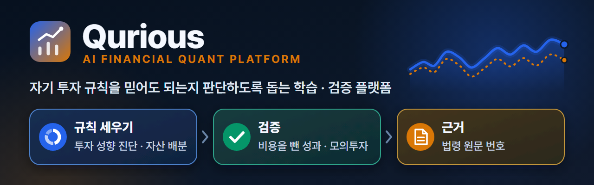
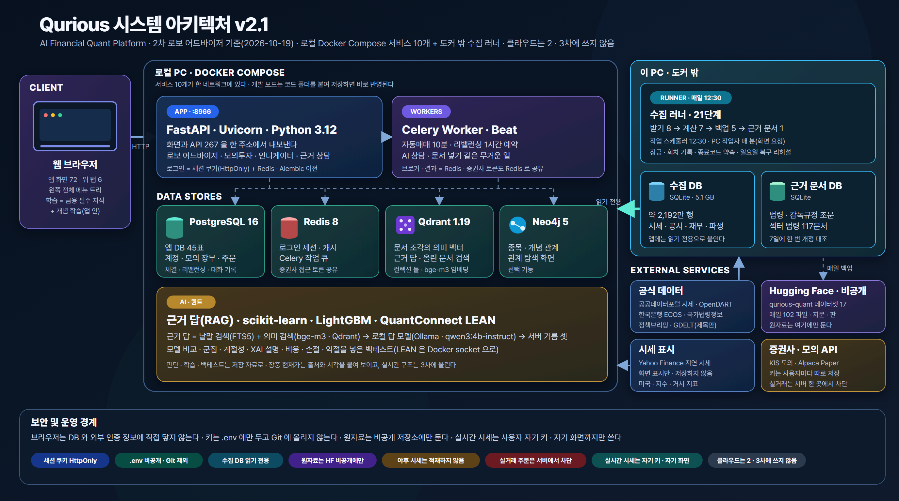
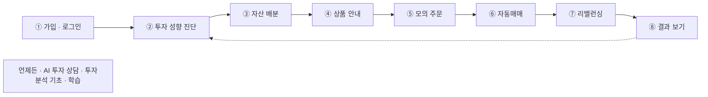

# Qurious — AI Financial Quant Platform

<p align="center">
  
</p>

자기 투자 규칙을 가진 개인투자자가 그 규칙을 믿어도 되는지 판단하도록 돕는 학습 · 검증 플랫폼입니다.
투자 성향 진단과 자산 배분으로 규칙을 세우고, 비용을 뺀 성과와 모의투자로 검증하고, 판단에 쓴 근거를 법령 원문 번호와 함께 보여 줍니다.

> 교육 · 연습용입니다. 증권사에는 모의투자 계좌로만 주문하고, 실거래 주문은 승인 전까지 서버가 막습니다([ADR-0001](docs/ADR/ADR-0001-실거래-주문-경로-차단.md)). 투자 권유가 아닙니다.

**<표 1> 판과 프로젝트 단계** · 판 번호 = 프로젝트 단계(2차 v2.x · 3차 v3.x)

| 판 | 단계 | 과제 | 기간 | 상태 |
|---|---|---|---|---|
| v3.0 | 3차 | 나만의 투자 인디케이터 개발 및 성과 검증 | 2026-10-22 ~ 11-11 | 예정 |
| v2.0 | 2차 | 나만의 로보 어드바이저 개발 및 성과 검증 | 2026-10-01 ~ 10-21(준비 2026-09-15 ~ 09-30) | 완료(2026-10-21 발표) · 2차 최종 판 태그 `phase2-final-2026-10-21` · 이 README 는 v2.1(2차 최종) |
| v1.0 | 1차 | Alpha_Stack(이 저장소 밖 · 팀의 별도 저장소) | — | 완료 |

같은 단계 안에서 README 를 고치면 v2.1 · v2.2 처럼 뒷자리를 올리고, 구조 그림도 같은 판 번호를 씁니다.

[시연 영상](#시연-영상) · [주요 기능](#주요-기능) · [구조](#구조) · [빠른 시작](#빠른-시작) · [사용법](#사용법) · [팀](#팀) · [문서](#문서)

## 소개

개인 주식 소유자 1,442만 명 가운데 459만 명(31.5%)이 한 종목만 들고 있고, 2020 ~ 2022년 표본에서 순수익률이 양(+)인 개인은 국내 28% 였습니다(한국예탁결제원 · 한국은행 · 자본시장연구원, 2026-04 · [프로젝트 계획서](docs/3차/계획서/프로젝트계획서.md) 표 1).
우리는 종목 고르기보다 **자기 규칙을 믿어도 되는지 판단할 방법이 없는 것**이 더 큰 문제라고 봤습니다.
그래서 Qurious 는 같은 데이터 · 같은 비용 · 같은 지표 정의 위에서 규칙을 세우고 재고 기록하게 합니다.
2차에서는 규칙을 세우고 검증하는 로보 어드바이저를, 3차에서는 규칙을 지표로 만들어 외부 도구로 다시 검증하는 투자 인디케이터를 만듭니다(<표 1>).

이번 과제에서 하지 않는 일도 정해 두었습니다.

- 실제 계좌로 실거래 자동 주문: 실거래 승인 없이는 모든 주문 경로가 모의로 낮춰집니다.
- 상용 서비스 배포 · 다른 사람의 자산 운용.
- 클라우드 배포: 2 · 3차에는 AWS 를 쓰지 않기로 팀이 정했습니다(2026-10-16). 공개 데모 주소 대신 로컬 실행과 시연 영상으로 보여 줍니다.
- 유료 LLM API: 기본 답과 임베딩은 PC 안의 로컬 모델(Ollama)로 만듭니다.
- 원자료 재배포: 시세 · 공시 · 뉴스는 출처마다 이용 조건을 따르고, 원자료와 수집 DB 는 공개 저장소에 올리지 않습니다([출처와 이용 조건](#출처와-이용-조건)).

## 시연 영상

2차(v2.0) 기능은 영상 열다섯 편(여정 일곱 · 기능 여덟)으로 볼 수 있고, 여정 영상은 처음 쓰는 사람이 지나는 차례로 찍었습니다(<표 2>).
발표용 영상 mp4 와 첫 장면 그림은 저장소의 `docs/영상/파일/` 에 있습니다(2026-10-20 팀 결정 — 팀원도 발표 자료에서 재생).
발표 자료는 HTML 한 파일 판입니다 — `docs/2차/발표/발표자료.html` 하나만 내려받아(GitHub 파일 쪽 「Download raw file」) Chrome · Edge 로 열면 그림 · 영상 · 글꼴이 모두 보입니다(약 50 MB · 인터넷 없이도 · 2026-10-21). 앱 안에서 영상을 보려면 아래처럼 받습니다.

**<표 2> 여정 영상** · 처음 쓰는 사람이 지나는 차례

| 편 | 보여 주는 것 | 화면 |
|---|---|---|
| V01 | 내 투자 성향을 알고, 그 성향대로 자산을 나눕니다 | 자산배분·최적화 |
| V02 | 나눈 비중대로 상품을 공시 정보로 비교합니다 | 투자 성향별 상품 안내 |
| V03 | 규칙 신호로 종목을 거르고 차트를 읽습니다 | 패턴 인식·종목 스크리닝 · 차트 패턴 |
| V04 | 가상 돈으로 국내 · 미국 주식을 주문하고 기록을 남깁니다 | 국내주식 모의주문 · 미국주식 주문/매매 |
| V05 | 리밸런싱 계획을 세우고 팔고 살 주문을 미리 봅니다 | 리밸런싱 엔진 |
| V06 | 가상 돈으로 한 거래를 계좌와 기록으로 되돌아봅니다 | 모의계좌 현황 · 모의 투자 의사결정 · 자동매매 현황 |
| V07 | 근거를 댈 수 없으면 답하지 않는 금융 AI 상담 | AI 투자 상담 |

<details>
<summary>기능 영상 여덟 편</summary>

| 편 | 보여 주는 것 | 화면 |
|---|---|---|
| F01 | 매일 낮, 공식 자료를 받아 검증하고 백업합니다 | 데이터 관제 · 수집 일정 · 단계 · 적재 · 백업(관리자) |
| F02 | 화면의 숫자가 어디서 왔고, 어디까지 쓸 수 있는지 봅니다 | 자료 안내 |
| F03 | 모르는 금융 낱말을 배우고 찾습니다 | 강의실 · 펀드와 ETF · 용어사전 · 개념 학습 |
| F04 | 한 종목의 공시 · 일정 · 재무를 한 길로 봅니다 | 투자 정보 리서치 · 재무 · 신용 위험 · 일정 |
| F05 | 시장 속설과 모델을 데이터로 따져 봅니다 | 계절성 분석 · 종목 군집화 · 모델 비교 |
| F06 | 지수 · 금리 · 산업 · 일정으로 시장을 봅니다 | 거시경제 지표 · 산업 분석 · 일정 |
| F07 | 국내 · 미국 주가 차트와 시세 시각을 봅니다 | 직접매매 › 주가 차트 · 미국주식 › 대시보드 · 주가 차트 |
| F08 | 지표와 계좌 요약을 첫 화면에서 봅니다 | 퀀트 대시보드 · 통합 대시보드 |

</details>

영상 파일은 팀 안에서만 나눕니다.

- 앱 안에서 보기: `python tools/demo/help_videos.py pull` 로 Hugging Face 비공개 데이터셋에서 각자 PC 의 `data/help/` 에 받습니다(조직 회원만). 받은 뒤에는 로그인한 화면 위쪽의 「▶ 영상」 단추나 「사용법」 창의 「영상으로 보기」 에서 그 화면이 나오는 장부터 재생됩니다.
- 발표용 mp4: 녹화한 PC 에서 `python tools/demo/export_mp4.py` 로 만들어 `docs/영상/파일/` 에 두고 함께 커밋합니다. 발표 자료 한 파일 판은 `python tools/deck/bundle_deck.py` 로 다시 만듭니다(고치는 원본은 `docs/2차/발표/발표자료-원본.html`).
- 목록 · 다시 찍는 법 · 바꿔 끼우는 기준은 [시연 영상 안내](docs/영상/README.md)에 있습니다.

## 주요 기능

기능은 프로젝트 단계로 나눕니다. 2차 로보 어드바이저(v2.0)가 이번 발표의 범위이고, 3차 투자 인디케이터(v3.0)는 2026-10-22 에 시작합니다.
상태 칸은 [요구 추적표](docs/3차/요구사항/RTM.md) 3절의 「진행」 을 옮겼습니다. 「완료」 는 동작하고 자동 시험이 그 요구를 직접 재는 것, 「진행」 은 시험이 일부만 있거나 아직 없는 것입니다. 사람이 인수 기준으로 검사를 끝낸 요구는 아직 없습니다.

### 2차 · 로보 어드바이저 (v2.0)

2차에서 만든 기능은 열네 가지이고, 열두 가지가 「완료」 입니다(<표 3>).

**<표 3> 2차 기능** · 화면 이름은 앱 메뉴 글자 그대로 · 주담당은 프로젝트 계획서 4.2절(UI 요소는 4.4절 제안)

| 기능 | 대표 화면 | 주담당 | 상태 |
|---|---|---|---|
| 투자 성향 진단(7문항 · 5단계) | 자산배분·최적화 | 오준영 | 완료 |
| 자산 배분(평균-분산 · 블랙-리터만 · 리스크 패리티)과 비중 그림 | 자산배분·최적화 | 오준영 | 완료 |
| 목표 수익률 달성 확률 | 자산배분·최적화 | 강민석 | 완료 |
| 과거 구간 수익 분포 시뮬레이션 | 자산배분·최적화 | 강민석 | 진행 |
| 나눈 비중대로 상품을 공시 정보로 비교(추천 목록이 아님) | 투자 성향별 상품 안내 | 이동원 | 완료 |
| 지표 · 차트 패턴 · 지지/저항 · 여러 주기 신호와 신뢰도 | 패턴 인식·종목 스크리닝 · 차트 패턴·지지/저항·멀티타임프레임 | 신장환 | 완료 |
| 판단 이유를 쉬운 말과 기여도로 설명(XAI) | 패턴 인식·종목 스크리닝 | 신장환 | 완료 |
| 리밸런싱(시간 · 이탈률 · 현금흐름 조건 → 주문 산출) | 리밸런싱 엔진 | 오준영 | 완료 |
| 비용을 뺀 성과와 매수 · 매도 · 보유 의견 | 모의 투자 의사결정 | 강민석 | 완료 |
| 모의 주문과 포트폴리오(가상 돈 1억 원) | 국내주식 모의주문 · 모의계좌 현황 | 강민석 | 완료 |
| 근거 번호를 단 상담(2026년 시행 법령 · 감독규정 · 근거가 없으면 답하지 않음) | AI 투자 상담 | 이동원 | 완료 |
| 가격 · 거래량 · 재무 · 뉴스 매일 수집 · 검사 · 비공개 백업 | 데이터 관제 · 자료 안내 | 이동원 | 완료 |
| 갱신일 · 금융 일정 · 정기 배치 | 일정 · 데이터 관제 | 이동원 | 완료 |
| 용어사전과 연관 개념(용어 761 · 분류 22) | 용어사전 | 이동원 | 진행 |

2차 기능 밖에서 함께 쓰는 화면도 있습니다. 모의투자 탭의 코인 · 대체자산 · Open API 키, 퀀트자동매매 탭의 10분 주기 모의 자동매매와 위험 한도, 학습 탭의 금융 필수 지식 강의(주제 아홉) · 요약 · 개념 학습, 왼쪽 전체 메뉴의 직접매매 · 미국주식(지연 시세) · 투자분석 기초(거시 · 산업 · 재무제표 · 기술적 분석 · 일정) · ML·딥러닝(모델 비교 · 회귀 · 군집 · 튜닝 · 딥러닝) · 시스템관리 · 내 계정입니다.
화면마다 「사용법」 창이 있고, 영상을 받아 둔 PC 에서는 「▶ 영상」 단추도 보입니다.
「현재가」 칸과 모의 주문 체결가는 지금 값을 씁니다 — 내 증권사 키가 있으면 증권사 조회 값, 없으면 지연 시세(약 20분), 그것도 없으면 「10월 16일 종가」 처럼 날짜를 밝힌 지난 종가이고, 값마다 출처와 시각을 붙입니다. 판단 · 백테스트 · 학습은 같은 자료로 다시 돌릴 수 있게 저장 자료 그대로 둡니다([실시간 시세 조사서](docs/2차/조사/실시간시세-지연표기-조사.md) 7절).

### 3차 · 투자 인디케이터 (v3.0 · 예정)

투자 인디케이터 탭과 퀀트자동매매 탭에는 강사님 기초 코드에서 온 화면이 이미 있고, 3차에 주담당이 설계부터 다시 맞춥니다. 3차에 할 일과 지금 있는 것은 <표 4> 에 적었습니다. 「지금」 칸은 그 기초 화면과 요구 추적표의 「진행」 입니다.

**<표 4> 3차 기능** · 주담당은 프로젝트 계획서 4.3절(화면 요소는 4.4절 제안)

| 기능 | 주담당 | 지금 | 상태 |
|---|---|---|---|
| 기본 인디케이터 전략: 이동평균 · RSI · MACD 를 조합한 매수 · 매도 조건, 기간 · 임계값 백테스트 | 신장환 | 「기본 인디케이터 전략」 화면 · 시험 일부 | 예정 |
| 커스텀 인디케이터: 가격 · 거래량 · 변동성 지표, 미래 데이터 참조 차단, API 로 제공 | 신장환 | 「커스텀 인디케이터 개발」 · 「자유 산식 지표 (DSL·버전)」 화면 · 시험 있음(API 제공은 흔적만) | 예정 |
| TradingView · Pine Script: 지표 · 전략 구현, Strategy Tester 1차 성과, 알림 Webhook | 이동원 | 「TradingView 연동 (Webhook·교차검증)」 화면 · 시험 일부 | 예정 |
| QuantConnect LEAN 성과 검증: 같은 데이터 · 기간 · 수수료로 누적수익률 · MDD · 샤프 · 승률, TradingView 결과와 비교 | 강민석 | 「LEAN 백테스트 (QuantConnect)」 화면 · 시험 일부 | 예정 |
| 증권사 API 연동 자동화: LEAN 신호를 증권사 API 주문으로, 중복 주문 방지, 실행 일정 | 오준영 | 「증권사 API 설정」 · 자동매매 · 시험 있음 | 예정 |
| 실시간 시세 구조: 사용자 자기 키의 증권사 웹소켓 → Redis 최신 값 → SSE 로 화면 갱신, 신호는 장중 마감된 분봉으로, 실시간 값은 주문 직전 확인에만 쓰고 저장 · 공유하지 않음 | 3차에 정함 | 조사 · 설계([실시간 시세 조사서](docs/2차/조사/실시간시세-지연표기-조사.md) 6.2절) | 예정 |
| 화면 요소와 일정표 칸: 전략 설정 · 지표 차트 · 백테스트 · 성과 대시보드 · 자동매매 모니터링 · 강건성 검증 · 주문 정정 | 신장환 · 강민석 · 오준영(제안) | — | 예정 |

## 구조

Qurious 는 PC 한 대에서 돕니다. 브라우저는 8966 포트 하나로 앱에 닿고, 앱 · 예약 작업 · 저장소는 도커 컴포즈 안에 있습니다.
시세 · 공시 · 법령을 받는 수집 러너는 도커 밖에서 매일 12:30 에 돌고, 앱은 그 결과(수집 DB · 근거 DB)를 읽기 전용으로 붙여 씁니다.
전체 연결은 <그림 1> 과 같습니다.

**<그림 1> 시스템 구성 v2.1** · 2026-10-19 · 원본 [SVG](docs/img/architecture/qurious-architecture_v2.1.svg)

<p align="center">
  
</p>

수집 러너가 받은 자료는 검사를 거쳐 수집 DB 에 쌓이고, Hugging Face 비공개 데이터셋에 백업됩니다.
매주 일요일 15:00 에는 그 백업을 임시 폴더에 되살려 지문을 맞대는 복원 리허설을 합니다.
2026-10-19 낮 회차 기준으로 국내 주식 일봉만 451만 행이 쌓였습니다(<그림 2>).

**<그림 2> 수집 DB 의 주요 자료** · 2026-10-19 낮 회차 · 단위 만 행 · 막대 한 칸 = 25만 행

```text
국내 주식 일봉    ██████████████████  451  (2020-01-02 ~ 2026-10-16)
재무 주요계정     ████████            188
ETF 일봉          █████               123
공시 목록         ███                  78
지수 일봉         █                    26
그 밖             배당 9,207건 · 정책뉴스 33,168건 · 언론사 기사(GDELT) 44,059건
```

포트 · 망 · 볼륨은 [인프라 · 네트워크 구성도](docs/3차/설계/인프라-네트워크구성도.md), API 는 [API 명세서](docs/3차/인터페이스/API명세서.md), 기능이 안에서 도는 방식은 [기능별 동작 원리서](docs/3차/설계/기능동작원리.md)에 있습니다.

## 빠른 시작

준비물은 Windows 10 · 11, Docker Desktop, PowerShell 5.1(Windows 기본)입니다. 디스크는 이미지에 약 4 GB, AI 모델에 약 1.3 GB 가 듭니다.

```powershell
git clone https://github.com/EST-team-project/Qurious.git
cd Qurious
.\scripts\personal\start.ps1        # 띄우기: .env 만들기 → DB → 앱 → 브라우저 (처음에는 몇 분)
docker compose up -d model-pull     # 처음 한 번: 채팅 · 임베딩 모델 받기 (약 1.3 GB)
.\scripts\personal\check.ps1        # 기능 점검: API 66건을 불러 통과 · 실패 표
```

브라우저에서 <http://localhost:8966> 을 열고 회원가입한 뒤 로그인합니다.
끌 때는 `.\scripts\personal\stop.ps1`(DB 데이터는 남습니다), 지금 무엇이 떠 있는지는 `.\scripts\personal\status.ps1` 로 봅니다.
스크립트 실행이 막히면 [scripts/personal/README.md](scripts/personal/README.md) 의 「실행 정책」 을 따릅니다.

처음 띄운 PC 에서 알아 둘 점이 넷 있습니다.

- 공개 데모 주소는 없습니다. 발표는 발표 PC 의 로컬 앱과 시연 영상으로 합니다.
- 계정은 각 PC 의 로컬 DB 에만 있으므로 첫 화면에서 회원가입하면 됩니다. 데이터 수집 · 시스템관리 화면은 `.env` 의 `ADMIN_EMAILS` 에 적은 이메일로 가입한 계정에만 열립니다.
- 국내 시세 · 지표가 제 숫자로 나오려면 수집 DB 가 있어야 합니다. 수집 DB 는 이용 조건 때문에 공개 저장소에 없고 팀 Hugging Face 비공개 데이터셋에서 받습니다([개발자 참고](#개발자-참고)). 없으면 국내 일봉 · 지표가 외부 시세로 가서 느리거나 막힐 수 있습니다.
- AI 투자 상담의 답 문장은 `qwen3:4b-instruct`, 근거 찾기는 `bge-m3` 모델을 씁니다. 두 모델이 없으면 낱말 검색으로 찾은 근거 조문만 보입니다.

## 사용법

로그인하면 위 탭 여섯과 왼쪽 전체 메뉴가 보입니다. 2차 로보 어드바이저를 처음 쓰는 사람은 투자 성향 진단에서 시작해 결과 보기까지 여덟 단계를 지납니다(<그림 3>). 3차 투자 인디케이터의 사용법은 v3.0 에서 더합니다.

**<그림 3> 처음 쓰는 차례** · 실선 = 차례 · 점선 = 다시 돌아감



단계마다 여는 화면은 <표 5> 에 적었습니다. 메뉴 이름은 앱에 보이는 글자 그대로입니다.

**<표 5> 단계별 화면** · 2차 로보 어드바이저 여정

| 단계 | 메뉴 | 하는 일 |
|---|---|---|
| ① 가입 · 로그인 | 첫 화면 | 「회원가입」 으로 계정을 만들고 로그인합니다. |
| ② 투자 성향 진단 | 로보 어드바이저 › 자산배분·최적화 | 「투자성향 진단」 설문 7문항에 답하면 안정형 ~ 공격투자형 다섯 단계 가운데 하나가 나옵니다. |
| ③ 자산 배분 | 같은 화면 | 진단한 성향이 자산배분 모델에 들어갑니다. 「포트폴리오 최적화 실행」 으로 비중을 계산하고 「저장한 배분 보기」 로 다시 봅니다. |
| ④ 상품 안내 | 로보 어드바이저 › 투자 성향별 상품 안내 | 나눈 비중대로 상품을 공시 정보로 나란히 비교합니다. 추천이 아니라 같은 기준으로 늘어놓은 목록입니다. |
| ⑤ 모의 주문 | 모의투자 › 국내주식 모의주문 | 가상 돈 1억 원으로 사고팝니다. 장이 닫힌 날에는 주문 미리 보기까지 됩니다. |
| ⑥ 자동매매 | 퀀트자동매매 › 자동매매 현황 | 「▶ 자동매매 시작」 을 누르면 10분마다 신호를 계산해 모의로 주문합니다. 위험 한도를 넘는 주문은 막힙니다. |
| ⑦ 리밸런싱 | 로보 어드바이저 › 리밸런싱 엔진 | 목표 비중과 조건(시간 · 이탈률 · 현금흐름)을 정하고 「주문 산출」 로 팔고 살 수량을 미리 봅니다. |
| ⑧ 결과 보기 | 모의투자 › 모의계좌 현황 · 로보 어드바이저 › 모의 투자 의사결정 | 계좌 숫자와 거래 기록, 최근 규칙 판단 근거와 모의 투자 성과 분석을 봅니다. |
| 언제든 | 로보 어드바이저 › AI 투자 상담 | 질문하면 2026년에 시행 중인 법령 · 감독규정 조문을 근거 번호와 함께 답합니다. 근거를 찾지 못하면 답하지 않습니다. |
| 언제든 | 왼쪽 전체 메뉴 › 투자분석 기초 · 위 탭 학습 | 거시경제 지표 · 산업 분석 · 재무제표 분석 · 기술적 분석 · 일정을 보고, 강의실 · 용어사전 · 개념 학습에서 낱말과 개념을 익힙니다. |

## 기술 스택

기술은 쓰는 곳과 함께 <표 6> 에 적었습니다.

**<표 6> 기술 스택**

| 영역 | 기술 | 쓰는 곳 |
|---|---|---|
| 앱 | Python 3.12 · FastAPI · Uvicorn | 화면 내보내기 · API 267(라우터 40) |
| 화면 | Vanilla JS(ES Modules · 빌드 없음) · Tailwind CSS(CDN) · TradingView Lightweight Charts | 차트 · 표 · 사용법 창 |
| 앱 DB | PostgreSQL 16 · SQLAlchemy(async) · Alembic | 계정 · 모의 장부 · 주문 · 리밸런싱 · 용어사전 · 감사 기록 |
| 세션 · 예약 | Redis 8 · Celery(워커 · 비트) | 로그인 세션 · 캐시 · 자동매매 · 체결 확인 · 리밸런싱 점검 |
| 수집 | Python 수집기 · SQLite · Windows 작업 스케줄러 · Hugging Face Hub | 시세 · 배당 · 수정주가 · 공시 · 재무 · 뉴스 · 법령 → 수집 DB · 근거 DB → 비공개 백업 |
| AI · 검색 | Ollama · LangChain · LangGraph · Qdrant 1.19 · Neo4j 5 | 근거 답(`qwen3:4b-instruct`) · 채팅(`qwen2.5:1.5b`) · 임베딩 · 벡터 검색 · 종목 관계 그래프 |
| 분석 | pandas · NumPy · LightGBM · scikit-learn | 지표 · 모델 비교 · 군집 · XAI 기여도 |
| 백테스트 | QuantConnect LEAN(도커) | LEAN 백테스트 |
| 시험 · 도구 | pytest · Playwright | 자동 시험 · 시연 영상 녹화 |

## 검증

- 자동 시험은 2,361건입니다(2026-10-20 · `pytest --collect-only`). 마지막 전체 실행(2026-10-20 · 시험 DB 를 띄워 2,363건)은 통과 2,349 · 건너뜀 9 · 실패 5 이고, 실패는 모두 결함대장에 올라 있는 알려진 결함(DF-110 · DF-137 · DF-140)입니다. 시험은 일회용 시험 DB 를 띄워 로컬에서 돌립니다. CI 는 두지 않았습니다([ADR-0003](docs/ADR/ADR-0003-CI를-걷어내고-먼저-논의한다.md)).
- 기능 점검 `check.ps1` 은 떠 있는 앱의 API 66건을 밖에서 불러 봅니다.
- API 명세는 정적 스캐너(`scripts/api_scan.py`)가 라우트를 뽑아 만들고, 앱의 OpenAPI 와 맞대어 봅니다.
- 근거 답은 사람이 판정한 평가셋(20문항)으로 잽니다. 기본 답 모델은 답할 수 있는 질문 15개 가운데 12개를 맞혔고, 근거 밖 질문 3개에는 지어낸 답이 없었습니다.
- 백테스트와 주문이 같은 비용표(위탁수수료 · 유관기관 제비용 · 연도별 증권거래세 · 농어촌특별세 · 슬리피지)를 씁니다. 2026년 국내주식 왕복 비용은 0.4354% 로, 예전 대칭 가정(왕복 0.2%)의 2.18배입니다.

시험 범위 · 결과서 · 결함대장은 [테스트 계획서](docs/3차/시험/테스트계획서.md)에 있습니다.

## 팀

역할은 2026-10-01 팀이 정했습니다(<표 7>). 주담당은 자기 기능의 설계 → 산출물 → 코드를 끝까지 맡고, 확인은 네 명 모두 합니다.

**<표 7> 팀과 주담당**

| 이름 | 2차 나만의 로보 어드바이저 | 3차 나만의 투자 인디케이터 |
|---|---|---|
| 이동원(팀장) | 목표 기능 ① 세부 1 ~ 4: 용어사전 · 투자 자료 수집 · 근거 RAG · 일정과 정기 배치 | ③ TradingView · Pine Script 성과 확인 |
| 신장환 | ① 세부 5 XAI · ② 패턴 인식 예측 | ① 기본 인디케이터 전략 · ② 커스텀 인디케이터 |
| 오준영 | ③ 자산배분 · 스크리닝 · 리밸런싱 | ⑤ 증권사 API 연동 자동화 |
| 강민석 | ④ 성과 해석 · 모의투자 | ④ QuantConnect LEAN 성과 검증 |

사람별 일정과 산출물은 [프로젝트 계획서](docs/3차/계획서/프로젝트계획서.md) 4 · 5절에 있습니다.

## 문서

산출물은 저장소 안에 판을 붙여 둡니다. 자주 찾는 문서만 <표 8> 에 모았습니다.

**<표 8> 자주 찾는 문서**

| 알고 싶은 것 | 문서 |
|---|---|
| 목표 · 범위 · 역할 · 일정 | [프로젝트 계획서](docs/3차/계획서/프로젝트계획서.md) |
| 기능 설계 | [기능 설계서](docs/3차/설계/기능설계.md) · [목표 기능 ① 데이터 · 지식](docs/3차/설계/목표기능1-데이터지식-설계.md) · [② 패턴 예측 · XAI](docs/3차/설계/목표기능2-패턴예측-XAI-설계.md) · [③ 리밸런싱](docs/3차/설계/목표기능3-리밸런싱-설계.md) |
| 기능이 안에서 도는 방식 | [기능별 동작 원리서](docs/3차/설계/기능동작원리.md) |
| 구성 · 포트 | [인프라 · 네트워크 구성도](docs/3차/설계/인프라-네트워크구성도.md) |
| API | [API 명세서](docs/3차/인터페이스/API명세서.md) |
| 시험 · 결함 · 성과 | [테스트 계획서](docs/3차/시험/테스트계획서.md) · [백테스트 보고서](docs/3차/시험/백테스트보고서.md) |
| 로컬 실행 · 문제 해결 | [로컬 실행 안내서](docs/3차/배포/로컬실행안내서.md) · [scripts/personal](scripts/personal/README.md) |
| 결정 기록 | [ADR](docs/ADR/) · [논의 결정 대장](docs/3차/계획서/논의결정대장.md) |
| 시연 영상 | [시연 영상 안내](docs/영상/README.md) |
| 산출물 전체 · 폴더 지도 | [산출물 목록](docs/산출물목록.md) · [docs 안내](docs/README.md) |

## 출처와 이용 조건

앱은 강사님 기초 코드(lumina-invest) 위에 만들었습니다. 받은 것과 조건은 [NOTICE](NOTICE.md)에 적었고, 원본에 라이선스 파일이 없어 이 저장소에도 오픈소스 라이선스를 붙이지 않습니다.

데이터는 출처마다 이용 조건이 다릅니다. 주요 출처만 <표 9> 에 모았고, 전체 열네 줄은 [출처 대장](docs/3차/데이터/대장/자료안내-출처.tsv)과 앱의 「자료 안내」 화면에 있습니다.

**<표 9> 주요 데이터 출처**

| 출처 | 무엇 | 이용 조건 |
|---|---|---|
| 금융위원회 시세(공공데이터포털) | 주식 · ETF · 지수 일봉 | 공공누리 제4유형: 출처 표시 · 상업적 이용 금지 · 변경 금지 · 다시 나눠 주지 않음 |
| OpenDART | 공시 · 재무 · 배당 | 원자료를 다시 나눠 주지 않음 |
| 국가법령정보센터 | 근거 상담의 법령 · 행정규칙 원문 | 법령 · 고시는 저작권 보호 대상이 아님(저작권법 제7조) |
| 한국은행 ECOS | 거시 통계 · 지수 | 출처 표시 |
| 야후 파이낸스 | 분봉 · 화면 표시용 지연 시세 | 개인 · 비상업 이용 · 원문을 남기지 않음 |
| 한국투자증권 Open API | 사용자 자기 키의 현재가 조회 · 모의 주문 | 그 사람의 화면에서만(제3자 제공 금지 · 고객 이용약관 제5조 3항) · 실시간 값은 저장 · 백업하지 않음 |
| 정책브리핑 · GDELT | 뉴스 | 기사마다 공공누리 유형이 다름(제1유형만 본문) · GDELT 는 제목 · 링크만 |

- 화면의 시세 출처는 「자료: 금융위원회 주식시세정보(공공데이터포털 · 공공누리 제4유형) · 수정주가 · 지표는 Qurious 가 계산」 꼴로 적습니다.
- 원자료 · 수집 DB · 시연 영상은 공개 저장소에 두지 않고 Hugging Face 비공개 데이터셋에만 둡니다.
- 이 저장소의 화면과 숫자는 교육 · 연습용이며 투자 권유가 아닙니다.

## 개발자 참고

<details>
<summary>스크립트 · 주소 · 포트</summary>

`scripts/personal/` 의 PowerShell 스크립트로 띄우고 점검합니다. 옵션과 자주 막히는 곳은 [scripts/personal/README.md](scripts/personal/README.md) 에 있습니다.

| 스크립트 | 하는 일 | 자주 쓰는 옵션 |
|---|---|---|
| `start.ps1` | 사전 점검 → `.env` → 망 `shared-net` → DB 넷 → 앱 · Celery → 헬스 체크 → 브라우저 | `-Dev` · `-NoCelery` · `-Build` · `-NoBrowser` |
| `check.ps1` | 기능 점검(API 66건) | `-Full` · `-Write` · `-Group <묶음>` |
| `status.ps1` | 컨테이너 · 앱 응답 · 이미지 신선도 · 수집 DB · 디스크 | `-Data` |
| `logs.ps1` | 컨테이너 로그 | `-Service app` · `-Follow` |
| `stop.ps1` | 끄기(데이터 유지) | `-Keep` · `-DeleteData` |
| `test.ps1` | 일회용 시험 DB 를 띄워 pytest | `-Path <파일>` · `-NoDb` |

| 무엇 | 주소 · 포트 |
|---|---|
| 화면 | <http://localhost:8966> |
| API 자동 문서(FastAPI) | <http://localhost:8966/docs> |
| API 문서(앱 디자인 · 관리자 메뉴) | <http://localhost:8966/api-docs/> |
| PostgreSQL · Redis · Qdrant · Neo4j | 15432 · 16379 · 16333 · 17474 / 7687 |

</details>

<details>
<summary>개발 모드(코드를 고치며 보기)</summary>

```powershell
.\scripts\personal\start.ps1 -Dev                  # 코드 폴더를 컨테이너에 연결 (주소는 그대로 8966)
.\scripts\personal\logs.ps1 -Service app -Follow   # 다시 켜지는 모습 보기
```

`app\*.py` 를 저장하면 앱과 Celery 가 몇 초 안에 다시 켜지고, `public\` 은 브라우저 새로고침만 하면 됩니다. `requirements.txt` · `Dockerfile` 을 바꾸면 `start.ps1 -Dev` 를 다시 돌립니다.

</details>

<details>
<summary>Windows 밖에서 띄우기(이 절차는 시험하지 않았습니다)</summary>

```bash
docker network create shared-net
cp .env.example .env
docker compose up -d postgres redis neo4j qdrant
docker compose up -d app celery-worker celery-beat
docker compose up -d model-pull
```

</details>

<details>
<summary>환경 변수</summary>

`.env.example` 이 정본입니다(변수 67개). `start.ps1` 은 `.env` 가 없으면 이것을 복사합니다. 값은 저장소에 올리지 않습니다.

| 변수 | 쓰임 |
|---|---|
| `ADMIN_EMAILS` | 이 이메일로 가입한 계정이 관리자가 됩니다(쉼표로 여럿) |
| `COMPOSE_OLLAMA_URL` · `COMPOSE_LLM_MODEL` | PC 에 따로 깐 Ollama 와 채팅 모델을 쓸 때 |
| `KB_ANSWER_MODEL` | 근거 상담 답 모델을 바꿀 때(기본 `qwen3:4b-instruct`) |
| `SESSION_TTL` | 로그인 유지 기간(기본 30일 · 마지막 활동부터) |
| `QDRANT_CPUS` | Qdrant CPU 상한(기본 2) |
| `LEAN_MODE` | LEAN 실행 방식 `auto` · `docker` · `ssh` · `local` |

증권사(KIS) 모의투자 키는 사용자마다 「증권사 API 설정」 화면에서 넣고 사용자별로 저장됩니다([ADR-0004](docs/ADR/ADR-0004-KIS-자격증명은-사용자마다.md)).

</details>

<details>
<summary>수집 러너와 데이터</summary>

수집 러너는 도커 밖에서 PC 의 파이썬으로 돌고, 작업 스케줄러가 매일 12:30 에 부릅니다. 자세한 단계와 자료 규격은 [collector/README.md](collector/README.md) 에 있습니다.

```powershell
python scripts/daily_update.py status           # 마지막 실행 결과와 예약 상태
python scripts/daily_update.py install          # 작업 스케줄러에 매일 12:30 등록(백업 올리기 포함)
python scripts/weekly_rehearsal.py install      # 매주 일요일 15:00 복원 리허설 등록
python scripts/hf_dataset.py restore --from <받은 폴더> --into data/collector/market.sqlite3   # 수집 DB 되살리기
python -m collector.kb_law fetch                # 근거 DB(data/collector/kb.sqlite3) 만들기
```

- 수집 DB · 근거 DB 는 앱 컨테이너에 읽기 전용으로 붙습니다(`./data` → `/app/data/csv`). 앱은 이 파일에 쓰지 않습니다.
- 근거 상담을 끝까지 쓰려면 앱이 부르는 Ollama 에 두 모델을 더 받습니다: `docker compose exec ollama ollama pull qwen3:4b-instruct` · `docker compose exec ollama ollama pull bge-m3`.

</details>

<details>
<summary>시험 돌리기</summary>

```powershell
.\scripts\personal\test.ps1                              # 일회용 시험 DB(pgvector)를 띄워 전부 돌리고 지운다
.\scripts\personal\test.ps1 -Path tests\test_formula.py -NoDb   # 한 파일만 · DB 시험은 건너뜀
```

모의 장부 시험은 시험 DB 의 표를 지우고 다시 만듭니다. 그래서 `test.ps1` 은 앱 개발 DB(15432)를 시험에 넘기지 않습니다. 직접 `python -m pytest` 로 돌릴 때 DB 시험은 `QURIOUS_TEST_DATABASE_URL` 이 있을 때만 돕니다.

</details>

<details>
<summary>매매비용(백테스트와 주문이 같은 표)</summary>

비용 계산은 `app/services/trading_cost.py` 한 곳에 있습니다. 국내주식 비용은 매수와 매도가 대칭이 아닙니다.

| 항목 | 요율(편도) | 매수 | 매도 |
|---|--:|:-:|:-:|
| 위탁수수료(온라인 · KRX) | 0.0140527% | 냄 | 냄 |
| 유관기관 제비용 | 0.0036396% | 냄 | 냄 |
| 증권거래세 + 농어촌특별세 | 연도별(아래) | — | 냄 |
| 슬리피지 | 기본 10bp(가정) | 냄 | 냄 |

| 시행일 | 2023-01-01 | 2024-01-01 | 2025-01-01 | 2026-01-01 |
|---|--:|--:|--:|--:|
| 매도세 합계(코스피 · 코스닥) | 0.20% | 0.18% | 0.15% | 0.20% |

- 코넥스는 0.10% 입니다. 2026년 세율은 대통령령 제36001호를 따릅니다.
- 화면과 응답에는 비용이 어디서 왔는지(`cost_basis`: `none` · `estimated` · `broker`)가 함께 나갑니다. 증권사 체결의 비용 합계가 우리 계산과 맞을 때만 `broker` 를 붙입니다.

</details>

<details>
<summary>증권사 연결 · Open API · LEAN</summary>

- 증권사: KIS 모의투자에 사용자별 키로 연결합니다. 실거래 승인(`QURIOUS_ALLOW_LIVE_TRADING`) 없이는 어떤 경로도 모의로 낮춥니다([ADR-0001](docs/ADR/ADR-0001-실거래-주문-경로-차단.md)).
- Open API: 「Open API · 외부 연동」 화면에서 받은 키로 `/openapi/v1/*` 를 부릅니다(`Authorization: Bearer <키>` · 키당 분당 60회). 엔드포인트는 [API 명세서](docs/3차/인터페이스/API명세서.md)에 있습니다.
- LEAN 백테스트: `LEAN_MODE=docker` 면 앱이 PC 의 도커로 `quantconnect/lean` 컨테이너를 띄웁니다(이미지 약 14 GB).
- 루트의 `onprem.md` · `pipeline.md` 는 강사님 기초 코드의 목표 설계서(참고)입니다.

</details>

---

숫자 기준 2026-10-19 · 각 숫자의 출처 문서에 기준 커밋이 있습니다.
